# RealSense D4xx Series Depth Camera Usage

## Hardware Environment

A SpacemiT RISC-V 64-bit development board. These instructions have been verified on the MUSE Pi Pro.

## Verified Camera Models

RealSense D415

## Recommended Operating Systems

ROS2_LXQT (recommended), [image link](https://archive.spacemit.com/ros2/bianbu-ros-images/v1.5/ROS2_LXQT-v1.5-20251216.zip)

Bianbu 2.2 Desktop, [image link](https://archive.spacemit.com/image/k1/version/bianbu/v2.2/bianbu-24.04-desktop-k1-v2.2-release-20250430190125.zip)

## SDK Version Notes

Use SDK version v2.56.4.

The SpacemiT SDK is a modified build of the official release. See the [official SDK releases](https://github.com/realsenseai/librealsense/releases) for the source code.

Check the [firmware updates page](https://dev.intelrealsense.com/docs/firmware-updates) for the SDK version required by your camera.

## Download and Use the SDK

Disconnect all RealSense devices from the board before downloading the SDK.

This example uses SDK version 2.56.4. If you use another version, replace `2.56.4` in the commands and paths accordingly.

### Get the Download Script

```
wget https://archive.spacemit.com/ros2/prebuilt_libs/install_scripts_common/install_librealsense.sh
```

### Install a Specific Version

```
bash install_librealsense.sh 2.56.4
```

Terminal output:

```
bianbu@bianbu:~$ bash install_librealsense.sh 2.56.4
准备安装 librealsense 2.56.4
版本说明: 高版本，支持 D4xx系列相机, 已经过测试。具体见: https://dev.intelrealsense.com/docs/firmware-updates
当前系统 Python 版本: 3.12 (使用目录: bianbu24)
更新 apt 源并安装依赖...
[sudo] bianbu 的密码：
```

Enter the password, which defaults to `bianbu`.

Wait for the dependencies to install and the following prompt to appear:

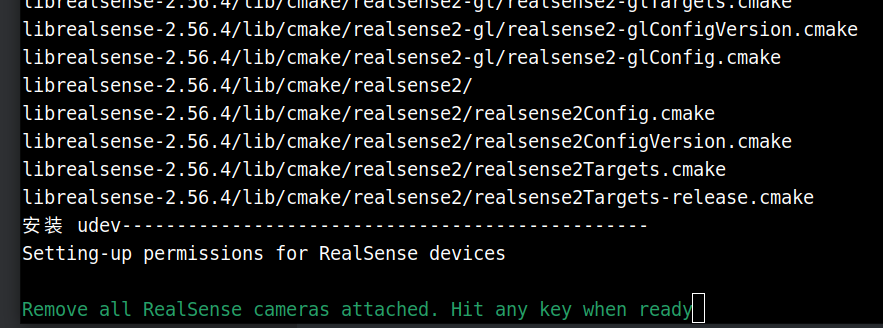

After confirming that no RealSense camera is connected to the board, press Enter to continue.

After installation, the terminal displays output similar to the following:

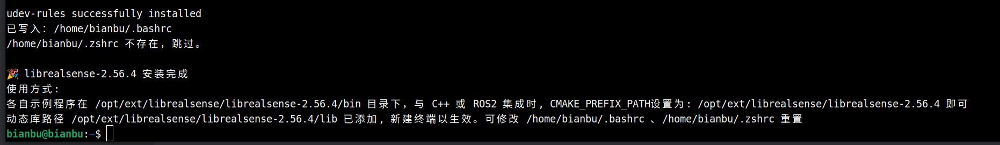

Open a new terminal for the `LD_LIBRARY_PATH` change to take effect.

Do not install multiple SDK versions on the same machine to avoid conflicts.

### Hardware Connection

After installing the SDK, you can connect the RealSense camera:

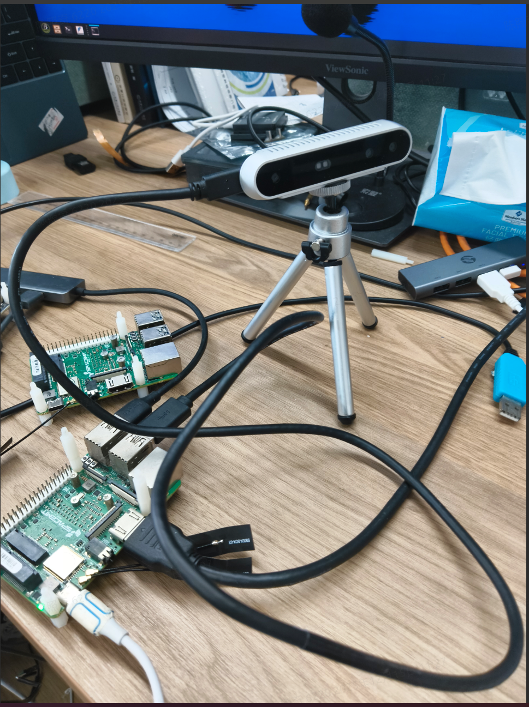

This example uses a D415 camera.

Run `lsusb` to check that the device is detected:

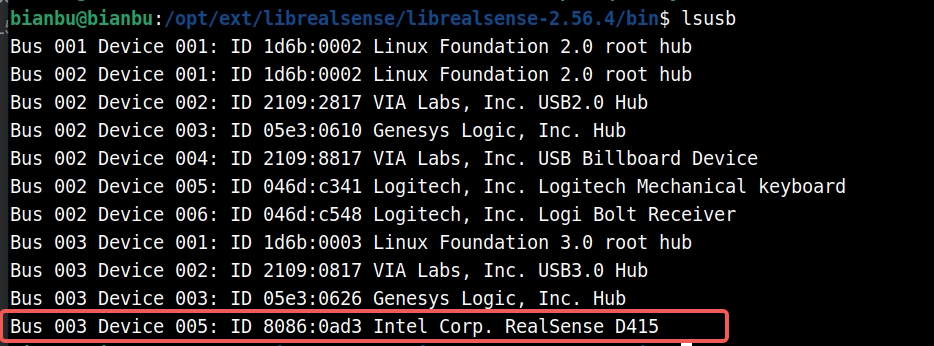

The output should show the connected device.

### Run Examples

Navigate to the `/opt/ext/librealsense/librealsense-2.56.4/bin` directory.

The directory contains several example programs:

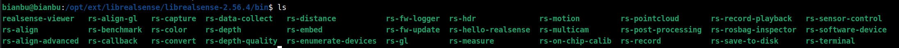

#### rs-hello-realsense

This program reads the depth value at the center of the camera image:

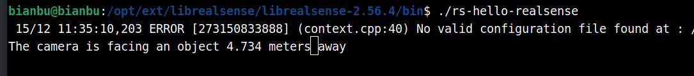

#### rs-capture

This program opens a graphical window. Run it locally, not from an SSH terminal.

Display:

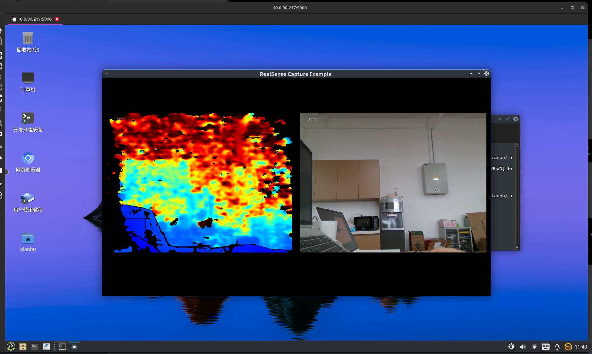

Because local computing resources are limited, use the visualization tool only to verify communication with the camera.

## Integration with ROS 2

The RealSense ROS 2 wrapper depends on the RealSense SDK. Complete the steps in [Download and Use the SDK](#download-and-use-the-sdk) first.

### Software and Hardware Environment

- Hardware: MUSE PI PRO
- Operating System: ROS2_LXQT
- RealSense SDK version: 2.56.4
- RealSense camera model: D415
- ROS 2 version: Humble

For non-ROS2_LXQT firmware, install ROS 2 Humble first by following the [official tutorial](https://bianbu.spacemit.com/robot/ros2).

### Install Dependencies

```
sudo apt install ros-humble-cv-bridge \
ros-humble-image-transport \
ros-humble-diagnostic-updater \
ros-humble-rqt-image-view \
ros-dev-tools
```

### Download ROS 2 Source Code

```
mkdir -p ~/realsense_ws/src
cd ~/realsense_ws/src
git clone https://github.com/IntelRealSense/realsense-ros.git
cd realsense-ros && git checkout 5ef0858501a94d769381417aaafe6e0f56515292
```

Ensure that the version specified by `find_package(realsense2` in `realsense2_camera/CMakeLists.txt` matches the SDK. Commit `5ef0858501a94d769381417aaafe6e0f56515292` requires version 2.56.

### Build ROS 2 Source Code

```
cd ~/realsense_ws
source /opt/ros/humble/setup.bash
colcon build \
--cmake-args \
-DCMAKE_PREFIX_PATH=/opt/ext/librealsense/librealsense-2.56.4
```

### Run Example

```
source ~/realsense_ws/install/setup.bash
```

```
ros2 launch realsense2_camera rs_launch.py depth_module.depth_profile:=640x480x30 depth_module.infra_profile:=640x480x30 rgb_camera.color_profile:=640x480x30 pointcloud.enable:=true
```

Terminal output:

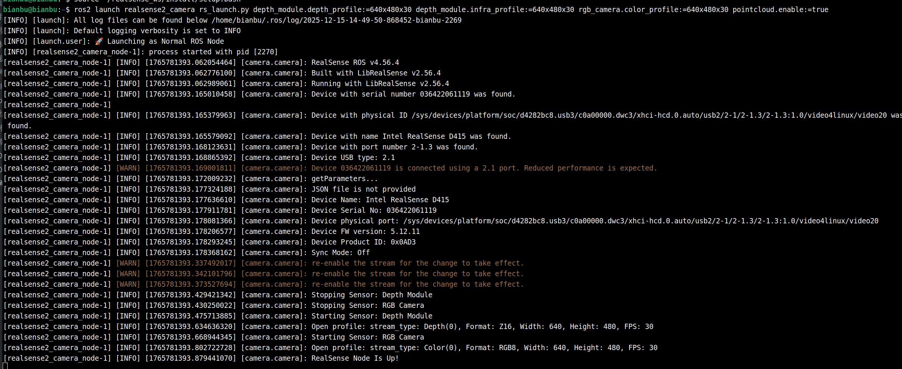

Run `ros2 topic list`:

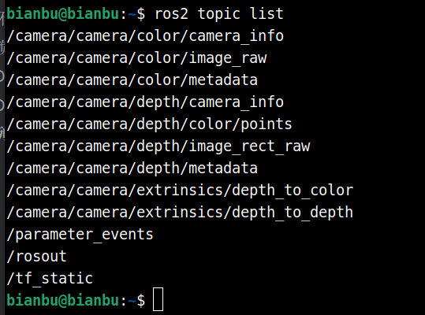

Verify that the expected topics are being published.

**Check depth image publish rate**

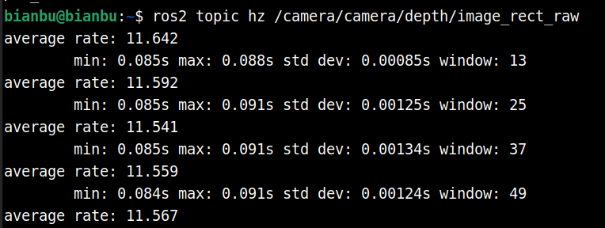

**View depth image**

`ros2 run rqt_image_view rqt_image_view`

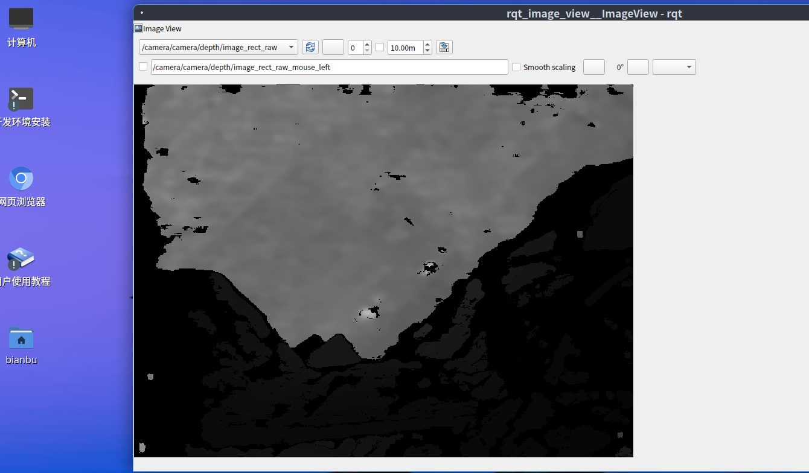

For more information, see the [RealSense ROS repository](https://github.com/realsenseai/realsense-ros).

## Use from Python

### Software and Hardware Environment

- Hardware: MUSE PI PRO
- Operating system: ROS2_LXQT
- RealSense camera model: D415
- Python RealSense SDK version: 2.56.5
- Python version: 3.12

### Install Dependencies

```bash
sudo apt install python3-venv python3-pip
```

### Install the Package

```bash
python3 -m venv rs2
source rs2/bin/activate
pip install pyrealsense2 --index-url https://git.spacemit.com/api/v4/projects/33/packages/pypi/simple
```

### Example Program

Save the following as `demo.py`:

```python
import pyrealsense2 as rs

pipeline = rs.pipeline() # Create a pipeline
pipeline.start() # Start streaming

try:
	while True:
		frames = pipeline.wait_for_frames()
		depth_frame = frames.get_depth_frame()
		if not depth_frame:
			continue

		width, height = depth_frame.get_width(), depth_frame.get_height()
		dist = depth_frame.get_distance(width // 2, height // 2)
		print(f"The camera is facing an object {dist:.3f} meters away", end="\r")

finally:
	pipeline.stop() # Stop streaming
```

### Example Output

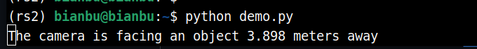
