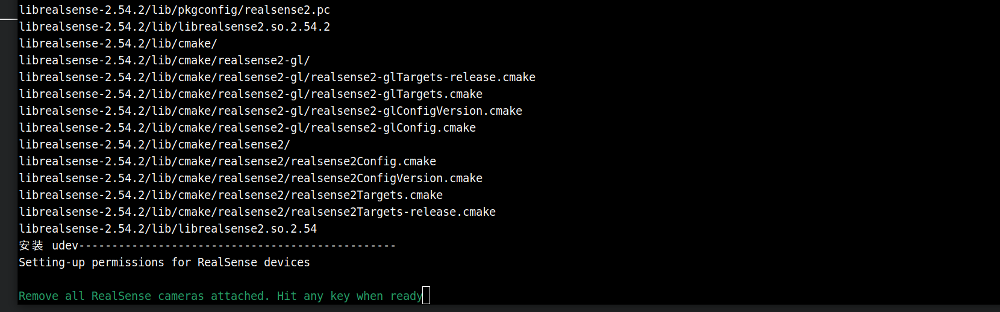
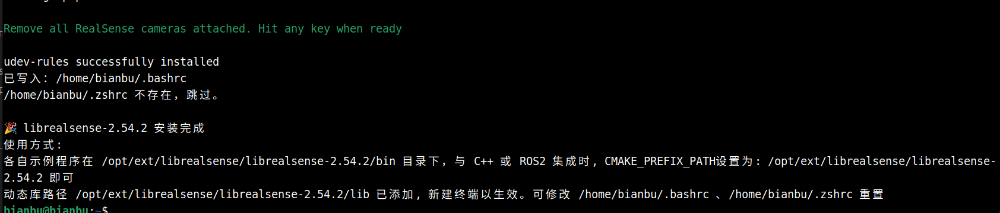
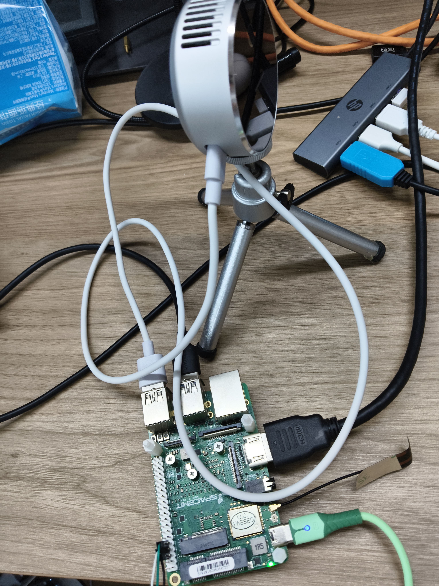
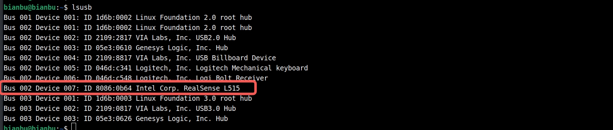
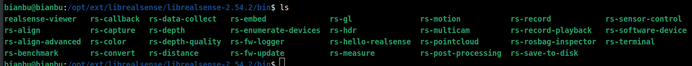
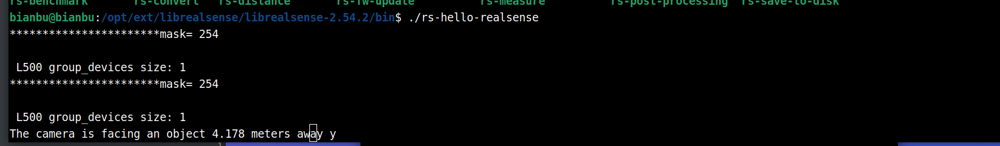
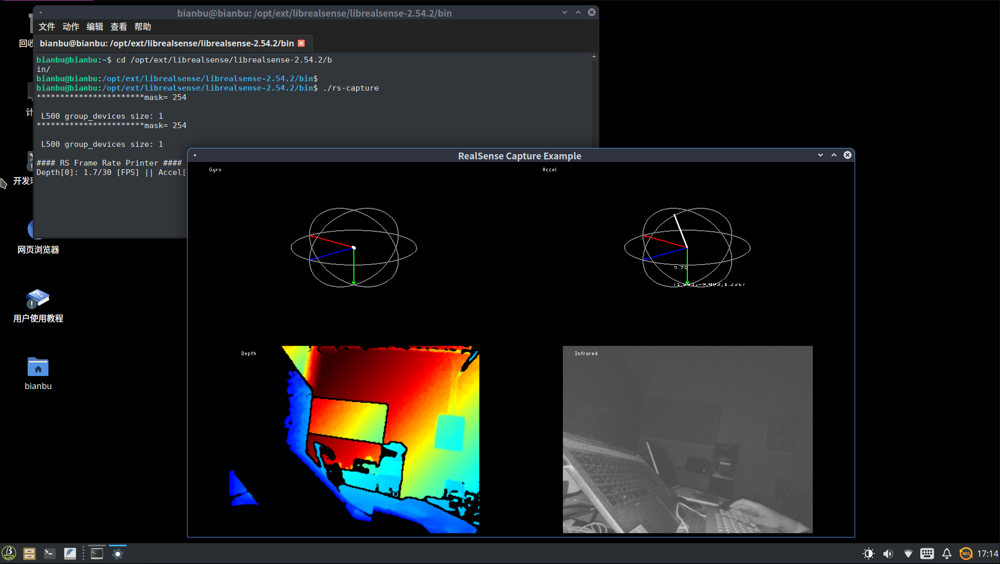

# RealSense L515 Depth Camera Usage

## Hardware Environment

A SpacemiT RISC-V 64-bit development board. These instructions have been verified on the MUSE Pi Pro.

Intel has discontinued support for the L515. The D4xx series is recommended instead.

## Recommended Operating Systems

ROS2_LXQT (recommended), [image link](https://archive.spacemit.com/ros2/bianbu-ros-images/v1.5/ROS2_LXQT-v1.5-20251216.zip)

Bianbu 2.2 Desktop, [image link](https://archive.spacemit.com/image/k1/version/bianbu/v2.2/bianbu-24.04-desktop-k1-v2.2-release-20250430190125.zip)

## SDK Version Notes

Use SDK version v2.54.2; other versions are not supported for this setup.

The SpacemiT SDK is a modified build of the official release. See the [official SDK releases](https://github.com/realsenseai/librealsense/releases) for the source code.

## Replace the Kernel

**Download the kernel package:**

```
wget https://archive.spacemit.com/ros2/prebuilt_libs/bianbu24/kernel_image/linux-image-6.6.63_6.6.63-20251217101945_riscv64.deb
```

**Install the kernel package:**

```
sudo apt update
sudo apt install ./linux-image-6.6.63_6.6.63-20251217101945_riscv64.deb
```

Wait for the installation to complete, then run:

```
sudo reboot
```

## Download and Use the SDK

Disconnect all RealSense devices from the board before downloading the SDK.

### Get the Download Script

```
wget https://archive.spacemit.com/ros2/prebuilt_libs/install_scripts_common/install_librealsense.sh
```

### Install a Specific Version

```
bash install_librealsense.sh 2.54.2
```

Terminal output:

```
bianbu@bianbu:~$ bash install_librealsense.sh 2.54.2
准备安装 librealsense 2.54.2
版本说明: 高版本，支持 D4xx系列相机, 已经过测试。具体见: https://dev.intelrealsense.com/docs/firmware-updates
当前系统 Python 版本: 3.12 (使用目录: bianbu24)
更新 apt 源并安装依赖...
[sudo] bianbu 的密码：
```

Enter the password, which defaults to `bianbu`.

Wait for the dependencies to install and the following prompt to appear:



After confirming that no RealSense camera is connected to the board, press Enter to continue.

After installation, the terminal displays output similar to the following:



Open a new terminal for the `LD_LIBRARY_PATH` change to take effect.

Do not install multiple SDK versions on the same machine to avoid conflicts.

### Hardware Connection

After installing the SDK, you can connect the RealSense L515 camera:



This example uses an L515 camera.

Run `lsusb` to check that the device is detected:



The output should show the connected device.

### Run Examples

Navigate to the `/opt/ext/librealsense/librealsense-2.54.2/bin` directory.

The directory contains several example programs:



#### rs-hello-realsense

This program reads the depth value at the center of the camera image:



#### rs-capture

This program opens a graphical window. Run it locally, not from an SSH terminal.

Display:



Because local computing resources are limited, use the visualization tool only to verify communication with the camera.
