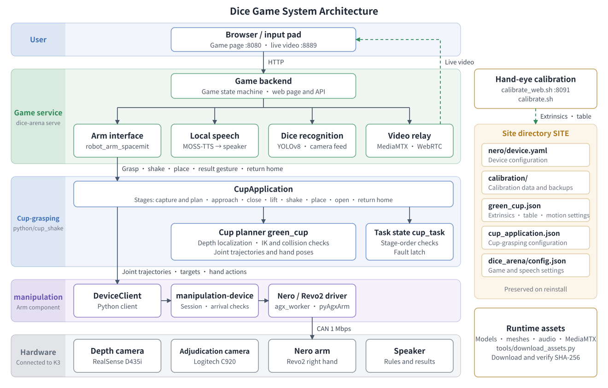
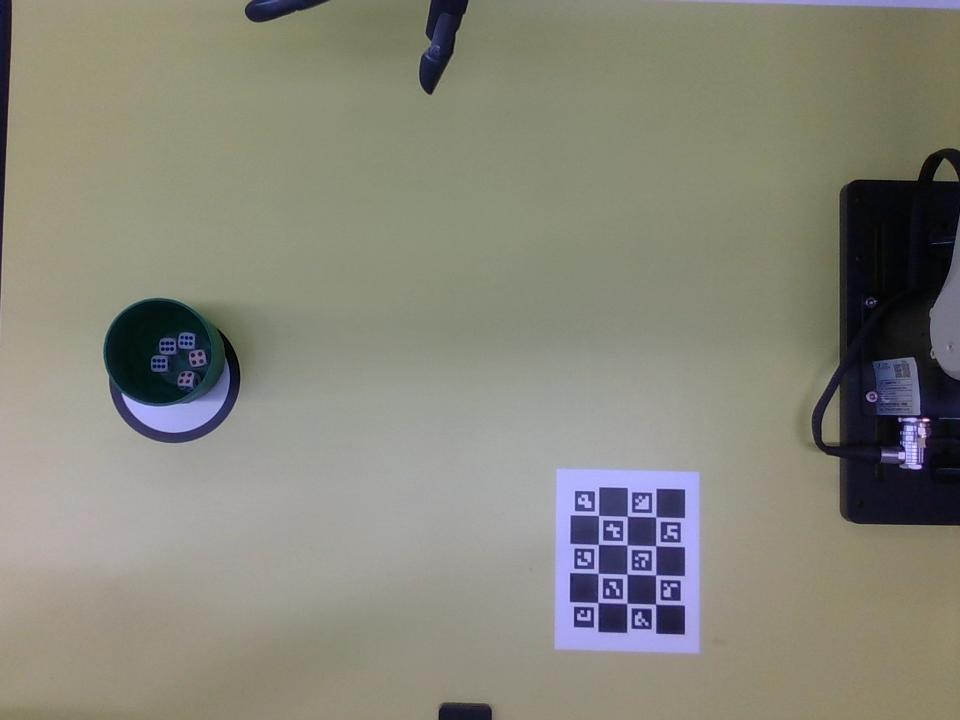
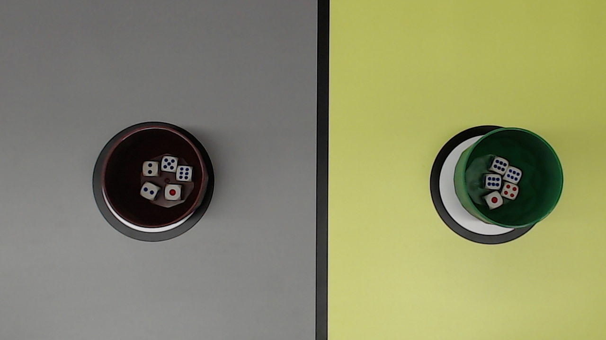
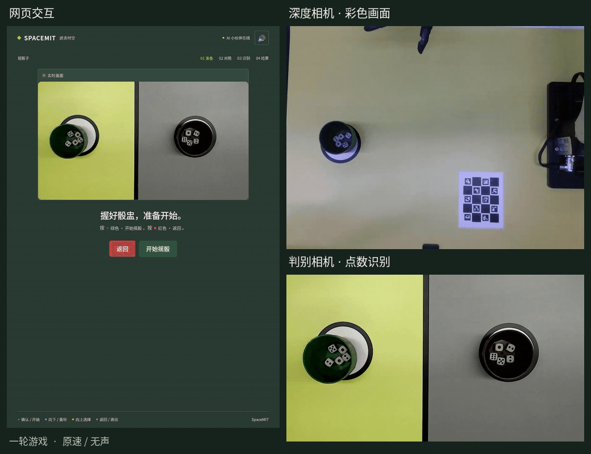

# Dice Game

This solution runs on a SpacemiT K3 development board and implements a dice-shaking match between a robotic arm and a player. The system uses an Agilex Nero seven-axis arm and a Revo2 dexterous hand to locate and grasp a green open cup with a depth camera, shake it, and place it back on the table. An adjudication camera films the dice inside both cups from above; the system recognizes the pips, decides the winner, announces the result on the web page and by voice, and the arm performs the corresponding gesture.

The arm is controlled by the `manipulation` component. See [Robotic Arm Component Control](../../05-机器人开发/5.2-运动控制/5.2.5-机械臂组件控制.md) for the component's configuration, commands, and interfaces.

This document covers:

- [§1 Overview](#1-overview): features, system architecture, execution flow, and software components;
- [§2 Bill of Materials](#2-bill-of-materials) through [§5 Scenario 2: Full Dice Game](#5-scenario-2-full-dice-game): hardware preparation, environment setup, and reproducing the functionality;
- [§6 Extending the Solution](#6-extending-the-solution): adjusting motions, hand poses, game content, and devices;
- [§7 Troubleshooting](#7-troubleshooting) and [§8 Technical Reference](#8-technical-reference): problem diagnosis, plus command, file, and port references.

## 1. Overview

### 1.1 Features

This solution supports the following capabilities:

- **Vision-based cup grasping**: the depth camera locates the green cup on the table, computes the grasp pose, and checks the motion path for collisions with the table and cup.
- **Cup shaking and placement**: the arm lifts the cup, shakes it with the configured motion, places it back in its original position, and returns to the home pose.
- **Dice recognition**: each side has five dice; the adjudication camera films the dice inside the cups from above, and YOLOv8 recognizes the pips. The side with the higher total wins.
- **Interactive feedback**: the web page shows the live view and score, and local speech announces the rules and results. The arm makes a V sign when it wins, a thumbs-up when it loses, and an open-and-close gesture on a tie.
- **Hand-eye calibration**: calibrates the extrinsics between the depth camera and the arm base through the web page or command line, and registers the table.

### 1.2 System Architecture



The left side of the diagram shows runtime call relationships, invoked layer by layer from top to bottom; the right side shows offline-prepared data: hand-eye calibration writes extrinsics and table information into the site directory, and runtime resources are fetched by the download script. The software has three layers:

| Layer | Components | Responsibility |
| --- | --- | --- |
| Game service | Game backend, web page, local speech, dice recognition, video relay | Runs the game state machine, announces speech, recognizes pips, and issues motion commands to the arm interface |
| Cup-grasping application | Cup-grasping planning, task state | Converts commands such as grasp and shake into joint trajectories and dexterous-hand actions, checks stage ordering, and latches after faults |
| `manipulation` component | `DeviceClient`, `manipulation-device`, Nero / Revo2 drivers | Handles device exclusivity, action execution, arrival determination, and fault handling |

Hand-eye calibration is independent of game operation. Calibration results and per-layer configuration are stored together in the site directory (referred to below as `SITE`), whose default path is `~/.local/share/spacemit-manipulation/site/`; reinstalling the application does not overwrite this directory.

### 1.3 Game Execution Flow

The game backend advances the match through a state machine (defined in `game/backend/games/dice/manifest.json`) and issues commands to the arm interface on entering the following states:

| Game state | Arm command | System behavior |
| --- | --- | --- |
| `rules` | — | Announces the rules; meanwhile connects to devices in the background and loads the camera, detection model, and collision model; the arm does not move |
| `ready` | — | Waits for the player to press the green button to start |
| `game_start` | `grasp_cup` | Captures an image and locates the cup; the arm approaches the cup and lifts it once the hand has closed |
| `shake_countdown` | — | Announces the countdown while the arm holds the cup and waits |
| `shaking` | `shake_dice` | The player and the arm shake their cups at the same time |
| `stop_call` | `settle_dice` | Announces "stop"; the arm places the cup back, opens the hand, and returns home |
| `analysis` | — | Recognizes both sides' pips from the adjudication camera view and decides the winner |
| `result` | `gesture:win`, `gesture:lose`, `gesture:draw` | Announces the result and the arm performs the corresponding gesture |
| `rehome` | `reset_home` | After choosing to play again, the arm returns home and opens the hand |
| `arm_failed`, `analysis_failed` | `reset_home` | The arm returns home when idle; the command is refused when the arm may be holding a cup or is already latched, pending manual handling |

The cup-grasping application splits each command into stages. For example, `grasp_cup` includes capture and planning (`prepare`), approach (`approach`), hand closing (`grip`), and lifting (`lift`). The task state library checks stage ordering:

- The cup cannot be lifted before the hand has closed;
- The arm cannot return home while it may be holding a cup;
- Any stage failure after a command has been issued latches the task without automatic retry; failures before the command is issued (such as not detecting a cup) do not change task state.

### 1.4 Software Components

The source is in `application/native/dice_arena` and depends on the arm component `components/control/manipulation` and the vendor SDK `components/thirdparty/pyagxarm`.

| Module | Source location | Description |
| --- | --- | --- |
| Command entry point | `python/spacemit_dice_arena/` | The `dice-arena` command, including cup grasping, the game service, and checks |
| Cup-grasping application | `python/cup_shake/` | Application entry point `CupApplication`, planner, and stage orchestration |
| Task state | `src/`, `include/` | C++ stage-order checks and fault latching, built as `libcup_task.so` |
| Cup-grasping algorithms | `algorithms/` | Cup detection, kinematics, collision model, motion configuration, TCP, and model files |
| Hand-eye calibration | `calibration/`, `calibrate.sh`, `calibrate_web.sh` | Calibration command line and web page |
| Game | `game/` | Game backend, web page, local speech (MOSS-TTS), and dice recognition |
| Video relay | `mediamtx/` | MediaMTX binary and configuration, converting the recognition view into a WebRTC stream playable in the browser |
| Deployment and tests | `config/`, `tools/`, `tests/` | Runtime resource download, configuration generation, and hardware-free tests |

## 2. Bill of Materials

### 2.1 Equipment List

| Device | Model or specification | Purpose |
| --- | --- | --- |
| Controller | SpacemiT K3 development board | Runs control, vision planning, dice recognition, speech, and the web service |
| Robotic arm | Agilex Nero seven-axis arm | Grasps, shakes, and places the cup, and performs result gestures |
| End effector | Revo2 right dexterous hand, six channels | Grasps the cup and performs result gestures |
| CAN adapter | USB-CAN adapter supporting SocketCAN | Connects the K3 to the arm at 1 Mbps |
| Depth camera | Intel RealSense D435i | Cup localization and hand-eye calibration |
| Adjudication camera | USB camera supporting MJPEG, configured by default for a Logitech C920 | Films both cups' dice from above |
| Calibration boards | One ChArUco end-effector board and one table-mounted board | Solves extrinsics and registers the table |
| Audio output | Speaker, any model | Plays the rule explanation and match results |
| Game props | Green open cup and dice, five dice per side | The grasped cup dimensions must match the cup-grasping configuration |

### 2.2 Connections and Installation

- **Arm and dexterous hand**: connect the USB end of the USB-CAN adapter to the K3 and the CAN end to the arm. Revo2 mounts on the arm's end effector and shares the controller connection through the end-effector port, so no separate cabling is needed.
- **Depth camera**: connect to the K3 by USB and mount it outside the arm with its field of view covering the cup-grasping workspace and the calibration board.
- **Adjudication camera**: connect to the K3 by USB and mount it above the table with its field of view covering both cups' dice and the table divider.
- **Speaker**: connect to the K3's system audio output.

**Depth camera first-person view (RealSense D435i color image)**



The green cup and grasp workspace must be fully within the frame; the fixed calibration board must be clearly visible during calibration.

**Adjudication camera first-person view (Logitech C920 raw image)**



Both cup rims, the dice inside the cups, and the table divider must be fully within the frame, and the dice pips must be clearly legible.

Once installed, the arm base, cameras, and table must remain fixed; moving any of them requires recalibration. The vision planning, calibration parameters, and hand poses provided by this solution apply to the device combination above. If you change the arm, dexterous hand, cup, or camera mounting position, re-adapt according to [§6.6 Replacing the Planner or Devices](#66-replacing-the-planner-or-devices).

## 3. Environment Setup

### 3.1 Get the Code

This solution is released with the SpacemiT Robot SDK. Run the following commands in a K3 terminal to download the full SDK to `~/spacemit_robot`, where `~` is the current user's home directory. If the full SDK is already downloaded there, skip the download and load the build environment directly.

```bash
sudo apt update
sudo apt install repo git

# Run only if Git identity is not yet configured; replace the name and email with your own
git config --global user.name "Your Name"
git config --global user.email "you@example.com"

mkdir -p ~/spacemit_robot
cd ~/spacemit_robot
repo init -u https://github.com/spacemit-robotics/manifest.git -b main -m default.xml \
  --repo-url=https://gitee.com/spacemit-robotics/git-repo
repo sync -j4
repo start robot-dev --all
```

- If GitHub is unreachable, replace the URL after `-u` with `https://gitee.com/spacemit-robotics/manifest.git`;
- For group-based partial downloads and other approaches, see [Build and Compile](../../02-快速入门/2.3-构建编译.md).

Enter the SDK root `~/spacemit_robot`, load the build environment, register the Nero vendor SDK, and enter the application directory. The remaining commands in this chapter run in `~/spacemit_robot/application/native/dice_arena` in that terminal:

```bash
cd ~/spacemit_robot
source build/envsetup.sh
bash components/thirdparty/pyagxarm/tools/setup_sdk.sh
cd application/native/dice_arena
```

`setup_sdk.sh` registers the downloaded Nero vendor SDK source as a build dependency. After opening a new terminal, run the following commands to load the environment and return to the application directory; the source does not need to be downloaded again:

```bash
cd ~/spacemit_robot
source build/envsetup.sh
cd application/native/dice_arena
```

### 3.2 Download Runtime Resources

Models, meshes, audio, default teaching data, and the video service binary are large and are not shipped with the source; download them according to the manifest `runtime_assets.json` (about 700 MB in total):

```bash
python3 tools/download_assets.py
```

Resources are hosted at `https://archive.spacemit.com/ros2/manipulation/dice_arena/` and organized by module:

| Resource | Server directory | Downloads to application directory | Size |
| --- | --- | --- | --- |
| Cup detection model | `algorithms/cup_grasp/` | `algorithms/cup_grasp_demo/models/` | About 4 MB |
| Arm and dexterous-hand meshes | `algorithms/meshes/` | `algorithms/nero_revo2_control/models/hand_geometry/` | About 18 MB |
| Hand-eye calibration default teaching data | `calibration/` | `calibration/trajectories/` | About 3 MB |
| Dice recognition model and game audio | `game/dice/` | `game/backend/games/dice/` | About 12 MB |
| Local speech model and reference voice | `game/tts/` | `game/tts/moss-tts-nano/` | About 613 MB |
| MediaMTX video service | `mediamtx/` | `mediamtx/` | About 51 MB |

- Each file's size and SHA-256 are verified during download, and files already downloaded and verified are not downloaded again;
- When using an internal mirror, append `--base-url <mirror address>`. The mirror address corresponds to `https://archive.spacemit.com/ros2/manipulation/` and keeps the same `dice_arena/` directory structure beneath it;
- Already-downloaded resources can be re-verified with `python3 tools/check_assets.py --verify`.

### 3.3 Build

```bash
mm --with-deps
```

This command builds the vendor SDK, the `manipulation` component, and this application (task state library and dice recognition program) in sequence, installing by default to `~/spacemit_robot/output/staging`.

- **System dependencies**: if dependencies declared in `package.xml` are missing, install them as prompted, for example OpenCV, GStreamer, the SpacemiT inference library, and `python3-sentencepiece` and `python3-soundfile` for local speech.
- **Dice recognition program**: depends on the SpacemiT inference library and is built only on the K3.
- **Depth camera**: additionally requires the RealSense Python bindings `pyrealsense2` matching the K3 architecture and Python version.

The main installed contents are as follows, with paths relative to `~/spacemit_robot/output/staging`:

| Category | Location |
| --- | --- |
| Commands | `bin/dice-arena`, plus the arm component's `bin/manipulation` and `bin/manipulation-device` |
| Python modules | `python/cup_shake/`, `python/spacemit_dice_arena/` |
| Task state library | `lib/libcup_task.so` |
| Algorithms, calibration, game, and video service | `share/dice_arena/` |

### 3.4 Offline Checks

The following commands do not connect to the arm, cameras, or audio devices and verify that the software installation is complete:

```bash
dice-arena mock
dice-arena check
manipulation check --profile vision
python3 tools/check_assets.py --verify
```

Pass criteria:

- `dice-arena mock`: completes cup grasping, shaking, and placement on simulated devices with exit code `0`;
- `dice-arena check`: completes one game round through the game's arm interface on simulated devices with exit code `0`;
- `manipulation check --profile vision`: control, OpenCV, SciPy, and RealSense dependency checks pass;
- `check_assets.py --verify`: runtime resources are complete and all digests match.

## 4. Scenario 1: Single Grasp, Shake, and Place

This scenario configures the device, performs hand-eye calibration, generates the cup-grasping configuration, and finally performs one grasp, shake, and place on real hardware. The full game depends on all results from this scenario.

**Safety requirements**: the real-hardware steps below drive the arm. An operator must be present, the emergency stop must be within reach, and no people or obstacles may be in the arm's motion path. Nero collapses when powered off or disabled; never use power removal or disabling in place of a software stop.

### 4.1 Configure the Arm Component

**Step 1: Generate the device configuration.** Generate a configuration for Nero with a Revo2 right hand:

```bash
manipulation configure nero --variant revo2_right
manipulation validate
```

- The configuration is saved to `SITE/nero/device.yaml` and includes drivers, CAN interface, joint limits, and dexterous-hand channels; existing files are not overwritten.
- If the CAN interface is not `can0`, append `--set channel=<interface name>` to the `configure` command.
- `configure` also sets Nero as the current device. If other devices have been configured on this machine, run `manipulation use nero` first; when the current device is not Nero, hand-eye calibration and `dice-arena configure` are refused.

**Step 2: Bring up the CAN interface.**

```bash
sudo ip link set can0 up type can bitrate 1000000
```

**Step 3: Enable the arm.** Exit the vendor web interface, teleoperation, and other control programs, then enable the arm and enter position control mode according to the vendor procedure. The application does not automatically enable the arm or clear faults.

**Step 4: Read device state.**

```bash
manipulation inspect
```

This command only reads state and sends no motion targets. Confirm that `enabled` and `position_mode` are `true`, `fault` is `false`, and the seven joint positions match the actual pose.

### 4.2 Hand-Eye Calibration

Hand-eye calibration solves the extrinsics from the depth camera to the arm base and registers the table workspace; cup-grasping planning depends on both results.

**Step 1: Prepare.** Fix the depth camera, arm base, table, and both calibration boards, and fill in the site parameters in `calibration/config/calibration_workflow.json`:

- Depth camera serial number and image parameters;
- Calibration board dictionary, grid counts, and measured dimensions;
- Home pose and tool center point (TCP) when not holding an object;
- Automatic sampling parameters and quality thresholds.

Calibration and cup grasping must use the same resolution, crop region, and camera intrinsics. If the camera, base, or TCP changes, the existing extrinsics can no longer be used.

**Step 2: Start the calibration web page.** Set the engineer PIN and start the web page. If the calibration error does not meet the threshold, the PIN must be entered to approve temporary use of the result.

```bash
bash calibrate_web.sh --set-pin
bash calibrate_web.sh --host 0.0.0.0
```

**Step 3: Perform calibration.** Open `http://<K3_IP>:8091/` in a browser and choose a task according to the on-site situation:

| Task | When it applies | Steps |
| --- | --- | --- |
| First installation | First calibration, or the base or table-mounted board has moved | Prepare the device and workspace → teach and save poses manually (at least 12) → set the full-board visibility region → generate the automatic sampling route → automatic sampling → register the table-mounted board → apply the result and register the table |
| Recalibration | Recalibrate along a saved route | Prepare the device and workspace → generate the automatic sampling route → automatic sampling → register the table-mounted board → apply the result and register the table |
| Camera moved | The base and table-mounted board have not moved; only the camera moved | Prepare the device and workspace → restore the camera position using the fixed board → apply the result and register the table |

Automatic sampling drives the arm along the taught route and solves the extrinsics, returning home when finished. The calibration workflow can also be completed from the command line; see `calibrate.sh` in [§8.1 Command Reference](#81-command-reference).

Calibration results are saved in `SITE/calibration/`, and applying the result generates `SITE/green_cup.json`. When finished, press Ctrl+C to exit the calibration web page.

### 4.3 Generate the Cup-Grasping Configuration

```bash
dice-arena configure
```

This command validates the device and algorithm configurations offline and generates `SITE/cup_application.json`; existing files are not overwritten. This file records the path of the Nero configuration, so subsequent `dice-arena` grasp and game commands are unaffected by `manipulation use`.

After generation, verify the following against the physical hardware:

- Home pose, TCP, and cup dimensions;
- Grasp hand pose: the default is `grip_targets_0_100` from the algorithm strategy `algorithms/vision/strategy/green_cup.json`, ordered according to the channels in `SITE/nero/device.yaml`, using dexterous-hand scale (`0` open, `100` closed); to adjust it, see [§6.2 Adjusting Motions and Hand Poses](#62-adjusting-motions-and-hand-poses);
- `grip_confirmation`: defaults to `none`, so the cup is lifted directly after the hand closes; when set to `operator`, the system waits for operator confirmation that the cup is held after each hand closure.

### 4.4 Running and Results

Confirm that the arm is not holding anything and is at home, the dexterous hand is open, and the cup is in the workspace within the depth camera's field of view. Read state first, then run the grasp sequence:

```bash
dice-arena inspect
dice-arena cycle
```

`cycle` executes the grasp, shake, and place commands in sequence, printing an event line at the start and end of each stage. Execution succeeds when all three commands return `"status": "completed"`. Example output (excerpt):

```text
{"event": "robot", "phase": "prepare", "elapsed_s": 1.64, "startup_wait_s": 4.3}
{"event": "robot", "phase": "approach", "progress": 1, "elapsed_s": 1.03, "plan_s": 0.0}
{"event": "robot", "phase": "grip", "progress": 1, "elapsed_s": 0.31}
{"event": "robot", "phase": "lift", "progress": 1, "elapsed_s": 0.55, "plan_s": 0.25}
{"status": "completed", "grip_evidence": "grip_commanded", "physical_grip_verified": false}
agx_worker: agx-trajectory-stream planned 3.57 s, took 3.58 s, 716 commands (200 Hz of 200 Hz)
{"event": "robot", "phase": "shake", "progress": 1, "elapsed_s": 3.8, "plan_s": 0.11}
{"status": "completed", "physical_grip_verified": false}
{"event": "robot", "phase": "lower", "progress": 1, "elapsed_s": 0.46, "plan_s": 0.01}
{"event": "robot", "phase": "open", "progress": 1, "elapsed_s": 0.32}
{"event": "robot", "phase": "return_home", "progress": 1, "elapsed_s": 1.03, "plan_s": 0.01}
{"status": "completed", "physical_grip_verified": false}
```

| Field | Meaning |
| --- | --- |
| `phase` | Stage name: `prepare` for capture and planning, `approach`, `grip` for hand closure, `lift`, `shake`, `lower` for placement, `open` for opening the hand, `return_home` |
| `elapsed_s` | Stage duration in seconds |
| `plan_s` | Planning time before the stage starts, in seconds |
| `startup_wait_s` | Time waiting for the camera, detection model, and collision model to load; appears only on the process's first grasp |
| `agx_worker: ... planned / took` | Planned duration, actual duration, and send rate for the arm stream; close values indicate normal sending |

`physical_grip_verified` is always `false`: the system has no force or tactile sensing and cannot confirm a secure grasp. On the first run, observe the hand closure and lift on site.

### 4.5 Returning Home and Exception Handling

When the arm is not holding anything and the return path is clear, the following command returns it home and opens the hand:

```bash
dice-arena home
```

Failures before a command is issued (such as not detecting a cup) do not change task state, so you can retry directly. After a failure, cancellation, or possible grasp following an issued command, the application does not automatically open the hand, return home, or retry, and `dice-arena home` is also refused:

- Task state is recorded in `SITE/runtime/task_state.json`, and motion remains refused after the process restarts;
- After the on-site operator inspects and handles the arm, dexterous hand, and cup, run the following command to clear the record, then restart the program:

```bash
dice-arena reset
```

`reset` does not connect to devices or move anything; it only deletes the record.

## 5. Scenario 2: Full Dice Game

### 5.1 Starting the Game

After completing [§4 Scenario 1: Single Grasp, Shake, and Place](#4-scenario-1-single-grasp-shake-and-place), exit other programs that use the devices. The safety requirements are the same as in scenario 1. Confirm that the arm is at home and the dexterous hand is open, place the cup containing the dice in the workspace, then start the game service:

```bash
dice-arena serve
```

`serve` starts the video relay, local speech, and game backend in sequence:

- On the first start, local speech loads its models, which takes tens of seconds;
- Press Ctrl+C to stop the game and video service; the local speech process is kept and reused on the next start;
- To allow only local access, use `dice-arena serve --host 127.0.0.1`.

### 5.2 Playing a Round

1. Open `http://<K3_IP>:8080/` in a browser and select "Dice game". An input pad can also be used.
2. The system plays the rule explanation while the arm connects and initializes in the background without moving. After the explanation, press the green button to confirm and press it again to start the round.
3. The arm grasps the cup. When the countdown ends, the player and the arm shake their cups at the same time.
4. After hearing "stop", the player sets down the cup and keeps the dice still while the arm places its cup back and returns home.
5. The system recognizes both sides' pips from the adjudication camera view, the web page shows the score and outcome, speech announces the result, and the arm performs the corresponding gesture.
6. Select "Play again" or "Back to game list"; the arm returns home and opens the hand.

If an arm action fails, the web page shows "The arm just got stuck", and you can press the blue "Retry arm" button or the red "Exit round" button:

- Failures before a command is issued (such as not detecting a cup) do not change task state, so you can retry directly;
- Failures after a command is issued latch the task as faulty, and retries are refused. In this case, stop the game first, have the on-site operator handle the situation, run `dice-arena reset`, then restart.

### 5.3 Observed Behavior

The recording below shows one round on real hardware, covering cup grasping, shaking, placement, pip recognition, and win determination. The left side is the game web page, the upper right is the depth camera color view, and the lower right is the adjudication camera stream.



The animation is about 20 seconds long, at normal speed and without sound. In this round the arm scored 20 and the player 16, and the web page shows the arm winning.

### 5.4 Querying Status

Query component status from another terminal; this command does not separately connect to devices:

```bash
dice-arena status
```

The output includes the health status of the arm, local speech, and dice recognition, plus the current round identifier `active_round`. A single component can be queried with `dice-arena component health <component>`, for example `dice-arena component health tts_moss_nano`. Video service logs are in `SITE/dice_arena/mediamtx.log`.

## 6. Extending the Solution

### 6.1 Code Guide

Start with [§1.2 System Architecture](#12-system-architecture) and [§1.3 Game Execution Flow](#13-game-execution-flow) to understand the overall structure, then read the source according to your area of interest. The paths in the table are relative to `application/native/dice_arena`:

| Area of interest | Entry point | Further reading |
| --- | --- | --- |
| Command execution | `python/spacemit_dice_arena/operator.py` | `CupApplication.command()` in `python/cup_shake/runtime.py` |
| Generating grasp and shake motions | `motions()` in `python/cup_shake/green_cup.py` | `transition()`, `shake()`, and `algorithms/cup_grasp_demo/flow/` |
| Stage ordering and fault latching | `src/cup_task.cpp` | `python/cup_shake/policy.py` |
| How actions reach the arm | `spacemit_manipulation.DeviceClient` | [Robotic Arm Component Control §4 Application Development](../../05-机器人开发/5.2-运动控制/5.2.5-机械臂组件控制.md#4-application-development) |
| Match flow | `game/backend/games/dice/manifest.json` | `game/backend/core/state_machine.py` |
| How the game calls the arm | `game/backend/components/robot_arm_spacemit/provider.py` | `CupApplication.command()` |
| Hand-eye calibration | `calibration/workflow.py` (command line) | `calibration/web/` (web page) |

Parameter descriptions for each game component ship with the source: see `game/backend/parameters.md`, `game/backend/games/dice/parameters.md`, and `game/backend/components/*/parameters.md`.

### 6.2 Adjusting Motions and Hand Poses

**`SITE/green_cup.json`**:

| Field | Description | Default |
| --- | --- | --- |
| `green_cup.fast_speed_percent` | Lift speed, as a percentage of the controller's joint speed limit | `30` |
| `green_cup.fast_phase_speed_percent` | Speed for the approach (`approach`), placement (`lower`), and return home (`return_home`) stages, in the same units | All `100` |
| `green_cup.fast_finger_duration_s` | Hand close and open duration, in seconds | `0.3` |

**`algorithms/vision/strategy/green_cup.json`** (cup-grasping strategy):

| Field | Description | Default |
| --- | --- | --- |
| `lift_mm` | Lift height, in mm | `50` |
| `grip_targets_0_100` | Grasp hand pose, ordered by the device configuration's channels, on a dexterous-hand scale: `0` open, `100` closed | `[0, 80, 50, 50, 50, 100]` |
| `open_targets_0_100` | Open hand pose; must be fully open when returning home and placing the cup | `[0, 0, 0, 0, 0, 0]`, must not be modified |

Fields in the strategy file can also be written into the `green_cup` section of `SITE/green_cup.json`; values in the site file take precedence and are not overwritten on reinstall.

**`algorithms/configs/actions/joint_shake.json`**:

| Field | Description | Default |
| --- | --- | --- |
| `joints` | Joints involved in the shake | 1, 3, 4, 5, 6, 7 |
| `amplitude_deg` | Amplitude per joint, in degrees | `1.5` |
| `cycles` | Number of cycles | `8` |
| `command_rate_hz` | Send rate, in Hz | `200` |

**`algorithms/configs/actions/gestures/result_feedback.json`**:

| Field | Description |
| --- | --- |
| `gestures.<name>.joints_deg` | Arm pose, in degrees |
| `gestures.<name>.hand_0_100` | Hand pose on a dexterous-hand scale: `0` means open and `100` means closed |
| `gestures.<name>.speed_percent` | Motion speed percentage |
| `gestures.<name>.hand_sequence` | Repeated finger motion |
| `aliases` | Map `win`, `lose`, and `draw` to gesture names |

How configuration changes take effect:

- Files in `SITE`: edit directly;
- Files in `algorithms/`: re-run `mm` after editing;
- A running process that detects changes to algorithms, models, calibration, or configuration files refuses to continue; restart `dice-arena cycle` or `dice-arena serve` for the changes to take effect.

After adjusting motions, run `dice-arena mock` for the offline check first, then validate at low speed with an operator present.

### 6.3 Adjusting the Game

| Adjustment | File | Description |
| --- | --- | --- |
| Voice, speech rate, player position, idle state, and input pad | `SITE/dice_arena/config.json` | Generated on first game start; reloaded automatically after editing and not overwritten on reinstall |
| Game flow, lines, and timeouts | `game/backend/games/dice/manifest.json` | Re-run `mm` after editing |
| Prerecorded audio | `game/backend/games/dice/audio/` | Prerecorded audio such as the countdown; re-run `mm` after editing |
| Dice recognition | `game/backend/games/dice/adjudicator_config.json` | Model, confidence, camera device, and resolution; re-run `mm` after editing |

### 6.4 Replacing the Adjudication Camera

The adjudication camera is specified by the `camera` field in `adjudicator_config.json`; the default `/dev/v4l/by-id/usb-046d_HD_Pro_Webcam_C920_*-video-index0` matches any C920. At startup the field must match exactly one device:

- When replacing with the same model, no configuration change is needed;
- When several C920 cameras are connected at once, query devices with `ls /dev/v4l/by-id/` and enter a fixed path.

When switching to another model, the camera must support MJPEG output. First confirm the camera's capabilities (requires `v4l-utils`):

```bash
v4l2-ctl -d /dev/video0 --list-formats-ext         # Whether MJPG is supported, plus resolutions and frame rates
v4l2-ctl -d /dev/video0 --list-ctrls | grep zoom   # Whether zoom is supported
```

Then modify the following fields in `adjudicator_config.json` and re-run `mm`:

- `camera`: the fixed path found with `ls /dev/v4l/by-id/`;
- `width`, `height`, `fps`: an MJPEG mode the camera supports; defaults are 1280×720 at 24 fps;
- `zoom`: a zoom value the camera supports; the default is `180`. Set it to `-1` when zoom is not supported, otherwise the camera cannot be opened.

The bundled model is verified only on the C920. After changing cameras, adjust the camera position and `zoom` so that both cups and the divider are fully within the frame, and confirm recognition accuracy with an actual round; if accuracy is insufficient, adjust `conf` or retrain the model.

### 6.5 Calling Cup Grasping from Another Application

`CupApplication` is the entry point for the cup-grasping application. The game uses it to control the arm, and other applications can call it directly. The following example uses a mock device configuration and does not connect hardware:

```bash
python3 - <<'PY'
import os
from pathlib import Path
from cup_shake import CupApplication

app = CupApplication(Path(os.environ["PREFIX"]) / "share/dice_arena/config/mock.json")
try:
    for name in ("grasp_cup", "shake_dice", "settle_dice"):
        print(app.command(name, on_event=print))
finally:
    app.close()
PY
```

Expected result: start and end events are printed for each stage, and all three commands return `{'status': 'completed', ...}`. When connecting real hardware, replace the configuration file with `SITE/cup_application.json`.

Supported commands:

| Command | Purpose |
| --- | --- |
| `grasp_cup` | Capture and plan, approach, close the hand, and lift; returns home first when not at home |
| `shake_dice` | Shake the cup |
| `settle_dice` | Place the cup, open the hand, and return home |
| `gesture:win`, `gesture:lose`, `gesture:draw` | Perform the result gesture and hold the pose afterwards |
| `reset_home` | Return home and open the hand |
| `ensure_home` | Does not move when already at home with the hand open; otherwise returns home and opens the hand |
| `query_pose` | Read-only query of whether the arm is at home |

`command(name, on_event=..., is_cancelled=..., timeout_seconds=120)` executes only one command at a time:

- `on_event`: receives the stage events shown in [§4.4 Running and Results](#44-running-and-results);
- `is_cancelled`: cancel the current command when it returns `True`;
- Return value: `completed` or `failed`; failure results include `reason` and task state.

Once the task is latched as faulty, all motion commands are refused. The on-site operator must handle the situation, and the program must be restarted after running `dice-arena reset`.

### 6.6 Replacing the Planner or Devices

**Planner**: `python/cup_shake/planners.py` registers `fixture` (for simulated devices only) and `green_cup` (vision-based grasping of the green cup). A new planner must provide the following; see `FixturePlanner` for a minimal implementation:

- Required: the home pose `home`, plus `prepare()`, `targets()` or `motions()`, `verify_lower()`, and `close()`;
- Required for planners other than `fixture`: `hand_poses()`, returning the open hand pose, grasp hand pose, and finger motion durations; `fixture`'s hand poses are defined in the application configuration;
- Optional: `warm_up()`, `ready()`, `gesture()`.

**Arm and dexterous hand**: device integration is handled by the `manipulation` component.

- Devices with an existing driver: generate configuration with `manipulation configure`;
- New devices: extend drivers according to [Robotic Arm Component Control §4 Integrating a New Device](../../05-机器人开发/5.2-运动控制/5.2.5-机械臂组件控制.md#integrating-a-new-device);
- The `green_cup` planner's kinematics, collision model, TCP, and hand poses target Nero and Revo2; when changing devices, also adapt the corresponding content in `algorithms/` and recalibrate.

**Cameras**: after changing the depth camera mounting position, recalibrate; to replace the adjudication camera, see [§6.4 Replacing the Adjudication Camera](#64-replacing-the-adjudication-camera).

### 6.7 Testing

After changing code, load the SDK environment, enter the application directory, and run the hardware-free tests (requires `python3-pytest`):

```bash
cd ~/spacemit_robot
source build/envsetup.sh
cd application/native/dice_arena
PYTHONNOUSERSITE=1 PYTHONPATH=algorithms python3 -m pytest -q tests/algorithms
PYTHONNOUSERSITE=1 PYTHONPATH=. python3 -m pytest -q tests/calibration
dice-arena mock
dice-arena check
```

`PYTHONNOUSERSITE=1` excludes Python packages in the user directory, matching the build system's test settings.

To verify a full build of the component and application, run the following from the SDK root:

```bash
cd ~/spacemit_robot
bash components/control/manipulation/tools/verify_stack.sh
```

The script builds and installs the component and application into `output/manipulation-dev`, runs all hardware-free tests and mock device checks, and does not access hardware.

## 7. Troubleshooting

| Symptom | Resolution |
| --- | --- |
| Device connection failure | Run `ip -details link show can0` and confirm the interface is up at 1 Mbps; check power, enable state, and position control mode |
| Device reported as in use | Exit the vendor web interface, teleoperation, the calibration web page, and other control programs; do not delete lock files or take over a device that is still moving |
| Nero device required | Run `manipulation use nero` to set Nero as the current device |
| `pyrealsense2` missing | Install the RealSense Python bindings matching the K3 architecture and current Python version |
| Model or video service binary missing | Run `python3 tools/download_assets.py`, then `mm --with-deps` |
| Table registration missing or extrinsics mismatch | Exit the game and run `bash calibrate.sh table` in the application directory to recapture and register the table |
| Game ports in use | Stop programs using ports 8080, 8554, or 8889; if speech port 18082 is held by another installed speech service, stop that service first |
| Web page does not open | Confirm that `dice-arena serve` is running and was not started with `--host 127.0.0.1`; if the browser uses a proxy, add the K3 address to the proxy exceptions |
| No adjudication camera image | Check the adjudication camera connection. The default configuration requires exactly one C920 `video-index0` device in `ls /dev/v4l/by-id/`; otherwise see [§6.4 Replacing the Adjudication Camera](#64-replacing-the-adjudication-camera) |
| Task faulted or cancelled | Stop the game, have the on-site operator handle any held object and the device pose, then run `dice-arena reset`; do not retry directly, open the hand, or return home |

## 8. Technical Reference

### 8.1 Command Reference

The `dice-arena` global option `--site DIR` is placed before the subcommand and specifies the site directory.

| Command | Purpose | Drives the arm |
| --- | --- | --- |
| `dice-arena mock` | Run cup grasping, shaking, and placement on simulated devices | No |
| `dice-arena check` | Check the game's arm interface on simulated devices | No |
| `dice-arena configure` | Generate `SITE/cup_application.json` offline | No |
| `dice-arena inspect` | Connect to devices and read state | No |
| `dice-arena cycle` | Perform one grasp, shake, and place | Yes |
| `dice-arena home` | Return home and open the hand | Yes |
| `dice-arena reset` | Clear the latched task state after manual handling | No |
| `dice-arena serve` | Start the video relay, local speech, and game service | Yes |
| `dice-arena status` | Query the status of game service components | No |
| `dice-arena component ACTION [component]` | Manage game components according to site configuration: `list`, `health`, `start`, `stop`, and others | No |
| `dice-arena events ROUND_ID` | Read a round's event stream, used for manual grasp confirmation | No |
| `dice-arena ack-grip TOKEN OUTPUT` | Submit manual grasp confirmation for this round | No |
| `bash calibrate_web.sh --host 0.0.0.0` | Start the calibration web page; `--set-pin` sets the engineer PIN | Yes (sampling and returning home from the web page) |
| `bash calibrate.sh <step>` | Command-line calibration: `first`, `window`, `solve`, `plan`, `auto`, `register`, `restore`, `apply`, `table`, `status` | Yes (`auto`, `restore`) |
| `bash calibration_web_service.sh start` | Run the calibration web page in the background; `stop` stops it and `status` queries its state | Same as the calibration web page |
| `python3 tools/download_assets.py` | Download runtime resources | No |
| `python3 tools/check_assets.py --verify` | Verify runtime resources | No |

For descriptions of each command-line calibration step, see `docs/grasp.md` in the application source.

### 8.2 Site Files

| File | Contents | Generated by |
| --- | --- | --- |
| `SITE/nero/device.yaml` | Device driver, CAN interface, joint limits, and dexterous-hand channels | `manipulation configure` |
| `SITE/calibration/` | Calibration samples, extrinsic candidates, the applied result, and backups | Hand-eye calibration |
| `SITE/green_cup.json` | Camera, extrinsics, table, home pose, TCP, cup, and motion parameters | Generated when applying hand-eye calibration |
| `SITE/cup_application.json` | Device configuration reference, planner, and grasp confirmation method | `dice-arena configure` |
| `SITE/runtime/` | Task state `task_state.json` requiring manual handling; grasp capture data, keeping the most recent 3 startups with the most recent 20 grasps each | Generated at runtime |
| `SITE/dice_arena/config.json` | Game, speech, and video settings | Generated on first game start |
| `SITE/dice_arena/` | Runtime files such as the speech process, recognition cache, and video service logs | Generated while the game runs |

Reinstalling the application does not overwrite site files. To regenerate them, back up and move the corresponding files away first; do not overwrite files that are in use.

### 8.3 Service Ports

| Service | Default port |
| --- | --- |
| Game web page | TCP 8080 |
| Calibration web page | TCP 8091 |
| Local speech | TCP 18082 |
| Video RTSP / WebRTC signaling | TCP 8554 / 8889 |
| WebRTC media | UDP 8189 |

### 8.4 Application Source Documentation

The application directory `application/native/dice_arena/docs/` provides more detailed references:

- `grasp.md`: command-line calibration, table updates, manual grasp confirmation, and returning home;
- `real_robot.md`: game service management, status queries, and offline checks;
- `configuration.md`: cup-grasping configuration fields, per-stage motion parameters, and business interfaces.
