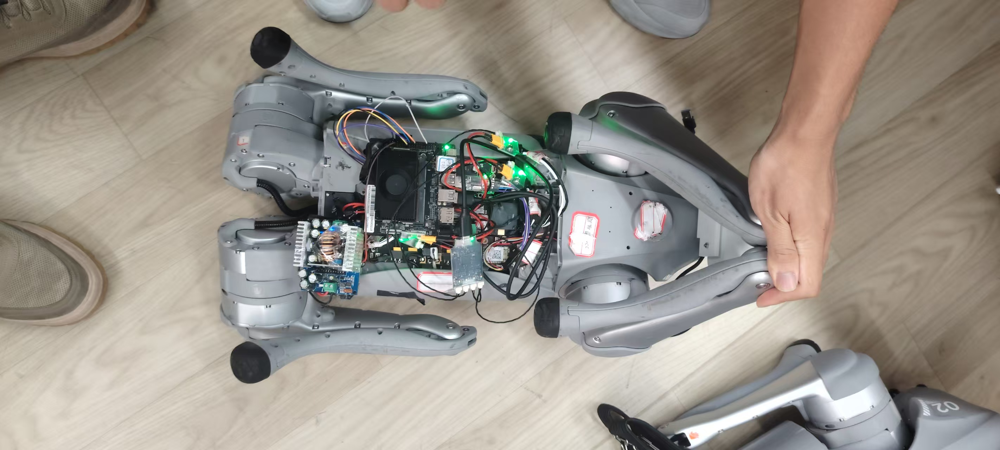
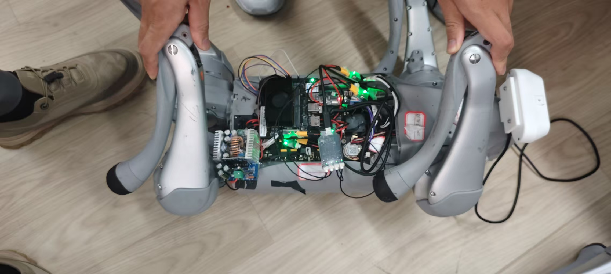

# Unitree Go2 quadruped robot

## 1. Overview

The Unitree Go2 solution runs ROS 2 control software on the SpacemiT K3. Linux on the main CPU cores performs ONNX policy inference, reads motor and IMU feedback, and sends control targets to the 12 joint motors. A mobile web interface, an Android client, and an SBUS remote controller provide mode selection and velocity commands.

The application repository is [spacemit-robotics/unitree-go2](https://github.com/spacemit-robotics/unitree-go2). Its SDK path is `application/ros2/unitree-go2`, and its ROS 2 package name is `unitree_go2`. Inference and peripheral access use shared SDK components. All robots use the same startup command, with each board's identity, board profile, and calibration stored in `/etc/unitree-go2/robot.yaml`.

### 1.1 System components

```text
Android / web interface                  SBUS remote
          |                                  |
          v                                  v
    Web server node                    SBUS input node
          |                                  |
          +----------------+-----------------+
                           v
                 Go2 control node (ROS 2) <--> Shared RL component
                 Modes, state, and motion      ONNX policy inference
                           |  ^
                   Targets |  | Feedback
                           v  |
                  Shared peripheral components
                       motor / imu / led
                           |  ^
                           v  |
                    Go2 motors and sensors
```

Flat-ground walking, rough-terrain locomotion, sitting, forward jumping, and waving use ONNX policies. The application implements standing, crouching, and self-righting. The web interface also provides a white-light switch and a camera preview.

The SBUS input node reads remote-controller data through `components/peripherals/rc_receiver`. The application handles Go2-specific modes and joint mappings. The shared drivers handle device communication.

The web server handles pages, network management, and user requests. It sends mode requests and velocity commands to the C++ controller through ROS 2. The controller runs motor control continuously. Phones and PCs use the same web interface, and the Android client also connects to the board's service.

### 1.2 Control and policy inference

The controller converts motor and IMU feedback into joint positions, velocities, and body orientation, then assembles observations for the active mode. Locomotion policies use body angular velocity, gravity direction, velocity commands, joint state, and the previous action. Waving, sitting, and forward jumping also use their respective reference-motion data.

ONNX outputs pass through joint-order mapping, action scaling, and position limits before becoming motor targets. `config/policies.yaml` defines each model's observation layout, joint mapping, and proportional and derivative (PD) gains. Check these parameters when replacing a model. An unchanged filename does not establish that the input and output conventions match.

Control and policy inference use separate ROS 2 callback groups, with timer periods of 1 ms and 20 ms respectively. The control task checks state and handles motor targets. The inference task updates policy actions at approximately 50 Hz. These are scheduling periods; actual execution rates depend on system load and device communication.

### 1.3 Application directories

```text
application/ros2/unitree-go2/
├── src/                  # ROS nodes, mode control, policy adaptation, and hardware integration
├── launch/               # Merge board-local configuration and start ROS 2 nodes
├── config/               # Shared parameters, board profiles, policy manifest, and service template
├── policy/               # Downloaded ONNX models
├── resources/motions/    # Reference motions used by policies
├── clients/web/          # Web pages served by the board
├── scripts/              # Startup, model download, web server, and network management
└── tool/calibration/     # XYZ calibration tool and pose references
```

Daily operation mainly uses the startup script, board-local configuration, and web interface. To connect another control program, use the ROS 2 interfaces in section 5.8. For model changes or hardware adaptation, refer to the corresponding configuration and source files.

## 2. Hardware preparation

### 2.1 Hardware checklist

| Hardware | Purpose |
| --- | --- |
| Unitree Go2 body | Four legs with 12 joint motors in total |
| K3 / CoM260 controller and matching Go2 carrier board | Run Linux, ROS 2, policy inference, and motor communication |
| BMI270 IMU | Provide body orientation and inertial measurements |
| SBUS receiver and matching remote controller | Select modes, control velocity, and brake |
| Wi-Fi network and a phone or PC | Connect to the web interface or Android client |

The main procedure uses the `new_bigcore` board profile. Linux communicates with the motors through the onboard UARTs, reads the onboard BMI270, and receives SBUS data on UART7. The system image, device tree, and carrier-board wiring must match this profile. See [System flashing](../02-快速入门/2.2-镜像烧录.md) for image installation.

The camera is optional. The current web preview selects a Tstc USB Full HD Camera with USB ID `1bcf:28c4`. Motion control, the web interface, and the remote controller remain available without a camera. Other camera models require changes to device selection and capture settings in the web server.

### 2.2 New-board wiring for main-core control

Leg positions refer to the robot's own front, rear, left, and right. The fixed application order is FR (front right), FL (front left), RR (rear right), and RL (rear left). Each leg has a hip, thigh, and calf motor, with motor IDs 0, 1, and 2 respectively.

| Logical position | Carrier-board label / connector | Linux device |
| --- | --- | --- |
| FR, front-right leg | LB / J18, UART8 | `/dev/ttyS8` |
| FL, front-left leg | RB / J19, UART5 | `/dev/ttyS5` |
| RR, rear-right leg | LF / J16, UART6 | `/dev/ttyS6` |
| RL, rear-left leg | RF / J17, UART3 | `/dev/ttyS3` |
| BMI270 | U50, SSP1 | `/dev/iio:device0` |
| SBUS receiver | J22, UART7 RX | `/dev/ttyS7` |
| Status lights | J13, white / orange / red / green | Hardware PWM associated with each platform device |

Use the table above to map the carrier-board labels to the logical leg positions. The onboard SBUS receive circuit already includes signal inversion. Keep only one controller active on the motor bus. Stop other controllers and diagnostic programs before allowing the K3 to control the motors.

Board wiring is defined under `board_profiles` in `config/robot.yaml`. The board-local `/etc/unitree-go2/robot.yaml` overrides shared defaults for device paths and IMU mounting compensation.

## 3. Software setup

### 3.1 Download the required SDK groups

Run these commands as root on the K3, using `/root/spacemit_robot` as the SDK directory and `new_bigcore` as the board profile. See [Build and compile](../02-快速入门/2.3-构建编译.md) for the system image and base environment. For a regular user, replace the working directory and use `sudo` to manage system configuration and services.

Install the download tools. When configuring Git for the first time, replace the name and email with your own:

```bash
apt update
apt install -y repo git curl
git config --global user.name "Your Name"
git config --global user.email "you@example.com"
```

Download the selected groups into a new working directory:

```bash
mkdir -p /root/spacemit_robot
cd /root/spacemit_robot
repo init -u https://github.com/spacemit-robotics/manifest.git -b main -m default.xml \
  --repo-url=https://gitee.com/spacemit-robotics/git-repo \
  -g core,model_zoo_rl,peripherals,unitree-go2
repo sync -j4
```

`-g` selects the SDK core repositories, RL inference, peripheral components, and the Go2 application without downloading the full SDK. `peripherals` includes the repositories in the peripheral group. The Go2 target selects the motor, IMU, SBUS, and LED components for the build. Cloning only the application repository is insufficient for an SDK build.

For an existing full SDK, keep its current groups and run `repo sync -j4` in that directory to update it. To edit source in a new workspace, run `repo start robot-dev --all` after synchronization to create development branches. If a download is interrupted, rerun `repo sync -j4` to resume it.

After synchronization, the main required paths are:

```text
build/
scripts/
target/k3-com260-unitree-go2.json
application/ros2/unitree-go2/
components/model_zoo/rl/
components/peripherals/motor/
components/peripherals/imu/
components/peripherals/rc_receiver/
components/peripherals/led/
```

`lunch` reads build targets from `target/`. Check that the paths above exist before running it.

### 3.2 Software dependencies

The K3 uses ROS 2 Humble and a SpacemiT ONNX Runtime package that matches the system. See [Reinforcement learning](../04-AI与算法/4.3-强化学习.md) for inference-environment installation. Go2 uses ONNX policies.

Install these system dependencies for the web interface, network management, and service discovery:

```bash
apt update
apt install -y python3-yaml python3-numpy python3-dbus \
  python3-aiortc network-manager avahi-daemon psmisc
```

The SDK build environment and the application's `package.xml` manage ROS 2 and component dependencies. NetworkManager manages Wi-Fi, and Avahi provides local-network service discovery. `psmisc` provides `fuser`, which the calibration tool uses to check whether a motor port is busy.

Camera preview also requires K3 FFmpeg with the `h264_stcodec` encoder and [MediaMTX for riscv64](https://github.com/Fitz8863/spacemit-mediamtx/releases/tag/v1.20.1-riscv64). Place `mediamtx` in `/usr/local/bin/`. The web button starts and stops the preview. A separate MediaMTX configuration file is not required.

### 3.3 Prepare the models

The models are published in the [SpacemiT model archive's unitree-go2 directory](https://archive.spacemit.com/spacemit-ai/model_zoo/rl/unitree-go2/). Downloaded files are stored in the application's `policy/` directory. The `model_manifest` in `config/policies.yaml` records the file list, sizes, and SHA-256 hashes. Reference motions and policy parameters are included in the application source.

| Function | ONNX file |
| --- | --- |
| Flat-ground walking | `go2_blind_rough.onnx` |
| Rough-terrain locomotion | `go2_terrain.onnx` |
| Waving | `go2_wave.onnx` |
| Forward jumping | `go2_forward_jump.onnx` |
| Sitting | `go2_sit.onnx` |

Download and verify the models from the SDK root on the K3:

```bash
cd /root/spacemit_robot
python3 application/ros2/unitree-go2/scripts/download_models_go2.py
```

Successful verification prints `Verified 5 files`. The models are stored in `application/ros2/unitree-go2/policy/`. The script skips files that already pass verification.

`config/policies.yaml` defines policy parameters and records model sources. `resources/motions/` contains reference trajectories. Both are installed when the application is built. Copyright and license information is in the application's `NOTICE` and `LICENSE` files. Project-trained weights use Apache-2.0, and the third-party rough-terrain weights use MIT.

### 3.4 Build and install

```bash
cd /root/spacemit_robot
source build/envsetup.sh
lunch k3-com260-unitree-go2
m
sros2_setup
ros2 pkg prefix unitree_go2
```

The final command should print the SDK installation prefix. The build installs the models to `output/staging/share/unitree_go2/policy/`. After adding or replacing models in the source directory, rebuild and install the application.

For later changes limited to the Go2 application, use an incremental package build:

```bash
cd /root/spacemit_robot
source build/envsetup.sh
lunch k3-com260-unitree-go2
cd application/ros2/unitree-go2
mm -j4
```

If shared components such as RL or motor have also changed, run `mm --with-deps -j4` from the application directory. This builds the dependencies before installing the application. Restart Go2 after the build to load the updated installation.

## 4. Board-local configuration and calibration

### 4.1 Configuration files

`config/robot.yaml` contains shared control parameters, board wiring, and reference values from a sample robot. Each robot's identity, ROS domain, and measured calibration are stored in `/etc/unitree-go2/robot.yaml`. Code updates and builds preserve this board-local file.

At startup, the launch file reads shared defaults and the selected `board_profiles` entry, then overrides matching fields with board-local `go2.ros__parameters`. Identity and the ROS domain come from the board-local `robot` fields. Explicit launch arguments can override their corresponding settings. Startup with real hardware validates local identity and both calibration arrays. Calibration from the sample robot does not fill missing local fields.

Policy and hardware settings are maintained separately. `config/policies.yaml` describes models, observations, and action mapping. `config/robot.yaml` describes control settings and board profiles. The board-local YAML stores differences between robots. Identity and network changes usually require a local-file edit and a restart. Model or shared-configuration changes require rebuilding and installation.

For a new robot, create a separate board-local configuration. These commands preserve an existing file:

```bash
if [[ ! -e /etc/unitree-go2/robot.yaml ]]; then
  install -D -m 600 /dev/null /etc/unitree-go2/robot.yaml
  cat > /etc/unitree-go2/robot.yaml <<'YAML'
robot:
  id: go2
  name: Go2
  ros_domain_id: 220
  board_profile: new_bigcore
  wifi_connection: ''
  ap_ssid: Go2
go2:
  ros__parameters:
    joint_zero_offsets_rad: []
    startup_reference_rotor_positions_rad: []
YAML
fi
```

Edit these fields after creating the file:

| Field | Value to set |
| --- | --- |
| `robot.id`, `robot.name` | The robot's unique identifier and display name |
| `robot.ros_domain_id` | A separate ROS 2 domain for each robot on the same network |
| `robot.board_profile` | The profile matching the wiring and firmware, normally `new_bigcore` |
| `robot.wifi_connection` | Leave empty to keep the current Wi-Fi connection, or name a preferred connection already saved on the system |
| `robot.ap_ssid` | The network name used in access-point mode |
| `go2.ros__parameters` | Board-local motor calibration, device paths, and IMU mounting compensation |

Both motor-calibration arrays in this new-robot configuration are empty. Complete XYZ calibration before starting real motor control. The application's `config/robot.yaml` contains motor and IMU calibration from a sample robot. Do not apply those values directly to another robot.

When board-local IMU compensation is absent, `new_bigcore` uses its nominal mounting orientation. Check the actual IMU mounting before entering board-local compensation. The XYZ tool updates motor calibration only; it does not calculate IMU compensation.

Robots with an existing configuration continue to use the board-local file. Set `GO2_LOCAL_CONFIG` to use another board-local configuration path.

The two motor-calibration arrays have different roles. `joint_zero_offsets_rad` is used when converting motor rotor angles to joint angles. `startup_reference_rotor_positions_rad` stores the rotor references for Pose A, which establish the position reference for the current run. Each array contains 12 values in radians, ordered FR, FL, RR, RL, with hip, thigh, and calf joints for each leg. Generate both arrays together with the XYZ tool, keeping each value matched to its motor and leg.

### 4.2 Interactive Pose X/Y/Z calibration

Stop the Go2 control program and other programs using the motor ports. Support the robot's body before starting calibration. If the startup service is installed, stop it first:

```bash
systemctl stop go2.service
```

```bash
cd /root/spacemit_robot
source build/envsetup.sh
sros2_setup
python3 output/staging/lib/unitree_go2/tool/calibration/calibrate_robot.py
```

The tool prompts for Pose X, Pose Y, and Pose Z in sequence. Set the pose and keep the robot still, then press Enter. Recording starts after a 5-second countdown. Keep the pose throughout sampling.

For each motor involved in a pose, the default sample count is 20 new, valid BRAKE feedback frames. The tool checks the feedback ID, error code, timestamp, and angle stability. A timeout on the first request is retried up to three times; retries do not count toward the valid frames. Persistent timeouts, invalid feedback, or an unstable pose fail the current capture. The terminal prompts you to set the pose again and retry. Detailed errors are saved in that capture directory's logs.

| Phase | Joints sampled |
| --- | --- |
| Pose X | Thigh and calf joints on all four legs, 8 motors |
| Pose Y | Front-left and rear-left hip joints, 2 motors |
| Pose Z | Front-right and rear-right hip joints, 2 motors |

Pose X:



Pose Y:


Pose Z:



Use the photos to set each pose. The reference angles are defined in `tool/calibration/calibration_pose_xyz.yaml`.

After all three captures pass validation, the terminal tells you to release your hold and place the robot securely. It then displays the old and new zero offsets and startup rotor references for all 12 joints. Results and raw samples are saved in `output/calibration/poseXYZ-<timestamp>/`.

Enter `yes` to apply the calibration. The tool updates only `joint_zero_offsets_rad` and `startup_reference_rotor_positions_rad` in the board-local YAML, preserving identity, network, and other settings. Press Enter without a confirmation to save the result without applying it. During pose setup, enter `q` or press `Ctrl+C` to exit. Confirmed calibration takes effect on the next startup.

### 4.3 Pose A for startup

Before every startup, return all four legs to the Pose A crouch defined by the configuration. Hold the pose until startup finishes. When using the boot service, set Pose A before powering on the board. The program uses this pose to establish the motor rotor-position reference for the current run. X/Y/Z are calibration poses; return the robot to Pose A after calibration.


After replacing a motor, reassembling the robot, or changing the IMU mounting, check the board-local calibration and mounting compensation again. See `tool/calibration/CALIBRATION.md` in the application for separate capture phases and offline merging commands.

## 5. Operation

### 5.1 Start the program and use the web interface

After board-local configuration and calibration are complete, start the program on the K3. Set the Pose A crouch from section 4.3 before every startup.
If the boot service is enabled, run `systemctl stop go2.service` before starting the program manually.

```bash
cd /root/spacemit_robot
bash application/ros2/unitree-go2/scripts/start-go2.sh
```

The program uses the current Wi-Fi connection by default. Connect the phone or PC to the same network and open the [control page](http://go2-sdk.local:8082/).
Select the robot at the top right. You can also open `http://BOARD_IP:8082/`.
On an Android phone, [download and install the Go2 app](https://archive.spacemit.com/ros2/prebuilt/unitree-go2/go2-web.apk).
Use the camera button in the web interface to open the preview.

On the first connection, check that the intended robot is selected at the top right. A loaded page confirms that the web server is reachable. Use the connection indicator and startup-terminal logs to check whether the controller is ready.

Operate the web interface in this order:

1. To use web control, select the remote controller's web-control slot, or turn off the remote controller and wait for control to transfer.
2. Use **Stand** and **Crouch** for fixed poses. Select **Flat-ground walking** or **Rough-terrain locomotion** before using the joysticks. The left joystick controls forward, backward, and sideways movement. The right joystick controls turning.
3. Releasing a joystick returns its velocity command to zero while retaining the current motion mode. To rest, select **Normal rest**. The program completes the current motion's exit sequence, crouches, and enters passive mode.
4. To interrupt the current motion, select **Emergency brake**. The program skips the motion's exit sequence and proceeds directly to crouching and passive mode.

Sitting is a policy-driven motion, while crouching uses fixed-pose control. **Self-righting** recovers from a fallen pose. The **Navigation** and **AI** buttons select external velocity inputs. Path planning and AI decision programs must be connected separately.

To stop the program, let the robot crouch first, then press `Ctrl+C` in the startup terminal.

### 5.2 Connect through a hotspot

Stop the current Go2 program, then start it in access-point mode as a transient systemd service. The program keeps running if the network switch disconnects SSH:

```bash
systemd-run --unit=go2-ap --collect \
  --working-directory=/root/spacemit_robot \
  --property=KillSignal=SIGINT --property=KillMode=mixed \
  --property=TimeoutStopSec=50 \
  --setenv=SROBOTIS_ROOT=/root/spacemit_robot \
  --setenv=GO2_NETWORK_MODE=ap \
  /bin/bash /root/spacemit_robot/application/ros2/unitree-go2/scripts/start-go2.sh
```

The hotspot name comes from `robot.ap_ssid` in the board-local configuration. The reference value is `Go2`, and the default password is `go2control`.
After connecting, open the [hotspot control page](http://10.0.91.250:8082/).

To stop the transient hotspot service, connect the PC to the hotspot and log in with `ssh root@10.0.91.250`.
Run `systemctl stop go2-ap.service`. The program attempts to restore the previous Wi-Fi connection.
If the stop command reports that the transient service is not loaded, the program has already exited. View logs with `journalctl -u go2-ap.service -f`.
For regular hotspot use, install the boot service below and switch it to access-point mode.

### 5.3 Start automatically at boot

Stop any manually started Go2 program and set Pose A before installing and starting the service.
If the SDK is in a different directory, update `SROBOTIS_ROOT`, `WorkingDirectory`, and `ExecStart` in the service file first.

```bash
cd /root/spacemit_robot
install -m 644 application/ros2/unitree-go2/config/systemd/go2.service /etc/systemd/system/go2.service
systemctl daemon-reload
systemctl enable --now go2.service
```

The service uses Wi-Fi by default. Run these commands from the SDK root to save a network mode and restart the service:

| Network mode | Command |
| --- | --- |
| Hotspot | `bash application/ros2/unitree-go2/scripts/start-go2.sh --switch ap` |
| Wi-Fi | `bash application/ros2/unitree-go2/scripts/start-go2.sh --switch wifi` |

| Service management | Command |
| --- | --- |
| Check status | `systemctl status go2.service` |
| View logs | `journalctl -u go2.service -f` |
| Stop the program | `systemctl stop go2.service` |
| Start the program | `systemctl start go2.service` |
| Disable boot startup and stop | `systemctl disable --now go2.service` |

### 5.4 Change Wi-Fi through the serial console

Connect the K3 debug port (UART0 / Console) to a Linux PC. On the Go2 carrier board, connect pins to the same labels on the USB-to-serial adapter:
**RX to RX, TX to TX, and GND to GND**.

1. Find the serial device on the PC and open it. Replace `/dev/ttyUSB0` with the actual device:

   ```bash
   ls -l /dev/serial/by-id/
   sudo minicom -D /dev/ttyUSB0 -b 115200 -8
   ```

   If minicom is not installed, run `sudo apt install minicom`. Press `Ctrl+A`, then `O`, to open the serial settings.
   Use `115200 8N1` and disable hardware and software flow control. Press Enter to log in. The default username is `root`, and the password is `bianbu`.
   Use the new password if it has been changed. Password input is not echoed.

2. Stop Go2 from the board's serial terminal. For the service, run `systemctl stop go2.service`.
   For a manually started instance, stop that program first. Scan for Wi-Fi networks and connect:

   ```bash
   nmcli radio wifi on
   nmcli device wifi rescan
   nmtui connect
   ```

   Use the arrow keys to select a network, press `Tab` to select **Activate**, and enter the password. Exit nmtui after the connection succeeds.
   If the network list has not refreshed, exit nmtui, scan again, and reopen it.

3. Check the connection name, enable automatic connection, and find the IP address:

   ```bash
   nmcli -f DEVICE,TYPE,STATE,CONNECTION device status
   nmcli connection modify "Wi-Fi connection name" connection.autoconnect yes connection.autoconnect-priority 100
   ip -br addr
   ```

   Replace `Wi-Fi connection name` with the `CONNECTION` value for the connected wireless interface.
   Note its IPv4 address. For example, the address in `192.168.1.80/24` is `192.168.1.80`.
   Leave `robot.wifi_connection` empty in `/etc/unitree-go2/robot.yaml` to keep the current connection.
   If it names the old network, clear only that field and preserve the remaining configuration.

4. Connect the PC to the same Wi-Fi network, then log in from a new terminal using the board's IP address:

   ```bash
   ssh root@192.168.1.80
   ```

   Set Pose A and start Go2 as described in section 5.1. If using the boot service, run the Wi-Fi switching command from the previous section.
   The serial cable can then be disconnected while control continues through the web interface or app.

### 5.5 Remote controller

The left stick controls forward, backward, and sideways movement. The horizontal axis of the right stick controls turning.
Keep B off. Use F and E to select a mode, then set H to the middle position and press C to enter it:

| F | E | Mode |
| --- | --- | --- |
| Low | Low | Rough-terrain locomotion |
| Low | Middle | Waving |
| Low | High | Sitting |
| Middle | Low | Web control; no C press required |
| High | Low | Forward jumping |
| High | High | Flat-ground walking |

| Operation | Control |
| --- | --- |
| Stand / crouch | Set G to the high / low position and keep it there for 0.5 seconds |
| Normal rest | Set H to the middle position and press D. The robot completes the exit sequence for the current motion, crouches, and enters passive mode |
| Emergency brake | H high + D. The robot crouches and enters passive mode without waiting for the current motion's exit sequence |
| Self-righting | While passive or crouching, set H to the low position and keep it there for 0.5 seconds |
| Toggle the white light | H high + C |

In the web-control slot, the web interface controls the robot. The remote controller retains emergency braking and white-light control. Selecting another slot restores remote control.
Turning off the remote controller or losing its connection for a sustained period also transfers control to the web interface. The crouch selected by G differs from the sit motion in the mode table.

### 5.6 Terminal control

Keep the Go2 program running. Open another terminal on the board, then load the environment and the board-local ROS domain:

```bash
cd /root/spacemit_robot
source build/envsetup.sh
sros2_setup
go2_config="${GO2_LOCAL_CONFIG:-/etc/unitree-go2/robot.yaml}"
export ROS_DOMAIN_ID="$(python3 -c 'import sys,yaml; print(yaml.safe_load(open(sys.argv[1]))["robot"]["ros_domain_id"])' "$go2_config")"
```

For example, switch to standing:

```bash
ros2 service call /go2/set_mode unitree_go2/srv/SetMode '{mode: stand}'
```

Common mode names are listed below. Use the exact lowercase values:

| `mode` | Operation |
| --- | --- |
| `stand` | Stand |
| `crouch` | Crouch |
| `walk` | Flat-ground walking with velocity input |
| `terrain` | Rough-terrain locomotion with velocity input |
| `navigation` | Flat-ground walking with external `/cmd_vel` input |
| `ai_agent` | Flat-ground walking with external `/cmd_vel_ai` input |
| `wave` | Wave |
| `sit` | Sit motion |
| `forward_jump` | Forward jump |
| `rollover` | Self-righting |
| `passive` | Normal rest, completing the motion's exit sequence first |
| `passive_direct` | Emergency brake, skipping the motion's exit sequence |

The service returns `accepted` and `message`. `accepted: true` means that the request was accepted. A standing transition or motion may still be running. Read `/go2/status` for the current mode and reason. If a request is rejected, read `message` and check control ownership, device state, and policy-loading results.

For continuous velocity commands from a terminal, use `navigation` mode and `/cmd_vel`. The controller selects this input so that periodic web joystick commands do not overwrite terminal commands. This mode uses the flat-ground walking policy. Request the mode first:

```bash
ros2 service call /go2/set_mode unitree_go2/srv/SetMode '{mode: navigation}'
```

After the request is accepted and the standing transition finishes, publish a low forward velocity continuously at 10 Hz. Keep only one velocity publisher on this topic:

```bash
ros2 topic pub -r 10 /cmd_vel geometry_msgs/msg/Twist \
  '{linear: {x: 0.1, y: 0.0}, angular: {z: 0.0}}'
```

`linear.x`, `linear.y`, and `angular.z` represent forward, sideways, and turning commands respectively. After this publisher stops, the velocity input times out and returns to zero, while the robot remains in walking mode. To rest, request normal rest, wait for the robot to crouch, then stop the main program:

```bash
ros2 service call /go2/set_mode unitree_go2/srv/SetMode '{mode: passive}'
```

### 5.7 Camera preview

Selecting **Open camera** starts FFmpeg capture and hardware H.264 encoding. MediaMTX delivers the video to the browser through WebRTC. The default preview is 640 × 360 at 30 fps. Closing the preview stops its processes. The controller runs motion control separately.

The camera starts on demand. No separate video service startup or video YAML editing is required for normal use. If the camera is disconnected or a dependency is missing, the page displays an error while other controls remain available.

In addition to web access on port 8082, the phone or PC needs access to TCP port 8889 and UDP port 8189 on the board for preview. If the page loads but video keeps connecting, check Wi-Fi client isolation, VPN routes, and firewall rules. See section 6.5 for device and encoder checks.

### 5.8 ROS 2 interfaces and status

In a terminal with the environment and ROS domain loaded as described in section 5.6, inspect nodes and feedback:

```bash
ros2 node list
ros2 topic echo /go2/status --once
ros2 topic hz /joint_states
```

The main interfaces are:

| Interface | ROS type | Purpose |
| --- | --- | --- |
| `/go2/set_mode` | `unitree_go2/srv/SetMode` | Change modes from a terminal or external program |
| `/cmd_vel_direct` | `geometry_msgs/msg/Twist` | Send velocity directly to the controller |
| `/cmd_vel` | `geometry_msgs/msg/Twist` | External velocity forwarded after selecting `navigation` |
| `/cmd_vel_ai` | `geometry_msgs/msg/Twist` | External velocity forwarded after selecting `ai_agent` |
| `/go2/status` | `std_msgs/msg/String` | JSON containing mode, control source, and device state |
| `/joint_states` | `sensor_msgs/msg/JointState` | State feedback for all 12 joints |
| `/go2/body_imu` | `sensor_msgs/msg/Imu` | Body IMU feedback |
| `/go2/toggle_white_light` | `std_srvs/srv/Trigger` | Toggle the white light |

In `/go2/status`, `mode` is the actual mode, `control_source` identifies web, remote, or terminal control, and `reason` describes the current control state. `startup_pose_invalid`, `imu_valid`, `imu_age_ms`, and each joint's `valid` and `feedback_age_ms` help distinguish startup-pose, IMU, and motor-feedback problems.

The reported control source reflects arbitration between web and remote control. Direct terminal input through `/go2/set_mode` and `/cmd_vel_direct` bypasses that arbitration. When connecting an external program, assign one velocity producer and avoid simultaneous input from multiple sources.

Navigation and AI inputs share the flat-ground walking policy. Select `navigation` or `ai_agent` through the mode service before the controller forwards the corresponding velocity topic. Switching inputs clears the previous velocity. The application provides input channels; external programs implement mapping, path planning, and AI decisions.

## 6. Troubleshooting

### 6.1 Missing models or verification failure

From the SDK root, run `python3 application/ros2/unitree-go2/scripts/download_models_go2.py --check`. Check the names, sizes, and hashes of all five models against the output. Run the download script again, then rebuild and install the application after verification passes.

### 6.2 Missing board-local configuration or invalid calibration arrays

Check that `/etc/unitree-go2/robot.yaml` exists. Check `robot.id`, `robot.ros_domain_id`, and both calibration arrays. Each array must contain 12 finite numbers. Complete interactive calibration on a new robot before starting control.

### 6.3 Missing motor feedback or startup-position verification failure

Check all four motor ports against the wiring table and verify motor IDs 0, 1, and 2 on each leg. Ensure that the control program, calibration tool, and boot service are not using the same ports at the same time. If startup-position verification fails, restore Pose A, then check the robot's calibration and rotor references.

### 6.4 Web access or remote-control input failure

Try the board's actual IP address on port 8082. Check that the phone and board can reach each other over the network. Hostname discovery also requires Avahi. For remote-controller input, check `/dev/ttyS7`, receiver power, and channel mapping. With B off, F in the middle, and E low, control belongs to the web interface.

The status light is green in passive or fixed-pose modes and orange in policy modes. Red indicates a failed check involving the startup pose, IMU, input connection, or loss of feedback from all motors. Read `light_fault` and `reason` in `/go2/status` to identify the cause. The light color does not describe an individual joint's state.

Before using ROS 2 commands to inspect topics or call services, load the ROS environment and SDK installation environment in the diagnostic terminal. Set `ROS_DOMAIN_ID` to the value in the board-local YAML.

### 6.5 Web controls work but camera video is missing

Read the error shown in the camera area first. If no device is recognized, check USB wiring, power, and the camera model. Current device selection requires USB ID `1bcf:28c4`. A `/dev/video*` entry alone does not establish that the intended RGB camera is connected, because the board's video codec also creates video nodes.

On the board, check the preview programs and hardware encoder:

```bash
command -v ffmpeg
command -v mediamtx
ffmpeg -hide_banner -h encoder=h264_stcodec
```

If the encoder is missing, install FFmpeg built for the K3 system. If MediaMTX fails to start, check that the binary is executable, that another video service is not using its ports, and that the web-server logs contain no startup error. If preview has started but the browser has no picture, check the network ports in section 5.7.

### 6.6 Configuration or model changes have no effect

Check whether the change is in the board-local file or application source. Restart the program after editing `/etc/unitree-go2/robot.yaml`. If `GO2_LOCAL_CONFIG` is set, check the file it selects. Rebuild and install shared configuration or model changes, then restart the running process.

Follow [section 5.6](#56-terminal-control) to enter the SDK root and run `source build/envsetup.sh` followed by `sros2_setup`. Then run `ros2 pkg prefix unitree_go2` and confirm that it uses the intended SDK installation. `start-go2.sh` uses an existing `SROBOTIS_ROOT` value, so check that variable when starting from a terminal used for another SDK. For the boot service, inspect the SDK paths and network-mode overrides with `systemctl cat go2.service`.
