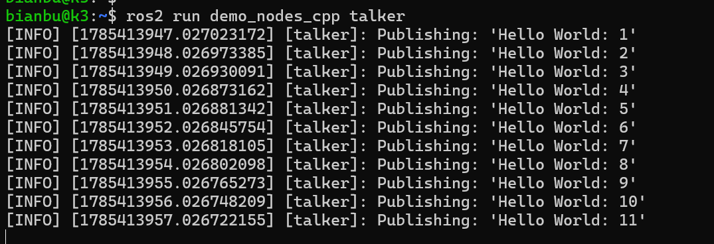
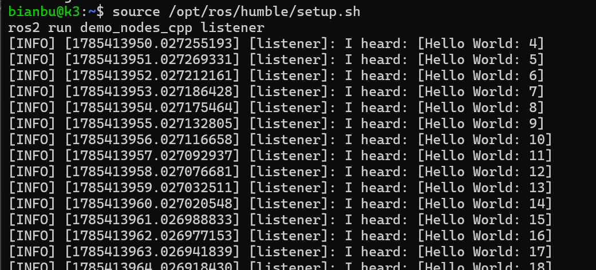
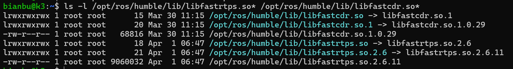

# ROS2 Installation

## Platform Requirements

Hardware: SpacemiT K3 RISC-V

Operating System: Bianbu 4.0.1 and above, Ubuntu 26.04

## About Software Sources

### Bianbu

SpacemiT Bianbu 4.0.1 and above firmware includes ROS2 software sources by default, no additional source configuration is needed.

Currently, the well-supported versions are Humble and Jazzy, both of which can install ros-$ROS_DISTRO-desktop. Humble is recommended.

Make sure the system is online and the time reported by `date` is synchronized, then run:

```bash
sudo apt update
```

Do not configure sources according to the official ROS2 documentation!

### Ubuntu 26.04

1. Import the Bianbu signing key on the Ubuntu host:

```
wget -P /tmp https://archive.spacemit.com/bianbu/bianbu-archive-keyring.gpg

sudo install -Dm644 /tmp/bianbu-archive-keyring.gpg \
  /etc/apt/keyrings/bianbu-archive-keyring.gpg
```

2. Add the suite that contains ROS:

```
sudo tee /etc/apt/sources.list.d/bianbu-ros2.sources >/dev/null <<'EOF'
Types: deb
URIs: https://archive.spacemit.com/bianbu4/
Suites: resolute-porting
Components: main universe
Architectures: riscv64
Signed-By: /etc/apt/keyrings/bianbu-archive-keyring.gpg
EOF
```

3. Configure package pinning:

```
sudo tee /etc/apt/preferences.d/bianbu-ros2 >/dev/null <<'EOF'
Package: ros-humble-* ros-jazzy-*
Pin: release o=Bianbu,n=resolute-porting
Pin-Priority: 700

Package: python3-rosdistro-modules libignition-math6 libignition-math6-dev libignition-cmake2-dev
Pin: release o=Bianbu,n=resolute-porting
Pin-Priority: 100

Package: ros-dev-tools ros-build-essential python3-bloom python3-rosdep python3-rosdep-modules python3-rosdistro python3-colcon-common-extensions python3-colcon-mixin python3-colcon-powershell
Pin: release o=Bianbu,n=resolute-porting
Pin-Priority: 100

Package: opencv-spacemit libavutil59 libswresample5 libswscale8
Pin: release o=Bianbu,n=resolute-porting
Pin-Priority: 100

Package: *
Pin: release o=Bianbu
Pin-Priority: -1
EOF
```

4. Refresh the package index:

```
sudo find /var/lib/apt/lists -maxdepth 1 -type f \
  -name '*_Packages' -empty -delete

sudo apt-get update --error-on=any
```

Once the update completes successfully, you can install ROS2.

## Installation

### Install Development Tools (Recommended)

If you need to compile ROS2 packages or perform secondary development, it is recommended to install the development toolset:

```bash
sudo apt update && sudo apt install ros-dev-tools
```

This will install necessary tools such as colcon.

### Install ROS-Base

The base version includes ROS communication libraries, message interfaces, command-line tools, and other core components, but does not include GUI tools:

Humble version is recommended:

```bash
sudo apt install ros-humble-ros-base
```


### Load ROS2 Environment Variables

```bash
source /opt/ros/humble/setup.sh
```


## Publish/Subscribe Example

```bash
sudo apt install ros-humble-demo-nodes-cpp
```

Terminal 1

```bash
source /opt/ros/humble/setup.sh
ros2 run demo_nodes_cpp talker
```

Output:



Terminal 2:

```bash
source /opt/ros/humble/setup.sh
ros2 run demo_nodes_cpp listener
```

Output



## rviz2 Usage Notes

```bash
sudo apt install ros-humble-desktop
```

Start it:

```bash
source /opt/ros/humble/setup.bash
rviz2
```

**If startup fails on Humble, try importing this in the terminal:**

```bash
export QT_QPA_PLATFORM=xcb
```

**If startup fails on Jazzy, try importing this in the terminal:**

```bash
export __GLX_VENDOR_LIBRARY_NAME=mesa
```

rviz2 has high resource consumption. Use it only when validating on the board.


## DDS Notes

K3 ROS2 Humble uses `fastdds` by default.

**Humble**

Fast DDS / Fast RTPS: 2.6.11
Fast CDR: 1.0.29

```bash
ls -l /opt/ros/humble/lib/libfastrtps.so* /opt/ros/humble/lib/libfastcdr.so*
```



If you need to customize fastdds, pay attention to version compatibility.
