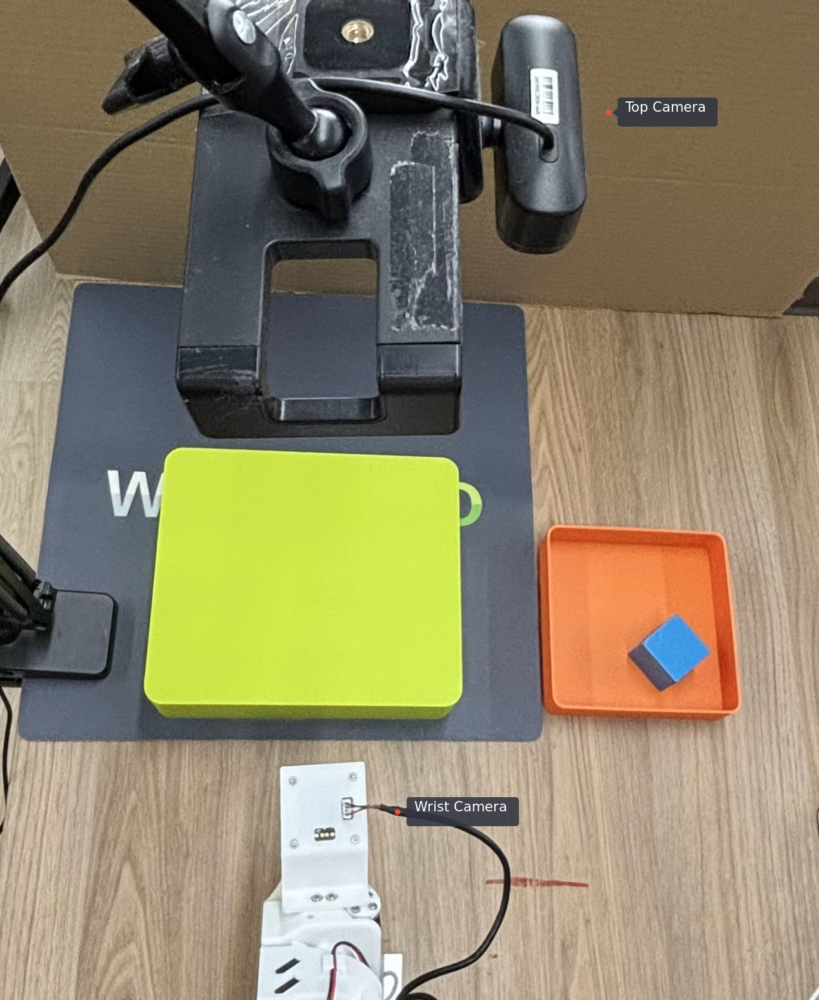
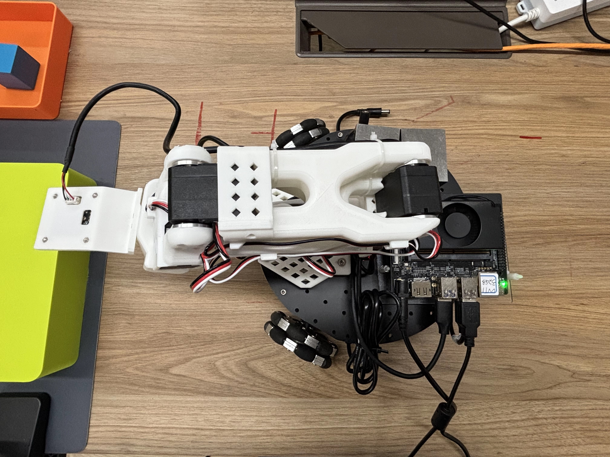
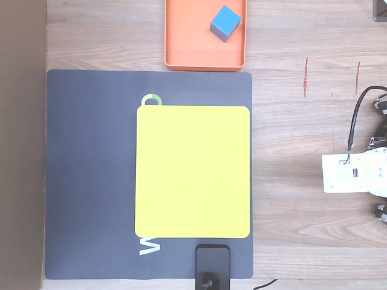
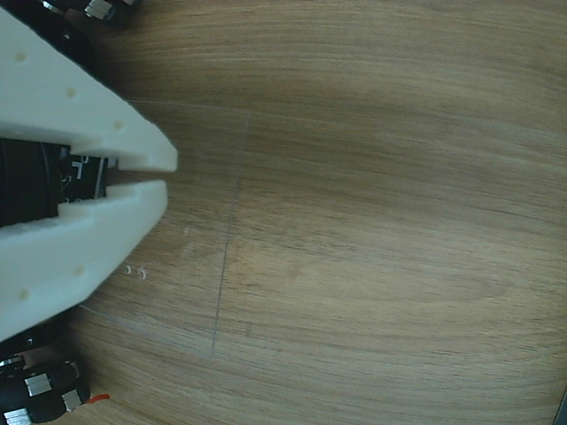
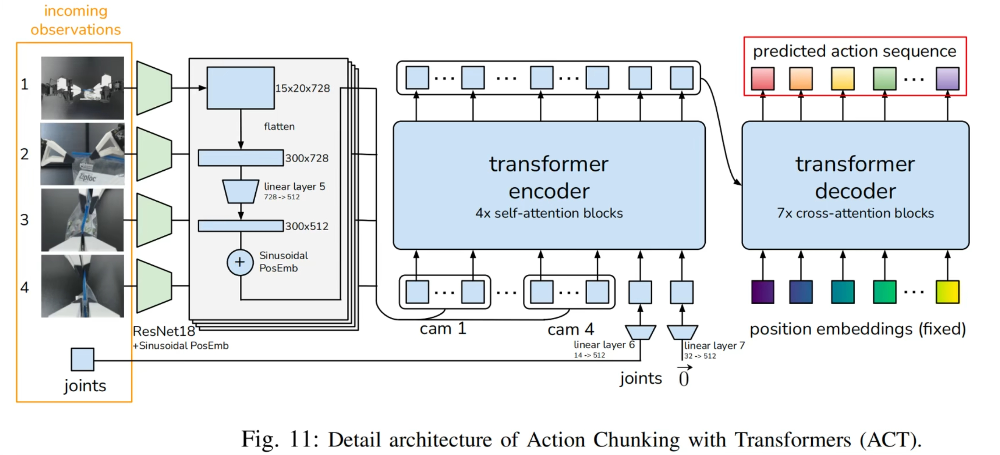
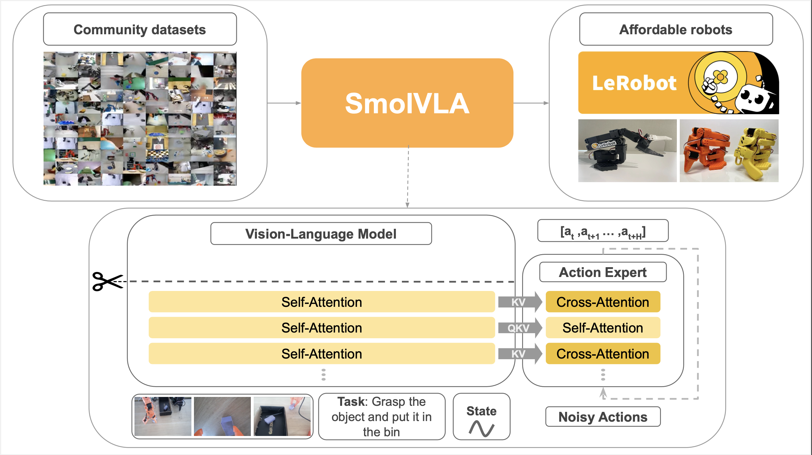
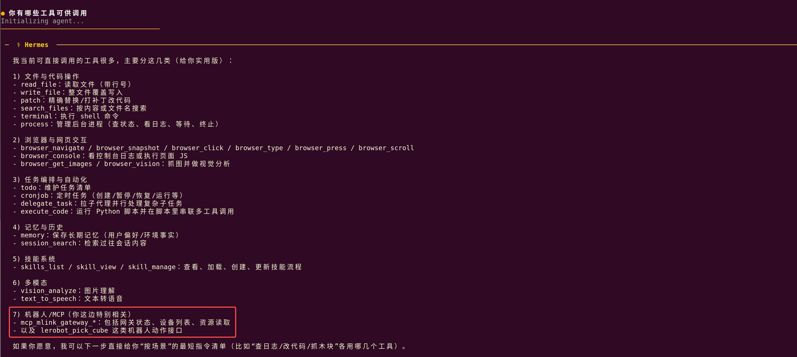

# LeRobot 真机推理训练

本文覆盖 LeRobot SO101 机械臂在 Spacemit K3 上的数采、训练、推理与自然语言控制全链路，共三个场景：ACT/SmolVLA 模型训练到推理、把抓取能力封装为 MCP 工具由 Hermes 自然语言触发、ACT FP16 加速部署。

## 1. 方案概述

- **校准与数采**：机械臂校准、遥操作、数据采集；
- **ACT 训练与部署**：GPU 服务器训练，K3 本地推理；
- **SmolVLA 微调与分布式推理**：服务器微调，通过 gRPC 分布式推理驱动板端机械臂；
- **MCP 工具封装**：把抓取流程封装为 C++ 原生应用，经 `mlink device → mlink gateway → MCP` 注册为工具；
- **Hermes 自然语言控制**：Hermes 调用 `lerobot.pick_cube` 触发抓取。

## 2. 硬件清单

| 项目 | 内容 |
| --- | --- |
| 训练平台 | 一台配置 RTX 系列及以上 GPU 的服务器 |
| 数采平台（可选） | 推荐 PC，可视化数采必须 |
| 本地环境 | Spacemit K3 开发板 + bianbu v3.0+ 固件 |
| 机械臂 | SO101 双臂（主导臂 + 随从臂）；自然语言调用场景只需要 SO101 随从臂 |
| 视觉输入 | 两个 USB 相机，本文布置为 top 全局视角和 wrist 腕部视角 |
| 关键接口 | 机械臂串口通常为 `/dev/ttyACM*`，相机设备通常为 `/dev/video*` |

确认机械臂与相机已上电接入 K3：`lerobot-find-port` 检查串口，`lerobot-find-cameras opencv` 查看相机索引。

抓取场景和硬件连接如图所示：





## 3. 环境搭建

三类环境按流程选装：训练环境在 GPU 服务器，数采环境建议放在 PC（视频编解码更快），开发板本地环境在 K3 上跑 ACT 推理、`mlink device` 和 Hermes 调用。用到哪个流程，就在对应平台下载代码并装依赖。

### 3.1 下载源码

```bash
#克隆 Spacemit 版本代码，基于 LeRobot v0.5.0 适配，集成了 Linksee 等机器人能力
git clone git@github.com:spacemit-robotics/lerobot.git
```

### 3.2 安装系统依赖

```bash
sudo apt update
sudo apt install ffmpeg
sudo apt install -y \
  libavformat-dev \
  libavcodec-dev \
  libavdevice-dev \
  libavutil-dev \
  libavfilter-dev \
  libswscale-dev \
  libswresample-dev

sudo apt install -y \
  build-essential \
  cmake \
  pkg-config \
  python3-dev
```

`ffmpeg` 用于视频帧处理和数据集视频编码。

### 3.3 uv 安装和使用

K3 使用 Bianbu v3+ 固件时系统 Python 为 3.14，而 LeRobot 使用的 Spacemit PyTorch wheel 基于 3.12 构建，因此用 `uv` 装 Python 3.12 并建虚拟环境。平台说明见[进迭时空 Python 开发文档](https://www.spacemit.com/community/document/info?lang=zh&nodepath=software/SDK/bianbu/development/python.md)，完整命令见 [uv 官方文档](https://docs.astral.sh/uv/)。

1. 安装 `uv`：

```bash
curl -LsSf https://astral.sh/uv/install.sh | sh
```

重新进入终端，或在当前终端 `source "$HOME/.local/bin/env"` 加载。

2. 用 Python 3.12 创建虚拟环境，`--seed` 预装 pip：

```bash
cd ~/lerobot
uv venv ~/.lerobot-venv --python 3.12 --seed
source ~/.lerobot-venv/bin/activate
python -V
python -m pip --version
```

### 3.4 设置 Python 包索引

激活环境后为其 pip 设置 Aliyun 主索引和进迭时空附加索引：

```bash
source ~/.lerobot-venv/bin/activate
python -m pip config --site set global.index-url https://mirrors.aliyun.com/pypi/simple
python -m pip config --site set global.extra-index-url https://git.spacemit.com/api/v4/projects/33/packages/pypi/simple
python -m pip config --site list
```

`--site` 只写入当前虚拟环境，不动系统 Python。后续统一用 `python -m pip`，确保包装进已激活的 3.12 环境。

### 3.5 安装 Python 依赖

```bash
cd ~/lerobot

# 激活 3.3 节创建的虚拟环境
source ~/.lerobot-venv/bin/activate

# 安装 PyTorch 和运行时依赖
python -m pip install \
  torch==2.7.1 \
  torchvision==0.22.0 \
  wandb==0.24.0 \
  pyarrow==23.0.0

# 以 editable 模式安装 LeRobot 和 Feetech 依赖
python -m pip install -e ".[feetech]"

python -m pip check
```

训练或推理 SmolVLA 时，还需安装：

```bash
python -m pip install -e '.[smolvla,async]'
```

## 4 场景一：ACT/SmolVLA 模型训练到推理

覆盖 SO101 从真机校准、遥操作、数据采集，到模型训练和部署的完整流程。

### 4.1 复现步骤

#### 4.1.1 机械臂校准

1. 接好主导臂、随从臂的电源和 USB 口，查询设备端口：

```bash
lerobot-find-port
```

2. K3 上通常表现为 `/dev/ttyACM0`、`/dev/ttyACM1`，按需授权：

```bash
sudo chmod 666 /dev/ttyACM0
sudo chmod 666 /dev/ttyACM1
```

3. 分别校准随从臂和主导臂：

```bash
# 随从臂
lerobot-calibrate \
    --robot.type=so101_follower \
    --robot.port=/dev/ttyACM0 \
    --robot.id=my_awesome_follower_arm

# 主导臂
lerobot-calibrate \
    --teleop.type=so101_leader \
    --teleop.port=/dev/ttyACM1 \
    --teleop.id=my_awesome_leader_arm
```

> [!TIP]
>
> 端口号按实际系统替换。首次启动会进入校准流程，参考 [SO101 机械臂校准流程](https://huggingface.co/docs/lerobot/en/so101#calibrate)。校准文件存于 `~/.cache/huggingface/lerobot/calibration`。主导臂用于遥操作与数采，推荐接到 PC 上操作。

#### 4.1.2 遥控操作验证

1. 无相机遥操作：

```bash
lerobot-teleoperate \
    --robot.type=so101_follower \
    --robot.port=/dev/ttyACM0 \
    --robot.id=my_awesome_follower_arm \
    --teleop.type=so101_leader \
    --teleop.port=/dev/ttyACM1 \
    --teleop.id=my_awesome_leader_arm
```

2. 将用户加入 video 组获取相机权限，随后重新登录生效：

```bash
sudo usermod -aG video $USER
```

3. 相机摆放：一个固定在操作台顶部（top）提供全局视角，一个固定在腕部（wrist）获取细部视角，画面中避免无关物体，以保证数据集质量。





接好两个 USB 相机后查看 ID：

```bash
lerobot-find-cameras opencv
```

终端打印检测到的相机信息，拍摄的图片在 `outputs/captured_images`，据此确认各位置对应的端口 ID。K3 同时读多路 `YUYV` 帧不稳定，第二路可能报访问失败——拔掉第一个相机再执行一次 `lerobot-find-cameras opencv`。重点核对 top 视角是否与图一致。

4. 可视化遥操作，确认两路视觉输入质量：

```bash
lerobot-teleoperate \
    --robot.type=so101_follower \
    --robot.port=/dev/ttyACM0 \
    --robot.id=my_awesome_follower_arm \
    --robot.cameras="{
        top:  {type: opencv, index_or_path: 13, width: 640, height: 480, fps: 30, fourcc: MJPG},
        wrist: {type: opencv, index_or_path: 15, width: 640, height: 480, fps: 30, fourcc: MJPG}
    }" \
    --teleop.type=so101_leader \
    --teleop.port=/dev/ttyACM1 \
    --teleop.id=my_awesome_leader_arm \
    --display_data=true
```

相机和机械臂设备号记得改成系统实时索引。

#### 4.1.3 数据集采集

> [!TIP]
>
> 开发板端也能采集。开启 `--display_data=true` 时建议在 X86 PC 端数采，显示更流畅。

1. **可选**：登录 Hugging Face 便于上传数据集和模型，帐号在 [https://huggingface.co/](https://huggingface.co/) 创建：

```bash
hf auth login
HF_USER=$(hf auth whoami | head -n 1 | awk '{print $3}')
echo $HF_USER

# 如果不登录 Hugging Face，手动设置 $HF_USER 变量
HF_USER=annyi
echo $HF_USER
```

2. 采集抓取绿色方块数据集：

```bash
lerobot-record \
    --robot.type=so101_follower \
    --robot.port=/dev/ttyACM0 \
    --robot.id=my_awesome_follower_arm \
    --robot.cameras="{
        top:  {type: opencv, index_or_path: 13, width: 640, height: 480, fps: 30, fourcc: MJPG},
        wrist: {type: opencv, index_or_path: 15, width: 640, height: 480, fps: 30, fourcc: MJPG}
    }" \
    --teleop.type=so101_leader \
    --teleop.port=/dev/ttyACM1 \
    --teleop.id=my_awesome_leader_arm \
    --dataset.num_episodes=60 \
    --dataset.episode_time_s=30 \
    --dataset.reset_time_s=30 \
    --dataset.repo_id=${HF_USER}/record-green-cube \
    --dataset.single_task="Place the green cube into the box" \
    --dataset.root=./datasets/record-green-cube \
    --dataset.push_to_hub=True \
    --dataset.vcodec=h264 \
    --play_sounds=false \
    --display_data=true
```

关键参数：`num_episodes` 数据条数、`episode_time_s` 每条采集时长、`reset_time_s` 每条之间的准备时间、`repo_id` 数据集仓库 ID、`single_task` 任务描述（可作为 VLA 输入）、`root` 本地保存路径、`push_to_hub` 是否上传、`vcodec` 在 K3 上推荐 `h264`、`display_data` 是否显示界面。

录制期间键盘控制（X11 下生效）：`→` 提前结束当前 episode 或 reset 并进入下一条，`←` 取消当前 episode 重录，`ESC` 立即停止会话并编码上传。

也可直接用笔者采集的 [数据集](https://archive.spacemit.com/spacemit-ai/model_zoo/vla/act/datasets/record-green-cube.tar.gz)，场景一致即可复用，解压至 `~/.cache/huggingface/lerobot/${HF_USER}/`。

#### 4.1.4 ACT 模型训练

ACT（Action Chunking Transformer）结合 Transformer 表达能力与动作分块，适合精细操作和较长时序的控制任务。



数据集若在开发板本地采集，先移到 GPU 服务器：服务器能访问 Hugging Face 时靠 `dataset.repo_id` 加载，用本地数据集则移到服务器 `lerobot/datasets` 目录。

1. **可选**：登录 wandb 观察训练曲线，帐号在 [https://wandb.ai/site/](https://wandb.ai/site/) 创建：

```bash
wandb login
```

2. 服务器端启动 ACT 训练：

```bash
lerobot-train \
  --policy.type=act \
  --policy.repo_id=${HF_USER}/record-green-cube \
  --dataset.repo_id=${HF_USER}/record-green-cube \
  --dataset.root=datasets/record-green-cube \
  --output_dir=outputs/train/so101_act_pick_green_cube_amp \
  --job_name=so101_act_pick_green_cube \
  --batch_size=4 \
  --steps=100000 \
  --policy.device=cuda \
  --policy.use_amp=True
```

`dataset.root` 优先级高于 `dataset.repo_id`；`policy.device` 可选 `cpu`、`cuda`、`mps`。参考配置：RTX 4090、60 组数据、batch size 8，训练到 loss 收敛约三小时。

#### 4.1.5 ACT 模型部署与本地推理

1. 训练完成后把检查点复制到开发板 `lerobot` 工作空间：

```text
lerobot/outputs/train/so101_act_pick_green_cube_amp/checkpoints/100000/pretrained_model
├── config.json
├── model.safetensors
├── policy_postprocessor.json
├── policy_postprocessor_step_0_unnormalizer_processor.safetensors
├── policy_preprocessor.json
├── policy_preprocessor_step_3_normalizer_processor.safetensors
└── train_config.json
```

其中 `config.json` 为模型配置、`model.safetensors` 为权重、`train_config.json` 为训练参数记录。也可下载笔者已训练的 [模型权重](https://archive.spacemit.com/spacemit-ai/model_zoo/vla/act/so101_act_pick_green_cube_amp.tar.gz)，放在 `lerobot/outputs/train/` 下。

2. 在开发板执行 ACT 推理：

```bash
lerobot-record \
  --robot.type=so101_follower \
  --robot.port=/dev/ttyACM0 \
  --robot.cameras="{
        top:  {type: opencv, index_or_path: 13, width: 640, height: 480, fps: 30, fourcc: MJPG},
        wrist: {type: opencv, index_or_path: 15, width: 640, height: 480, fps: 30, fourcc: MJPG}
    }" \
  --robot.id=my_awesome_follower_arm \
  --display_data=false \
  --dataset.repo_id=${HF_USER}/eval_act \
  --dataset.single_task="Place the green cube into the box" \
  --dataset.vcodec=h264 \
  --policy.path=outputs/train/so101_act_pick_green_cube_amp/checkpoints/100000/pretrained_model \
  --policy.device=cpu \
  --dataset.episode_time_s=180 \
  --dataset.reset_time_s=30 \
  --play_sounds=false
```

> [!NOTE]
>
> `--policy.path` 按实际模型路径替换。多轮测试前先删掉上次的评估数据集避免冲突：`rm -rf ~/.cache/huggingface/lerobot/${HF_USER}/eval_act`。

#### 4.1.6 SmolVLA 微调与分布式推理

SmolVLA 约 450M 参数，能理解视觉输入和自然语言指令并生成动作序列。



1. 服务器端微调：

```bash
lerobot-train \
  --dataset.root=datasets/record-green-cube \
  --dataset.repo_id=${HF_USER}/record-green-cube \
  --output_dir=./outputs/train/so101_smolvla_pick_green_cube_2cam \
  --job_name=so101_smolvla_pick_green_cube_2cam \
  --policy.repo_id=annyi/so101_smolvla_pick_green_cube_2cam \
  --policy.path=lerobot/smolvla_base \
  --policy.device=cuda \
  --steps=100000 \
  --batch_size=4 \
  --policy.empty_cameras=0 \
  --policy.input_features=null
```

2. 开发板本地算力不建议直接跑 SmolVLA，改用分布式推理：开发板作客户端采集观测、执行动作，PC 或服务器作服务端推理，两者经 gRPC 通信。服务端启动：

```bash
python -m lerobot.async_inference.policy_server \
     --host=0.0.0.0 \
     --port=8080 \
     --fps=30 \
     --inference_latency=0.033 \
     --obs_queue_timeout=1
```

3. 开发板客户端启动：

```bash
python -m lerobot.async_inference.robot_client \
    --robot.type=so101_follower \
    --robot.port=/dev/ttyACM0 \
    --robot.cameras="{
        top:  {type: opencv, index_or_path: 2, width: 640, height: 480, fps: 30, fourcc: MJPG},
        wrist: {type: opencv, index_or_path: 4, width: 640, height: 480, fps: 30, fourcc: MJPG}
    }" \
    --robot.id=my_awesome_follower_arm \
    --task="Place the green cube into the box" \
    --server_address=${server_ip}:8080 \
    --policy_type=smolvla \
    --pretrained_name_or_path=outputs/train/so101_smolvla_pick_green_cube_2cam/checkpoints/last/pretrained_model \
    --policy_device=cuda \
    --actions_per_chunk=50 \
    --chunk_size_threshold=0.5 \
    --aggregate_fn_name=weighted_average \
    --debug_visualize_queue_size=True
```

更多参数见 <https://huggingface.co/docs/lerobot/en/async>。

### 4.2 运行效果

ACT 模型训练完成后可在 K3 上用 CPU 本地推理，控制随从臂完成"将方块放入盒子"。


## 5 场景二：自然语言控制 SO101 机械臂抓取

把底层 LeRobot 抓取流程封装为 C++ 原生应用，经 `mlink device → mlink gateway → MCP` 注册为工具，绑定到 Hermes Agent，即可用自然语言触发抓取。

### 5.1 复现步骤

#### 5.1.1 运行环境准备

##### 代码下载

```bash
mkdir spacemit_robot
cd spacemit_robot
repo init -u https://github.com/spacemit-robotics/manifest.git -b main -m default.xml \
  --repo-url=https://gitee.com/spacemit-robotics/git-repo
repo sync -j4
repo start robot-dev --all
```

示例代码位于 `spacemit_robot/application/native/lerobot_app`。

##### 模型准备

`pick_cube` 依赖底层 LeRobot 工作流与模型文件，首次运行前准备其一：前文训练得到的 ACT 策略模型，或笔者已训练的 [模型权重](https://archive.spacemit.com/spacemit-ai/model_zoo/vla/act/so101_act_pick_green_cube_amp.tar.gz)。放在 `models/` 等约定目录，并确保路径与 `scripts/pick_cube_record.sh` 配置一致。

##### 修改相机和机械臂设备索引

查看设备索引，确保与 `scripts/pick_cube_record.sh` 中一致。

##### 机械臂校准

按 4.1.1 完成随从臂校准；若已校准且 Robot ID 与上文一致可跳过。

##### 系统依赖安装

```bash
sudo apt update
sudo apt install -y python3-cryptography libssl-dev cargo rustc pkg-config build-essential python3-dev
```

##### 虚拟环境安装

```bash
# 进入 spacemit robot sdk，并设置环境变量
cd spacemit_robot
source build/envsetup.sh

# 激活 3.3 节创建的 Python 3.12 虚拟环境
source ~/.lerobot-venv/bin/activate
python -V

m_env_build application/native/lerobot_app
```

也可在应用目录内执行 `bash scripts/setup_env.sh`，脚本会在仓库根目录准备 `output/envs/lerobot_app`。

#### 5.1.2 编译 mlink device 依赖

`lerobot_device` 编译依赖 `mlink` 的头文件和动态库，先构建 `mlink device`：

```bash
cd spacemit_robot
source build/envsetup.sh
cd components/agent_tools/mlink_device
mm
```

产物：`output/staging/include/mlink.h`（编译引用）、`output/staging/lib/libmlink_device.so`（链接与运行时加载）、`output/staging/bin/mlink_device_test`（组件自带测试）。

#### 5.1.3 构建 lerobot 原生应用

```bash
cd spacemit_robot
source build/envsetup.sh
cd application/native/lerobot_app
mm
```

产物装在 `output/staging/bin/`：`lerobot_native` 是本地命令行入口，直接触发 `pick_cube` 等 task；`lerobot_device` 是 mlink 设备进程，向 gateway 动态注册工具并把调用转发给 `lerobot_native`。

只做本地调试时可改用独立 CMake，产物在 `build/`：

```bash
cd application/native/lerobot_app
cmake -B build -S .
cmake --build build
```

#### 5.1.4 直接运行工具

```bash
lerobot_native tool-pick-cube
```

#### 5.1.5 验证工具注册

1. 启动 gateway：

```bash
cd spacemit_robot
source build/envsetup.sh
m_env_build components/agent_tools/mlink_gateway

source output/envs/mlink-gateway/bin/activate
mlink gateway restart
```

2. 启动 `mlink device`：

```bash
lerobot_device unix lerobot
```

3. 检查工具列表，注册成功时应看到 `lerobot.pick_cube`：

```bash
mlink gateway tools
```

#### 5.1.6 Hermes 自然语言调用

1. 安装 Hermes：

```bash
sudo apt-get update
sudo apt-get install --reinstall hermes-agent
```

2. 按向导完成密钥和模型配置：

```bash
hermes model
```

3. 把本机 gateway 的 HTTP MCP endpoint 写入 `~/.hermes/config.yaml` 末尾：

```yaml
mcp_servers:
    mlink-gateway:
        transport: http
        url: http://127.0.0.1:18765/mcp
        enabled: true
```

4. 启动交互式 CLI：

```bash
hermes
```

gateway 运行且 `lerobot_device` 已连接后，在 Hermes 中输入"抓木块"等自然语言指令，请求会路由到 `lerobot.pick_cube` 触发抓取。

### 5.2 运行效果

在 K3 打开 hermes 终端，查询可调用工具能看到"抓木块"；输入后机械臂执行任务，效果同 4.2 节。



## 6 场景三：ACT FP16 加速推理部署

在原有 ACT FP32 推理之外，增加面向 K3 的 SpineTorch FP16 加速模式。FP16 使用独立虚拟环境 `~/.lerobot-venv-torh2.8` 和 `examples/spine-torch-deploy` 中的专用入口，扩展只在 FP16 进程内生效，不改 `src/lerobot` 原始代码。

### 6.1 安装虚拟环境

1. 用 `uv` 和 Python 3.12 创建 FP16 专用环境并预装 pip：

```bash
uv venv ~/.lerobot-venv-torh2.8 --python 3.12 --seed
source ~/.lerobot-venv-torh2.8/bin/activate
python -V
python -m pip --version
```

该环境独立，不继承默认 LeRobot 环境的 Torch 和 site-packages。

2. Torch 2.8 依赖 `libopenblas.so.0` 和 `libomp.so.5`，直接装系统库：

```bash
sudo apt update
sudo apt install -y libopenblas0-pthread libomp5
```

3. 用环境内 pip 安装 FP16 运行环境：

```bash
cd ~/lerobot
source ~/.lerobot-venv-torh2.8/bin/activate

python -m pip config --site set global.index-url https://mirrors.aliyun.com/pypi/simple
python -m pip config --site set global.extra-index-url https://git.spacemit.com/api/v4/projects/33/packages/pypi/simple

python -m pip install --no-deps \
  "torch @ https://git.spacemit.com/api/v4/projects/33/packages/pypi/files/51484d46602b0e9537a5eb83c251ecd2227cea571127c2560cb8411bca154a42/torch-2.8.0%2Bspacemit.2-cp312-cp312-linux_riscv64.whl#sha256=51484d46602b0e9537a5eb83c251ecd2227cea571127c2560cb8411bca154a42" \
  "spine-torch-extension @ https://git.spacemit.com/api/v4/projects/33/packages/pypi/files/81ac3ccb44810bc6d8a89ff136daeda3b1527fa0c103d3c986059594f9e76a97/spine_torch_extension-2.8.0%2Bspacemit.0-cp312-cp312-linux_riscv64.whl#sha256=81ac3ccb44810bc6d8a89ff136daeda3b1527fa0c103d3c986059594f9e76a97"

python -m pip install \
  numpy==2.2.6 \
  pyarrow==23.0.0 \
  torchvision==0.23.0 \
  torchcodec==0.5 \
  setuptools==80.9.0 \
  fsspec==2026.2.0

python -m pip install \
  -e ".[feetech]" \
  wandb==0.24.0

python -m pip check
```

4. 验证 FP16 环境。无需打补丁，专用启动脚本会在当前进程加载 ACT FP16 增量源码：

```bash
cd ~/lerobot
source ~/.lerobot-venv-torh2.8/bin/activate

./examples/spine-torch-deploy/run_lerobot_fp16_a100x8.sh python - <<'PY'
import importlib.metadata as metadata
import torch
import spinednn_torch_plugin as plugin

print("torch:", torch.__version__, torch.__file__)
print("mkldnn available:", torch.backends.mkldnn.is_available())
print("plugin:", metadata.version("spine-torch-extension"), plugin.__file__)
plugin.only_enable(["addmm", "bmm", "softmax", "layer_norm", "relu", "add"])
print("plugin enabled:", plugin.is_enabled())
PY
```

应显示 Torch 2.8.0、插件 `2.8.0+spacemit.0`、`mkldnn available: True`、`plugin enabled: True`。

### 6.2 模型转出 FP16

进入 LeRobot 源码目录，把 4.1.4 训练得到的 FP32 模型转为 FP16：

```bash
cd ~/lerobot
source ~/.lerobot-venv-torh2.8/bin/activate

python examples/spine-torch-deploy/convert_act_model_to_fp16.py \
  --input-path outputs/train/so101_act_pick_green_cube_amp/checkpoints/100000/pretrained_model \
  --output-path outputs/train/so101_act_pick_green_cube_amp/checkpoints/100000/pretrained_model_fp16
```

转换脚本把 ACT 权重转为 `torch.float16`，保留 `config.json` 结构（FP16 精度由专用运行入口在进程内设置）以及原目录的预处理、后处理、归一化统计和训练配置，不改动原 FP32 目录。

转换后校验权重精度：

```bash
ls -lh outputs/train/so101_act_pick_green_cube_amp/checkpoints/100000/pretrained_model_fp16

python - <<'PY'
from pathlib import Path

import torch
from safetensors import safe_open

model = Path("outputs/train/so101_act_pick_green_cube_amp/checkpoints/100000/pretrained_model_fp16/model.safetensors")
with safe_open(model, framework="pt", device="cpu") as handle:
    dtypes = {handle.get_tensor(key).dtype for key in handle.keys()}

print("weight dtypes:", dtypes)
assert dtypes == {torch.float16}
PY
```

### 6.3 配置启动环境

`examples/spine-torch-deploy/run_lerobot_fp16_a100x8.sh` 设置 K3 AI Core 和 SpineDNN 运行参数：

```bash
# 使用 8 个 OpenMP 工作线程执行模型推理
export OMP_NUM_THREADS=8

# 将 SpineDNN 算子内线程绑定到 K3 的 8 个 AI Core
export SPINEDNN_INTRA_THREAD_AFFINITY="8;9;10;11;12;13;14;15"

# 不启用通用 CPU Core 路径，使当前启动配置仅使用 AI Core
unset USE_COMMON_CORE

# 设置 SpineDNN 卷积切分优化强度
# 配置范围为[1,1000]内的整数，默认值50。配置值越高，在A100上conv matmul性能越好，每个ai core的负载越大。
export SPINEDNN_CONV_TILING_STRENGTH=900

# 为 ACT 视觉骨干网络启用可复用的 SpineDNN 执行上下文
export SPINEDNN_TORCH_PLUGIN_VISUAL_CONTEXT=1

# 将视觉上下文优化应用到完整视觉骨干网络
export SPINEDNN_TORCH_PLUGIN_VISUAL_SCOPE=full

# 在视觉优化路径内部使用 NHWC 数据布局
export SPINEDNN_TORCH_PLUGIN_VISUAL_LAYOUT=nhwc
```

首次使用前加执行权限：

```bash
cd ~/lerobot
chmod +x examples/spine-torch-deploy/run_lerobot_fp16_a100x8.sh
```

脚本接收要运行的命令及参数，在启动 Python 前完成 AI Core 亲和性和 SpineDNN 参数配置。OpenBLAS 与 OpenMP 已装为系统库，无需额外配置动态库路径。

### 6.4 运行 FP16 推理

1. 确认机械臂和两路相机设备索引：

```bash
lerobot-find-port
lerobot-find-cameras opencv
```

2. 删除同名的历史本地评估数据集，避免 LeRobot 拒绝重复创建：

```bash
# 已登录 Hugging Face 时，填写自己的 Hugging Face 用户名
export HF_USER=annyi

# 不登录且仅保存到本地时，也可以设置为固定的本地命名空间
# export HF_USER=local

# 确认变量非空后再删除对应的历史评估数据集
test -n "${HF_USER:-}" || { echo "HF_USER 未设置"; exit 1; }
rm -rf "$HOME/.cache/huggingface/lerobot/${HF_USER}/eval_act_fp16"
```

`HF_USER` 是数据集 ID 的命名空间，通常填 Hugging Face 用户名或组织名，后续 `--dataset.repo_id=${HF_USER}/eval_act_fp16` 靠它确定本地缓存目录。即使 `--dataset.push_to_hub=false` 不上传，也必须提供，可固定为 `local`。

3. 启动 ACT FP16 推理：

```bash
cd ~/lerobot
source ~/.lerobot-venv-torh2.8/bin/activate

./examples/spine-torch-deploy/run_lerobot_fp16_a100x8.sh \
  lerobot-record \
  --robot.type=so101_follower \
  --robot.port=/dev/ttyACM0 \
  --robot.cameras="{
        top:  {type: opencv, index_or_path: 13, width: 640, height: 480, fps: 30, fourcc: MJPG},
        wrist: {type: opencv, index_or_path: 15, width: 640, height: 480, fps: 30, fourcc: MJPG}
    }" \
  --robot.id=my_awesome_follower_arm \
  --display_data=false \
  --dataset.repo_id=${HF_USER}/eval_act_fp16 \
  --dataset.single_task="Place the green cube into the box" \
  --dataset.num_episodes=1 \
  --dataset.vcodec=h264 \
  --dataset.push_to_hub=false \
  --policy.path=outputs/train/so101_act_pick_green_cube_amp/checkpoints/100000/pretrained_model_fp16 \
  --policy.device=cpu \
  --dataset.episode_time_s=180 \
  --dataset.reset_time_s=30 \
  --play_sounds=false
```

`--policy.path` 指向转换后的 FP16 模型目录；启动脚本设置 AI Core/SpineDNN 环境，并把 `lerobot-record` 切到仅当前进程生效的 FP16 入口。日志出现 `Enabled SpineDNN torch plugin for ACT FP16 inference.` 表示插件已启用。

### 6.5 性能验证与分阶段计时

部署前可先使用虚拟输入测试完整模型推理，避免直接驱动机械臂：

```bash
cd ~/lerobot
source ~/.lerobot-venv-torh2.8/bin/activate

./examples/spine-torch-deploy/run_lerobot_fp16_a100x8.sh \
  python examples/spine-torch-deploy/benchmark_act_dummy_inference.py \
  --model-path outputs/train/so101_act_pick_green_cube_amp/checkpoints/100000/pretrained_model_fp16 \
  --device cpu \
  --use-half \
  --keep-mkldnn \
  --use-spinednn \
  --warmup 3 \
  --iters 5
```

如需在真机运行时输出完整推理和缓存 action 路径耗时，在 `lerobot-record` 启动命令前增加：

```bash
export LEROBOT_PREDICT_TIMING=1
```

日志中 `path=full` 是一次完整真机推理，含 observation 转换、输入预处理、ACT `select_action` 和输出后处理，不含相机取帧、数据集写入和机械臂通信；`path=cached` 直接读取已生成的 action chunk，不重复预处理和推理。

| 测试项 | 计时范围 | 实测结果 |
| --- | --- | --- |
| Benchmark | 模型前向推理一次，即 `select_action` | 361.9 ms |
| 真机 pipeline | observation 转换、输入预处理、`select_action`、输出后处理 | 463.6 ms |
| 队列取出 action | 从 action chunk 取出 action 并执行输出后处理 | 0.5 ms |

### 6.6 切回默认 FP32 推理

按第 4.1.5 节的 `lerobot-record` 命令执行即可：先 `deactivate` 再激活 `~/.lerobot-venv`，不经过启动脚本，`--policy.path` 指向原 `pretrained_model`，用标准入口。无需任何回退操作——FP16 扩展只在专用进程内，进程退出后标准 LeRobot 仍用 `~/.lerobot-venv` 的默认 PyTorch 和原始 FP32 路径。

## 7. 常见问题

| 现象 | 处理 |
| --- | --- |
| 找不到机械臂串口 | `lerobot-find-port` 确认端口，检查电源和 USB，替换 `/dev/ttyACM*`。 |
| 串口权限不足 | `sudo chmod 666 /dev/ttyACM0`，多设备逐个授权。 |
| 找不到相机或索引不正确 | `lerobot-find-cameras opencv`，按输出替换 `index_or_path`。 |
| 可视化数采卡顿 | 在 X86 PC 端开启 `--display_data=true` 数采；K3 端设 `--display_data=false`。 |
| Rerun 渲染失败 | Bianbu LXQt 后端为 GLES，`export WGPU_BACKEND=gles` 后重试。 |
| 推理模型路径错误 | 检查 `--policy.path` 或 `scripts/pick_cube_record.sh` 的模型路径。 |
| `lerobot.pick_cube` 不在工具列表 | 确认 `mlink gateway` 已启动、`lerobot_device` 已运行，重跑 `mlink gateway tools`。 |
| Hermes 无法调用工具 | 检查 `~/.hermes/config.yaml` 的 MCP endpoint 是否为 `http://127.0.0.1:18765/mcp`，确认 gateway 正常。 |
