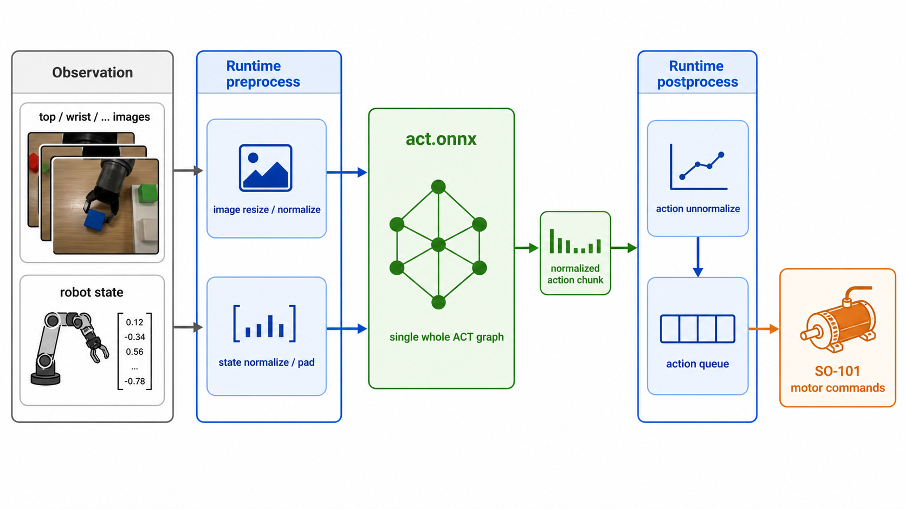
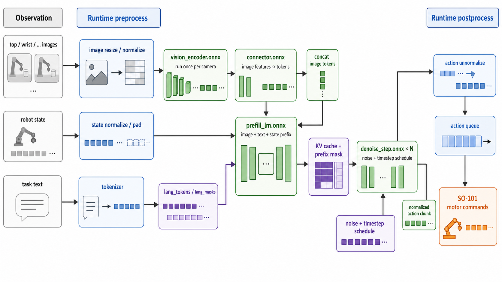

# LeRobot ONNX 部署指南

本文介绍 ACT 与 SmolVLA 策略模型在 SpacemiT K3 上的 ONNX 部署：模型导出、量化、Python/C++ 推理、离线验证与 SO-101 真机运行。

## 1. 方案概述

ACT 以多路相机图像和关节状态为输入，输出一段动作序列（action chunk），部署使用单个完整图：



SmolVLA 以多路相机图像、关节状态和任务文本为输入，输出 action chunk，部署使用 4 个子图串联：



ONNX 图只做前向推理，图外由 Python/C++ 运行时完成：图像与关节状态归一化、SmolVLA 任务文本 token 与 KV cache 管理、action 反归一化、SO-101 舵机标定值与 LeRobot 动作空间转换、action queue 播放。

## 2. 硬件清单

| 硬件 | 说明 |
|---|---|
| x86 主机 | 推荐用于 PyTorch checkpoint 导出 ONNX、模型量化 |
| SpacemiT K3 开发板 | 推理平台 |
| SO-101 Follower 机械臂 | 通过 USB 串口控制 Feetech 总线舵机 |
| 俯视相机 top camera | 示例设备号为 `/dev/video15` |
| 手腕相机 wrist camera | 示例设备号为 `/dev/video13` |

## 3. 场景一：ACT 部署指南

### 3.1 环境搭建

#### 3.1.1 获取代码

```bash
cd ~
mkdir -p spacemit_robot
cd spacemit_robot

repo init -u https://github.com/spacemit-robotics/manifest.git \
  -b main -m default.xml \
  --repo-url=https://gitee.com/spacemit-robotics/git-repo
repo sync -j4
repo start robot-dev --all

cd ~/spacemit_robot/components/thirdparty/lerobot/examples/onnx_inference
```

#### 3.1.2 K3 C++ 环境

```bash
sudo apt-get update
sudo apt-get install -y spacemit-onnxruntime python3-spacemit-ort
```

装好后应存在 `/usr/include/spacemit_ort_env.h`、`/usr/lib/libonnxruntime.so`、`/usr/lib/libspacemit_ep.so`。若改用单独下载解压的 SDK，CMake 时指定 `cmake .. -DSPACEMIT_ORT_DIR=/path/to/spacemit-ort-sdk`，该路径下需有 `include/spacemit_ort_env.h` 与 `lib/libonnxruntime.so`、`lib/libspacemit_ep.so`；运行 `act_benchmark` 或 `act_evaluate` 时还需 `export LD_LIBRARY_PATH=/path/to/spacemit-ort-sdk/lib:$LD_LIBRARY_PATH`。

#### 3.1.3 K3 Python 环境

Python 真机入口依赖 LeRobot、Feetech 驱动、safetensors 和 SpaceMIT EP，复用 Python 3.12 虚拟环境 `~/.lerobot-venv`。若未装 `uv`，先按[《真机训练推理》](3.3.1-真机训练推理.md#33-uv-安装和使用)安装。

K3 不装 `xslim`：它依赖 `opencv-python`，与 LeRobot 用的 `opencv-python-headless` 共享 `cv2` 目录会冲突。量化放在 x86 主机做。

```bash
source "$HOME/.local/bin/env"
uv venv ~/.lerobot-venv --python 3.12 --seed --allow-existing
source ~/.lerobot-venv/bin/activate
python --version
python -m pip --version

cd ~/spacemit_robot/components/thirdparty/lerobot/examples/onnx_inference
python -m pip install -r requirements-act.txt

python -m pip list | grep '^opencv'
python -m pip check
```

`--allow-existing` 保留环境里已有的包。`python --version` 应为 3.12；统一用 `python -m pip`，避免 `pip3` 误用系统 Python 触发 `externally-managed-environment`。OpenCV 只能有 `opencv-python-headless` 一个。

#### 3.1.4 x86 导出与量化环境

```bash
conda create -n lerobot-venv python=3.12 -y
conda activate lerobot-venv

cd ~/spacemit_robot/components/thirdparty/lerobot/examples/onnx_inference
python -m pip install -r requirements-act-pc.txt
```

`requirements-act-pc.txt` 已含 ACT 导出、ONNX 对比与 INT8 动态量化所需依赖。

### 3.2 前置准备

#### 3.2.1 PyTorch 模型生成

按[《真机训练推理》](3.3.1-真机训练推理.md)完成数采与训练，把 checkpoint 放到：

```text
~/spacemit_robot/components/thirdparty/lerobot/examples/onnx_inference/models/pytorch/act/checkpoints/100000/pretrained_model/
├── config.json
├── model.safetensors
├── policy_preprocessor.json
├── policy_preprocessor_step_3_normalizer_processor.safetensors
├── policy_postprocessor.json
└── policy_postprocessor_step_0_unnormalizer_processor.safetensors
```

#### 3.2.2 ONNX 导出

在 x86 主机执行，产物为 `models/onnx/act-fp32/act.onnx`：

```bash
python tools/act_pytorch_to_onnx.py \
  --checkpoint models/pytorch/act/checkpoints/100000/pretrained_model \
  --output-dir models/onnx/act-fp32
```

模型输入输出：

| 名称 | Shape | 说明 |
|---|---|---|
| `images` | `(B, n_cam, 3, H, W)` | 已归一化图像，float32 |
| `state` | `(B, state_dim)` | 已归一化关节状态，float32 |
| `actions` | `(B, chunk_size, action_dim)` | 已归一化动作序列，float32 |

可下载[基于《真机训练推理》导出和量化的模型](https://archive.spacemit.com/spacemit-ai/model_zoo/vla/act/onnx/models.tar.gz)复现本文基准测试。

#### 3.2.3 精度验证

仅跑 ONNX（K3 或 x86，K3 上可开 SpaceMIT EP）：

```bash
python tools/compare_act_onnx.py \
  --model-dir models/onnx/act-fp32 \
  --checkpoint models/pytorch/act/checkpoints/100000/pretrained_model \
  --use-spacemit-ep \
  --ep-threads 8 \
  --ep-affinity "8;9;10;11;12;13;14;15"
```

与 PyTorch 对比（需有 PyTorch/LeRobot）：

```bash
python tools/compare_act_onnx.py \
  --model-dir models/onnx/act-fp32 \
  --checkpoint models/pytorch/act/checkpoints/100000/pretrained_model \
  --cpu \
  --with-torch
```

也可在 x86 存参考输出再拷到 K3 对比：

```bash
# X86 生成输出
python tools/compare_act_onnx.py \
  --model-dir models/onnx/act-fp32 \
  --checkpoint models/pytorch/act/checkpoints/100000/pretrained_model \
  --cpu \
  --with-torch \
  --save-ref /tmp/act_ref.npy

# K3 运行对比
python tools/compare_act_onnx.py \
  --model-dir models/onnx/act-fp32 \
  --checkpoint models/pytorch/act/checkpoints/100000/pretrained_model \
  --use-spacemit-ep \
  --ep-threads 8 \
  --ep-affinity "8;9;10;11;12;13;14;15" \
  --ref-npy /tmp/act_ref.npy
```

#### 3.2.4 INT8 量化

x86 上用 xslim 动态量化，产物为 `models/onnx/act-int8/act.q.onnx`：

```bash
mkdir -p models/onnx/act-int8

python -m xslim \
  -i models/onnx/act-fp32/act.onnx \
  -o models/onnx/act-int8/act.q.onnx
```

`xslim 2.x` 不指定配置文件且不传 `--fp16` 时默认执行 INT8 动态量化。

### 3.3 部署推理

#### 3.3.1 C++ 部署

导出 C++ 运行所需的归一化与 SO-101 标定参数，再生成离线测试输入：

```bash
python tools/export_norm_stats.py \
  --checkpoint models/pytorch/act/checkpoints/100000/pretrained_model \
  --output models/onnx/act-fp32/act_norm_stats.txt

python tools/make_act_test_inputs.py \
  --model-dir models/onnx/act-fp32 \
  --stats models/onnx/act-fp32/act_norm_stats.txt \
  --out-dir cpp/inputs
```

生成 `cpp/inputs/images.npy`、`cpp/inputs/state_deg.npy`、`cpp/inputs/ref_action0.txt`。

构建并跑离线测试（用外部 SDK 时把 `cmake ..` 换成 `cmake .. -DSPACEMIT_ORT_DIR=/path/to/spacemit-ort-sdk`）：

```bash
cd ~/spacemit_robot/components/thirdparty/lerobot/examples/onnx_inference/cpp
rm -rf build && mkdir build && cd build
cmake ..
make -j$(nproc)

./act_benchmark ../../models/onnx/act-int8/act.q.onnx \
  --images-npy ../inputs/images.npy \
  --state-npy ../inputs/state_deg.npy \
  -s -t 8 -a "8;9;10;11;12;13;14;15" \
  -n 20 -w 3
```

真机运行需启用 `ACT_ROBOT_HW` 并可访问 `components/peripherals/motor`：

```bash
cd ~/spacemit_robot/components/thirdparty/lerobot/examples/onnx_inference/cpp
rm -rf build && mkdir build && cd build
cmake .. -DACT_ROBOT_HW=ON
make act_evaluate -j$(nproc)

./act_evaluate ../../models/onnx/act-int8/act.q.onnx \
  --stats ../../models/onnx/act-fp32/act_norm_stats.txt \
  --port /dev/ttyACM0 --camera top=15 --camera wrist=13 \
  --fps 30 --episode-time 180 \
  -s -t 8 -a "8;9;10;11;12;13;14;15"
```

参数：`--stats` 为归一化参数文件（必填）；`--port` 串口，默认 `/dev/ttyACM0`；`--camera NAME=IDX` 相机名到 `/dev/videoIDX` 的映射；`--fps` 控制循环频率，默认 30；`--episode-time` 单次运行秒数，默认 180；`-s/--spacemit` 启用 SpaceMIT EP；`-t/--threads` EP 与 ORT 线程数，默认 4；`-a/--affinity` EP 线程亲和性；`--dry-run` 只算动作不下发；`--verbose` 打印每步状态和动作。

#### 3.3.2 Python 部署

离线测试：

```bash
source ~/.lerobot-venv/bin/activate
cd ~/spacemit_robot/components/thirdparty/lerobot/examples/onnx_inference

python python/act_benchmark.py \
  --model-dir models/onnx/act-int8 \
  --checkpoint models/pytorch/act/checkpoints/100000/pretrained_model \
  --use-spacemit-ep \
  --ep-threads 8 \
  --ep-affinity "8;9;10;11;12;13;14;15" \
  --warmup 5 \
  --iters 20
```

真机运行：

```bash
source ~/.lerobot-venv/bin/activate
cd ~/spacemit_robot/components/thirdparty/lerobot/examples/onnx_inference

python python/act_evaluate.py \
  --model-dir models/onnx/act-int8 \
  --checkpoint models/pytorch/act/checkpoints/100000/pretrained_model \
  --port /dev/ttyACM0 \
  --camera top=15 \
  --camera wrist=13 \
  --use-spacemit-ep \
  --ep-threads 8 \
  --ep-affinity "8;9;10;11;12;13;14;15" \
  --episode-time 180
```

### 3.4 效果展示

ACT Python 真机运行效果如下。相比 PyTorch 版本，chunk 推理时延大幅降低，动作块之间衔接更流畅。


## 4. 场景二：SmolVLA 部署指南

SmolVLA ONNX 部署含 FP32 导出、FP16 量化、FP16 图修复、数值对比与真机运行。K3 真机推荐 C++ FP16 图修复版；Python 路径用于 FP32 离线验证与调试。

### 4.1 环境搭建

K3 侧复用 `~/.lerobot-venv`（`uv` 补齐 pip 并保留已装包），不装 `xslim`；FP16 转换与图修复在 x86 主机做。

```bash
source "$HOME/.local/bin/env"
uv venv ~/.lerobot-venv --python 3.12 --seed --allow-existing
source ~/.lerobot-venv/bin/activate
python --version
python -m pip --version

cd ~/spacemit_robot/components/thirdparty/lerobot/examples/onnx_inference
python -m pip install -r requirements-smolvla.txt

python -m pip list | grep '^opencv'
python -m pip check
```

`python --version` 应为 3.12，不要用系统 `pip3`，OpenCV 只能有 `opencv-python-headless`。

x86 导出、量化与数值对比环境：

```bash
conda create -n lerobot-venv python=3.12 -y
conda activate lerobot-venv

cd ~/spacemit_robot/components/thirdparty/lerobot/examples/onnx_inference
python -m pip install -r requirements-smolvla-pc.txt
```

C++ 真机入口在 K3 上还需构建依赖：

```bash
sudo apt-get update
sudo apt-get install -y build-essential cmake pkg-config libopencv-dev
```

### 4.2 前置准备

进入示例目录，可直接下载已发布的 2 路相机模型复现：

```bash
cd ~/spacemit_robot/components/thirdparty/lerobot/examples/onnx_inference

mkdir -p models/pytorch models/onnx /tmp/smolvla_models

BASE=https://archive.spacemit.com/spacemit-ai/model_zoo/vla/smolvla
for f in \
  models/pytorch/so101_smolvla_pick_green_cube_2cam.tar.gz \
  models/onnx/so101_smolvla_pick_green_cube_2cam_100k_fp32.tar.gz \
  models/onnx/so101_smolvla_pick_green_cube_2cam_100k_fp16_surgeried.tar.gz; do
  curl -L "$BASE/$f" -o "/tmp/smolvla_models/$(basename "$f")"
done

tar -xzf /tmp/smolvla_models/so101_smolvla_pick_green_cube_2cam.tar.gz -C models/pytorch
tar -xzf /tmp/smolvla_models/so101_smolvla_pick_green_cube_2cam_100k_fp32.tar.gz -C models/onnx
tar -xzf /tmp/smolvla_models/so101_smolvla_pick_green_cube_2cam_100k_fp16_surgeried.tar.gz -C models/onnx

ln -sfn so101_smolvla_pick_green_cube_2cam_100k_fp32 models/onnx/smolvla-fp32
ln -sfn so101_smolvla_pick_green_cube_2cam_100k_fp16_surgeried models/onnx/smolvla-fp16-surgeried
mkdir -p models/pytorch/smolvla/checkpoints/100000
ln -sfn ../../../so101_smolvla_pick_green_cube_2cam/checkpoints/100000/pretrained_model \
  models/pytorch/smolvla/checkpoints/100000/pretrained_model
```

K3 运行 FP16 图修复版需要补丁版 SpacemiT ORT SDK：

```bash
curl -L \
  https://archive.spacemit.com/spacemit-ai/model_zoo/vla/smolvla/spacemit-ort-sdk/spacemit-ort.riscv64.2.0.4_yyx.tar.gz \
  -o /tmp/smolvla_models/spacemit-ort.riscv64.2.0.4_yyx.tar.gz

tar -xzf /tmp/smolvla_models/spacemit-ort.riscv64.2.0.4_yyx.tar.gz -C ~
```

> [!NOTE]
>
> FP16 图修复版必须在补丁版 SpacemiT ORT SDK 上运行。用系统 SpaceMIT EP、普通 ONNX Runtime 或 CPU 跑 FP16 会出现数值漂移或溢出。Python 调试用 FP32 模型。

### 4.3 导出 ONNX FP32

自训练 checkpoint 放到 `models/pytorch/smolvla/checkpoints/100000/pretrained_model/`（含 `config.json`、`model.safetensors`、`policy_preprocessor.json`、`policy_postprocessor.json`、`train_config.json`），在 x86 主机导出：

```bash
python tools/export_smolvla_4model_to_onnx.py \
  --checkpoint models/pytorch/smolvla/checkpoints/100000/pretrained_model \
  --output-dir models/onnx/smolvla-fp32 \
  --num-cameras 2 \
  --validate-load
```

产物为 `models/onnx/smolvla-fp32/` 下的 `vision_encoder.onnx`、`connector.onnx`、`prefill_lm.onnx`、`denoise_step.onnx`。`--num-cameras` 是 ONNX 的相机槽位数，须与训练时相机数或 empty camera 配置一致（2 路填 `2`，3 路填 `3`）。

### 4.4 FP16 量化与图修复

先转 FP16：

```bash
python tools/convert_smolvla_fp32_to_fp16.py \
  --input-dir models/onnx/smolvla-fp32 \
  --output-dir models/onnx/smolvla-fp16
```

整图直接转 FP16 后，部分视觉注意力、归一化和索引更新子图容易漂移。`prefill_lm` 与 `denoise_step` 中的 RMSNorm 参与语言模型和扩散去噪的关键计算，误差在多步 denoise 中累积，可能表现为动作异常、抓取失败甚至 FP16 溢出。因此要对 FP16 模型做图修复：保留主要算子的 FP16 加速，把敏感子图改成更稳定的形式。

```bash
python tools/surgery_smolvla_fp16.py \
  --input-dir models/onnx/smolvla-fp16 \
  --output-dir models/onnx/smolvla-fp16-surgeried
```

修复内容：`vision_encoder` 把 self-attention 核心融合为 `VisionSelfAttnNHWC`，MLP 中的 GELU 近似子图替换为 ONNX `Gelu(approximate="tanh")`；`prefill_lm`/`denoise_step` 把 RMSNorm 子图的关键计算提升为 FP32，scatter 写入算子降解为等价子图；`connector` 等主要前向计算仍为 FP16，保留 K3 上的速度收益。

修复后目录仍是 4 个子图：`vision_encoder.onnx`、`connector.onnx`、`prefill_lm.onnx`、`denoise_step.onnx`。

### 4.5 精度验证

x86 上用 CPU 对比 FP32 与 FP16 修复版输出：

```bash
python tools/compare_smolvla_onnx.py \
  --fp32-dir models/onnx/smolvla-fp32 \
  --fp16-dir models/onnx/smolvla-fp16-surgeried \
  --cpu \
  --num-cameras 2 \
  --denoise-steps 10
```

K3 上的 FP16 验证需同时加载补丁版 `libonnxruntime.so` 和 `libspacemit_ep.so`，所以用 4.8.2 节的 C++ EP204 数值检查作为验收步骤；不要在 Python 进程里通过 `--spacemit-ort-dir` 加载补丁版 SDK。

### 4.6 导出 C++ 运行时元数据

C++ 真机入口需要任务文本、归一化参数、相机顺序、chunk 参数和 SO-101 标定。首次部署或更换机械臂后先校准 follower：

```bash
lerobot-calibrate \
  --robot.type=so101_follower \
  --robot.port=/dev/ttyACM0 \
  --robot.id=my_awesome_follower_arm
```

确认标定文件存在后导出 `smolvla_runtime.txt`：

```bash
ls ~/.cache/huggingface/lerobot/calibration/robots/so_follower/my_awesome_follower_arm.json

python tools/export_smolvla_runtime.py \
  --checkpoint models/pytorch/smolvla/checkpoints/100000/pretrained_model \
  --output models/onnx/smolvla_runtime.txt \
  --task "Place the green cube into the box" \
  --num-cameras 2 \
  --calibration ~/.cache/huggingface/lerobot/calibration/robots/so_follower/my_awesome_follower_arm.json
```

`--task` 需与训练、部署任务一致；在线推理的 `--camera` 名称要与 checkpoint 图像 key 后缀一致，如 `observation.images.top` 对应 `top`。

### 4.7 Python 推理

Python SmolVLA 路径用 FP32 模型做离线验证或 dry-run 调试。K3 上跑 FP32 需传 `--cpu-denoise`：`denoise_step` 用 CPU EP，其余 3 个子图用 SpaceMIT EP。FP16 修复版走 C++ 路径，因为其数值正确性依赖补丁版 SDK 和对应 EP 配置。

运行前确认文件齐全：

```bash
cd ~/spacemit_robot/components/thirdparty/lerobot/examples/onnx_inference

ls models/onnx/smolvla-fp32/{vision_encoder,connector,prefill_lm,denoise_step}.onnx
ls models/pytorch/smolvla/checkpoints/100000/pretrained_model/config.json
```

#### 4.7.1 离线基准测试

不接机械臂和相机，用合成 observation 跑完整 4-model pipeline，验证模型加载与 EP 可用性并统计 full-inference 延迟：

```bash
source ~/.lerobot-venv/bin/activate
cd ~/spacemit_robot/components/thirdparty/lerobot/examples/onnx_inference

python python/smolvla_evaluate.py \
  --no-robot --iters 1 \
  --model-dir models/onnx/smolvla-fp32 \
  --checkpoint models/pytorch/smolvla/checkpoints/100000/pretrained_model \
  --use-spacemit-ep \
  --cpu-denoise \
  --ep-threads 8 --ep-affinity "8;9;10;11;12;13;14;15" \
  --warmup 1 \
  --denoise-steps 10 \
  --n-action-steps 50 \
  --infer-every-tick \
  --print-actions
```

关键参数：`--no-robot` 用合成 observation；`--model-dir` FP32 ONNX 目录；`--checkpoint` 为 `pretrained_model` 目录；`--use-spacemit-ep` 默认开启，`--cpu` 强制 CPU EP 用于诊断；`--cpu-denoise` 让 FP32 `denoise_step` 走 CPU；`--warmup` 计时前合成输入热身次数；`--infer-every-tick` 每轮完整推理；`--denoise-steps` 每次推理调用 `denoise_step` 的次数（默认 10）；`--n-action-steps` 每轮放入 action queue 的步数（读 checkpoint）。

不加 `--infer-every-tick` 时会复用 action queue 中未消费的动作，后续循环可能不重跑完整模型，不能用于统计 full-inference 延迟。

#### 4.7.2 dry-run 调试

dry-run 连接真实机械臂和相机、读真实 observation，但不下发动作。首次上机先用 `--max-iters 1` 检查相机、串口、模型输出和 action 数值范围：

```bash
python python/smolvla_evaluate.py \
  --dry-run --max-iters 1 \
  --port /dev/ttyACM0 \
  --camera top=/dev/video15 --camera wrist=/dev/video13 \
  --camera-fps 30 --camera-fourcc MJPG \
  --use-spacemit-ep \
  --cpu-denoise \
  --ep-threads 8 --ep-affinity "8;9;10;11;12;13;14;15" \
  --model-dir models/onnx/smolvla-fp32 \
  --checkpoint models/pytorch/smolvla/checkpoints/100000/pretrained_model \
  --denoise-steps 10 \
  --n-action-steps 50 \
  --print-actions
```

检查项：相机路径（`top=/dev/video15`、`wrist=/dev/video13`）；`--camera` 名称与训练数据及 `smolvla_runtime.txt` 的图像 key 后缀一致；首帧 action 是否有限值、是否明显超出动作范围；`--denoise-steps`、`--n-action-steps` 是否与后续 C++ 部署一致。

### 4.8 C++ 真机部署

C++ 是 SmolVLA 在 K3 上的推荐路径，默认运行 `models/onnx/smolvla-fp16-surgeried`，由 `run_smolvla_robot_pipeline.sh` 使用补丁版 SDK、EP 线程与绑核配置。

#### 4.8.1 构建

确认补丁版 SDK 已解压且模型与 runtime metadata 就绪：

```bash
ls ~/spacemit-ort.riscv64.2.0.4_yyx/lib/libonnxruntime.so
ls ~/spacemit-ort.riscv64.2.0.4_yyx/lib/libspacemit_ep.so
ls ~/spacemit_robot/components/thirdparty/lerobot/examples/onnx_inference/models/onnx/smolvla-fp16-surgeried/
ls ~/spacemit_robot/components/thirdparty/lerobot/examples/onnx_inference/models/onnx/smolvla_runtime.txt
```

构建产物为 `cpp/build_smolvla_robot/smolvla_robot_pipeline`：

```bash
cd ~/spacemit_robot/components/thirdparty/lerobot/examples/onnx_inference/cpp
./build_smolvla_robot_cpp.sh EP204
```

#### 4.8.2 K3 FP16 数值检查

先用合成输入跑无硬件检查（不开机械臂和相机，不下发动作）：

```bash
cd ~/spacemit_robot/components/thirdparty/lerobot/examples/onnx_inference/cpp

DRY_RUN=1 WARMUP=1 ./run_smolvla_robot_pipeline.sh \
  --warmup-only \
  --debug-numerics
```

日志中 4 个 ONNX 子图都应成功创建 SpaceMIT EP session，10 次 `denoise_step` 的 `bad` 计数应为 `0`。

#### 4.8.3 dry-run 安全检查

真机执行前先 dry-run：打开相机和机械臂、读真实状态与图像，但不下发动作。

```bash
./run_smolvla_robot_pipeline.sh \
  --port /dev/ttyACM0 \
  --camera top=15 \
  --camera wrist=13 \
  --dry-run \
  --max-iters 1 \
  --n-action-steps 25 \
  --print-actions
```

通过后再进入基准测试或真机运行。

#### 4.8.4 完整推理基准测试

加 `--infer-every-tick` 避免 action queue 复用，每个控制周期都重新采集 observation 并跑完整 4-model pipeline：

```bash
cd ~/spacemit_robot/components/thirdparty/lerobot/examples/onnx_inference/cpp

./run_smolvla_robot_pipeline.sh \
  --port /dev/ttyACM0 \
  --camera top=15 \
  --camera wrist=13 \
  --dry-run \
  --warmup 1 \
  --max-iters 3 \
  --infer-every-tick \
  --n-action-steps 50
```

`--warmup 1` 在正式计时前用合成输入跑 1 次推理，减少初始化影响；`--max-iters 3` 只跑 3 个控制周期；`--dry-run` 禁止下发但仍采集真实 observation。

#### 4.8.5 真机运行

```bash
./run_smolvla_robot_pipeline.sh \
  --port /dev/ttyACM0 \
  --camera top=15 \
  --camera wrist=13 \
  --n-action-steps 25 \
  --print-actions
```

参数：`--model-dir` 默认 `models/onnx/smolvla-fp16-surgeried`；`--runtime` 默认 `models/onnx/smolvla_runtime.txt`；`--port` 默认 `/dev/ttyACM0`；`--camera NAME=IDX` 相机映射；`--n-action-steps` 每次推理后入队的动作步数（读 runtime）；`--denoise-steps` 默认 10，越大越慢；`--infer-every-tick` 每周期完整推理；`--dry-run` 只算不下发；`--print-actions` 脚本默认开启。

`--n-action-steps` 影响 action queue 刷新频率。建议从 `25` 起测：动作频繁重规划可调大，需要更快响应环境变化可调小。

#### 4.8.6 多相机模型

2 路示例用 `top` 和 `wrist`。3 路训练时，导出 ONNX 与 `smolvla_runtime.txt` 都要对应相机数量，运行时传对应映射：

```bash
./run_smolvla_robot_pipeline.sh \
  --model-dir models/onnx/smolvla-3cam-fp16-surgeried \
  --runtime models/onnx/smolvla_runtime_3cam.txt \
  --port /dev/ttyACM0 \
  --camera camera1=3 \
  --camera camera2=1 \
  --camera camera3=5 \
  --dry-run \
  --max-iters 1 \
  --print-actions
```

### 4.9 效果展示

C++ SmolVLA 真机运行效果，`--n-action-steps` 设为 35。


## 5. K3 实测参考

延迟随固件、ORT SDK、模型和散热状态变化，以下数据只用于估算量级，不作为验收结果。

### 5.1 Python 性能测试数据

| 模型 | 配置 | 平均延迟 |
|---|---|---|
| `act-fp32` | EP 8 线程 | 1290.0 ms |
| `act-int8` | EP 8 线程 | 210.9 ms |
| `smolvla-fp32` | EP 8 线程 + CPU denoise | 8762.5 ms |

### 5.2 C++ 性能测试数据

| 模型 | 配置 | 平均延迟 |
|---|---|---|
| `act-fp32` | EP 8 线程 | 1288.3 ms |
| `act-int8` | EP 8 线程 | 247.2 ms |
| `smolvla-fp32` | EP 8 线程 | 9023.9 ms |
| `smolvla-fp16` | EP204 8 线程 | 1113.2 ms |

SmolVLA 数据使用 2 路相机模型和 `--denoise-steps 10`，统计完整推理平均耗时，不含模型加载。

用仓库的 K3 性能门禁复测：

```bash
source ~/.lerobot-venv/bin/activate
cd ~/spacemit_robot/components/thirdparty/lerobot/examples/onnx_inference

bash test/test_act_k3_performance.sh
bash test/test_smolvla_k3_performance.sh
```

ACT 脚本执行 3 次 warmup 和 20 次 INT8 测量，阈值 500 ms；SmolVLA 脚本用合成输入、EP204、1 次 warmup 和 3 次 FP16 测量，阈值 1600 ms；通过时输出 `PERF_OK`。2026 年 8 月 10 日在 K3 复测，ACT INT8 平均 247.226 ms、SmolVLA FP16 平均 1113.167 ms，均通过门禁。

## 6. 常见问题

### 6.1 ACT 和 SmolVLA 选哪个部署入口？

ACT 优先 Python 或 C++ INT8，端到端延迟更低；SmolVLA 用 C++ FP16 图修复版，Python 路径只做 FP32 离线验证和 dry-run 调试。

### 6.2 SmolVLA FP16 为什么必须用补丁版 SpacemiT ORT SDK？

FP16 对部分算子数值更敏感。补丁版 SDK 配 FP16 图修复版模型验证过数值正确性；用系统 SpaceMIT EP、普通 ONNX Runtime 或 CPU 跑 FP16 会数值漂移或溢出。

### 6.3 `--camera` 名称怎么填？

必须与训练数据和模型 metadata 的图像 key 后缀一致。训练用 `observation.images.top` 和 `observation.images.wrist` 时，部署传 `--camera top=15 --camera wrist=13`。

### 6.4 `--n-action-steps` 影响什么？

控制每次推理后入队的动作步数。值越大复用越久、动作更连续但响应变慢；值越小重规划更频繁、响应更快但可能抖动。SmolVLA 真机建议从 `25` 起调。

### 6.5 如何确认机械臂标定文件可用？

C++ 真机运行前需导出含 SO-101 标定的 runtime metadata。先 `lerobot-calibrate`，再确认 `~/.cache/huggingface/lerobot/calibration/robots/so_follower/<robot_id>.json` 存在，并在 `export_smolvla_runtime.py` 中用 `--calibration` 指向它。

### 6.6 K3 导入 `cv2` 报 `gapi_wip_gst_GStreamerPipeline` 不存在？

说明虚拟环境同时装了 `opencv-python` 和 `opencv-python-headless`，两个发行包往同一个 `cv2` 目录写不同版本的文件和二进制扩展。下面这组命令只用于 K3 虚拟环境，不要在 x86 导出量化环境执行：

```bash
source "$HOME/.local/bin/env"
uv venv ~/.lerobot-venv --python 3.12 --seed --allow-existing
source ~/.lerobot-venv/bin/activate
python -m pip uninstall -y xslim opencv-python opencv-python-headless
python -m pip install \
  --index-url https://mirrors.aliyun.com/pypi/simple \
  opencv-python-headless==4.12.0.88

python -c 'import cv2; print(cv2.__version__, hasattr(cv2, "VideoCapture"))'
python -m pip list | grep '^opencv'
python -m pip check
```

应显示 OpenCV `4.12.0`、`VideoCapture` 为 `True`，且列表里只有 `opencv-python-headless`。
