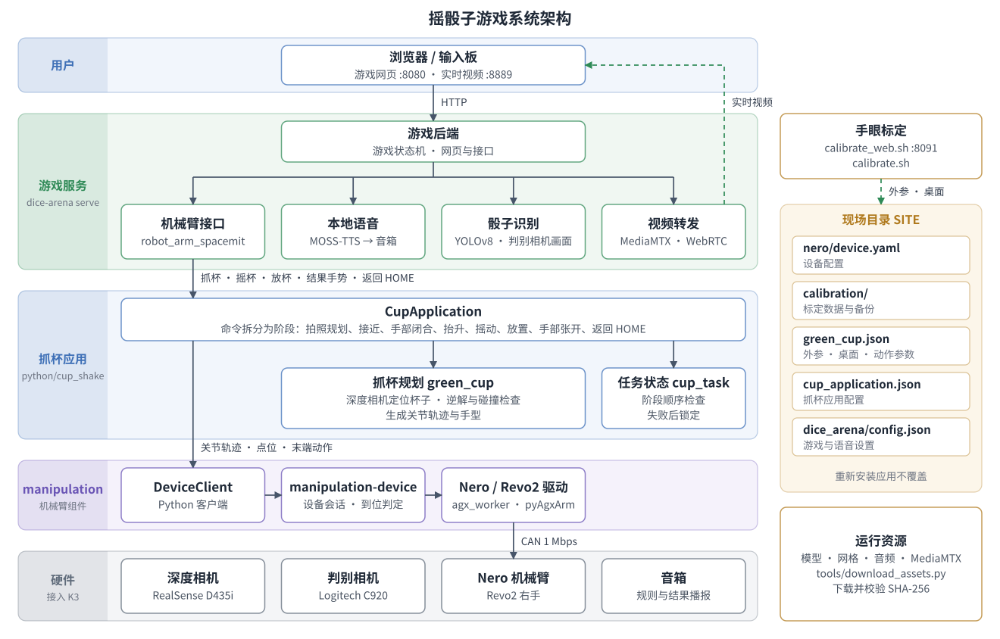
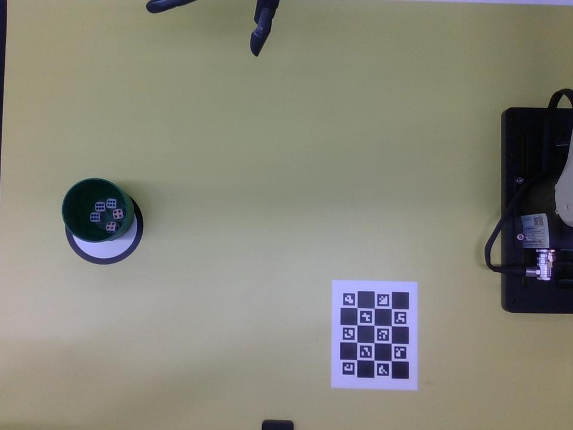
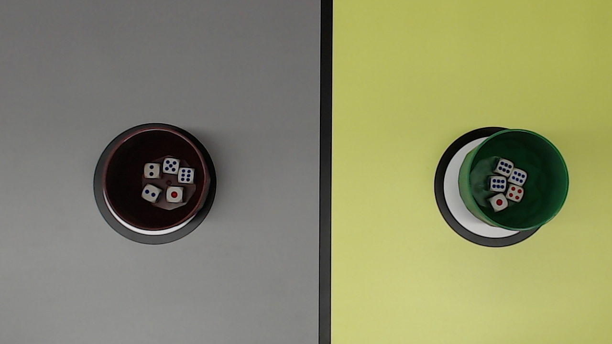
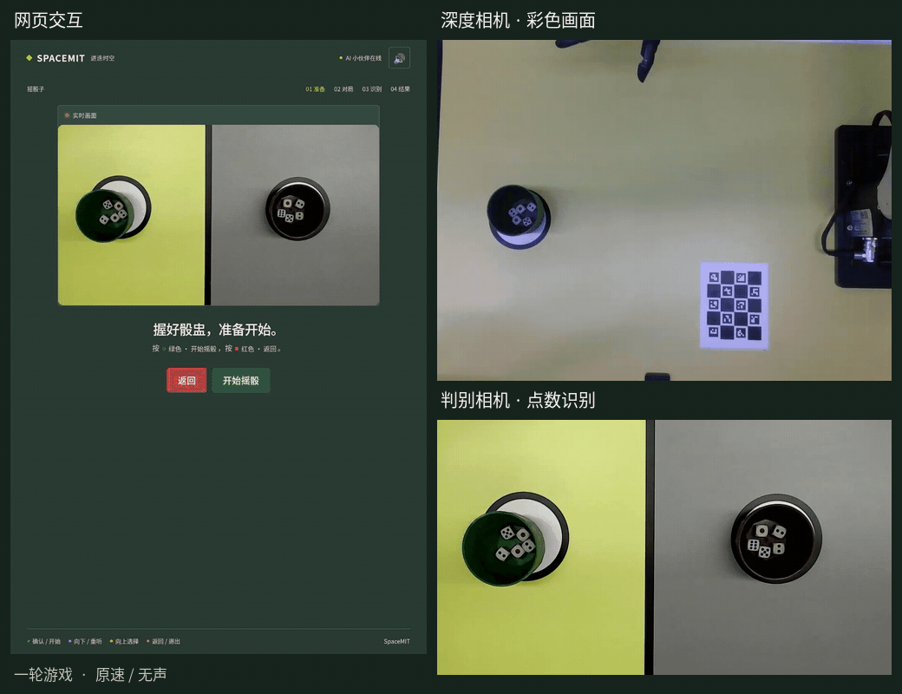

# 摇骰子游戏

本方案基于 SpacemiT K3 开发板，实现机械臂与玩家的摇骰子对局。系统使用松灵 Nero 七轴机械臂和 Revo2 灵巧手，通过深度相机定位并抓取绿色敞口杯，摇动后放回桌面；判别相机从上方拍摄双方杯内骰子，系统识别点数并判定胜负，网页和语音公布结果，机械臂执行对应手势。

机械臂由 `manipulation` 组件控制，组件的配置、命令和接口见[机械臂组件控制](../../05-机器人开发/5.2-运动控制/5.2.5-机械臂组件控制.md)。

本文档内容如下：

- [§1 方案概述](#1-方案概述)：功能、系统架构、执行流程和软件组成；
- [§2 硬件清单](#2-硬件清单) 至 [§5 场景二：完整摇骰子游戏](#5-场景二完整摇骰子游戏)：硬件准备、环境搭建和功能复现；
- [§6 二次开发](#6-二次开发)：动作、手型、游戏内容和设备的调整方法；
- [§7 常见问题](#7-常见问题)、[§8 技术参考](#8-技术参考)：问题排查，以及命令、文件和端口参考。

## 1. 方案概述

### 1.1 功能

本方案支持以下功能：

- **视觉抓杯**：深度相机定位桌面上的绿色杯子，计算抓取位姿，并检查运动路径与桌面、杯子的碰撞。
- **摇杯与放杯**：机械臂抬起杯子，按配置的动作摇动，放回原位后返回起始姿态（HOME）。
- **骰子识别**：双方各 5 颗骰子，判别相机从上方拍摄杯内骰子，YOLOv8 识别点数，点数总和较大的一方获胜。
- **交互反馈**：网页显示实时画面和比分，本地语音播报规则与结果；机械臂获胜时执行 V 手势，失败时执行竖拇指手势，平局时执行开合手势。
- **手眼标定**：通过网页或命令行标定深度相机与机械臂基座之间的外参，并登记桌面。

### 1.2 系统架构



图中左侧为运行时的调用关系，自上而下逐层调用；右侧为离线准备的数据：手眼标定将外参和桌面信息写入现场目录，运行资源由下载脚本获取。软件分为三层：

| 层次 | 组成 | 职责 |
| --- | --- | --- |
| 游戏服务 | 游戏后端、网页、本地语音、骰子识别、视频转发 | 运行游戏状态机，播报语音，识别点数，并向机械臂接口下发动作命令 |
| 抓杯应用 | 抓杯规划、任务状态 | 将抓杯、摇杯等命令转换为关节轨迹和灵巧手动作，检查阶段顺序，并在故障后锁定 |
| `manipulation` 组件 | `DeviceClient`、`manipulation-device`、Nero / Revo2 驱动 | 负责设备独占、动作执行、到位判定和故障处理 |

手眼标定独立于游戏运行。标定结果和各层配置统一保存在现场目录（下文记为 `SITE`），默认路径为 `~/.local/share/spacemit-manipulation/site/`，重新安装应用不会覆盖该目录。

### 1.3 游戏执行流程

游戏后端按状态机推进对局（定义见 `game/backend/games/dice/manifest.json`），进入以下状态时向机械臂接口下发命令：

| 游戏状态 | 机械臂命令 | 系统行为 |
| --- | --- | --- |
| `rules` 规则讲解 | — | 播报规则；同时在后台连接设备，加载相机、检测模型和碰撞模型，机械臂不运动 |
| `ready` 准备 | — | 等待玩家按绿色按钮开始 |
| `game_start` 开局 | `grasp_cup` | 拍摄图像并定位杯子，机械臂接近杯子，手部闭合后抬升杯子 |
| `shake_countdown` 倒计时 | — | 播报倒计时，机械臂持杯等待 |
| `shaking` 摇杯 | `shake_dice` | 玩家与机械臂同时摇动杯子 |
| `stop_call` 停止 | `settle_dice` | 播报“停”，机械臂放回杯子，手部张开，返回 HOME |
| `analysis` 识别 | — | 通过判别相机画面识别双方点数并判定胜负 |
| `result` 结果 | `gesture:win`、`gesture:lose`、`gesture:draw` | 播报结果，机械臂执行对应手势 |
| `rehome` 回位 | `reset_home` | 选择再来一局后，机械臂返回 HOME，手部张开 |
| `arm_failed`、`analysis_failed` | `reset_home` | 机械臂空闲时返回 HOME；可能持杯或已故障锁定时拒绝执行，等待人工处理 |

抓杯应用将每条命令拆分为若干阶段。例如，`grasp_cup` 包含拍照规划（`prepare`）、接近（`approach`）、手部闭合（`grip`）和抬升（`lift`）。任务状态库检查阶段顺序：

- 手部未闭合时不能抬升；
- 可能持杯时不能返回 HOME；
- 动作发出后任一阶段失败即锁定，不自动重试；动作发出前失败（如没有识别到杯子）不改变任务状态。

### 1.4 软件组成

源码位于 `application/native/dice_arena`，依赖机械臂组件 `components/control/manipulation` 和厂商 SDK `components/thirdparty/pyagxarm`。

| 模块 | 源码位置 | 说明 |
| --- | --- | --- |
| 命令入口 | `python/spacemit_dice_arena/` | `dice-arena` 命令，包含抓杯、游戏服务和检查功能 |
| 抓杯应用 | `python/cup_shake/` | 业务入口 `CupApplication`、规划器和阶段编排 |
| 任务状态 | `src/`、`include/` | C++ 实现的阶段顺序检查与故障锁定，构建为 `libcup_task.so` |
| 抓杯算法 | `algorithms/` | 杯体检测、运动学、碰撞模型、动作配置、TCP 和模型文件 |
| 手眼标定 | `calibration/`、`calibrate.sh`、`calibrate_web.sh` | 标定命令行与网页 |
| 游戏 | `game/` | 游戏后端、网页、本地语音（MOSS-TTS）和骰子识别 |
| 视频转发 | `mediamtx/` | MediaMTX 程序与配置，将识别画面转换为浏览器可播放的 WebRTC 视频流 |
| 部署与测试 | `config/`、`tools/`、`tests/` | 运行资源下载、配置生成和无硬件测试 |

## 2. 硬件清单

### 2.1 设备清单

| 设备 | 型号或规格 | 用途 |
| --- | --- | --- |
| 主控 | SpacemiT K3 开发板 | 运行控制、视觉规划、骰子识别、语音和网页服务 |
| 机械臂 | 松灵 Nero 七轴机械臂 | 抓取、摇动和放置杯子，执行结果手势 |
| 末端执行器 | Revo2 右手灵巧手，六通道 | 抓取杯子，执行结果手势 |
| CAN 适配器 | 支持 SocketCAN 的 USB-CAN 适配器 | 连接 K3 与机械臂，通信速率 1 Mbps |
| 深度相机 | Intel RealSense D435i | 杯体定位与手眼标定 |
| 判别相机 | 支持 MJPEG 的 USB 相机，默认配置为 Logitech C920 | 从上方拍摄双方杯内骰子 |
| 标定板 | ChArUco 末端标定板和桌面固定板各一块 | 求解外参并登记桌面 |
| 音频输出 | 音箱，型号不限 | 播放规则讲解和对局结果 |
| 游戏道具 | 绿色敞口杯和骰子，双方各 5 颗骰子 | 机械臂抓取的杯体尺寸须与抓杯配置一致 |

### 2.2 连接与安装

- **机械臂与灵巧手**：USB-CAN 适配器的 USB 端连接 K3，CAN 端连接机械臂。Revo2 安装在机械臂末端，经末端接口与机械臂共用控制器连接，无需单独接线。
- **深度相机**：通过 USB 连接 K3，固定在机械臂外部，视野覆盖抓杯工作区和标定板。
- **判别相机**：通过 USB 连接 K3，安装在桌面上方，视野覆盖双方杯内骰子和桌面分界。
- **音箱**：连接 K3 的系统音频输出。

**深度相机第一视角（RealSense D435i 彩色画面）**



绿色杯和抓取工作区须完整位于画面内；标定时，固定标定板须清晰可见。

**判别相机第一视角（Logitech C920 原始画面）**



双方杯口、杯内骰子和桌面分界须完整位于画面内，骰子点数须清晰可辨。

机械臂基座、相机和桌面安装后须保持固定，其中任一项移动后都需要重新标定。本方案提供的视觉规划、标定参数和手型适用于上述设备组合；更换机械臂、灵巧手、杯子或相机安装位置时，需按 [§6.6 替换规划器或设备](#66-替换规划器或设备) 重新适配。

## 3. 环境搭建

### 3.1 获取代码

本方案随 SpacemiT Robot SDK 发布。在 K3 终端执行以下命令，将 SDK 全量代码下载到 `~/spacemit_robot`，其中 `~` 表示当前用户的主目录。若已在该目录下载完整 SDK，可跳过下载，直接加载编译环境。

```bash
sudo apt update
sudo apt install repo git

# 仅在尚未配置 Git 身份时执行，将姓名和邮箱替换为自己的信息
git config --global user.name "Your Name"
git config --global user.email "you@example.com"

mkdir -p ~/spacemit_robot
cd ~/spacemit_robot
repo init -u https://github.com/spacemit-robotics/manifest.git -b main -m default.xml \
  --repo-url=https://gitee.com/spacemit-robotics/git-repo
repo sync -j4
repo start robot-dev --all
```

- 无法访问 GitHub 时，将 `-u` 后的地址替换为 `https://gitee.com/spacemit-robotics/manifest.git`；
- 按分组下载部分代码等其他方式，见[构建编译](../../02-快速入门/2.3-构建编译.md)。

进入 SDK 根目录 `~/spacemit_robot`，加载编译环境，注册 Nero 厂商 SDK，并进入应用目录。本章后续命令均在该终端的 `~/spacemit_robot/application/native/dice_arena` 目录下执行：

```bash
cd ~/spacemit_robot
source build/envsetup.sh
bash components/thirdparty/pyagxarm/tools/setup_sdk.sh
cd application/native/dice_arena
```

`setup_sdk.sh` 用于将已下载的 Nero 厂商 SDK 源码注册为构建依赖。打开新终端后，执行以下命令加载环境并回到应用目录，无需重新下载源码：

```bash
cd ~/spacemit_robot
source build/envsetup.sh
cd application/native/dice_arena
```

### 3.2 下载运行资源

模型、网格、音频、默认示教数据和视频服务程序体积较大，不随源码提供，需按清单 `runtime_assets.json` 下载（共约 700 MB）：

```bash
python3 tools/download_assets.py
```

资源存放在 `https://archive.spacemit.com/ros2/manipulation/dice_arena/`，按使用模块分目录：

| 资源 | 服务器目录 | 下载到应用目录 | 大小 |
| --- | --- | --- | --- |
| 杯体检测模型 | `algorithms/cup_grasp/` | `algorithms/cup_grasp_demo/models/` | 约 4 MB |
| 机械臂与灵巧手网格 | `algorithms/meshes/` | `algorithms/nero_revo2_control/models/hand_geometry/` | 约 18 MB |
| 手眼标定默认示教数据 | `calibration/` | `calibration/trajectories/` | 约 3 MB |
| 骰子识别模型与游戏音频 | `game/dice/` | `game/backend/games/dice/` | 约 12 MB |
| 本地语音模型与参考音色 | `game/tts/` | `game/tts/moss-tts-nano/` | 约 613 MB |
| MediaMTX 视频服务 | `mediamtx/` | `mediamtx/` | 约 51 MB |

- 下载时逐个校验文件大小和 SHA-256，已下载且校验通过的文件不会重复下载；
- 使用内网镜像时，追加 `--base-url <镜像地址>`。镜像地址对应 `https://archive.spacemit.com/ros2/manipulation/`，其下保持相同的 `dice_arena/` 目录结构；
- 已下载的资源可用 `python3 tools/check_assets.py --verify` 复核。

### 3.3 编译构建

```bash
mm --with-deps
```

该命令依次构建厂商 SDK、`manipulation` 组件和本应用（任务状态库、骰子识别程序），默认安装到 `~/spacemit_robot/output/staging`。

- **系统依赖**：缺少 `package.xml` 声明的依赖时，按提示安装，例如 OpenCV、GStreamer、SpacemiT 推理库，以及本地语音所需的 `python3-sentencepiece`、`python3-soundfile`。
- **骰子识别程序**：依赖 SpacemiT 推理库，仅在 K3 上编译。
- **深度相机**：需另外安装与 K3 架构和 Python 版本匹配的 RealSense Python 绑定 `pyrealsense2`。

主要安装内容如下，路径相对 `~/spacemit_robot/output/staging`：

| 类别 | 位置 |
| --- | --- |
| 命令 | `bin/dice-arena`，以及机械臂组件的 `bin/manipulation`、`bin/manipulation-device` |
| Python 模块 | `python/cup_shake/`、`python/spacemit_dice_arena/` |
| 任务状态库 | `lib/libcup_task.so` |
| 算法、标定、游戏和视频服务 | `share/dice_arena/` |

### 3.4 离线检查

以下命令不连接机械臂、相机或音频设备，用于确认软件安装完整：

```bash
dice-arena mock
dice-arena check
manipulation check --profile vision
python3 tools/check_assets.py --verify
```

通过条件：

- `dice-arena mock`：在模拟设备上完成抓杯、摇杯和放杯，退出码为 `0`；
- `dice-arena check`：游戏的机械臂接口在模拟设备上完成一局，退出码为 `0`；
- `manipulation check --profile vision`：控制、OpenCV、SciPy 和 RealSense 依赖检查通过；
- `check_assets.py --verify`：运行资源完整，摘要全部匹配。

## 4. 场景一：单次抓杯、摇杯和放杯

本场景依次完成设备配置、手眼标定和抓杯配置，最后在真机上执行一次抓杯、摇杯和放杯。完整游戏依赖本场景的全部结果。

**安全要求**：以下真机步骤会驱动机械臂。现场须有人看护，急停装置须触手可及，机械臂运动路径内不得有人员或障碍物。Nero 断电或失能后会坍塌，不得以断电或失能代替软件停止。

### 4.1 配置机械臂组件

**步骤 1：生成设备配置。** 为 Nero 与 Revo2 右手组合生成配置：

```bash
manipulation configure nero --variant revo2_right
manipulation validate
```

- 配置保存到 `SITE/nero/device.yaml`，包含驱动、CAN 接口、关节限位和灵巧手通道；已有文件不会被覆盖。
- CAN 接口不是 `can0` 时，在 `configure` 命令后追加 `--set channel=<接口名>`。
- `configure` 同时将 Nero 设为当前设备。本机配置过其他设备时，先执行 `manipulation use nero`；当前设备不是 Nero 时，手眼标定和 `dice-arena configure` 会拒绝执行。

**步骤 2：启用 CAN 接口。**

```bash
sudo ip link set can0 up type can bitrate 1000000
```

**步骤 3：使能机械臂。** 退出厂商 Web、遥操作和其他控制程序，按厂商规程使能机械臂并进入位置控制模式。应用不会自动使能或清除故障。

**步骤 4：读取设备状态。**

```bash
manipulation inspect
```

该命令只读取状态，不发送运动目标。确认输出中 `enabled`、`position_mode` 为 `true`，`fault` 为 `false`，七个关节位置与实际姿态一致。

### 4.2 手眼标定

手眼标定用于求解深度相机到机械臂基座的外参，并登记桌面工作区，抓杯规划依赖这两项结果。

**步骤 1：准备。** 固定深度相机、机械臂基座、桌面和两块标定板，并在 `calibration/config/calibration_workflow.json` 中填写现场参数：

- 深度相机序列号和图像参数；
- 标定板字典、格数和实测尺寸；
- 未持物时的 HOME 姿态和工具中心点（TCP）；
- 自动采样参数和质量阈值。

标定与抓杯须使用相同的分辨率、裁剪区域和相机内参。相机、基座或 TCP 变化后，原有外参不能继续使用。

**步骤 2：启动标定网页。** 设置工程师 PIN 并启动网页。标定误差未达标时，需输入 PIN 批准后才能临时使用该结果。

```bash
bash calibrate_web.sh --set-pin
bash calibrate_web.sh --host 0.0.0.0
```

**步骤 3：执行标定。** 在浏览器中打开 `http://<K3_IP>:8091/`，根据现场情况选择任务：

| 任务 | 适用情况 | 步骤 |
| --- | --- | --- |
| 首次安装 | 首次标定，或基座、桌面固定板移动过 | 准备设备与工作区 → 手动示教并保存姿态（至少 12 组）→ 设定整板可见范围 → 生成自动采样路线 → 自动采样 → 登记桌面固定板 → 应用结果并登记桌面 |
| 重新标定 | 沿已保存的路线重新标定 | 准备设备与工作区 → 生成自动采样路线 → 自动采样 → 登记桌面固定板 → 应用结果并登记桌面 |
| 相机位置变了 | 基座和桌面固定板未移动，仅相机移动 | 准备设备与工作区 → 通过固定板恢复相机位置 → 应用结果并登记桌面 |

自动采样会驱动机械臂沿示教路线运动并求解外参，完成后返回 HOME。标定流程也可通过命令行完成，见 [§8.1 命令一览](#81-命令一览) 中的 `calibrate.sh`。

标定结果保存在 `SITE/calibration/`，应用结果时生成 `SITE/green_cup.json`。完成后按 Ctrl+C 退出标定网页。

### 4.3 生成抓杯配置

```bash
dice-arena configure
```

该命令离线校验设备配置和算法配置，并生成 `SITE/cup_application.json`；已有文件不会被覆盖。该文件记录 Nero 配置的路径，因此后续 `dice-arena` 的抓杯和游戏命令不受 `manipulation use` 影响。

生成后核对以下内容是否与实物一致：

- HOME 姿态、TCP 和杯体尺寸；
- 抓取手型：默认值为算法策略 `algorithms/vision/strategy/green_cup.json` 的 `grip_targets_0_100`，按 `SITE/nero/device.yaml` 的通道顺序排列，使用灵巧手刻度（`0` 张开，`100` 闭合）；需要调整时见 [§6.2 调整动作与手型](#62-调整动作与手型)；
- `grip_confirmation`：默认为 `none`，手部闭合后直接抬升杯子；设为 `operator` 时，每次手部闭合后等待操作人员确认持杯。

### 4.4 运行与结果

确认机械臂未持物并位于 HOME，灵巧手张开，杯子位于深度相机视野内的工作区。先读取状态，再执行抓杯流程：

```bash
dice-arena inspect
dice-arena cycle
```

`cycle` 依次执行抓杯、摇杯和放杯三条命令，每个阶段开始和结束时各输出一行事件。三条命令均返回 `"status": "completed"` 时，表示执行成功。输出示例（节选）：

```text
{"event": "robot", "phase": "prepare", "elapsed_s": 1.64, "startup_wait_s": 4.3}
{"event": "robot", "phase": "approach", "progress": 1, "elapsed_s": 1.03, "plan_s": 0.0}
{"event": "robot", "phase": "grip", "progress": 1, "elapsed_s": 0.31}
{"event": "robot", "phase": "lift", "progress": 1, "elapsed_s": 0.55, "plan_s": 0.25}
{"status": "completed", "grip_evidence": "grip_commanded", "physical_grip_verified": false}
agx_worker: agx-trajectory-stream planned 3.57 s, took 3.58 s, 716 commands (200 Hz of 200 Hz)
{"event": "robot", "phase": "shake", "progress": 1, "elapsed_s": 3.8, "plan_s": 0.11}
{"status": "completed", "physical_grip_verified": false}
{"event": "robot", "phase": "lower", "progress": 1, "elapsed_s": 0.46, "plan_s": 0.01}
{"event": "robot", "phase": "open", "progress": 1, "elapsed_s": 0.32}
{"event": "robot", "phase": "return_home", "progress": 1, "elapsed_s": 1.03, "plan_s": 0.01}
{"status": "completed", "physical_grip_verified": false}
```

| 字段 | 含义 |
| --- | --- |
| `phase` | 阶段名称：`prepare` 拍照与规划，`approach` 接近，`grip` 手部闭合，`lift` 抬升，`shake` 摇动，`lower` 放置，`open` 手部张开，`return_home` 返回 HOME |
| `elapsed_s` | 阶段耗时，单位为 s |
| `plan_s` | 阶段开始前的规划耗时，单位为 s |
| `startup_wait_s` | 等待相机、检测模型和碰撞模型加载的时间，仅在进程首次抓杯时出现 |
| `agx_worker: ... planned / took` | 机械臂连续发送的计划时长、实际时长和发送频率；两个时长接近表示发送正常 |

`physical_grip_verified` 始终为 `false`：系统不具备力觉或触觉传感，无法确认是否抓稳。首次运行时，请在现场观察手部闭合和抬升过程。

### 4.5 返回 HOME 与异常处理

机械臂未持物且返回路径无障碍时，可执行以下命令返回 HOME 并张开手部：

```bash
dice-arena home
```

动作发出前的失败（如没有识别到杯子）不改变任务状态，可以直接重试。动作发出后的失败、取消或可能持杯时，应用不会自动张开手部、返回 HOME 或重试，`dice-arena home` 也会拒绝执行：

- 任务状态记录在 `SITE/runtime/task_state.json`，程序重启后仍拒绝运动；
- 现场操作人员检查机械臂、灵巧手和杯子并处理后，执行以下命令清除记录，再重新启动程序：

```bash
dice-arena reset
```

`reset` 不连接设备、不运动，只删除记录。

## 5. 场景二：完整摇骰子游戏

### 5.1 启动游戏

完成 [§4 场景一：单次抓杯、摇杯和放杯](#4-场景一单次抓杯摇杯和放杯) 后，退出其他占用设备的程序。安全要求与场景一相同。确认机械臂位于 HOME 且灵巧手张开，将装有骰子的杯子放在工作区，然后启动游戏服务：

```bash
dice-arena serve
```

`serve` 依次启动视频转发、本地语音和游戏后端：

- 首次启动时，本地语音需要加载模型，耗时约几十秒；
- 按 Ctrl+C 停止游戏和视频服务；本地语音进程保留，下次启动时直接复用；
- 仅允许本机访问时，使用 `dice-arena serve --host 127.0.0.1`。

### 5.2 进行对局

1. 在浏览器中打开 `http://<K3_IP>:8080/`，选择“摇骰子”。也可使用输入板操作。
2. 系统播放规则讲解，机械臂在后台完成连接和初始化，不运动。讲解结束后按绿色按钮确认，再次按绿色按钮开始对局。
3. 机械臂抓取杯子。倒计时结束后，玩家与机械臂同时摇动杯子。
4. 听到“停”后，玩家放好杯子并保持骰子不动，机械臂放回杯子并返回 HOME。
5. 通过判别相机画面识别双方点数，网页显示比分和胜负，语音播报结果，机械臂执行对应手势。
6. 选择“再来一局”或“返回游戏列表”，机械臂返回 HOME 并张开手部。

机械臂动作失败时，网页提示“机械臂刚刚卡了一下”，可按蓝色按钮“机械臂重试”或红色按钮“退出本局”：

- 动作发出前的失败（如没有识别到杯子）不改变任务状态，可以直接重试；
- 动作发出后的失败使任务进入故障锁定，重试会被拒绝。此时先停止游戏，由现场操作人员处理后执行 `dice-arena reset`，再重新启动。

### 5.3 运行效果

以下为一轮游戏的实机录制，展示抓杯、摇杯、放杯、点数识别和胜负判定。左侧为游戏网页，右上为深度相机的彩色画面，右下为判别相机的视频流。



动图约 20 秒，原速、无声。本轮机械臂 20 点、玩家 16 点，网页显示机械臂获胜。

### 5.4 查询状态

在另一终端查询各组件状态，该命令不会另行连接设备：

```bash
dice-arena status
```

输出包含机械臂、本地语音和骰子识别的健康状态，以及当前对局的标识 `active_round`。单个组件可用 `dice-arena component health <组件>` 查询，例如 `dice-arena component health tts_moss_nano`。视频服务日志位于 `SITE/dice_arena/mediamtx.log`。

## 6. 二次开发

### 6.1 代码导读

建议先阅读 [§1.2 系统架构](#12-系统架构) 和 [§1.3 游戏执行流程](#13-游戏执行流程) 了解整体结构，再根据关注内容阅读源码。下表路径均相对 `application/native/dice_arena`：

| 关注内容 | 入口 | 进一步阅读 |
| --- | --- | --- |
| 命令执行过程 | `python/spacemit_dice_arena/operator.py` | `python/cup_shake/runtime.py` 中的 `CupApplication.command()` |
| 抓杯、摇杯动作的生成 | `python/cup_shake/green_cup.py` 中的 `motions()` | `transition()`、`shake()`，以及 `algorithms/cup_grasp_demo/flow/` |
| 阶段顺序与故障锁定 | `src/cup_task.cpp` | `python/cup_shake/policy.py` |
| 动作下发到机械臂的过程 | `spacemit_manipulation.DeviceClient` | [机械臂组件控制 §4 应用开发](../../05-机器人开发/5.2-运动控制/5.2.5-机械臂组件控制.md#4-应用开发) |
| 对局流程 | `game/backend/games/dice/manifest.json` | `game/backend/core/state_machine.py` |
| 游戏调用机械臂的方式 | `game/backend/components/robot_arm_spacemit/provider.py` | `CupApplication.command()` |
| 手眼标定 | `calibration/workflow.py`（命令行） | `calibration/web/`（网页） |

游戏各组件的参数说明随源码提供，见 `game/backend/parameters.md`、`game/backend/games/dice/parameters.md` 和 `game/backend/components/*/parameters.md`。

### 6.2 调整动作与手型

**`SITE/green_cup.json`**：

| 字段 | 说明 | 默认值 |
| --- | --- | --- |
| `green_cup.fast_speed_percent` | 抬升速度，单位为控制器关节速度上限的百分比 | `30` |
| `green_cup.fast_phase_speed_percent` | 接近（`approach`）、放置（`lower`）和返回 HOME（`return_home`）阶段的速度，单位同上 | 均为 `100` |
| `green_cup.fast_finger_duration_s` | 手部闭合、张开时长，单位为 s | `0.3` |

**`algorithms/vision/strategy/green_cup.json`**（抓杯策略）：

| 字段 | 说明 | 默认值 |
| --- | --- | --- |
| `lift_mm` | 抬升高度，单位为 mm | `50` |
| `grip_targets_0_100` | 抓取手型，按设备配置的通道顺序，灵巧手刻度：`0` 张开，`100` 闭合 | `[0, 80, 50, 50, 50, 100]` |
| `open_targets_0_100` | 张开手型，返回 HOME 和放杯时须完全张开 | `[0, 0, 0, 0, 0, 0]`，不可修改 |

策略文件中的字段也可写入 `SITE/green_cup.json` 的 `green_cup` 段，现场文件中的值优先，重新安装不覆盖。

**`algorithms/configs/actions/joint_shake.json`**：

| 字段 | 说明 | 默认值 |
| --- | --- | --- |
| `joints` | 参与摇动的关节 | 1、3、4、5、6、7 |
| `amplitude_deg` | 各关节幅度，单位为 ° | `1.5` |
| `cycles` | 周期数 | `8` |
| `command_rate_hz` | 发送频率，单位为 Hz | `200` |

**`algorithms/configs/actions/gestures/result_feedback.json`**：

| 字段 | 说明 |
| --- | --- |
| `gestures.<名称>.joints_deg` | 手臂姿态，单位为 ° |
| `gestures.<名称>.hand_0_100` | 手型，使用灵巧手刻度：`0` 表示张开，`100` 表示闭合 |
| `gestures.<名称>.speed_percent` | 运动速度百分比 |
| `gestures.<名称>.hand_sequence` | 手指往复动作 |
| `aliases` | 将 `win`、`lose`、`draw` 映射到手势名称 |

配置生效方式：

- `SITE` 中的文件：直接修改；
- `algorithms/` 中的文件：修改后重新执行 `mm`；
- 运行中的进程检测到算法、模型、标定或配置文件变化后会拒绝继续执行，需重启 `dice-arena cycle` 或 `dice-arena serve` 使修改生效。

调整动作后，先执行 `dice-arena mock` 完成离线检查，再在有人看护的条件下低速验证。

### 6.3 调整游戏

| 调整项 | 文件 | 说明 |
| --- | --- | --- |
| 音色、语速、玩家方位、待机和输入板 | `SITE/dice_arena/config.json` | 首次启动游戏时生成，修改后自动重新加载，重新安装时不覆盖 |
| 游戏流程、台词和超时 | `game/backend/games/dice/manifest.json` | 修改后重新执行 `mm` |
| 预录音频 | `game/backend/games/dice/audio/` | 倒计时等预录音频；修改后重新执行 `mm` |
| 骰子识别 | `game/backend/games/dice/adjudicator_config.json` | 模型、置信度、相机设备和分辨率；修改后重新执行 `mm` |

### 6.4 更换判别相机

判别相机由 `adjudicator_config.json` 的 `camera` 字段指定，默认值 `/dev/v4l/by-id/usb-046d_HD_Pro_Webcam_C920_*-video-index0` 可匹配任意一台 C920。启动时该字段须恰好匹配一个设备：

- 更换同型号相机时，无需修改配置；
- 同时接入多台 C920 时，通过 `ls /dev/v4l/by-id/` 查询设备并填写固定路径。

更换其他型号时，相机须支持 MJPEG 输出。先确认相机能力（需安装 `v4l-utils`）：

```bash
v4l2-ctl -d /dev/video0 --list-formats-ext         # 是否支持 MJPG，以及分辨率和帧率
v4l2-ctl -d /dev/video0 --list-ctrls | grep zoom   # 是否支持变焦
```

然后修改 `adjudicator_config.json` 中的以下字段，并重新执行 `mm`：

- `camera`：通过 `ls /dev/v4l/by-id/` 查询到的固定路径；
- `width`、`height`、`fps`：相机支持的 MJPEG 模式，默认为 1280×720、24 fps；
- `zoom`：相机支持的变焦值，默认为 `180`；不支持变焦时须设为 `-1`，否则无法打开相机。

随附模型仅在 C920 上验证。更换相机后，需调整相机位置和 `zoom`，使双方杯子和分界线完整位于画面内，并通过实际对局确认识别准确率；准确率不满足要求时，调整 `conf` 或重新训练模型。

### 6.5 在其他应用中调用抓杯能力

`CupApplication` 是抓杯应用的业务入口。游戏通过它控制机械臂，其他应用也可直接调用。以下示例使用模拟设备配置，不连接硬件：

```bash
python3 - <<'PY'
import os
from pathlib import Path
from cup_shake import CupApplication

app = CupApplication(Path(os.environ["PREFIX"]) / "share/dice_arena/config/mock.json")
try:
    for name in ("grasp_cup", "shake_dice", "settle_dice"):
        print(app.command(name, on_event=print))
finally:
    app.close()
PY
```

预期结果：每个阶段输出开始和结束事件，三条命令均返回 `{'status': 'completed', ...}`。接入真机时，将配置文件替换为 `SITE/cup_application.json`。

支持的命令如下：

| 命令 | 作用 |
| --- | --- |
| `grasp_cup` | 拍照规划、接近、手部闭合和抬升；不在 HOME 时先返回 HOME |
| `shake_dice` | 摇动杯子 |
| `settle_dice` | 放置杯子、张开手部并返回 HOME |
| `gesture:win`、`gesture:lose`、`gesture:draw` | 执行结果手势，完成后保持姿态 |
| `reset_home` | 返回 HOME 并张开手部 |
| `ensure_home` | 已位于 HOME 且手部已张开时不运动，否则返回 HOME 并张开手部 |
| `query_pose` | 只读查询是否位于 HOME |

`command(name, on_event=..., is_cancelled=..., timeout_seconds=120)` 同一时间只执行一条命令：

- `on_event`：接收 [§4.4 运行与结果](#44-运行与结果) 所示的阶段事件；
- `is_cancelled`：返回 `True` 时取消当前命令；
- 返回值：`completed` 或 `failed`，失败结果包含 `reason` 和任务状态。

任务进入故障锁定后，所有运动命令都会被拒绝，需由现场操作人员处理，执行 `dice-arena reset` 后重新启动程序。

### 6.6 替换规划器或设备

**规划器**：`python/cup_shake/planners.py` 注册了 `fixture`（模拟设备专用）和 `green_cup`（绿色杯子视觉抓取）。新增规划器需提供以下内容，最小实现可参考 `FixturePlanner`：

- 必需：HOME 姿态 `home`，以及 `prepare()`、`targets()` 或 `motions()`、`verify_lower()`、`close()`；
- 必需（`fixture` 以外的规划器）：`hand_poses()`，返回张开手型、抓取手型和手指动作时长；`fixture` 的手型写在应用配置中；
- 可选：`warm_up()`、`ready()`、`gesture()`。

**机械臂与灵巧手**：设备接入由 `manipulation` 组件完成。

- 已有驱动的设备：使用 `manipulation configure` 生成配置；
- 新设备：按[机械臂组件控制 §4 接入新设备](../../05-机器人开发/5.2-运动控制/5.2.5-机械臂组件控制.md#接入新设备) 扩展驱动；
- `green_cup` 规划器的运动学、碰撞模型、TCP 和手型均针对 Nero 与 Revo2，更换设备时还需适配 `algorithms/` 中的对应内容，并重新标定。

**相机**：深度相机安装位置变化后需重新标定；更换判别相机见 [§6.4 更换判别相机](#64-更换判别相机)。

### 6.7 测试

修改代码后，加载 SDK 环境并进入应用目录运行无硬件测试（需安装 `python3-pytest`）：

```bash
cd ~/spacemit_robot
source build/envsetup.sh
cd application/native/dice_arena
PYTHONNOUSERSITE=1 PYTHONPATH=algorithms python3 -m pytest -q tests/algorithms
PYTHONNOUSERSITE=1 PYTHONPATH=. python3 -m pytest -q tests/calibration
dice-arena mock
dice-arena check
```

`PYTHONNOUSERSITE=1` 用于排除用户目录中的 Python 包，与构建系统的测试设置一致。

验证组件与应用的完整构建时，进入 SDK 根目录执行：

```bash
cd ~/spacemit_robot
bash components/control/manipulation/tools/verify_stack.sh
```

脚本将组件和应用构建安装到 `output/manipulation-dev`，运行全部无硬件测试和模拟设备检查，不访问硬件。

## 7. 常见问题

| 现象 | 处理方法 |
| --- | --- |
| 设备连接失败 | 执行 `ip -details link show can0`，确认接口已启用且速率为 1 Mbps；检查供电、使能状态和位置控制模式 |
| 提示设备被占用 | 退出厂商 Web、遥操作、标定网页和其他控制程序；请勿删除锁文件或接管正在运动的设备 |
| 提示需要 Nero 设备 | 执行 `manipulation use nero`，将 Nero 设为当前设备 |
| 缺少 `pyrealsense2` | 安装与 K3 架构和当前 Python 版本匹配的 RealSense Python 绑定 |
| 缺少模型或视频服务程序 | 执行 `python3 tools/download_assets.py`，再执行 `mm --with-deps` |
| 桌面记录缺失或外参不匹配 | 退出游戏，在应用目录执行 `bash calibrate.sh table`，重新采集并登记桌面 |
| 游戏端口被占用 | 停止占用 8080、8554 或 8889 端口的程序；语音端口 18082 被其他安装的语音服务占用时，先停止该服务 |
| 网页无法打开 | 确认 `dice-arena serve` 正在运行且未使用 `--host 127.0.0.1`；浏览器启用代理时，将 K3 地址加入代理例外 |
| 骰子识别无画面 | 检查判别相机连接。默认配置要求 `ls /dev/v4l/by-id/` 中恰好有一个 C920 的 `video-index0` 设备；其他情况见 [§6.4 更换判别相机](#64-更换判别相机) |
| 任务故障或被取消 | 停止游戏，由现场操作人员处理持物和设备姿态，再执行 `dice-arena reset`；请勿直接重试、张开手部或返回 HOME |

## 8. 技术参考

### 8.1 命令一览

`dice-arena` 的公共选项 `--site DIR` 写在子命令前，用于指定现场目录。

| 命令 | 作用 | 是否驱动机械臂 |
| --- | --- | --- |
| `dice-arena mock` | 在模拟设备上执行抓杯、摇杯和放杯 | 否 |
| `dice-arena check` | 在模拟设备上检查游戏的机械臂接口 | 否 |
| `dice-arena configure` | 离线生成 `SITE/cup_application.json` | 否 |
| `dice-arena inspect` | 连接设备并读取状态 | 否 |
| `dice-arena cycle` | 执行一次抓杯、摇杯和放杯 | 是 |
| `dice-arena home` | 返回 HOME 并张开手部 | 是 |
| `dice-arena reset` | 人工处理后清除记录的任务状态 | 否 |
| `dice-arena serve` | 启动视频转发、本地语音和游戏服务 | 是 |
| `dice-arena status` | 查询游戏服务各组件状态 | 否 |
| `dice-arena component ACTION [组件]` | 按现场配置管理游戏组件：`list`、`health`、`start`、`stop` 等 | 否 |
| `dice-arena events ROUND_ID` | 读取一局的事件流，用于人工持物确认 | 否 |
| `dice-arena ack-grip TOKEN OUTPUT` | 提交本局的人工持物确认 | 否 |
| `bash calibrate_web.sh --host 0.0.0.0` | 启动标定网页；`--set-pin` 用于设置工程师 PIN | 是（网页中的采样和返回 HOME） |
| `bash calibrate.sh <步骤>` | 命令行标定：`first`、`window`、`solve`、`plan`、`auto`、`register`、`restore`、`apply`、`table`、`status` | 是（`auto`、`restore`） |
| `bash calibration_web_service.sh start` | 在后台运行标定网页；`stop` 停止，`status` 查询状态 | 同标定网页 |
| `python3 tools/download_assets.py` | 下载运行资源 | 否 |
| `python3 tools/check_assets.py --verify` | 校验运行资源 | 否 |

命令行标定的各步骤说明见应用源码 `docs/grasp.md`。

### 8.2 现场文件

| 文件 | 内容 | 生成方式 |
| --- | --- | --- |
| `SITE/nero/device.yaml` | 设备驱动、CAN 接口、关节限位和灵巧手通道 | `manipulation configure` |
| `SITE/calibration/` | 标定采样、外参候选、启用结果和备份 | 手眼标定 |
| `SITE/green_cup.json` | 相机、外参、桌面、HOME、TCP、杯体和动作参数 | 手眼标定应用结果时生成 |
| `SITE/cup_application.json` | 设备配置引用、规划器和持物确认方式 | `dice-arena configure` |
| `SITE/runtime/` | 需要人工处理的任务状态 `task_state.json`；抓杯采集数据，只保留最近 3 次启动、每次最近 20 次抓杯 | 运行时生成 |
| `SITE/dice_arena/config.json` | 游戏、语音和视频设置 | 首次启动游戏时生成 |
| `SITE/dice_arena/` | 语音进程、识别缓存和视频服务日志等运行时文件 | 游戏运行时生成 |

重新安装应用不会覆盖现场文件。需要重新生成时，先备份并移走对应文件；请勿直接覆盖正在使用的文件。

### 8.3 服务端口

| 服务 | 默认端口 |
| --- | --- |
| 游戏网页 | TCP 8080 |
| 标定网页 | TCP 8091 |
| 本地语音 | TCP 18082 |
| 视频 RTSP / WebRTC 信令 | TCP 8554 / 8889 |
| WebRTC 媒体 | UDP 8189 |

### 8.4 应用源码文档

应用目录 `application/native/dice_arena/docs/` 提供更详细的参考：

- `grasp.md`：命令行标定、桌面更新、人工持物确认和返回 HOME；
- `real_robot.md`：游戏服务管理、状态查询和离线检查；
- `configuration.md`：抓杯配置字段、各阶段动作参数和业务接口。
