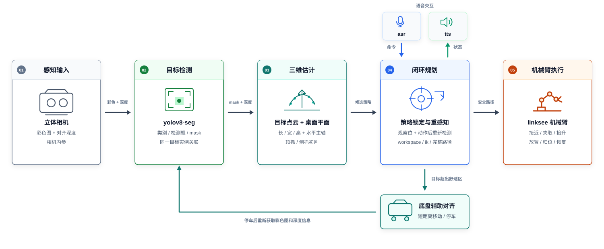

# 深度视觉抓取

`perceptive_grasp` 是面向 Linksee 轮式机器人的桌面闭环感知抓取应用。系统从 RGB-D 图像中检测并分割目标，通过深度反投影、eye-to-hand 手眼标定和三维几何规划生成顶抓或侧抓路径，再驱动底盘、机械臂和夹爪完成对齐、抓取、放置与安全恢复。

同一套 pipeline 支持三种部署方式，共用感知、规划、任务控制和语音接口。

| 部署方式 | 设备及执行后端 | 部署位置 |
| --- | --- | --- |
| Linksee 真机 | `manipulation` 控制 SO101 与夹爪；`libchassis` 控制底盘 | K3 |
| MuJoCo 同机部署 | UR5e + Robotiq 2F-85 仿真（`manipulation`） | 仿真服务与 pipeline 在同一台 PC 或 K3 |
| MuJoCo 跨机部署 | UR5e + Robotiq 2F-85 仿真（`manipulation`） | 服务在 PC，pipeline 在 K3 |

真机使用 `config/grasp_pipeline.yaml`，RGB-D 输入选择 RealSense D435i 或 `spacemit_las2`。

本文的仿真部署采用独立的仿真服务和抓取 pipeline，分别读取以下配置：

- **仿真服务**（`mujoco_grasp_sim_server`）：`config/grasp_pipeline_manipulation_mujoco.yaml`，配置仿真场景、模拟 RGB-D 相机和仿真设备。
- **抓取 pipeline**（`perceptive_grasp`）：`config/grasp_pipeline_manipulation_remote.yaml`，配置服务连接、感知和任务参数。

同机部署直接连接 `127.0.0.1:9090`；跨机部署通过 SSH 端口转发连接 PC 上的服务，K3 的 pipeline 仍使用该回环地址。

系统由以下模块组成：

- 感知输入：RealSense D435i、`spacemit_las2` 或 MuJoCo 后端，输出像素对齐的彩色图、深度图和相机内参。
- 目标检测：K3 使用 `vision_service`，PC 使用 OpenCV DNN；两者运行 YOLOv8-Seg 并输出目标类别、检测框和分割掩码。仿真配置还可以使用实例颜色细化或补充分割掩码。
- 三维估计：`grasp_geometry`，生成目标点云并估计桌面平面、三维尺寸和水平主轴。
- 任务控制：`grasp_pipeline` 完成目标关联、策略锁定、观察或底盘动作后的重感知、执行编排和失败恢复。
- 抓取规划：`grasp_planner` 和 `grasp_geometry` 生成并验证顶抓或侧抓候选。
- 机械臂执行：`manipulation` 统一控制真机和仿真设备；应用完成接近、夹取、抬升、放置、归位和失败恢复。
- 手眼标定：通过统一设备接口采集静止姿态，与其他应用共用公共标定会话、求解和外参格式。
- 底盘对齐：`libchassis` 调整机器人与目标的相对位置。
- 语音交互：`spacemit_audio`、VAD、ASR 和 TTS 接收命令并播报状态。

本方案适用于桌面或近距离场景中的单目标抓取。底盘辅助不提供导航、避障和全局路径规划。

## 1. 方案概述

下图以 Linksee 真机为主线展示感知抓取链路；MuJoCo 模式复用任务状态机和抓取规划，只替换 RGB-D 与机械臂执行后端：

1. **感知输入**：RGB-D 后端输出彩色图、对齐深度和相机内参。
2. **目标检测**：YOLOv8-Seg 输出目标类别、检测框和分割掩码，pipeline 在连续帧中关联同一目标并等待目标稳定。
3. **三维估计**：几何规划器生成目标点云并拟合桌面平面，估计目标长、宽、高和水平主轴，完成顶抓或侧抓初判。
4. **闭环规划**：pipeline 锁定抓取策略，进入对应观察位，并在观察动作或底盘动作后重新检测。候选需要通过工作空间、逆运动学（IK）、关节限制、桌面间隙和完整路径检查。
5. **机械臂执行**：Linksee 机械臂依次完成接近、夹取、抬升、放置、归位和失败恢复。

闭环规划还包含以下支路：

- **底盘辅助对齐**：目标超出舒适抓取区时，底盘执行短距离移动并停车，然后返回目标检测，重新获取彩色图像和深度信息。
- **语音交互**：ASR 向任务状态机输入抓取命令，TTS 播报任务状态。



## 2. 硬件准备

运行本方案需要以下硬件：

- Linksee 轮式机器人，提供 K3 计算平台、机械臂、差速底盘和机身结构。
- RGB-D 相机，支持 RealSense D435i 或 `spacemit_las2` 双目相机。
- 麦克风和扬声器，启用语音交互时需要。

实物连接如图所示：

| 相机安装 | 硬件连接 |
| --- | --- |
|  |  |

- 左图展示 RGB-D 相机面向机械臂工作区的安装方式。
- 右图展示 K3 与 RGB-D 相机、机械臂、底盘和音频设备的连接关系。
- 相机固定在机身顶部，机械臂工作区应同时位于彩色图像和有效深度范围内。

## 3. 应用部署

### 3.1 获取代码

以下命令默认 SDK 位于 `~/spacemit_robot`：

```bash
mkdir -p ~/spacemit_robot
cd ~/spacemit_robot
repo init -u https://github.com/spacemit-robotics/manifest.git \
  -b main \
  -m default.xml \
  --repo-url=https://gitee.com/spacemit-robotics/git-repo
repo sync -j4
repo start robot-dev --all
```

每次打开新终端后，先加载 SDK 环境：

```bash
cd ~/spacemit_robot
source build/envsetup.sh
```

### 3.2 安装软件依赖

#### 安装公共依赖

1. 安装源码管理、构建、Python 和运动学依赖：

```bash
sudo apt update
sudo apt install -y \
  git \
  repo \
  wget \
  unzip \
  patchelf \
  cmake \
  build-essential \
  meson \
  ninja-build \
  python3-pip \
  python3-venv \
  v4l-utils \
  libyaml-cpp-dev \
  libeigen3-dev \
  libopencv-dev \
  libopenblas0-pthread \
  openblas-spacemit \
  spacemit-onnxruntime \
  libglfw3-dev \
  libgl1-mesa-dev \
  libx11-dev
```

`manipulation` 组件内置 `eigen` 运动学后端（`MANIPULATION_ENABLE_KINEMATICS_EIGEN` 默认开启），正逆运动学只使用 `libeigen3-dev` 提供的 Eigen3 头文件，无需另外下载和编译运动学库。

2. 创建 Python 虚拟环境：

```bash
cd ~/spacemit_robot/application/ros2/linksee/perceptive_grasp
python3 -m venv ~/.venv-grasp
source ~/.venv-grasp/bin/activate
python3 -m pip install --upgrade pip
python3 -m pip install -r requirements.txt
```

该虚拟环境只用于运行应用侧的 Python 脚本。**编译 SDK 组件前必须先退出**，否则下一小节的依赖检查会误判：

```bash
deactivate
```

`mm --with-deps` 通过 `python3 -c 'import can'` 这类命令检查系统包。激活虚拟环境后 `python3` 指向 venv 中的解释器，而 venv 默认不继承系统 site-packages，`apt` 安装的 `python3-can`、`python3-typing-extensions` 在其中不可见，检查会持续报 `still missing after installation`，即使 `apt` 已经装好。

#### 构建 SDK 组件

`mm` 会将公共头文件和动态库安装到 `~/spacemit_robot/output/staging`。编译 C++ 组件不需要 Python 虚拟环境，进入本小节前确认当前终端已 `deactivate`；新开终端不会自动激活 venv，无需处理。

按以下顺序构建组件：

1. 激活 SDK 环境变量

```bash
cd ~/spacemit_robot
source build/envsetup.sh
```

2. 底盘控制组件提供 uart 驱动，用于短距离前后移动和原地转向。

```bash
cd ~/spacemit_robot/components/control/base
mm

ls ~/spacemit_robot/output/staging/include/chassis.h
ls ~/spacemit_robot/output/staging/lib/libchassis.so
```

3. 视觉推理组件提供 `vision_service` 接口，并通过 SpaceMIT EP 在 X100 AI 核上执行 YOLOv8-Seg 推理。

```bash
cd ~/spacemit_robot/components/model_zoo/vision
mm -- -C "$SROBOTIS_ROOT/application/ros2/linksee/perceptive_grasp/cmake/vision-k3-system-cpp.cmake"

ls ~/spacemit_robot/output/staging/include/vision_service.h
ls ~/spacemit_robot/output/staging/lib/libvision.so
```

`vision-k3-system-cpp.cmake` 由 Linksee 提供，使用现有 `vision` 组件源码构建 C++ 视觉库和测试工具。该配置使用系统 OpenCV、Eigen 和 OpenBLAS，不构建 Python 扩展、wheel 或示例程序。OpenBLAS 使用 `openblas-spacemit` 提供的同版本 LP64 头文件；配置阶段检查头文件与系统运行库是否匹配。

该配置会覆盖当前构建缓存中的依赖与功能开关，后续 `mm` 沿用该缓存。切换回全量构建时，使用新的构建目录或清理视觉组件的构建缓存。

4. `manipulation` 组件提供机械臂、夹爪、正逆运动学和标定工具。以下配置同时构建 MuJoCo 物理世界、窗口和 RGB-D 渲染。

```bash
cd ~/spacemit_robot/components/control/manipulation
mm --with-deps \
  -DMANIPULATION_ENABLE_MUJOCO=ON \
  -DMANIPULATION_ENABLE_SIMULATION_RENDERER=ON
manipulation drivers --roles
manipulation-simulation --help
```

#### 准备检测模型

下载 YOLOv8-Seg 模型并安装 COCO 标签：

```bash
cd ~/spacemit_robot/components/model_zoo/vision/examples/yolov8_seg
bash scripts/download_models.sh

mkdir -p ~/.cache/models/vision/labels
cp ~/spacemit_robot/components/model_zoo/vision/assets/labels/coco.txt \
  ~/.cache/models/vision/labels/coco.txt

ls ~/.cache/models/vision/yolov8_seg/yolov8n-seg.q.onnx
ls ~/.cache/models/vision/labels/coco.txt
```

#### 准备 RGB-D 相机后端

应用只初始化 `camera.type` 选中的后端。CMake 自动探测本机已安装的后端。运行时选择的后端必须包含在构建摘要中。

- 使用 RealSense D435i 时，安装运行库和工具：

```bash
sudo apt install -y ros-humble-librealsense2
source /opt/ros/humble/setup.sh
rs-enumerate-devices --version
```

- 使用 `spacemit_las2` 时，从托管站点下载运行时和深度模型。默认目录为 `~/las2_runtime`，无需额外设置环境变量：

```bash
cd ~
wget -O las2_runtime_handoff.zip \
  https://archive.spacemit.com/spacemit-ai/model_zoo/vla/libs/las2/las2_runtime_handoff.zip
unzip -oq las2_runtime_handoff.zip

mkdir -p ~/las2_runtime/models
wget -O ~/las2_runtime/models/LAS2_M_256x320.fp16.iofp32.corr_func_nhwc.gelu.onnx \
  https://archive.spacemit.com/spacemit-ai/model_zoo/vla/libs/las2/LAS2_M_256x320.fp16.iofp32.corr_func_nhwc.gelu.onnx

ls ~/las2_runtime/include/las2_usb_stereo.h
ls ~/las2_runtime/lib/liblas2_usb_stereo.so
ls ~/las2_runtime/models/LAS2_M_256x320.fp16.iofp32.corr_func_nhwc.gelu.onnx
ls ~/las2_runtime/config/matlab_stereo_opencv.json
```

`spacemit_las2` 使用双目标定文件计算深度和三维坐标。

#### 准备语音模型（可选）

只使用命令行抓取时可以跳过本节。本地语音桥需要 VAD、ASR、TTS 和中文文本规范化资源：

```bash
mkdir -p ~/.cache/models/asr
cd ~/.cache/models/asr
wget -O sensevoice.tar.gz \
  https://archive.spacemit.com/spacemit-ai/model_zoo/asr/sensevoice.tar.gz
tar -xzf sensevoice.tar.gz

# 使用 Qwen3-ASR 时安装 K3 优化运行时并准备模型
sudo apt install -y llama.cpp-tools-spacemit
mkdir -p ~/.cache/models/asr/qwen3asr
cd ~/.cache/models/asr/qwen3asr
wget -O qwen3-asr-0.6B-dynq-q40.tar.gz \
  https://archive.spacemit.com/spacemit-ai/model_zoo/asr/qwen3-asr-0.6B-dynq-q40.tar.gz
tar -xzf qwen3-asr-0.6B-dynq-q40.tar.gz
rm -f qwen3-asr-0.6B-dynq-q40.tar.gz

mkdir -p ~/.cache/models/vad/silero
wget -O ~/.cache/models/vad/silero/silero_vad.onnx \
  https://archive.spacemit.com/spacemit-ai/model_zoo/vad/silero/silero_vad.onnx

mkdir -p ~/.cache/models/tts/matcha-tts
cd ~/.cache/models/tts/matcha-tts
wget -O matcha-icefall-zh-baker.tar.gz \
  https://archive.spacemit.com/spacemit-ai/model_zoo/tts/matcha-tts/matcha-icefall-zh-baker.tar.gz
tar -xzf matcha-icefall-zh-baker.tar.gz

mkdir -p ~/.cache/models/tts/vocoder
wget -O ~/.cache/models/tts/vocoder/vocos-22khz-univ.q.onnx \
  https://archive.spacemit.com/spacemit-ai/model_zoo/tts/vocoder/vocos-22khz-univ.q.onnx

mkdir -p ~/.cache/models/tts/text_norm/v1/zh
cd ~/.cache/models/tts/text_norm/v1/zh
wget https://archive.spacemit.com/spacemit-ai/model_zoo/tts/text_norm/v1/zh/date.fst
wget https://archive.spacemit.com/spacemit-ai/model_zoo/tts/text_norm/v1/zh/new_heteronym.fst
wget https://archive.spacemit.com/spacemit-ai/model_zoo/tts/text_norm/v1/zh/number.fst
wget https://archive.spacemit.com/spacemit-ai/model_zoo/tts/text_norm/v1/zh/phone.fst
```

Qwen3-ASR 媒体后端需要 `llama.cpp-tools-spacemit 0.1.7` 或更高版本。应用在选择 `qwen3_asr` 后会自动启动本机 `llama-server`，无需单独常驻服务。

### 3.3 选择发布配置并设置 RGB-D 后端

三份配置分别用于 Linksee 真机、PC 或 K3 本机仿真服务，以及连接服务的仿真 pipeline。首次运行环境检查前，先选择与部署模式匹配的配置文件：

| 配置文件 | 用途 | 需要现场修改的内容 |
| --- | --- | --- |
| `config/grasp_pipeline.yaml` | Linksee 真机抓取 | RGB-D 后端、设备路径、手眼标定、机械臂与底盘串口、音频设备 |
| `config/grasp_pipeline_manipulation_mujoco.yaml` | PC 或 K3 本机仿真 pipeline 与服务 | 场景资源和 `manipulator.mujoco.device_plan`；本章启动器固定监听回环地址 |
| `config/grasp_pipeline_manipulation_remote.yaml` | PC 或 K3 连接仿真服务 | `remote_mujoco.host`、端口和可选音频设备；本章通过 SSH 转发连接远端 |

仿真构建和启动使用 [6 节](#6-mujoco-仿真) 的统一脚本。本章使用 `grasp_pipeline_manipulation_mujoco.yaml` 和 `grasp_pipeline_manipulation_remote.yaml` 配置。

真机主配置为 `config/grasp_pipeline.yaml`，至少完成以下设置：

- 通过 `camera.type` 选择 RGB-D 相机后端。
- 填写所选后端需要的设备、模型和标定文件路径。
- 其他参数保留发布配置中的默认值。

#### RealSense D435i 深度相机

使用 RealSense D435i 时配置为：

```yaml
camera:
  type: "realsense"
  realsense:
    width: 640
    height: 480
    fps: 30
    motion_flush_frames: 30
    align_depth: true
    depth_filter:
      spatial: true
      temporal: false
      hole_filling: false
```

#### `spacemit_las2` 双目相机

使用 `spacemit_las2` 时，先连接双目相机并查询稳定的视频设备路径：

```bash
ls -l /dev/v4l/by-id/*-video-index0
```

完成以下准备后配置 `spacemit_las2`：

- 将输出中指向双目相机的 `/dev/v4l/by-id/...-video-index0` 路径写入 `video_device`。
- 确认模型和双目标定文件位于 `~/las2_runtime`。

```yaml
camera:
  type: "spacemit_las2"
  spacemit_las2:
    video_device: "/dev/v4l/by-id/<video-index0>"
    model_path: "~/las2_runtime/models/LAS2_M_256x320.fp16.iofp32.corr_func_nhwc.gelu.onnx"
    calib_path: "~/las2_runtime/config/matlab_stereo_opencv.json"
    core_count: 1
    core_affinity: "8"
    depth:
      min_m: 0.05
      max_m: 2.0
```

`spacemit_las2` 参数说明如下：

- `model_path`：`spacemit_las2` 深度模型路径。
- `calib_path`：当前双目相机的标定文件路径。
- `core_count`：深度推理会话数。默认使用一个会话，减少 X100 AI 核竞争，并将其余 AI 核留给 YOLOv8-Seg。
- `core_affinity`：每个会话绑定的 X100 AI 逻辑核，有效范围为 `8–15`，条目数必须与 `core_count` 一致。

#### 目标检测

目标检测使用 YOLOv8-Seg 和 SpaceMIT EP。发布配置如下：

```yaml
detection:
  config_path: yolov8_seg.yaml
  target_labels: []
  min_confidence: 0.10
  min_area: 1000
  stable_frames: 3
```

- `target_labels` 为空时检测全部 COCO 类别。
- `min_confidence` 和 `min_area` 分别过滤低置信度和过小目标。
- `stable_frames` 表示目标检测框的位置和面积连续稳定多少帧后进入规划。目标仍在移动时，pipeline 保持在检测阶段。

### 3.4 构建并安装应用

先完成 3.2 节的 SDK 组件与相机依赖安装。以下配置包含 VisionService、真实硬件执行器、RealSense 后端以及本机和远程 MuJoCo：

```bash
cd ~/spacemit_robot
source build/envsetup.sh
cd application/ros2/linksee/perceptive_grasp
cmake -S . -B build \
  -DCMAKE_BUILD_TYPE=Release \
  -DCMAKE_INSTALL_PREFIX="$PREFIX" \
  -DCMAKE_PREFIX_PATH="$PREFIX" \
  -DOpenCV_DIR=/usr/lib/riscv64-linux-gnu/cmake/opencv4 \
  -DX86_STANDALONE=OFF \
  -DUSE_OPENCV_DNN=OFF \
  -DUSE_MOCK_EXECUTOR=OFF \
  -DENABLE_MUJOCO_EXECUTOR=ON \
  -DENABLE_REMOTE_MUJOCO=ON \
  -DENABLE_LAS2_CAMERA=OFF \
  -DENABLE_WEBRTC_AEC=OFF \
  -DENABLE_ROS2_VOICE=OFF
cmake --build build -j2
cmake --install build
```

程序安装到 `$PREFIX/bin`，配置、URDF、场景和脚本安装到 `$PREFIX/share/perceptive_grasp`。`perceptive_grasp` 是结构化日志启动器，`perceptive_grasp_core` 是运行 pipeline 的 C++ 程序；正常运行使用启动器。`debug_grasp` 提供感知与规划诊断入口。

安装完成后检查入口和配置。这些命令不初始化相机、机械臂或底盘：

```bash
"$PREFIX/bin/perceptive_grasp" --wrapper-help
"$PREFIX/bin/perceptive_grasp" \
  --config "$PREFIX/share/perceptive_grasp/config/grasp_pipeline.yaml" \
  --validate-config
"$PREFIX/bin/debug_grasp" --help
```

输出包含 `[Config] valid` 时，配置结构和字段取值通过检查。该检查不确认模型文件、设备连接或现场标定结果。

后续现场配置和运行示例使用源码目录中的 `config/`，通过 `--config` 传给安装程序。修改后的配置需要重新安装，才会更新 `$PREFIX/share/perceptive_grasp/config/`。

主要构建选项如下。表中默认值指不传入选项时的 CMake 默认值；上面的安装命令显式选择了本节使用的配置。

| 选项 | 默认值 | 作用 |
| --- | --- | --- |
| `ENABLE_LAS2_CAMERA` | `ON` | 构建 `spacemit_las2` 后端，需准备 LAS2 运行时 |
| `ENABLE_WEBRTC_AEC` | `ON` | 构建 WebRTC 软件回声消除模块 |
| `ENABLE_ROS2_VOICE` | `OFF` | 构建 ROS 2 `std_msgs/String` 语音话题桥；本地语音桥不依赖该项 |
| `ENABLE_MUJOCO_EXECUTOR` | `OFF` | 通过 `manipulation` 构建本机仿真执行器与服务 |
| `ENABLE_REMOTE_MUJOCO` | `OFF` | 构建可连接本机或远程仿真服务的应用抓取协议客户端 |
| `X86_STANDALONE` | `OFF` | 使用 OpenCV DNN 与 mock 执行器构建主机程序，不控制真实机械臂和底盘 |
| `LAS2_RUNTIME_DIR` | `~/las2_runtime` | 指定 LAS2 运行时目录 |

准备可选依赖后，重新配置对应的 `ENABLE_*` 选项并构建安装。启用 `ENABLE_WEBRTC_AEC=ON` 时，首次配置会下载固定版本的 `webrtc-audio-processing` 到 `~/.cache/thirdparty`。

本节安装命令关闭 WebRTC AEC。使用本地语音桥时，将 `voice.echo_cancellation.mode` 设为 `half_duplex`，或在音频设备提供回声消除时使用 `hardware_aec`。

构建摘要中的 `Detector` 应为 `VisionService`，`Executor` 应为 `Real hardware`，`Camera` 应包含 `realsense`。实际运行后端由 `camera.type` 选择，须包含在本次构建的可用后端中。

### 3.5 硬件配置和运行前检查

连接设备前关闭机械臂和底盘动力。运行用户需要访问串口、视频和音频设备：

```bash
sudo usermod -aG dialout,video,audio "$USER"
exec su - "$USER"
```

使用 `spacemit_las2` 时，还需要允许 `video` 用户组访问 DMA heap：

```bash
echo 'SUBSYSTEM=="dma_heap", KERNEL=="system", GROUP="video", MODE="0660"' | \
  sudo tee /etc/udev/rules.d/99-las2-dma-heap.rules
sudo udevadm control --reload-rules
sudo chgrp video /dev/dma_heap/system
sudo chmod 0660 /dev/dma_heap/system
```

连接硬件后首次执行运行环境检查：

```bash
cd ~/spacemit_robot/application/ros2/linksee/perceptive_grasp
source ~/spacemit_robot/build/envsetup.sh
source ~/.venv-grasp/bin/activate
python3 scripts/check_runtime_env.py \
  --config config/grasp_pipeline.yaml \
  --build-dir "$PREFIX/bin" \
  --no-fix
```

运行环境检查包括：

- 根据 `camera.type` 检查相机设备、运行库、模型和标定文件。
- 识别机械臂、底盘和音频设备。
- 给出机械臂和底盘的稳定串口路径。

设备路径尚未更新时，首次检查可以出现 `[FAIL]`：

```text
[SUGGEST] device.arm.options.port and device.effector.options.port: "/dev/serial/by-id/..."
[SUGGEST] mobile_base.dev_path: "/dev/serial/by-id/..."
```

#### 配置机械臂和底盘

机械臂与夹爪的稳定串口写入 `config/devices/linksee_so101.yaml` 中各自的 `options.port`，两者使用同一路径。

将本台设备的舵机校准文件放入该目录，已有文件不覆盖：

```bash
read -erp "本台 SO101 校准文件目录: " SO101_CALIBRATION
cp -n "$SO101_CALIBRATION/so101_calibration.json" config/devices/
cp -n "$SO101_CALIBRATION/so101_gripper_calibration.json" config/devices/
```

首次安装须先完成 SO101 舵机校准，不能使用其他机械臂的偏置和行程。

主配置保留任务姿态、模型及底盘参数。以下片段不要替换完整配置文件：

```yaml
manipulator:
  device_plan: "devices/linksee_so101.yaml"
  model: "devices/so101_model.json"
  calibration_resources:
    - "devices/so101_calibration.json"
    - "devices/so101_gripper_calibration.json"
  kinematics_solver: "eigen"
  urdf_path: "../urdf/so101.urdf"
  home_joints: [1.546, -1.765, 1.400, 1.093, 0.186]
  observe_joints: [1.544, -0.067, 0.101, 1.382, 0.188]
  side_ready_joints: [1.550, 0.021, 1.400, -1.700, -0.036]
  joint_limits:
    - {joint: 0, min: -1.540, max: 1.630}
    - {joint: 1, min: -1.770, max: 1.680}
    - {joint: 2, min: -1.840, max: 1.430}
    - {joint: 3, min: -1.790, max: 1.670}
    - {joint: 4, min: -2.700, max: 2.800}

place:
  place_joints: [-1.500, -0.122, 0.101, 1.383, 0.330]
  release_open: 0.5

mobile_base:
  enabled: true
  dev_path: "/dev/serial/by-id/<底盘串口>"
  target_x: 0.275
  x_tolerance: 0.035
  y_tolerance: 0.15
  max_step_m: 0.12
  linear_speed: 0.20
  angular_speed: 1.2
  min_cmd_duration_ms: 350
  max_align_attempts: 6
  max_total_travel_m: 0.24
```

- `target_x ± x_tolerance` 定义目标的前向舒适区。
- `y_tolerance` 定义相对机械臂基座中心线的横向允许偏差。
- `max_align_attempts` 和 `max_total_travel_m` 限制单轮任务的底盘对齐次数和累计直线移动距离。
- `observe_joints` 和 `side_ready_joints` 分别定义顶抓与侧抓观察姿态。
- `home_joints` 和 `place_joints` 分别定义任务归位姿态和放置姿态。更换机械臂后，应在完成关节标定的前提下重新确认这些预定义姿态。
- 底盘将目标移入舒适区后，pipeline 仍会执行机械臂工作空间和逆运动学可达性检查。

#### 配置抓取策略

`grasp.strategy` 支持 `auto`、`top` 和 `side`。发布配置使用 `auto`，根据目标三维高度、水平尺寸和候选可达性选择顶抓或侧抓，不读取目标类别。

```yaml
grasp:
  strategy: "auto"
  top:
    approach_height: 0.10
    grasp_depth: 0.015
    gripper_offset: 0.0
    grasp_point_x_ratio: 1.0
    position_source: "mask_depth"
    safe_mask_interior: false
    support_plane_occlusion_recovery: false
    support_plane_height_anchor: false
    minimum_grasp_height: 0.0
    verification_lift_m: 0.0
    gripper_open: 0.6
  side:
    min_height_m: 0.060
    min_height_width_ratio: 1.0
    approach_distance_m: 0.020
    entry_clearance_m: 0.030
    pregrasp_min_x_m: 0.270
    single_sided_gripper: true
    gripper_offset_m: 0.010
    grasp_forward_offset_m: 0.020
    grasp_height_ratio: 0.60
    initial_lift_m: 0.050
    lift_retreat_m: 0.025
  gripper_effort: 0.8
  gripper_hold_load_threshold: 100.0
  gripper_empty_position_margin: 0.03
  gripper_timeout_ms: 3000
  geometry:
    sample_stride: 2
    max_object_points: 4000
    min_object_points: 80
    plane_distance_threshold_m: 0.008
    table_clearance_m: 0.005
    footprint_padding_m: 0.005
    gripper_max_width_m: 0.10
    planning_timeout_ms: 750
    perception_budget_ms: 500
  workspace:
    x_min: 0.0
    x_max: 0.5
    y_min: -0.3
    y_max: 0.3
    z_min: 0.0
    z_max: 0.20
```

- `top` 参数只影响顶抓，`side` 参数只影响侧抓，两组参数不会互相覆盖。
- `side.min_height_m` 和 `side.min_height_width_ratio` 共同定义 `auto` 首次选择侧抓的三维形状门限。
- `side.entry_clearance_m` 控制机械臂从观察位进入侧抓区域时，夹爪下缘高于目标最高点的安全距离。
- `side.approach_distance_m` 定义预抓取位到抓取位的水平进给距离；`side.grasp_forward_offset_m` 对整套侧抓位姿施加前后补偿，不改变进给距离。
- `geometry` 控制目标点云、桌面平面、夹爪宽度和候选规划约束。
- `geometry.perception_budget_ms` 是性能告警预算。超过预算时记录 `OVERRUN`，但不会仅因耗时超限而终止安全候选。
- `workspace` 是机械臂动作前的安全边界。底盘对齐不会绕过工作空间和 IK 检查。
- 夹爪负载和闭合位置共同用于判断是否抓住目标。

#### 配置语音设备（可选）

启用本地语音交互时，根据检查结果更新采集设备和播放设备编号：

```yaml
voice:
  echo_cancellation:
    mode: "webrtc_aec"
    delay_ms: 50
    noise_suppression: true
    high_pass_filter: true

  asr:
    backend: "sensevoice"
    device: 1
    device_name: ""
    rate: 16000
    channels: 1
    channel_index: -1
    mixer_volume: 40
    vad_trigger_threshold: 0.4
    vad_stop_threshold: 0.3
    vad_min_speech_duration_ms: 100
    vad_endpoint_hold_ms: 600
    vad_max_speech_duration_ms: 4000

  tts:
    enabled: true
    engine: "matcha:zh"
    playback_device: 1
    playback_device_name: ""
    playback_rate: 48000
    channels: 1
    speed: 1.0
    volume: 80
    mixer_volume: 80
    speak_all_states: false
```

使用 `webrtc_aec` 前须启用 `ENABLE_WEBRTC_AEC=ON` 并重新构建安装；按 3.4 节安装时，将上述 `mode` 改为 `half_duplex` 或 `hardware_aec`。

语音设备参数说明如下：

- `echo_cancellation.mode`：普通麦克风和扬声器组合使用 `webrtc_aec`；音频硬件已输出消除回声后的录音流时使用 `hardware_aec`；无法使用回声消除时使用 `half_duplex`。
- `echo_cancellation.delay_ms`：扬声器播放到回声进入麦克风的估计延迟，仅用于 `webrtc_aec`。
- `asr.backend`：ASR 后端，可选 `sensevoice` 或 `qwen3_asr`。
- `asr.device_name`：采集设备名称。非空时优先按名称解析当前设备编号；未配置时使用 `asr.device`。
- `asr.device`：采集设备编号。
- `tts.enabled`：是否启用状态语音播报。
- `tts.playback_device_name`：播放设备名称。非空时优先按名称解析当前设备编号；未配置时使用 `tts.playback_device`。
- `tts.playback_device`：播放设备编号。
- `rate`、`playback_rate` 和 `channels`：录音与播放格式，应与所选设备支持的格式一致。
- `mixer_volume`：启动时设置的 ALSA 录音增益或 `PCM` 音量，设为 `-1` 时不修改 mixer。

设备不支持默认格式时，语音桥会探测可用格式并输出最终选择结果。

`hardware_aec` 和 `webrtc_aec` 在 TTS 播放期间保持 VAD 和 ASR 连续运行。`half_duplex` 会在 TTS 播放期间暂停语音识别。

#### 复查运行环境

更新配置并修正其他 `[FAIL]` 项后，重新执行检查：

```bash
python3 scripts/check_runtime_env.py \
  --config config/grasp_pipeline.yaml \
  --build-dir "$PREFIX/bin" \
  --no-fix
```

环境可运行时，最后一行显示：

```text
[SUMMARY] ready
```

### 3.6 执行手眼标定

`perceptive_grasp` 使用 eye-to-hand 标定计算 RGB-D 相机坐标系到机械臂基座坐标系的变换。安装如图所示，要求如下：

- RGB-D 相机固定在机身上。
- ChArUco 标定板刚性固定在夹爪末端。


#### 标定板生成

生成 4 × 5 ChArUco 标定板：

```bash
cd ~/spacemit_robot/application/ros2/linksee/perceptive_grasp
source ~/spacemit_robot/build/envsetup.sh
source ~/.venv-grasp/bin/activate
python3 scripts/generate_charuco_board.py \
  --squares-x 4 \
  --squares-y 5 \
  --square-length 0.020 \
  --marker-length 0.014 \
  --output config/charuco_4x5_20mm_14mm.png
```

#### 数据采集

采集使用 `manipulation` 只读连接，不使能、不释放力矩、不发送运动目标。按现场规程调整并停止，退出其他控制程序后输入 `CAPTURE`；一次采样结束后释放设备连接。

采集前确认安装与设备身份：

- **标定板**：相对模型末端刚性固定，采集期间不得改变夹爪开度。
- **安装标识**：`installation-id` 标识本次固定安装。会话绑定设备配置、模型、舵机校准文件和相机参数，资源变化后须新建数据目录。
- **LAS2 相机**：在 `camera.spacemit_las2.serial` 填写本台相机的序列号或固定资产编号。此字段用于登记设备身份，不自动核验 USB 设备。

采集数据时满足以下要求：

- 标定板尺寸使用打印后的实测值。
- 采集至少 15 个有效姿态。
- 姿态应覆盖左、中、右、高、低和不同腕部角度。

```bash
python3 scripts/calibrate_hand_eye.py \
  --config config/grasp_pipeline.yaml \
  --installation-id linksee_site \
  --charuco-squares-x 4 \
  --charuco-squares-y 5 \
  --charuco-square-length 0.020 \
  --charuco-marker-length 0.014 \
  --num-poses 15 \
  --dataset-dir output/hand_eye
```

#### 标定结果写入

使用采集时相同的安装标识和数据目录，求解并写回配置：

```bash
python3 scripts/calibrate_hand_eye.py \
  --solve-only \
  --installation-id linksee_site \
  --dataset-dir output/hand_eye \
  --apply-config config/grasp_pipeline.yaml
```

脚本仅导出满足质量要求的外参，更新 `calibration.<camera.type>.T_base_camera` 并备份原配置，不覆盖其他相机后端。

旧数据集可离线重算，不补造设备身份或校准来源。

#### 标定结果验证

使用定位工具验证目标在机械臂基座坐标系中的位置：

```bash
./build/debug_localize \
  --config config/grasp_pipeline.yaml \
  --target banana \
  --frames 5 \
  --output /tmp/debug_localize
```

根据定位结果检查标定质量：

- `base_point_m` 应与目标相对机械臂基座的实测位置一致。
- 存在稳定偏差时，检查标定板尺寸、采集姿态覆盖和相机固定情况。
- 不要使用抓取偏移掩盖标定误差。

### 3.7 运行抓取

**以下命令会初始化真实硬件，其中非 `--plan-only` 命令会驱动机械臂和底盘。运行前清理机器人工作空间，确认急停和断电装置可用，并保持人员远离运动范围。**

先验证配置结构。该命令不初始化硬件：

```bash
./build/perceptive_grasp_core \
  --config config/grasp_pipeline.yaml \
  --validate-config
```

输出包含 `[Config] valid` 时，配置字段和取值通过检查。

先使用 `--plan-only` 验证目标感知、抓取策略和机械臂路径。该模式会初始化硬件并读取机械臂状态，但不会发送机械臂或底盘运动命令：

```bash
cd ~/spacemit_robot/application/ros2/linksee/perceptive_grasp
source ~/spacemit_robot/build/envsetup.sh
"$PREFIX/bin/perceptive_grasp" \
  --config config/grasp_pipeline.yaml \
  --target cup \
  --plan-only
```

确认规划成功、机械臂空载且支撑可靠后，使能机械臂与夹爪，再执行真实抓取。使能会产生保持力矩；应用不自动使能设备：

```bash
cd ~/spacemit_robot/application/ros2/linksee/perceptive_grasp
source ~/spacemit_robot/build/envsetup.sh
manipulation inspect --plan config/devices/linksee_so101.yaml
manipulation enable --plan config/devices/linksee_so101.yaml
manipulation hand-enable --plan config/devices/linksee_so101.yaml
"$PREFIX/bin/perceptive_grasp" \
  --config config/grasp_pipeline.yaml \
  --target banana
```

程序按以下流程运行：

1. `DETECTING` 关联连续帧中的同一目标，并等待检测框的位置和面积满足稳定条件。
2. `PLANNING` 生成目标点云、拟合桌面平面并计算顶抓或侧抓候选。目标位置需要调整时，pipeline 进入 `BASE_ALIGNING`，停车后返回 `DETECTING`。
3. 目标位置满足要求后，pipeline 锁定抓取策略。顶抓进入 `observe_joints`，侧抓进入 `side_ready_joints`。
4. 观察动作结束后，pipeline 刷新相机数据并重新检测和规划。移动前的图像、深度和三维坐标不会复用。
5. 已锁定策略的候选通过工作空间、夹爪宽度、关节限制、IK、桌面间隙和完整路径检查后，pipeline 进入 `APPROACHING`。
6. 顶抓从目标上方向下接近。侧抓先从目标上方进入安全预抓取位，张开夹爪后下降并水平进给。
7. `GRASPING` 闭合夹爪，`LIFTING` 抬升或退出，`PLACING` 放置并释放目标，`HOMING` 完成本轮收尾。
8. 夹爪在闭合后和抬升后结合位置与负载判断是否持物。任一阶段失败时，pipeline 进入 `RECOVERING`。

底盘可以在策略锁定前或观察动作后的重规划阶段介入。每次底盘动作后都重新获取图像和深度；策略锁定后不会因单帧深度波动切换顶抓或侧抓。

连续抓取时增加 `--loop`：

```bash
"$PREFIX/bin/perceptive_grasp" \
  --config config/grasp_pipeline.yaml \
  --target banana \
  --loop
```

`--loop` 不限制循环次数。每轮完成后，机械臂回到本轮策略对应的观察位并立即开始下一轮检测。循环模式不区分上一轮目标实例，视野中满足目标类别和稳定性要求的目标可以再次被抓取。

按一次 `Ctrl+C` 后，程序等待当前动作结束并安全归位。仅在无法安全退出时，再次按 `Ctrl+C` 强制终止。

日志分为以下两种模式：

- 默认模式按阶段输出开始时间、耗时和结果，并在结束时给出 `PIPELINE SUMMARY`。
- 调试第三方库、相机、机械臂或底盘驱动时增加 `--debug`。

```bash
"$PREFIX/bin/perceptive_grasp" \
  --debug \
  --config config/grasp_pipeline.yaml \
  --target banana
```

### 3.8 启动语音控制

语音桥会启动抓取程序，并负责录音、VAD、ASR、TTS 和状态播报：

```bash
cd ~/spacemit_robot/application/ros2/linksee/perceptive_grasp
source ~/spacemit_robot/build/envsetup.sh
source ~/.venv-grasp/bin/activate
"$PREFIX/bin/perceptive_grasp" \
  --voice-control \
  --config config/grasp_pipeline.yaml
```

真机配置默认使用 SenseVoice。需要临时切换到 Qwen3-ASR 时增加 `--asr-backend qwen3_asr`；该参数只覆盖本次运行，不修改配置文件：

```bash
"$PREFIX/bin/perceptive_grasp" \
  --voice-control \
  --asr-backend qwen3_asr \
  --config config/grasp_pipeline.yaml
```

终端出现以下日志后即可发送语音命令：

```text
[VoiceBridge] Listening: ...
```

支持的命令包括：

- “抓香蕉”：启动一次香蕉抓取任务。
- “停止”：取消当前任务。夹爪未持物时回到观察位继续等待；夹爪可能持物时回到 home 位并退出。
- “结束”或“回家”：机械臂回到 home 姿态并退出程序。

## 4. 检查真机抓取结果与日志

使用顶抓和侧抓目标分别运行完整任务，检查以下结果：

- RGB-D 彩色图、深度图和相机内参初始化成功。
- 目标连续稳定后进入规划；观察动作或底盘动作结束后重新获取 RGB-D 数据。
- 候选通过工作空间、夹爪宽度、关节限制、IK、桌面间隙和完整路径检查。
- pipeline 依次完成 `APPROACHING`、`GRASPING`、`LIFTING`、`PLACING` 和 `HOMING`。
- 目标在夹爪闭合并确认持物后抬升，最终放置到指定区域。
- 最终摘要显示 `result=SUCCESS`，且没有进入 `RECOVERING` 或出现未处理错误。

默认日志用于核对阶段耗时和结果：

- `[Init]`：输出相机、检测器、机械臂和底盘的初始化结果。
- `[Stage N]`：输出状态机阶段、阶段耗时和结果。
- `[Action]`：输出机械臂、夹爪或底盘动作耗时。
- `[Timing] stage=PERCEPTION_PLANNING`：输出单轮感知与规划耗时、预算和结果。
- `PIPELINE SUMMARY`：汇总初始化、任务、端到端耗时和最终失败原因。

## 5. 运行效果

`spacemit_las2` 真机抓取效果如下：


## 6. MuJoCo 仿真

示例使用 UR5e、Robotiq 2F-85 和固定式 RGB-D 相机，将绿色取物区内的物体搬运到红色放置区。机械臂、夹爪、模拟相机和窗口共享同一个 `manipulation` 仿真世界。仿真配置关闭底盘对齐，不连接真实设备。

本节采用独立的仿真服务和抓取 pipeline，支持同机与跨机部署：

| 部署方式 | 仿真服务与场景 | 抓取 pipeline |
| --- | --- | --- |
| 同机部署 | PC 或 K3 | 与服务运行在同一设备 |
| 跨机部署 | PC | K3 |

两种部署均由 `serve` 读取仿真服务配置，由 `grasp` 读取抓取 pipeline 配置。同机直接连接回环地址，跨机通过 SSH 转发连接 PC 服务。

### 6.1 安装并构建本机仿真

在 PC 或 K3 安装构建与图形依赖。显示窗口和模拟相机均需要 X11 桌面会话；K3 使用带 EGL/GLES 图形驱动的桌面镜像，并先登录桌面：

```bash
sudo apt update
sudo apt install -y build-essential cmake pkg-config git python3 ca-certificates libopencv-dev \
  libyaml-cpp-dev liburdfdom-dev libglfw3-dev libgl1-mesa-dev libx11-dev
cd ~/spacemit_robot/application/ros2/linksee/perceptive_grasp
python3 scripts/run_manipulation_simulation.py build
```

构建自动获取缺失的 MuJoCo 和场景资源，产物位于 `build_manipulation/`：

- `prefix/`：公共组件安装目录。
- `app/`：本机应用。

图形后端在 K3 上使用 X11/gl4es，在 PC 上使用 GLFW/OpenGL。

上述脚本使用 OpenCV DNN 构建，并启用场景颜色辅助分割，未安装 YOLO 模型时也可运行；该设置只用于配套合成场景。

按 3.4 节安装的 K3 程序已包含仿真服务与客户端，无需另建示例目录。该构建使用 VisionService，需按 3.2 节准备 YOLO 模型和标签。安装目录中的启动命令如下：

```bash
source ~/spacemit_robot/build/envsetup.sh
"$PREFIX/bin/mujoco_grasp_sim_server" \
  --config "$PREFIX/share/perceptive_grasp/config/grasp_pipeline_manipulation_mujoco.yaml" \
  --viewer
```

保持服务运行，在另一终端执行：

```bash
source ~/spacemit_robot/build/envsetup.sh
"$PREFIX/bin/perceptive_grasp" \
  --config "$PREFIX/share/perceptive_grasp/config/grasp_pipeline_manipulation_remote.yaml" \
  --target apple
```

配置及完整场景位于 `$PREFIX/share/perceptive_grasp`，可从任意工作目录启动；服务所在设备仍须提供 X11 图形环境。

### 6.2 启动本机仿真服务

在 PC 或 K3 的应用目录运行：

```bash
python3 scripts/run_manipulation_simulation.py serve
```

服务使用 `config/grasp_pipeline_manipulation_mujoco.yaml`，仅监听 `127.0.0.1:9090`。

`manipulator.mujoco.device_plan` 必须指向公共设备配置，机械臂与夹爪分别选择 `mujoco_ur5e` 和 `mujoco_robotiq_2f85`。设备映射中的 `scene` 指定 MJCF 场景，机械臂、夹爪和相机共用该物理世界。

- **视角操作**：通过鼠标旋转、平移和缩放。
- **抓取目标**：`apple`、`banana`、`cube` 和 `cup` 位于绿色取物区。
- **场景状态**：切换目标时保留，重新启动服务后恢复初始状态。

`serve --no-viewer` 关闭窗口，但模拟 RGB-D 相机仍需要图形上下文。无桌面运行须准备 Xvfb 虚拟显示，或使用 PC 服务与 K3 远程客户端部署。

### 6.3 运行本机抓取

保持服务运行，在同一应用目录的另一终端执行：

```bash
cd ~/spacemit_robot/application/ros2/linksee/perceptive_grasp
python3 scripts/run_manipulation_simulation.py grasp apple
```

启动器使用 `config/grasp_pipeline_manipulation_remote.yaml`，通过 `127.0.0.1:9090` 连接同机服务。目标可选 `apple`、`banana`、`cube`、`cup`；前三种使用顶抓，杯子使用侧抓。

### 6.4 PC 显示、K3 远程抓取

跨机部署沿用同机部署的两份配置。PC 按 6.1 和 6.2 节构建并启动仿真服务；K3 运行 pipeline，通过 SSH 端口转发连接服务。

在 K3 构建纯客户端，然后建立 SSH 转发：

```bash
sudo apt update
sudo apt install -y build-essential cmake pkg-config python3 openssh-client \
  libopencv-dev libyaml-cpp-dev liburdfdom-dev
cd ~/spacemit_robot/application/ros2/linksee/perceptive_grasp
python3 scripts/run_manipulation_simulation.py build --client-only
read -rp "PC SSH 地址（用户@主机）: " SIM_PC
ssh -N -L 9090:127.0.0.1:9090 "$SIM_PC"
```

保持 SSH 转发，在 K3 同一应用目录的另一终端执行：

```bash
cd ~/spacemit_robot/application/ros2/linksee/perceptive_grasp
python3 scripts/run_manipulation_simulation.py grasp apple --client-only
```

纯客户端产物位于 `build_manipulation/client/`，不需要 K3 本机显示器或 MuJoCo。

服务仅监听回环地址；SSH 转发将 K3 的 `127.0.0.1:9090` 接到 PC 的同一端口，客户端配置无需改为 PC 的 IP 地址。

`grasp` 的 `--host`、`--port` 同时设置远程相机和机械臂的应用服务地址，本例保留默认值。

SDK 提供两种不同协议的仿真服务：

| 服务 | 协议 | 默认端口 |
| --- | --- | --- |
| 本章的 `mujoco_grasp_sim_server` | 应用抓取协议 | `9090` |
| [机械臂与末端控制](../../05-机器人开发/5.2-运动控制/5.2.5-机械臂组件控制.md) 中的 `manipulation-simulation` | 组件级设备与相机协议 | `9100` |

应用服务通过 `manipulation` 控制公共物理世界，并提供感知与抓取任务接口。两类服务的客户端、协议和配置不能互换，修改端口也不能使其兼容。

### 6.5 在 K3 使用语音控制仿真

启动前完成以下配置：

1. 按 3.2 节准备语音依赖和模型。
2. 在 `config/grasp_pipeline_manipulation_remote.yaml` 中填写本机音频设备。
3. 将 `voice.echo_cancellation.mode` 设置为 `half_duplex`，播报期间暂停识别。统一构建脚本关闭了 WebRTC AEC。

保持 PC 服务和 SSH 转发运行，在 K3 执行：

```bash
cd ~/spacemit_robot/application/ros2/linksee/perceptive_grasp
source ~/spacemit_robot/build/envsetup.sh
source ~/.venv-grasp/bin/activate
./build_manipulation/client/perceptive_grasp \
  --voice-control \
  --config config/grasp_pipeline_manipulation_remote.yaml \
  --remote-host 127.0.0.1 \
  --remote-port 9090
```

语音桥在 K3 本地执行 VAD、ASR 和 TTS，pipeline 通过同一个应用服务读取仿真相机并控制 UR5e。语音命令与真机相同，包括抓取、取消和归位。

场景参数、应用协议和语音配置的完整说明见 SDK 中的 `perceptive_grasp/docs/simulation.md`。

### 6.6 检查仿真运行结果

一次完整仿真任务包含以下过程与结果：

1. `apple`、`banana` 和 `cube` 选择顶抓，`cup` 选择侧抓。
2. 目标位于绿色取物区，机械臂按通过路径检查的动作接近目标。
3. 双指接触目标后建立抓持，目标随夹爪抬升并移动到红色放置区。
4. 夹爪张开后释放目标，服务端确认目标落在放置区内。
5. pipeline 完成接近、抓持、抬升、放置和归位，最终摘要显示 `result=SUCCESS`。
6. 切换抓取目标时保留已完成的场景状态；需要初始场景时重新启动服务。

抓持在双指接触后建立约束，这是仿真简化，不能用来证明纯摩擦抓持或真实夹爪抓稳。发生路径碰撞、空抓、通信超时或放置检查失败时，应检查失败日志与恢复结果，不以物体移动画面单独判定成功。
