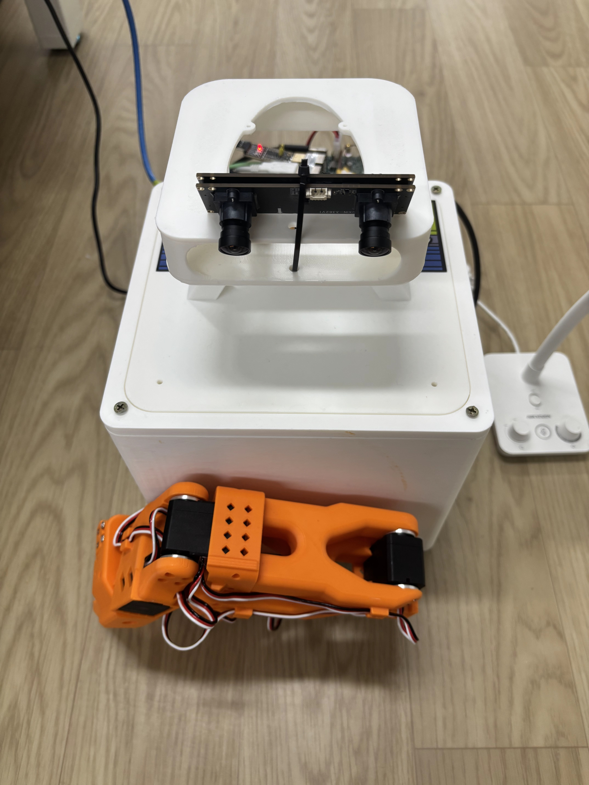
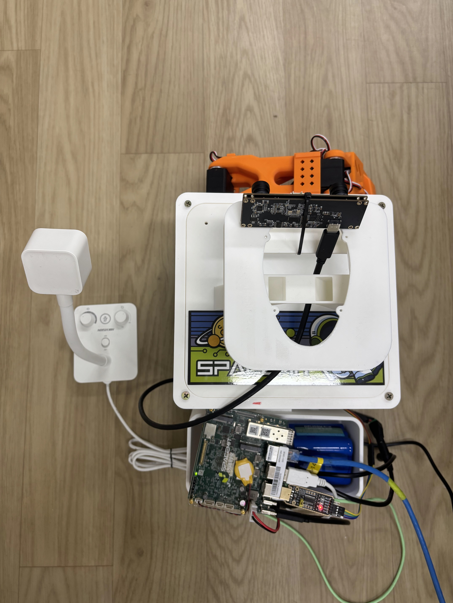
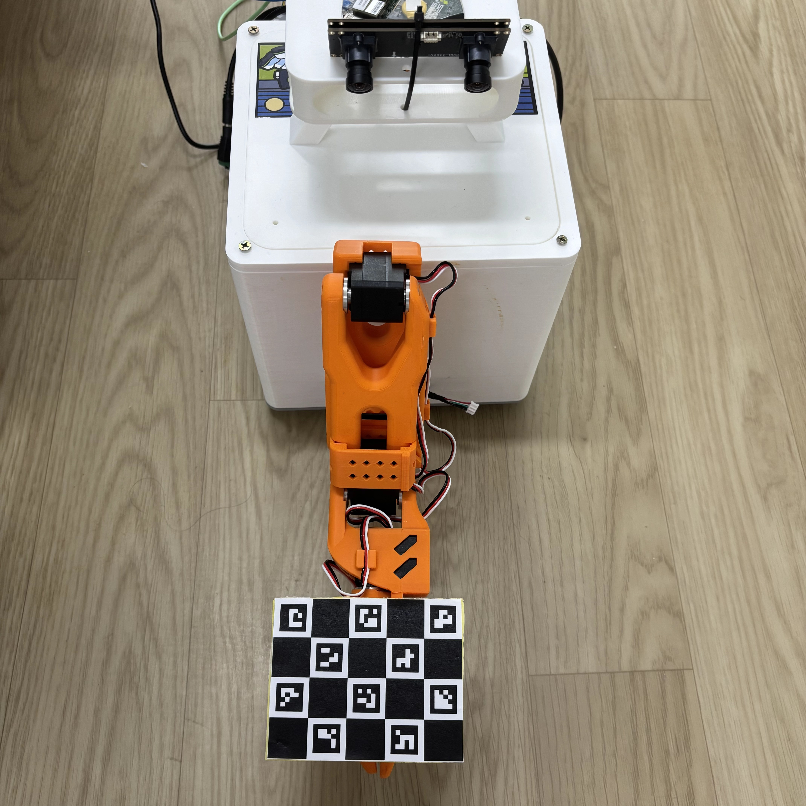

# Linksee 深度视觉抓取

`perceptive_grasp` 是面向 Linksee 轮式机器人的桌面闭环感知抓取应用：从 RGB-D 图像检测并分割目标，经深度反投影、eye-to-hand 手眼标定和三维几何规划生成顶抓或侧抓路径，再驱动底盘、机械臂和夹爪完成对齐、抓取、放置与安全恢复。面向桌面或近距离单目标抓取，底盘辅助不提供导航、避障和全局路径规划。

同一套 pipeline 支持三种部署，共用感知、规划、任务控制和语音接口：

| 部署方式 | 执行后端 | 位置 | 配置 |
| --- | --- | --- | --- |
| Linksee 真机 | `manipulation` 控制 SO101 与夹爪，内置驱动控制底盘 | K3 | `grasp_pipeline.yaml` |
| MuJoCo 同机 | UR5e + Robotiq 2F-85 仿真 | 服务与 pipeline 同机 | `grasp_pipeline_manipulation_mujoco.yaml`（服务）+ `_remote.yaml`（pipeline） |
| MuJoCo 跨机 | UR5e + Robotiq 2F-85 仿真 | 服务在 PC，pipeline 在 K3 | 同上 |

仿真服务与抓取 pipeline 是两个独立进程，配置分开：`mujoco_grasp_sim_server` 读场景、模拟 RGB-D 和仿真设备，`perceptive_grasp` 读服务连接、感知和任务参数。同机连接 `127.0.0.1:9090`；跨机通过 SSH 端口转发，K3 侧仍用该回环地址。

真机的 RGB-D 输入可选 RealSense D435i 或 `spacemit_las2`。

## 1. 方案概述

下图以真机为主线；MuJoCo 模式复用任务状态机和规划，只替换 RGB-D 与执行后端。

1. **感知**：RGB-D 输出彩色图、对齐深度和相机内参。
2. **检测**：YOLOv8-Seg 输出类别、检测框和分割掩码；pipeline 关联连续帧中的同一目标并等待其稳定。K3 用 `vision_service`，PC 用 OpenCV DNN。
3. **三维估计**：`grasp_geometry` 生成目标点云、拟合桌面平面，估计长宽高和水平主轴，完成顶抓或侧抓初判。
4. **闭环规划**：锁定策略后进入对应观察位，观察或底盘动作后重新检测，不复用旧图像。`grasp_planner` 生成的候选须通过工作空间、夹爪宽度、关节限制、IK、桌面间隙和完整路径检查。
5. **执行**：机械臂依次完成接近、夹取、抬升、放置、归位和失败恢复。

两条支路：目标超出舒适抓取区时，底盘短距离移动后重新感知；ASR 向状态机输入命令，TTS 播报状态。


## 2. 硬件准备

- Linksee 轮式机器人：K3 计算平台、机械臂、差速底盘和机身结构。
- RGB-D 相机：RealSense D435i 或 `spacemit_las2` 双目相机。
- 麦克风和扬声器：启用语音交互时需要。

| 相机安装 | 硬件连接 |
| --- | --- |
|  |  |

相机固定在机身顶部，工作区须同时落在彩色图像和有效深度范围内。

## 3. 应用部署

### 3.1 获取代码

以下命令默认 SDK 位于 `~/spacemit_robot`：

```bash
mkdir -p ~/spacemit_robot
cd ~/spacemit_robot
repo init -u https://github.com/spacemit-robotics/manifest.git \
  -b main \
  -m default.xml \
  --repo-url=https://gitee.com/spacemit-robotics/git-repo
repo sync -j4
repo start robot-dev --all
```

每次打开新终端后，先加载 SDK 环境：

```bash
cd ~/spacemit_robot
source build/envsetup.sh
```

### 3.2 安装软件依赖

#### 安装公共依赖

1. 安装源码管理、构建、Python 和运动学依赖：

```bash
sudo apt update
sudo apt install -y \
  git \
  repo \
  wget \
  unzip \
  patchelf \
  cmake \
  build-essential \
  meson \
  ninja-build \
  python3-pip \
  python3-venv \
  v4l-utils \
  libyaml-cpp-dev \
  libeigen3-dev \
  libopencv-dev \
  libopenblas0-pthread \
  openblas-spacemit \
  spacemit-onnxruntime \
  libglfw3-dev \
  libgl1-mesa-dev \
  libx11-dev
```

`manipulation` 内置 `eigen` 运动学后端（`MANIPULATION_ENABLE_KINEMATICS_EIGEN` 默认开启），正逆运动学只用 `libeigen3-dev` 的头文件，无需另编运动学库。

2. 创建 Python 虚拟环境：

```bash
cd ~/spacemit_robot/application/ros2/linksee/perceptive_grasp
python3 -m venv ~/.venv-grasp
source ~/.venv-grasp/bin/activate
python3 -m pip install --upgrade pip
python3 -m pip install -r requirements.txt
```

该环境只运行应用侧 Python 脚本。**编译 SDK 组件前必须先 `deactivate`**：`mm --with-deps` 用 `python3 -c 'import can'` 检查系统包，而 venv 不继承系统 site-packages，`apt` 装好的 `python3-can` 在其中不可见，检查会持续报 `still missing after installation`。

#### 构建 SDK 组件

`mm` 将公共头文件和动态库装到 `~/spacemit_robot/output/staging`。按顺序构建：

1. 激活 SDK 环境

```bash
cd ~/spacemit_robot && source build/envsetup.sh
```

2. 视觉推理组件：提供 `vision_service`，通过 SpaceMIT EP 在 X100 AI 核上跑 YOLOv8-Seg。

```bash
cd ~/spacemit_robot/components/model_zoo/vision
mm -- -C "$SROBOTIS_ROOT/application/ros2/linksee/perceptive_grasp/cmake/vision-k3-system-cpp.cmake"

ls ~/spacemit_robot/output/staging/include/vision_service.h
ls ~/spacemit_robot/output/staging/lib/libvision.so
```

`vision-k3-system-cpp.cmake` 用系统 OpenCV、Eigen 和 OpenBLAS 构建 C++ 视觉库，不构建 Python 扩展、wheel 或示例。配置阶段会校验 OpenBLAS 头文件与系统运行库是否匹配。该配置会覆盖当前构建缓存；要切回全量构建，请换构建目录或清理视觉组件缓存。

3. `manipulation` 组件：机械臂、夹爪、正逆运动学和标定工具。以下配置同时构建 MuJoCo 物理世界、窗口和 RGB-D 渲染。

```bash
cd ~/spacemit_robot/components/control/manipulation
mm --with-deps \
  -DMANIPULATION_ENABLE_MUJOCO=ON \
  -DMANIPULATION_ENABLE_SIMULATION_RENDERER=ON
manipulation drivers --roles
manipulation-simulation --help
```

底盘驱动 `drv_uart_esp32` 已随 `perceptive_grasp` 内置在 `src/chassis/`，构建应用时一并编译，不需要单独构建 `components/control/base`，运行时也不依赖 `libchassis.so`。

#### 准备检测模型

```bash
cd ~/spacemit_robot/components/model_zoo/vision/examples/yolov8_seg
bash scripts/download_models.sh

mkdir -p ~/.cache/models/vision/labels
cp ~/spacemit_robot/components/model_zoo/vision/assets/labels/coco.txt \
  ~/.cache/models/vision/labels/coco.txt

ls ~/.cache/models/vision/yolov8_seg/yolov8n-seg.q.onnx
ls ~/.cache/models/vision/labels/coco.txt
```

#### 准备 RGB-D 相机后端

应用只初始化 `camera.type` 选中的后端，CMake 自动探测本机已装的后端；选中的后端必须在构建摘要里出现。

- RealSense D435i：

```bash
sudo apt install -y ros-humble-librealsense2
source /opt/ros/humble/setup.sh
rs-enumerate-devices --version
```

- `spacemit_las2`：下载运行时和深度模型到默认目录 `~/las2_runtime`，无需设环境变量。

```bash
cd ~
wget -O las2_runtime_handoff.zip \
  https://archive.spacemit.com/spacemit-ai/model_zoo/vla/libs/las2/las2_runtime_handoff.zip
unzip -oq las2_runtime_handoff.zip

mkdir -p ~/las2_runtime/models
wget -O ~/las2_runtime/models/LAS2_M_256x320.fp16.iofp32.corr_func_nhwc.gelu.onnx \
  https://archive.spacemit.com/spacemit-ai/model_zoo/vla/libs/las2/LAS2_M_256x320.fp16.iofp32.corr_func_nhwc.gelu.onnx

ls ~/las2_runtime/include/las2_usb_stereo.h
ls ~/las2_runtime/lib/liblas2_usb_stereo.so
ls ~/las2_runtime/models/LAS2_M_256x320.fp16.iofp32.corr_func_nhwc.gelu.onnx
ls ~/las2_runtime/config/matlab_stereo_opencv.json
```

`spacemit_las2` 用双目标定文件计算深度和三维坐标。

#### 准备语音模型（可选）

只做命令行抓取可跳过。本地语音桥需要 VAD、ASR、TTS 和中文文本规范化资源：

```bash
mkdir -p ~/.cache/models/asr
cd ~/.cache/models/asr
wget -O sensevoice.tar.gz \
  https://archive.spacemit.com/spacemit-ai/model_zoo/asr/sensevoice.tar.gz
tar -xzf sensevoice.tar.gz

# 使用 Qwen3-ASR 时安装 K3 优化运行时并准备模型
sudo apt install -y llama.cpp-tools-spacemit
mkdir -p ~/.cache/models/asr/qwen3asr
cd ~/.cache/models/asr/qwen3asr
wget -O qwen3-asr-0.6B-dynq-q40.tar.gz \
  https://archive.spacemit.com/spacemit-ai/model_zoo/asr/qwen3-asr-0.6B-dynq-q40.tar.gz
tar -xzf qwen3-asr-0.6B-dynq-q40.tar.gz
rm -f qwen3-asr-0.6B-dynq-q40.tar.gz

mkdir -p ~/.cache/models/vad/silero
wget -O ~/.cache/models/vad/silero/silero_vad.onnx \
  https://archive.spacemit.com/spacemit-ai/model_zoo/vad/silero/silero_vad.onnx

mkdir -p ~/.cache/models/tts/matcha-tts
cd ~/.cache/models/tts/matcha-tts
wget -O matcha-icefall-zh-baker.tar.gz \
  https://archive.spacemit.com/spacemit-ai/model_zoo/tts/matcha-tts/matcha-icefall-zh-baker.tar.gz
tar -xzf matcha-icefall-zh-baker.tar.gz

mkdir -p ~/.cache/models/tts/vocoder
wget -O ~/.cache/models/tts/vocoder/vocos-22khz-univ.q.onnx \
  https://archive.spacemit.com/spacemit-ai/model_zoo/tts/vocoder/vocos-22khz-univ.q.onnx

mkdir -p ~/.cache/models/tts/text_norm/v1/zh
cd ~/.cache/models/tts/text_norm/v1/zh
wget https://archive.spacemit.com/spacemit-ai/model_zoo/tts/text_norm/v1/zh/date.fst
wget https://archive.spacemit.com/spacemit-ai/model_zoo/tts/text_norm/v1/zh/new_heteronym.fst
wget https://archive.spacemit.com/spacemit-ai/model_zoo/tts/text_norm/v1/zh/number.fst
wget https://archive.spacemit.com/spacemit-ai/model_zoo/tts/text_norm/v1/zh/phone.fst
```

Qwen3-ASR 需要 `llama.cpp-tools-spacemit 0.1.7` 或更高。应用选中 `qwen3_asr` 后会自动拉起本机 `llama-server`，无需常驻服务。

### 3.3 选择发布配置并设置 RGB-D 后端

| 配置文件 | 用途 | 需现场修改 |
| --- | --- | --- |
| `grasp_pipeline.yaml` | 真机抓取 | RGB-D 后端、设备路径、手眼标定、机械臂与底盘串口、音频设备 |
| `grasp_pipeline_manipulation_mujoco.yaml` | 本机仿真服务与 pipeline | 场景资源、`manipulator.mujoco.device_plan`；启动器固定监听回环 |
| `grasp_pipeline_manipulation_remote.yaml` | 连接仿真服务的 pipeline | `remote_mujoco.host`、端口、可选音频设备 |

仿真构建和启动统一走 [§6 MuJoCo 仿真](#6-mujoco-仿真) 的脚本。真机主配置 `grasp_pipeline.yaml` 至少设置 `camera.type` 和所选后端的设备、模型、标定路径，其余保留默认值。

#### RealSense D435i

```yaml
camera:
  type: "realsense"
  realsense:
    width: 640
    height: 480
    fps: 30
    motion_flush_frames: 30
    align_depth: true
    depth_filter:
      spatial: true
      temporal: false
      hole_filling: false
```

#### `spacemit_las2` 双目相机

先查出稳定的视频设备路径，把指向双目相机的那条写入 `video_device`：

```bash
ls -l /dev/v4l/by-id/*-video-index0
```

```yaml
camera:
  type: "spacemit_las2"
  spacemit_las2:
    video_device: "/dev/v4l/by-id/<video-index0>"
    model_path: "~/las2_runtime/models/LAS2_M_256x320.fp16.iofp32.corr_func_nhwc.gelu.onnx"
    calib_path: "~/las2_runtime/config/matlab_stereo_opencv.json"
    core_count: 1
    core_affinity: "8"
    depth:
      min_m: 0.05
      max_m: 2.0
```

`spacemit_las2` 参数：`model_path` 深度模型路径；`calib_path` 当前双目标定文件；`core_count` 深度推理会话数，默认 1 个会话，把其余 AI 核留给 YOLOv8-Seg；`core_affinity` 每个会话绑定的 X100 逻辑核，范围 `8–15`，条目数须等于 `core_count`。

#### 目标检测

```yaml
detection:
  config_path: yolov8_seg.yaml
  target_labels: []
  min_confidence: 0.10
  min_area: 1000
  stable_frames: 3
```

`target_labels` 为空时检测全部 COCO 类别；`min_confidence` 和 `min_area` 过滤低置信度与小目标；`stable_frames` 是进入规划前检测框位置和面积需连续稳定的帧数，目标仍在移动时 pipeline 停在检测阶段。

### 3.4 构建并安装应用

先完成 3.2 节的组件与相机依赖。以下配置包含 VisionService、真实硬件执行器、RealSense 后端以及本机和远程 MuJoCo：

```bash
cd ~/spacemit_robot
source build/envsetup.sh
cd application/ros2/linksee/perceptive_grasp
cmake -S . -B build \
  -DCMAKE_BUILD_TYPE=Release \
  -DCMAKE_INSTALL_PREFIX="$PREFIX" \
  -DCMAKE_PREFIX_PATH="$PREFIX" \
  -DOpenCV_DIR=/usr/lib/riscv64-linux-gnu/cmake/opencv4 \
  -DX86_STANDALONE=OFF \
  -DUSE_OPENCV_DNN=OFF \
  -DUSE_MOCK_EXECUTOR=OFF \
  -DENABLE_MUJOCO_EXECUTOR=ON \
  -DENABLE_REMOTE_MUJOCO=ON \
  -DENABLE_LAS2_CAMERA=OFF \
  -DENABLE_WEBRTC_AEC=OFF \
  -DENABLE_ROS2_VOICE=OFF
cmake --build build -j2
cmake --install build
```

程序装到 `$PREFIX/bin`，配置、URDF、场景和脚本装到 `$PREFIX/share/perceptive_grasp`。日常运行用 `perceptive_grasp`（结构化日志启动器），它内部调用 `perceptive_grasp_core`；`debug_grasp` 提供感知与规划诊断。

安装后检查入口与配置，这些命令不初始化相机、机械臂或底盘：

```bash
"$PREFIX/bin/perceptive_grasp" --wrapper-help
"$PREFIX/bin/perceptive_grasp" \
  --config "$PREFIX/share/perceptive_grasp/config/grasp_pipeline.yaml" \
  --validate-config
"$PREFIX/bin/debug_grasp" --help
```

输出含 `[Config] valid` 表示结构和取值通过检查，但不确认模型文件、设备连接或现场标定。后续运行示例都用源码目录的 `config/` 通过 `--config` 传入；改了配置要重新安装才会更新 `$PREFIX/share/` 下的副本。

| 选项 | 默认 | 作用 |
| --- | --- | --- |
| `ENABLE_LAS2_CAMERA` | `ON` | 构建 `spacemit_las2` 后端，需准备 LAS2 运行时 |
| `ENABLE_WEBRTC_AEC` | `ON` | 构建 WebRTC 软件回声消除；首次配置会下载 `webrtc-audio-processing` 到 `~/.cache/thirdparty` |
| `ENABLE_ROS2_VOICE` | `OFF` | 构建 ROS 2 `std_msgs/String` 语音话题桥；本地语音桥不需要 |
| `ENABLE_MUJOCO_EXECUTOR` | `OFF` | 通过 `manipulation` 构建本机仿真执行器与服务 |
| `ENABLE_REMOTE_MUJOCO` | `OFF` | 构建可连本机或远程仿真服务的抓取协议客户端 |
| `X86_STANDALONE` | `OFF` | 用 OpenCV DNN 与 mock 执行器构建主机程序，不控制真实设备 |
| `LAS2_RUNTIME_DIR` | `~/las2_runtime` | LAS2 运行时目录 |

上表默认值是不传选项时的 CMake 默认值，上面的安装命令已显式选定本节配置。构建摘要中 `Detector` 应为 `VisionService`、`Executor` 应为 `Real hardware`、`Camera` 应含 `realsense`；实际后端由 `camera.type` 选择，须在本次构建的可用后端内。

本节安装命令关闭了 WebRTC AEC，使用本地语音桥时把 `voice.echo_cancellation.mode` 设为 `half_duplex`，音频设备自带回声消除时用 `hardware_aec`。

### 3.5 硬件配置和运行前检查

连接设备前关闭机械臂和底盘动力。运行用户需能访问串口、视频和音频设备：

```bash
sudo usermod -aG dialout,video,audio "$USER"
exec su - "$USER"
```

用 `spacemit_las2` 时还要允许 `video` 组访问 DMA heap：

```bash
echo 'SUBSYSTEM=="dma_heap", KERNEL=="system", GROUP="video", MODE="0660"' | \
  sudo tee /etc/udev/rules.d/99-las2-dma-heap.rules
sudo udevadm control --reload-rules
sudo chgrp video /dev/dma_heap/system
sudo chmod 0660 /dev/dma_heap/system
```

接上硬件后先跑一次环境检查：

```bash
cd ~/spacemit_robot/application/ros2/linksee/perceptive_grasp
source ~/spacemit_robot/build/envsetup.sh
source ~/.venv-grasp/bin/activate
python3 scripts/check_runtime_env.py \
  --config config/grasp_pipeline.yaml \
  --build-dir "$PREFIX/bin" \
  --no-fix
```

它按 `camera.type` 检查相机设备、运行库、模型和标定文件，识别机械臂、底盘和音频设备，并给出机械臂和底盘的稳定串口路径。设备路径没改过时首次会出现 `[FAIL]`：

```text
[SUGGEST] device.arm.options.port and device.effector.options.port: "/dev/serial/by-id/..."
[SUGGEST] mobile_base.dev_path: "/dev/serial/by-id/..."
```

#### 配置机械臂和底盘

机械臂与夹爪的串口写入 `config/devices/linksee_so101.yaml` 中各自的 `options.port`，两者用同一路径。

**一律写 `by-id`，不要写 `ttyACMx`。** `ttyACMx` 的编号由内核按枚举顺序分配，取决于插在哪个口、谁先上电，同一台机器重启后也可能互换；`/dev/serial/by-id/` 下的名字由设备序列号生成，与插入顺序无关。查对应关系：

```bash
for port in /dev/serial/by-id/*; do
  echo "$port -> $(readlink -f "$port")"
done
```

路径写错时舵机读写会全部失败，报 `Read paras failed!` 加 `[Errno 5] Input/output error`，很容易被误判成舵机掉电或损坏。用 `so101-calibrate status` 区分：能读到 6 个舵机的电压和温度，说明串口对、舵机好。

首次安装须先完成 SO101 舵机校准，不能沿用其他机械臂的偏置和行程，见下一节。已有本台设备的校准文件时直接放入 `config/devices/`（`cp -n` 不覆盖已有文件）：

```bash
read -erp "本台 SO101 校准文件目录: " SO101_CALIBRATION
cp -n "$SO101_CALIBRATION/so101_calibration.json" config/devices/
cp -n "$SO101_CALIBRATION/so101_gripper_calibration.json" config/devices/
```

主配置保留任务姿态、模型及底盘参数。以下片段不要替换完整配置：

```yaml
manipulator:
  device_plan: "devices/linksee_so101.yaml"
  model: "devices/so101_model.json"
  calibration_resources:
    - "devices/so101_calibration.json"
    - "devices/so101_gripper_calibration.json"
  kinematics_solver: "eigen"
  urdf_path: "../urdf/so101.urdf"
  home_joints: [1.546, -1.765, 1.400, 1.093, 0.186]
  observe_joints: [1.544, -0.067, 0.101, 1.382, 0.188]
  side_ready_joints: [1.550, 0.021, 1.400, -1.700, -0.036]
  joint_limits:
    - {joint: 0, min: -1.540, max: 1.630}
    - {joint: 1, min: -1.770, max: 1.680}
    - {joint: 2, min: -1.840, max: 1.430}
    - {joint: 3, min: -1.790, max: 1.670}
    - {joint: 4, min: -2.700, max: 2.800}

place:
  place_joints: [-1.500, -0.122, 0.101, 1.383, 0.330]
  release_open: 0.5

mobile_base:
  enabled: true
  driver: "drv_uart_esp32"
  dev_path: "/dev/serial/by-id/<底盘串口>"
  baud: 115200
  left_wheel_gain: 1.0
  target_x: 0.275
  x_tolerance: 0.035
  y_tolerance: 0.15
  max_step_m: 0.12
  linear_speed: 0.20
  angular_speed: 1.2
  min_cmd_duration_ms: 350
  max_align_attempts: 6
  max_total_travel_m: 0.24
```

- `driver`：底盘驱动，默认 `drv_uart_esp32`（UART 差速底盘）；RPMsg 小核底盘改为 `drv_rpmsg_esos`。两者都由 `perceptive_grasp` 自身编译。
- `dev_path`：底盘串口，**不能与机械臂串口相同**，否则两个设备争用同一个 tty。
- `left_wheel_gain`：左轮速度补偿，仅差速底盘使用，校正左右轮实际差异。
- `target_x ± x_tolerance` 是目标的前向舒适区，`y_tolerance` 是相对机械臂基座中心线的横向允许偏差。
- `max_align_attempts`、`max_total_travel_m` 限制单轮任务的对齐次数和累计直线距离。
- `observe_joints`/`side_ready_joints` 是顶抓/侧抓观察姿态，`home_joints`/`place_joints` 是归位/放置姿态。换机械臂后，须在完成关节标定的前提下重新确认。
- 底盘把目标移入舒适区后，pipeline 仍会做工作空间和 IK 可达性检查。

#### 校准 SO101 舵机

首次安装、更换机械臂或舵机、重新装配后，或校准文件来自另一台机械臂时，必须重新校准——偏置和行程与装配强相关，型号相同也不能通用。完整步骤、子命令表和排错见 [§5.2.3 机械臂控制 · §3.4 SO101 机械臂与夹爪](../../05-机器人开发/5.2-运动控制/5.2.3-机械臂控制.md#34-示例四so101-机械臂与夹爪)。

校准前支撑机械臂、取下夹爪中的物品并释放扭矩，退出其他占用串口的程序：

```bash
source ~/spacemit_robot/build/envsetup.sh
PORT=/dev/serial/by-id/<机械臂串口>
so101-calibrate --port "$PORT" status    # 只读；6 个 ID 全部回应才继续
so101-calibrate --port "$PORT" all       # 按提示完成校准
```

`all` 依次执行 `configure`、`center`、`capture`、`limits`。其中 `center` 把**当前姿态**当作模型零位，姿态摆错会让整机偏置全错且事后无法从文件看出。工具从不使能扭矩，没有 `--baud` 参数（波特率固定 1 Mbps），已有校准文件不覆盖，要重做加 `--replace`。

校准文件写在 `SITE/so101/`（默认 `~/.local/share/spacemit-manipulation/site`），应用从 `config/devices/` 读取，须复制过去。已有本台设备的校准文件时可跳过校准，直接复制；`cp -n` 不覆盖已有文件：

```bash
cp -n "$HOME/.local/share/spacemit-manipulation/site/so101/so101_calibration.json" \
   ~/spacemit_robot/application/ros2/linksee/perceptive_grasp/config/devices/
cp -n "$HOME/.local/share/spacemit-manipulation/site/so101/so101_gripper_calibration.json" \
   ~/spacemit_robot/application/ros2/linksee/perceptive_grasp/config/devices/
```

常见报错：`Read paras failed!` 加 `[Errno 5]` 是串口选错，不是舵机损坏，按 by-id 路径逐一 `status` 确认；`torque must already be off` 需先释放扭矩；`homing offset differs from the calibration` 说明采集后偏移被改过（如又执行了 `center`），重新 `capture`。

#### 配置抓取策略

`grasp.strategy` 支持 `auto`、`top` 和 `side`。发布配置使用 `auto`，根据目标三维高度、水平尺寸和候选可达性选择顶抓或侧抓，不读取目标类别。

```yaml
grasp:
  strategy: "auto"
  top:
    approach_height: 0.10
    grasp_depth: 0.015
    gripper_offset: 0.0
    grasp_point_x_ratio: 1.0
    position_source: "mask_depth"
    safe_mask_interior: false
    support_plane_occlusion_recovery: false
    support_plane_height_anchor: false
    minimum_grasp_height: 0.0
    verification_lift_m: 0.0
    gripper_open: 0.6
  side:
    min_height_m: 0.060
    min_height_width_ratio: 1.0
    approach_distance_m: 0.020
    entry_clearance_m: 0.030
    pregrasp_min_x_m: 0.270
    single_sided_gripper: true
    gripper_offset_m: 0.010
    grasp_forward_offset_m: 0.020
    grasp_height_ratio: 0.60
    initial_lift_m: 0.050
    lift_retreat_m: 0.025
  gripper_effort: 0.8
  gripper_hold_load_threshold: 100.0
  gripper_empty_position_margin: 0.03
  gripper_timeout_ms: 3000
  geometry:
    sample_stride: 2
    max_object_points: 4000
    min_object_points: 80
    plane_distance_threshold_m: 0.008
    table_clearance_m: 0.005
    footprint_padding_m: 0.005
    gripper_max_width_m: 0.10
    planning_timeout_ms: 750
    perception_budget_ms: 500
  workspace:
    x_min: 0.0
    x_max: 0.5
    y_min: -0.3
    y_max: 0.3
    z_min: 0.0
    z_max: 0.20
```

- `top` 参数只影响顶抓，`side` 参数只影响侧抓，两组参数不会互相覆盖。
- `side.min_height_m` 与 `side.min_height_width_ratio` 共同定义 `auto` 首次选侧抓的三维形状门限。
- `side.entry_clearance_m`：从观察位进入侧抓区域时，夹爪下缘高于目标最高点的安全距离。
- `side.approach_distance_m` 是预抓取位到抓取位的水平进给；`side.grasp_forward_offset_m` 对整套侧抓位姿前后补偿，不改进给距离。
- `geometry` 控制点云、桌面平面、夹爪宽度和候选规划约束；`geometry.perception_budget_ms` 只是性能告警预算，超时记 `OVERRUN`，不会因此放弃安全候选。
- `workspace` 是动作前的安全边界，底盘对齐也绕不过工作空间和 IK 检查。
- 夹爪负载与闭合位置共同判断是否抓住目标。

#### 配置语音设备（可选）

启用本地语音交互时，根据检查结果更新采集设备和播放设备编号：

```yaml
voice:
  echo_cancellation:
    mode: "webrtc_aec"
    delay_ms: 50
    noise_suppression: true
    high_pass_filter: true

  asr:
    backend: "sensevoice"
    device: 1
    device_name: ""
    rate: 16000
    channels: 1
    channel_index: -1
    mixer_volume: 40
    vad_trigger_threshold: 0.4
    vad_stop_threshold: 0.3
    vad_min_speech_duration_ms: 100
    vad_endpoint_hold_ms: 600
    vad_max_speech_duration_ms: 4000

  tts:
    enabled: true
    engine: "matcha:zh"
    playback_device: 1
    playback_device_name: ""
    playback_rate: 48000
    channels: 1
    speed: 1.0
    volume: 80
    mixer_volume: 80
    speak_all_states: false
```

用 `webrtc_aec` 需先启用 `ENABLE_WEBRTC_AEC=ON` 重新构建；按 3.4 节安装时把 `mode` 改成 `half_duplex` 或 `hardware_aec`。

- `echo_cancellation.mode`：普通麦克风加扬声器用 `webrtc_aec`；音频硬件已输出消除回声的录音流用 `hardware_aec`；无法消除时用 `half_duplex`。`delay_ms` 是扬声器到麦克风的估计延迟，仅 `webrtc_aec` 使用。
- `asr.backend`：`sensevoice` 或 `qwen3_asr`。`asr.device_name` 非空时优先按名称解析设备编号，否则用 `asr.device`。
- `tts.enabled`：是否播报状态。`tts.playback_device_name` 非空时优先按名称解析，否则用 `tts.playback_device`。
- `rate`、`playback_rate`、`channels`：录音与播放格式，须与设备支持的格式一致；设备不支持时语音桥会探测并输出最终选择。
- `mixer_volume`：启动时设置的 ALSA 录音增益或 `PCM` 音量，`-1` 表示不改 mixer。

`hardware_aec` 和 `webrtc_aec` 在 TTS 播放期间保持 VAD 与 ASR 连续运行，`half_duplex` 会暂停识别。

#### 复查运行环境

更新配置并修正其他 `[FAIL]` 项后，重新执行检查：

```bash
python3 scripts/check_runtime_env.py \
  --config config/grasp_pipeline.yaml \
  --build-dir "$PREFIX/bin" \
  --no-fix
```

环境可运行时，最后一行显示：

```text
[SUMMARY] ready
```

### 3.6 执行手眼标定

eye-to-hand 标定求 RGB-D 相机坐标系到机械臂基座坐标系的变换。RGB-D 相机固定在机身，4 × 5 ChArUco 标定板刚性固定在夹爪末端：



#### 标定板生成

```bash
cd ~/spacemit_robot/application/ros2/linksee/perceptive_grasp
source ~/spacemit_robot/build/envsetup.sh
source ~/.venv-grasp/bin/activate
python3 scripts/generate_charuco_board.py \
  --squares-x 4 \
  --squares-y 5 \
  --square-length 0.020 \
  --marker-length 0.014 \
  --output config/charuco_4x5_20mm_14mm.png
```

#### 数据采集

采集走 `manipulation` 只读连接，不使能、不释放力矩、不发运动目标。退出其他控制程序后**按回车**采集（输入 `CAPTURE` 等效），`q` 结束。

采集前：

- 标定板相对模型末端刚性固定，采集期间不改夹爪开度。
- `installation-id` 标识本次固定安装；会话绑定设备配置、模型、舵机校准和相机参数，任一资源变化后须新建数据目录。
- `camera.spacemit_las2.serial` 填本台相机序列号或固定资产编号（仅登记身份，不核验 USB 设备）；`camera.realsense.serial` 建议填序列号，写回时用它确认相机。

采集要求：

- 标定板尺寸用打印后的实测值，至少 15 个有效姿态，覆盖左中右、高低和不同腕部角度。
- 标定板须完整在画面内。marker 成像偏小只提示不拒收，精度由重投影误差把关；被拒收时屏幕给出原因，调整后重试。
- ChArUco 角点少于 9 个（`--min-charuco-corners`）只提示不拒收，但角点少会让位姿估计变差、残差偏大，远距姿态最易缺角点。
- 板到相机距离默认限 0.10~0.40 m（`--min-distance`、`--max-distance`），推荐 0.20~0.30 m，超上界报 `marker too far`。工作空间较深时可放宽，示例取 0.60 m。

```bash
python3 scripts/calibrate_hand_eye.py \
  --config config/grasp_pipeline.yaml \
  --installation-id linksee_site \
  --charuco-squares-x 4 \
  --charuco-squares-y 5 \
  --charuco-square-length 0.020 \
  --charuco-marker-length 0.014 \
  --max-distance 0.60 \
  --num-poses 15 \
  --dataset-dir output/hand_eye
```

距离上界放宽后，远距样本的作用是约束深度方向，单帧精度仍不如近距：15 个姿态里让 0.20~0.30 m 的样本占多数，远距只放几个补覆盖。求解时终端会打印各方法的旋转与平移残差表，放宽后再求解发现残差明显变大，就把上界收回到 0.45 m 左右重新采集。

#### 标定结果写入

使用采集时相同的安装标识和数据目录，求解并写回配置：

```bash
python3 scripts/calibrate_hand_eye.py \
  --solve-only \
  --installation-id linksee_site \
  --dataset-dir output/hand_eye \
  --apply-config config/grasp_pipeline.yaml
```

脚本仅导出满足质量要求的外参，更新 `calibration.<camera.type>.T_base_camera` 并备份原配置，不覆盖其他相机后端。

默认质量门槛为最大位置残差 5 mm、最大角度残差 2°，留出样本与全量样本都要满足。未达标时报 `Report quality failed`，并给出实际最差残差与所用门槛。个别样本明显偏离时，删掉重采比放宽门槛更划算；整体散布均匀、只是略超门槛时，可用 `--solve-max-position-m`、`--solve-max-angle-deg` 放宽后重解，上限 15 mm / 5°：

```bash
python3 scripts/calibrate_hand_eye.py \
  --solve-only \
  --installation-id linksee_site \
  --dataset-dir output/hand_eye \
  --solve-max-position-m 0.010 \
  --solve-max-angle-deg 4.0 \
  --apply-config config/grasp_pipeline.yaml
```

放宽后 `result.json` 的 `thresholds` 记录实际门槛，`quality_passed` 只表示残差落在该门槛内。抓取精度要求高时仍应按 5 mm / 2° 重新采集。

写回前脚本会核对目标配置与采集会话是同一台相机。`camera.<camera.type>.serial` 建议填上本机相机序列号，RealSense 可用 `rs-enumerate-devices` 查询；留空时改按图像分辨率、帧率与内参确认相机，只给提示不中止写回。外参写回只改动 `calibration` 块，不影响这项核对，同一数据集可以反复求解。序列号填了但与采集会话不符时会报 `destination camera serial differs`，此时应确认是否换过相机。

旧数据集可离线重算，不补造设备身份或校准来源。

#### 标定结果验证

使用定位工具验证目标在机械臂基座坐标系中的位置：

```bash
./build/debug_localize \
  --config config/grasp_pipeline.yaml \
  --target banana \
  --frames 5 \
  --output /tmp/debug_localize
```

根据定位结果检查标定质量：

- `base_point_m` 应与目标相对机械臂基座的实测位置一致。
- 存在稳定偏差时，检查标定板尺寸、采集姿态覆盖和相机固定情况。
- 不要使用抓取偏移掩盖标定误差。

### 3.7 运行抓取

**以下命令会初始化真实硬件，其中非 `--plan-only` 命令会驱动机械臂和底盘。运行前清理机器人工作空间，确认急停和断电装置可用，并保持人员远离运动范围。**

先验证配置结构。该命令不初始化硬件：

```bash
./build/perceptive_grasp_core \
  --config config/grasp_pipeline.yaml \
  --validate-config
```

输出包含 `[Config] valid` 时，配置字段和取值通过检查。

再用 `--plan-only` 验证目标感知、抓取策略和机械臂路径。该模式会初始化硬件并读取机械臂状态，但不会发送机械臂或底盘运动命令，也不会给设备上扭矩：

```bash
cd ~/spacemit_robot/application/ros2/linksee/perceptive_grasp
source ~/spacemit_robot/build/envsetup.sh
"$PREFIX/bin/perceptive_grasp" \
  --config config/grasp_pipeline.yaml \
  --target cup \
  --plan-only
```

规划成功、机械臂空载且支撑可靠后即可执行真实抓取。**启动时会自动给机械臂和夹爪上扭矩**，不需要先执行 `manipulation enable`：

```bash
"$PREFIX/bin/perceptive_grasp" \
  --config config/grasp_pipeline.yaml \
  --target banana
```

需要只连接、不上扭矩（例如机械臂须保持松弛状态检查）时加 `--no-enable`，或在配置中设 `manipulator.enable_on_start: false`：

```bash
"$PREFIX/bin/perceptive_grasp" \
  --config config/grasp_pipeline.yaml \
  --target banana \
  --no-enable
```

`--no-enable` 下 pipeline 会在第一个运动动作处失败，报 `arm is not enabled`。这是预期行为：只读模式不能运动。

初始化失败时，报错本身会指出下一步：

| 报错 | 含义与处理 |
| --- | --- |
| `serial port does not exist` | USB 适配器未插或名称变了。用 `ls -l /dev/serial/by-id/` 查出完整路径，改 `config/devices/linksee_so101.yaml` 的 `options.port` |
| `serial port is held by another process` | 有别的进程占着串口。关掉正在跑的 `manipulation inspect`、`manipulation-device` 或另一个 `perceptive_grasp` |
| `read SO101 motor N failed: no reply on <port>` | 端口不是舵机总线，或该舵机没上电。先 `ls -l /dev/serial/by-id/` 核对端口，再查电机电源指示灯和菊花链线 |
| `<port> answered but is not the SO101 servo bus` | 端口能通但不是 SO101。换 `by-id` 下的另一条重试 |
| `arm is not enabled` | 用了 `--no-enable`，或设备没能确认位置模式 |
| `SO101 joints outside their limits: <关节> at N deg, allowed A..B deg` | 机械臂失能时在重力下垂出了标定行程，SO101 上最常见于 `elbow_flex`。托住手臂，把该关节手动掰回范围内再重跑；反复越界说明行程要重采，见 [§3.5 硬件配置和运行前检查 · 校准 SO101 舵机](#校准-so101-舵机) |
| `grasp device latched by an earlier error` | 前面已有一次失败。按上一条错误处理，然后直接重跑——重跑就是干净重连，不用重新插拔 |

初始化失败时程序还会打印三条常见原因（手臂下垂越界、设备被别人占用、串口路径变了）和恢复命令 `manipulation enable`。

重跑即可恢复：锁存只存在于本进程内，进程退出后不残留。

程序按以下流程运行：

1. `DETECTING` 关联连续帧中的同一目标，并等待检测框的位置和面积满足稳定条件。
2. `PLANNING` 生成目标点云、拟合桌面平面并计算顶抓或侧抓候选。目标位置需要调整时，pipeline 进入 `BASE_ALIGNING`，停车后返回 `DETECTING`。
3. 目标位置满足要求后，pipeline 锁定抓取策略。顶抓进入 `observe_joints`，侧抓进入 `side_ready_joints`。
4. 观察动作结束后，pipeline 刷新相机数据并重新检测和规划。移动前的图像、深度和三维坐标不会复用。
5. 已锁定策略的候选通过工作空间、夹爪宽度、关节限制、IK、桌面间隙和完整路径检查后，pipeline 进入 `APPROACHING`。
6. 顶抓从目标上方向下接近。侧抓先从目标上方进入安全预抓取位，张开夹爪后下降并水平进给。
7. `GRASPING` 闭合夹爪，`LIFTING` 抬升或退出，`PLACING` 放置并释放目标，`HOMING` 完成本轮收尾。
8. 夹爪在闭合后和抬升后结合位置与负载判断是否持物。任一阶段失败时，pipeline 进入 `RECOVERING`。

底盘可以在策略锁定前或观察动作后的重规划阶段介入。每次底盘动作后都重新获取图像和深度；策略锁定后不会因单帧深度波动切换顶抓或侧抓。

连续抓取时增加 `--loop`：

```bash
"$PREFIX/bin/perceptive_grasp" \
  --config config/grasp_pipeline.yaml \
  --target banana \
  --loop
```

`--loop` 不限制循环次数。每轮完成后，机械臂回到本轮策略对应的观察位并立即开始下一轮检测。循环模式不区分上一轮目标实例，视野中满足目标类别和稳定性要求的目标可以再次被抓取。

按一次 `Ctrl+C` 后，程序等待当前动作结束并安全归位。仅在无法安全退出时，再次按 `Ctrl+C` 强制终止。

日志分为以下两种模式：

- 默认模式按阶段输出开始时间、耗时和结果，并在结束时给出 `PIPELINE SUMMARY`。
- 调试第三方库、相机、机械臂或底盘驱动时增加 `--debug`。

```bash
"$PREFIX/bin/perceptive_grasp" \
  --debug \
  --config config/grasp_pipeline.yaml \
  --target banana
```

动作超时时，`detail` 会点名没到位的关节和偏差角度，并给出处理办法：

```
point deadline exceeded: elbow_flex off by 3.00 deg. If the joint does not move at all,
it is fighting gravity or static friction: support the arm and retry with a larger --speed,
or move the joint by hand while torque is released
```

先按提示托住手臂重试一次；偏差超过 8.6°（0.15 rad）时还会提示关节可能被挡住或目标超出行程。所有关节都在容差内仍报超时，说明反馈一直没稳定，通常是舵机振荡或采样中断。

### 3.8 启动语音控制

语音桥会启动抓取程序，并负责录音、VAD、ASR、TTS 和状态播报：

```bash
cd ~/spacemit_robot/application/ros2/linksee/perceptive_grasp
source ~/spacemit_robot/build/envsetup.sh
source ~/.venv-grasp/bin/activate
"$PREFIX/bin/perceptive_grasp" \
  --voice-control \
  --config config/grasp_pipeline.yaml
```

真机配置默认使用 SenseVoice。需要临时切换到 Qwen3-ASR 时增加 `--asr-backend qwen3_asr`；该参数只覆盖本次运行，不修改配置文件：

```bash
"$PREFIX/bin/perceptive_grasp" \
  --voice-control \
  --asr-backend qwen3_asr \
  --config config/grasp_pipeline.yaml
```

终端出现以下日志后即可发送语音命令：

```text
[VoiceBridge] Listening: ...
```

支持的命令包括：

- “抓香蕉”：启动一次香蕉抓取任务。
- “停止”：取消当前任务。夹爪未持物时回到观察位继续等待；夹爪可能持物时回到 home 位并退出。
- “结束”或“回家”：机械臂回到 home 姿态并退出程序。

## 4. 检查真机抓取结果与日志

使用顶抓和侧抓目标分别运行完整任务，检查以下结果：

- RGB-D 彩色图、深度图和相机内参初始化成功。
- 目标连续稳定后进入规划；观察动作或底盘动作结束后重新获取 RGB-D 数据。
- 候选通过工作空间、夹爪宽度、关节限制、IK、桌面间隙和完整路径检查。
- pipeline 依次完成 `APPROACHING`、`GRASPING`、`LIFTING`、`PLACING` 和 `HOMING`。
- 目标在夹爪闭合并确认持物后抬升，最终放置到指定区域。
- 最终摘要显示 `result=SUCCESS`，且没有进入 `RECOVERING` 或出现未处理错误。

默认日志用于核对阶段耗时和结果：

- `[Init]`：输出相机、检测器、机械臂和底盘的初始化结果。
- `[Stage N]`：输出状态机阶段、阶段耗时和结果。
- `[Action]`：输出机械臂、夹爪或底盘动作耗时。
- `[Timing] stage=PERCEPTION_PLANNING`：输出单轮感知与规划耗时、预算和结果。
- `PIPELINE SUMMARY`：汇总初始化、任务、端到端耗时和最终失败原因。

## 5. 运行效果

`spacemit_las2` 真机抓取效果如下：


## 6. MuJoCo 仿真

示例用 UR5e、Robotiq 2F-85 和固定式 RGB-D 相机，把绿色取物区内的物体搬到红色放置区。机械臂、夹爪、模拟相机和窗口共享同一个 `manipulation` 仿真世界；仿真配置关闭底盘对齐，不连接真实设备。

仿真服务与抓取 pipeline 是两个独立进程，`serve` 读服务配置，`grasp` 读 pipeline 配置。同机连回环地址，跨机通过 SSH 转发连 PC 服务。

### 6.1 安装并构建本机仿真

显示窗口和模拟相机都需要 X11 桌面会话；K3 用带 EGL/GLES 图形驱动的桌面镜像，并先登录桌面：

```bash
sudo apt update
sudo apt install -y build-essential cmake pkg-config git python3 ca-certificates libopencv-dev \
  libyaml-cpp-dev liburdfdom-dev libglfw3-dev libgl1-mesa-dev libx11-dev
cd ~/spacemit_robot/application/ros2/linksee/perceptive_grasp
python3 scripts/run_manipulation_simulation.py build
```

脚本自动获取缺失的 MuJoCo 和场景资源，产物在 `build_manipulation/`（`prefix/` 公共组件、`app/` 本机应用）。图形后端在 K3 走 X11/gl4es，在 PC 走 GLFW/OpenGL。该脚本用 OpenCV DNN 加场景颜色辅助分割，未装 YOLO 模型也能跑，但只适用于配套的合成场景。

按 3.4 节安装的 K3 程序已包含仿真服务与客户端（走 VisionService，需按 3.2 节准备 YOLO 模型），无需另建示例目录：

```bash
source ~/spacemit_robot/build/envsetup.sh
"$PREFIX/bin/mujoco_grasp_sim_server" \
  --config "$PREFIX/share/perceptive_grasp/config/grasp_pipeline_manipulation_mujoco.yaml" \
  --viewer
```

保持服务运行，另一终端执行：

```bash
source ~/spacemit_robot/build/envsetup.sh
"$PREFIX/bin/perceptive_grasp" \
  --config "$PREFIX/share/perceptive_grasp/config/grasp_pipeline_manipulation_remote.yaml" \
  --target apple
```

配置和完整场景在 `$PREFIX/share/perceptive_grasp`，可从任意目录启动；服务所在设备仍须提供 X11 图形环境。

### 6.2 启动本机仿真服务

在 PC 或 K3 的应用目录运行：

```bash
python3 scripts/run_manipulation_simulation.py serve
```

服务使用 `config/grasp_pipeline_manipulation_mujoco.yaml`，仅监听 `127.0.0.1:9090`。

`manipulator.mujoco.device_plan` 必须指向公共设备配置，机械臂与夹爪分别选择 `mujoco_ur5e` 和 `mujoco_robotiq_2f85`。设备映射中的 `scene` 指定 MJCF 场景，机械臂、夹爪和相机共用该物理世界。

- **视角操作**：通过鼠标旋转、平移和缩放。
- **抓取目标**：`apple`、`banana`、`cube` 和 `cup` 位于绿色取物区。
- **场景状态**：切换目标时保留，重新启动服务后恢复初始状态。

`serve --no-viewer` 只关窗口，模拟 RGB-D 相机仍需图形上下文；无桌面环境要么准备 Xvfb，要么改用 PC 服务 + K3 客户端。

### 6.3 运行本机抓取

保持服务运行，在同一应用目录的另一终端执行：

```bash
cd ~/spacemit_robot/application/ros2/linksee/perceptive_grasp
python3 scripts/run_manipulation_simulation.py grasp apple
```

启动器用 `config/grasp_pipeline_manipulation_remote.yaml` 经 `127.0.0.1:9090` 连同机服务。目标可选 `apple`、`banana`、`cube`、`cup`；前三种顶抓，杯子侧抓。

### 6.4 PC 显示、K3 远程抓取

PC 按 6.1、6.2 节构建并启动服务；K3 只构建纯客户端，靠 SSH 转发连接。在 K3 执行：

```bash
sudo apt update
sudo apt install -y build-essential cmake pkg-config python3 openssh-client \
  libopencv-dev libyaml-cpp-dev liburdfdom-dev
cd ~/spacemit_robot/application/ros2/linksee/perceptive_grasp
python3 scripts/run_manipulation_simulation.py build --client-only
read -rp "PC SSH 地址（用户@主机）: " SIM_PC
ssh -N -L 9090:127.0.0.1:9090 "$SIM_PC"
```

保持 SSH 转发，在 K3 同一应用目录的另一终端执行：

```bash
cd ~/spacemit_robot/application/ros2/linksee/perceptive_grasp
python3 scripts/run_manipulation_simulation.py grasp apple --client-only
```

纯客户端产物在 `build_manipulation/client/`，不需要 K3 的显示器和 MuJoCo。服务只监听回环，SSH 转发把 K3 的 `127.0.0.1:9090` 接到 PC 同一端口，客户端配置无需改成 PC 的 IP。`grasp` 的 `--host`、`--port` 同时设置远程相机和机械臂的服务地址，本例用默认值。

SDK 提供两种不同协议的仿真服务：

| 服务 | 协议 | 默认端口 |
| --- | --- | --- |
| 本章的 `mujoco_grasp_sim_server` | 应用抓取协议 | `9090` |
| [§5.2.3 机械臂控制](../../05-机器人开发/5.2-运动控制/5.2.3-机械臂控制.md) 中的 `manipulation-simulation` | 组件级设备与相机协议 | `9100` |

应用服务通过 `manipulation` 控制公共物理世界。两类服务的客户端、协议和配置不能互换，改端口也无法兼容。

### 6.5 在 K3 使用语音控制仿真

启动前：按 3.2 节准备语音依赖和模型，在 `config/grasp_pipeline_manipulation_remote.yaml` 填本机音频设备，并把 `voice.echo_cancellation.mode` 设为 `half_duplex`（统一构建脚本关闭了 WebRTC AEC，播报期间暂停识别）。

保持 PC 服务和 SSH 转发运行，在 K3 执行：

```bash
cd ~/spacemit_robot/application/ros2/linksee/perceptive_grasp
source ~/spacemit_robot/build/envsetup.sh
source ~/.venv-grasp/bin/activate
./build_manipulation/client/perceptive_grasp \
  --voice-control \
  --config config/grasp_pipeline_manipulation_remote.yaml \
  --remote-host 127.0.0.1 \
  --remote-port 9090
```

语音桥在 K3 本地跑 VAD、ASR 和 TTS，pipeline 通过同一个服务读取仿真相机并控制 UR5e；语音命令与真机相同。

场景参数、应用协议和语音配置的完整说明见 SDK 中的 `perceptive_grasp/docs/simulation.md`。

### 6.6 检查仿真运行结果

一次完整任务应满足：

1. `apple`、`banana`、`cube` 选顶抓，`cup` 选侧抓。
2. 机械臂按通过路径检查的动作接近绿色取物区内的目标。
3. 双指接触后建立抓持，目标随夹爪抬升并移到红色放置区。
4. 夹爪张开释放，服务端确认目标落在放置区内。
5. 最终摘要显示 `result=SUCCESS`。

抓持在双指接触后建立约束，这是仿真简化，不能用来证明摩擦抓持或真实夹爪抓稳。出现路径碰撞、空抓、通信超时或放置检查失败时，看失败日志和恢复结果，不要只看物体是否移动。
