# 四足机器人 Unitree Go2

## 1. 方案概述

Unitree Go2 方案使用 SpacemiT K3 运行 ROS 2 控制程序，在大核 Linux 上执行 ONNX 策略推理，读取电机和 IMU 反馈并下发 12 个关节的控制目标。手机网页、Android 客户端和 SBUS 遥控器提供模式选择与速度控制。

应用仓库为 [spacemit-robotics/unitree-go2](https://github.com/spacemit-robotics/unitree-go2)，位于 SDK 的 `application/ros2/unitree-go2`，ROS 2 包名为 `unitree_go2`。推理和外设使用 SDK 公共组件，各机器狗共用启动命令，身份、板型与标定值保存在各板的 `/etc/unitree-go2/robot.yaml`。

硬件接入分为 Go2 定制底板大核直连、普通 K3/CoM260 开发板 USB 两种方案，物料和接线分别见第 2 节。两种方案都在大核 Linux 上执行策略推理，共用后续的环境搭建、标定和运行流程。

### 1.1 系统组成

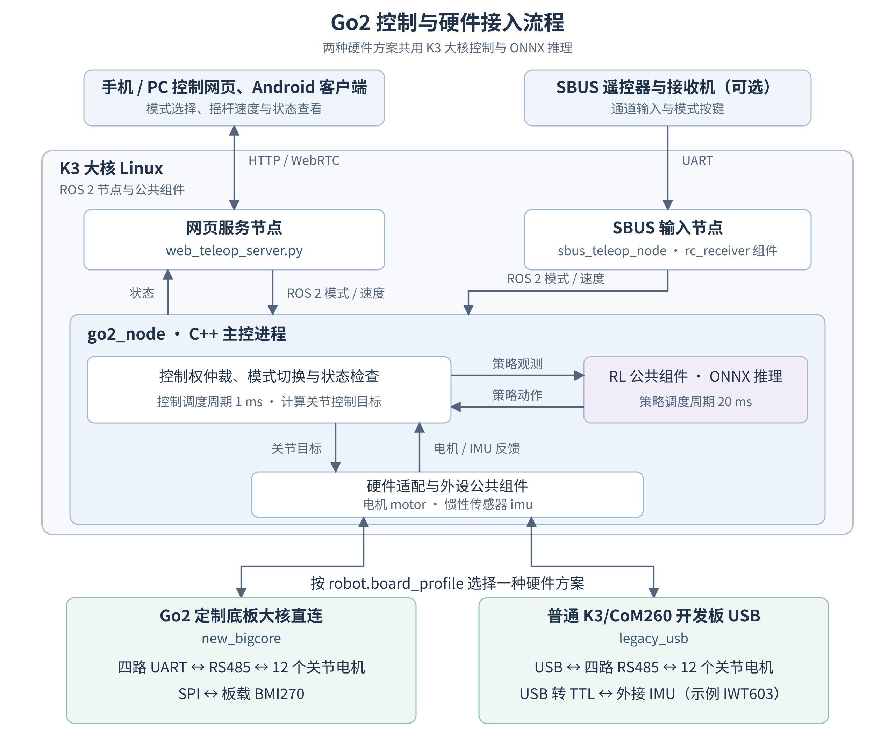

网页服务和 SBUS 输入作为独立 ROS 2 节点运行；策略推理与硬件适配由 `go2_node` 在进程内调用。手机、PC 和 Android 客户端连接同一板端服务，模式与速度指令由主控统一处理。

平地行走、综合地形、坐下、前跳和招手使用 ONNX 策略。站立、蹲下和倒地自起由应用控制流程实现。网页还提供白灯开关和摄像头预览。

### 1.2 控制与策略推理

主控把电机与 IMU 反馈转换为关节位置、速度和机身姿态，按当前模式组装策略观测。行走策略使用机身角速度、重力方向、速度指令、关节状态及上一次动作；招手、坐下和前跳还使用各自的参考动作信息。

ONNX 输出经关节顺序映射、动作缩放和位置限制后，转换为电机目标。各模型的观测布局、关节映射和位置与速度增益（PD）由 `config/policies.yaml` 定义。替换模型时需要同时核对这些参数，模型文件名相同并不代表输入输出约定相同。

控制任务和策略推理使用独立的 ROS 2 回调组，定时周期分别为 1 ms 和 20 ms。控制任务处理状态检查和电机目标，推理任务按约 50 Hz 更新策略动作。这些是程序的调度周期，实际执行频率取决于系统负载和设备通信。

### 1.3 应用目录

```text
application/ros2/unitree-go2/
├── src/                  # ROS 节点、模式控制、策略适配与硬件组织
├── launch/               # 合并本机配置并启动 ROS 2 节点
├── config/               # 公共参数、板型、策略清单与服务模板
├── policy/               # 下载后的 ONNX 模型
├── resources/motions/    # 策略使用的参考动作
├── clients/web/          # 板端服务提供的网页
├── scripts/              # 启动、模型下载、网页服务和网络管理
└── tool/calibration/     # XYZ 标定工具与摆姿参考
```

日常使用主要涉及启动脚本、本机配置和网页。需要接入其他控制程序时，使用 5.8 节的 ROS 2 接口；需要调整模型或硬件适配时，再查看对应配置和源码。

## 2. 硬件准备

### 2.1 接入方案

| 方案 | 电机通信 | IMU | `robot.board_profile` |
| --- | --- | --- | --- |
| Go2 定制底板大核直连 | Linux 板载 UART，经载板 RS485 接口连接四条腿 | 板载 BMI270 | `new_bigcore` |
| 普通 K3/CoM260 开发板 USB | USB 转四路 RS485，分别连接四条腿 | 外接 IMU，本例为 IWT603，经 USB 转 TTL 串口连接 | `legacy_usb` |

两种方案均需 Unitree Go2 本体、与主控和电机匹配的供电及线束，以及 Wi-Fi 网络和用于访问网页的手机或 PC。使用遥控器时，另接 SBUS 接收机并配备匹配的遥控器。

系统镜像、设备树和接口电平按实际板卡准备，安装参考 [镜像烧录](../02-快速入门/2.2-镜像烧录.md)。`robot.board_profile` 选择应用的接线与驱动配置，修改该字段不会切换底层固件或硬件选路。

Go2 定制底板的小核电机通信方式（`new_smallcore`）正在开发中，后续会推送。

摄像头属于可选外设。当前网页预览匹配 Tstc USB Full HD Camera（USB ID `1bcf:28c4`）；未连接摄像头时仍可使用运动控制、网页和遥控器。更换其他型号时，需要适配网页服务中的设备筛选和采集参数。

### 2.2 Go2 定制底板大核直连

#### 物料清单

| 物料 | 用途 |
| --- | --- |
| K3/CoM260 主控与 Go2 定制底板 | 提供四路电机 RS485 接口、IMU、SBUS 和状态灯接口 |
| 板载 BMI270 | 提供姿态、角速度和加速度，无需外接 IWT603 |
| 匹配定制底板的电机线束与供电连接 | 将四条腿的电机总线和电源接入底板 |

#### 接线与设备

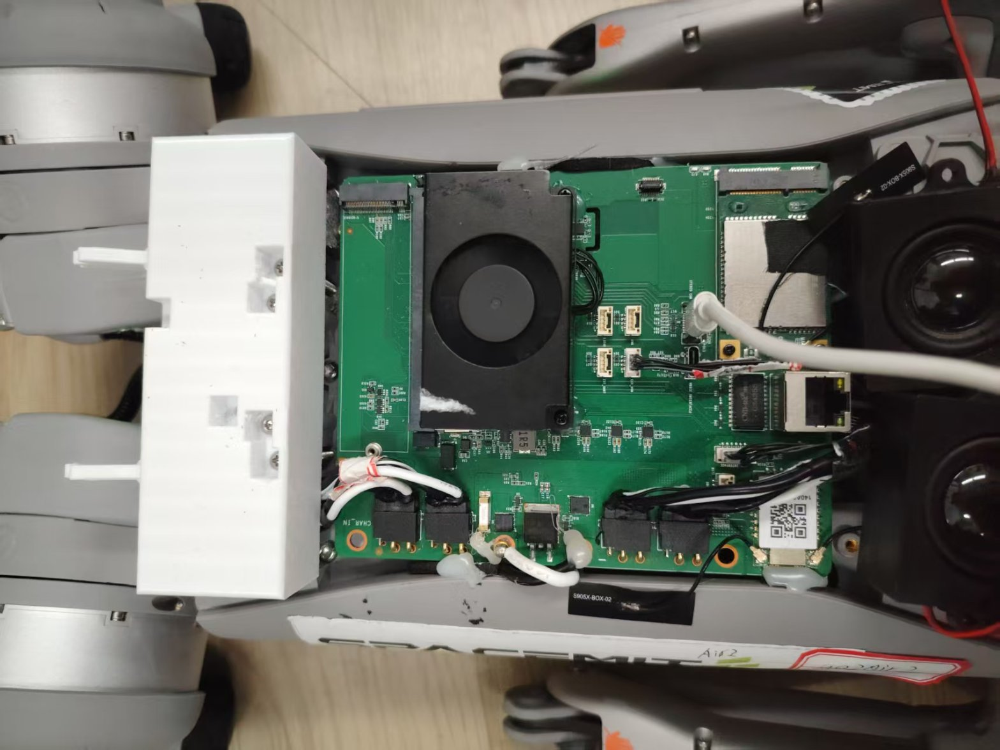

**接电前按定制底板丝印核对正负极：其正负极位置与宇树原厂板相反，不能按原厂接口的位置直接照接。**

腿位按机器狗自身的前后左右定义，与 USB 方案一致。应用内固定顺序为 FR 右前、FL 左前、RR 右后、RL 左后，每条腿依次为髋关节、大腿、小腿，电机 ID 为 0、1、2。定制底板各接口的丝印与实际腿位按下表对应：

| 逻辑位置 | 载板丝印 / 接口 | Linux 设备 |
| --- | --- | --- |
| FR 右前腿 | LB / J18，UART8 | `/dev/ttyS8` |
| FL 左前腿 | RB / J19，UART5 | `/dev/ttyS5` |
| RR 右后腿 | LF / J16，UART6 | `/dev/ttyS6` |
| RL 左后腿 | RF / J17，UART3 | `/dev/ttyS3` |
| BMI270 | U50，SSP1 | `/dev/iio:device0` |
| SBUS 接收机 | J22，UART7 RX | `/dev/ttyS7` |
| 状态灯 | J13，白 / 橙 / 红 / 绿 | 平台设备对应的硬件 PWM |

载板丝印与逻辑腿位的对应关系以上表为准。SBUS 板载接收链路已包含反相。固件与电机接口硬件选路需使 UART3、UART5、UART6、UART8 由 Linux 大核使用，并提供表中的 BMI270 设备。

`new_bigcore` 按定制底板上 BMI270 的名义安装方向提供绕 Z 轴 180° 的方向补偿；本机测得的安装补偿可在 `/etc/unitree-go2/robot.yaml` 中覆盖。

### 2.3 普通 K3/CoM260 开发板 USB

#### 原机拆装准备

1. 关闭机器狗并断开电池，拆下机身外壳，露出宇树原厂板和内部线束。
2. 核对并标记四条腿的电机线束，将电机插头从原厂板拔下，改插到 XT30（2+2）转接板上。
3. 将转接板的供电线接到原厂板，通信线接到 USB 转四路 RS485 模块。模块通过 USB 接入 K3，由 K3 作为电机总线唯一的控制主站。
4. USB 摄像头、雷达、喇叭等外设按实际需求选择保留或拆除；保留并接入 K3 的外设按实际设备核对接线、驱动和应用支持。

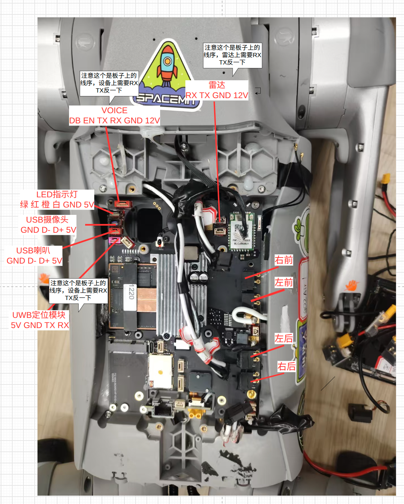

#### 物料清单

| 物料 | 单机参考数量 | 用途与选型要求 | 购买参考 |
| --- | --- | --- | --- |
| 普通 K3/CoM260 开发板 | 1 块 | 运行 Linux、ROS 2 和策略推理，提供 USB Host 接口 | 按实际板卡准备 |
| IWT603 传感器及线缆 | 1 套 | 本例 IMU，提供姿态、角速度和加速度；其他型号需适配驱动及坐标系 | [参考链接](https://item.taobao.com/item.htm?id=930684304729&skuId=5980587922334) |
| IMU 专用 USB 转换模块 | 1 个 | 将本例 IWT603 的 UART 接入 K3 USB Host，接口电平与 IMU 匹配 | [参考链接](https://item.taobao.com/item.htm?id=930684304729&skuId=5980587922337) |
| USB 转四路 RS485 模块（配套 XT30（2+2）转接板） | 1 套 | 四条腿各使用一路 RS485，需支持电机使用的 4,000,000 波特率 | [参考链接](https://detail.tmall.com/item.htm?id=679335252560&skuId=5795061774735) |
| DC-DC 降压模块 | 1 个 | 从宇树原板取电，输出调至 12 V 后给本例 K3 开发板供电 | [参考链接](https://detail.tmall.com/item.htm?id=41307963557&skuId=3944784489256) |
| XT30 公对母 | 4 个 | 对应四路电机供电，每条腿一路 | [参考链接](https://item.taobao.com/item.htm?id=877823221159&skuId=6099786434152) |
| USB 数据线、电机线束及供电线 | 按实际接线准备 | 连接开发板、转换模块、电机和传感器 | 按接口准备 |

数量按单台机器狗计算。购买链接对应本例的参考规格，选购时按实际硬件核对接口、通信速率和供电要求；IMU 型号与安装方向的适配见下文。

USB 接口不足时使用供电满足外设要求的 USB Hub。电机通过 RS485 接口连接，IMU 通过 TTL UART 连接，两者使用各自匹配的转换模块。

#### 整体接线

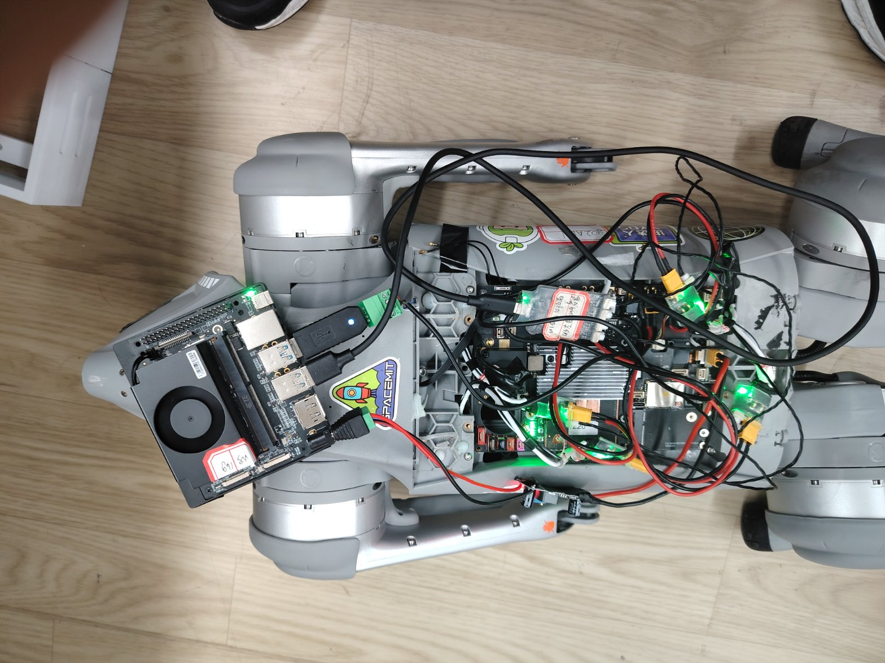

图中四条腿的电机插头已从原厂板拔下，改接到 XT30（2+2）转接板。转接板的供电线接原厂板，通信线接 USB 转四路 RS485 模块，再通过 USB 接入 K3。IWT603 经独立的 USB 转换模块连接 K3；K3 的电源另从原厂板取电，经降压模块输出 12 V 后接入。各模块的接线、安装方向和供电方式如下。

#### USB 四路 RS485 接线

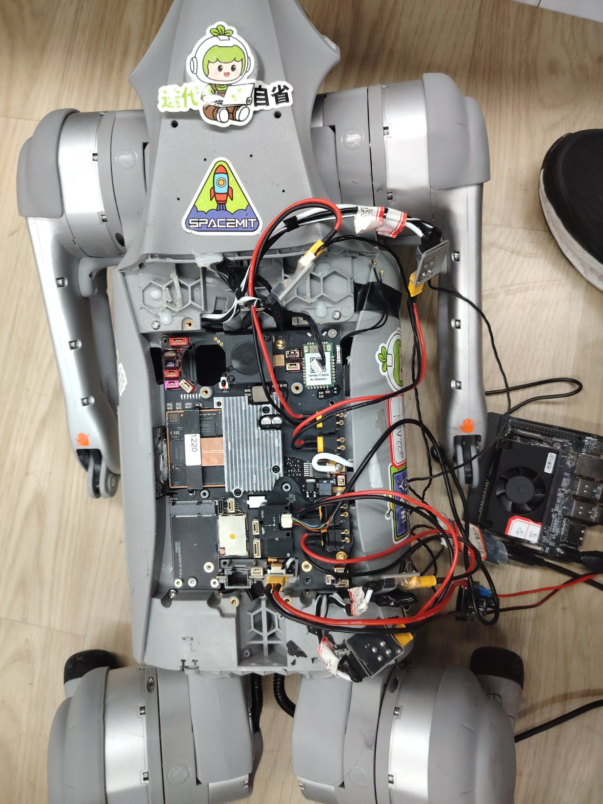

图中先将电机插头从宇树原厂板拔下，改插到 XT30（2+2）转接板上。转接板的供电线接到原厂板，由原厂板提供电机电源；通信线按腿位接到 USB 转四路 RS485 模块，模块再通过 USB 接入 K3 开发板的 USB Host。电机控制指令和状态反馈通过这条通信链路收发。

四条腿沿用 FR、FL、RR、RL 的逻辑顺序，每条腿的髋关节、大腿、小腿电机 ID 依次为 0、1、2。四路电机通信均使用 4,000,000 波特率、8N1。

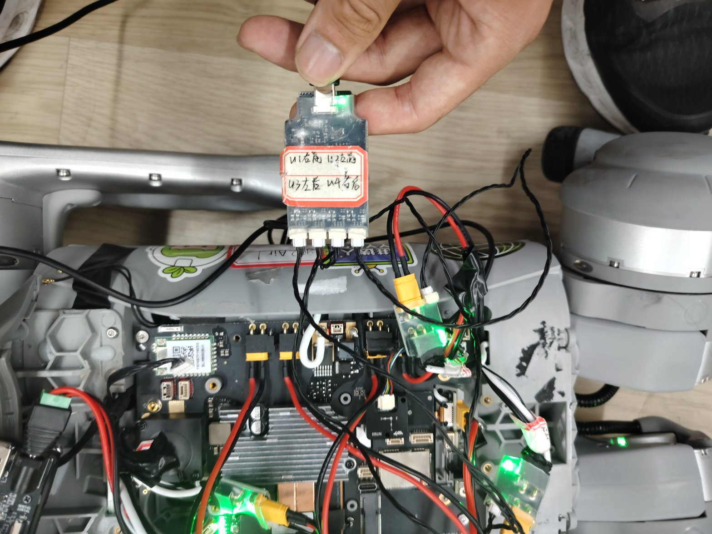

图中 USB 转四路 RS485 模块按自身丝印连接：串口 1 接右前腿，串口 2 接左前腿，串口 3 接左后腿，串口 4 接右后腿。腿位按机器狗自身的前后左右定义。本例 FTDI 模块的设备接口与配置位置对应如下：

| 模块丝印 | 连接腿位 | USB 串口接口 | 配置中的位置 |
| --- | --- | --- | --- |
| 串口 1 | FR 右前腿 | `if00-port0` | `serial_devices` 第 1 项 |
| 串口 2 | FL 左前腿 | `if01-port0` | `serial_devices` 第 2 项 |
| 串口 3 | RL 左后腿 | `if02-port0` | `serial_devices` 第 4 项 |
| 串口 4 | RR 右后腿 | `if03-port0` | `serial_devices` 第 3 项 |

更换转换模块或线束时，按实际通道核对腿位，并保持配置顺序为 FR、FL、RR、RL。

连接后在板端检查 USB 和稳定设备路径：

```bash
lsusb
ls -l /dev/serial/by-id/ /dev/serial/by-path/
```

应看到四个电机串口和一个 IMU 串口。使用 `/dev/serial/by-id/` 或 `/dev/serial/by-path/` 中的实际路径填写本机配置；`/dev/ttyUSB0` 等编号可能随插拔顺序变化。

#### IMU 安装与方向

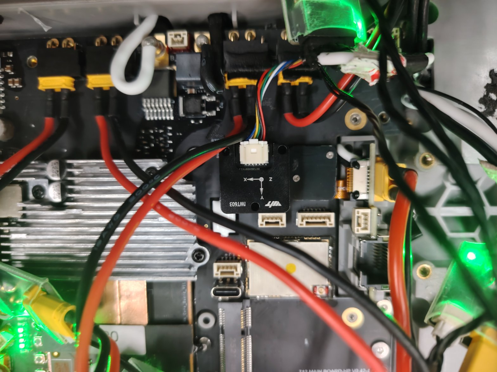

图中以 IWT603 演示 IMU 的固定位置和安装方向。IMU 型号可按实际硬件选择，更换型号时需适配对应驱动和硬件接入代码，核对通信协议与姿态输出格式，并使数据转换到下图的机身坐标系。

IWT603 经独立的 USB 转 TTL 模块连接 K3 的 USB Host 接口或 USB Hub。按信号方向连接 IWT603 的 TX 与转换器 RX、RX 与转换器 TX，并连接 GND；供电和电平以模块规格为准。串口波特率为 921600，输出需包含加速度、角速度和 `0x59` 四元数数据。

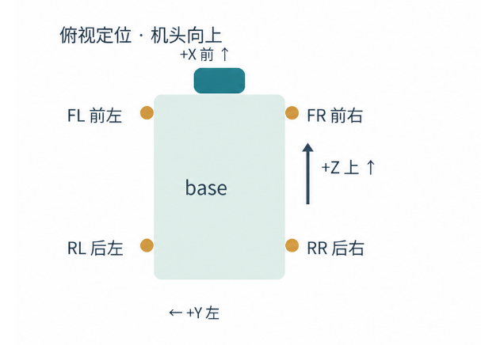

机身坐标系定义为 +X 向前、+Y 向左、+Z 向上。图为俯视图，机头朝图上方，左前、右前、左后、右后分别为 FL、FR、RL、RR；+Z 指向机身上方，在俯视图中朝观察者。

本例 IWT603 的安装方向与机身坐标系一致，使用单位矩阵和单位四元数，不添加定制底板 BMI270 的 180° 转向补偿。安装方向不同时，在 `/etc/unitree-go2/robot.yaml` 的 `go2.ros__parameters` 中调整 `imu_to_body_matrix` 和 `imu_to_body_quaternion_wxyz`，或在对应的 IMU 坐标变换代码中适配。角速度、加速度和姿态四元数需使用一致的方向变换。

#### K3 供电

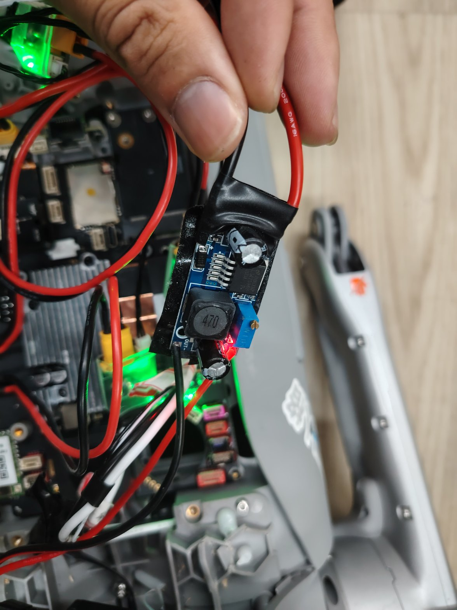

图中从宇树原板取电，通过 DC-DC 降压模块将输出调至 12 V，再接入本示例 K3 开发板的电源输入。接入 K3 前测量并确认降压模块输出为 12 V，按开发板电源接口定义连接正负极。更换开发板或降压模块时，按对应规格核对输入范围、输出电压和供电能力。

#### SBUS 与灯光

使用 SBUS 时，先确认开发板的接收串口已启用。`legacy_usb` 默认接收设备为 `/dev/ttyS5`，按开发板的引脚定义接入 UART5 RX，并按接收机输出完成电平和反相适配；使用其他接收串口时，在本机 `robot.sbus_device` 中指定实际路径。普通开发板的接线按自身接口定义准备，定制底板的 J22 接线表只适用于定制底板。

普通开发板的 USB 配置未包含状态灯和白灯的 PWM 接线；需要这些功能时，另行连接并配置本机 `led_pwm_devices`。

两种方案的电机总线上都只保留一个主站，其他控制器和调试程序退出后再由 K3 接管。板型接线保存在 `config/robot.yaml` 的 `board_profiles` 中，本机设备路径和 IMU 安装补偿由 `/etc/unitree-go2/robot.yaml` 覆盖公共默认值。

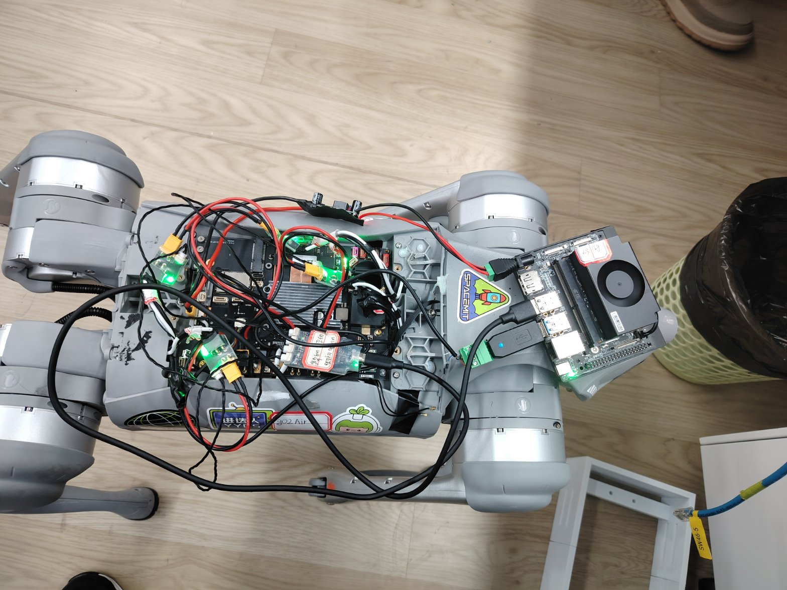

图为普通 K3/CoM260 开发板 USB 方案完成启动后，切换到“站立”状态的实机效果。

#### 固定与防护

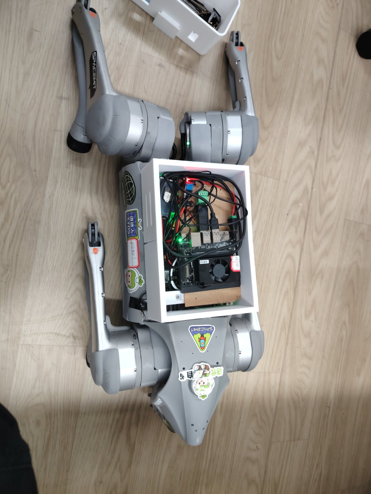

按实际安装位置自行配备外壳、扎带和 3M 胶，固定 K3、转换模块及线束，做好机械固定与防护。裸露焊点、接头等导电部位使用绝缘胶布包覆，避免与其他导电部件接触造成短路。

## 3. 环境搭建

### 3.1 按需组合下载 SDK

两种接入方案共用以下下载和构建流程。命令在 K3 板端以 root 执行，SDK 位于 `/root/spacemit_robot`。镜像和基础环境参考 [构建编译](../02-快速入门/2.3-构建编译.md)。使用普通用户时，替换工作目录，需要管理系统配置和服务时使用 `sudo`。

安装下载工具，首次使用 Git 时将姓名和邮箱替换为自己的信息：

```bash
apt update
apt install -y repo git curl
git config --global user.name "Your Name"
git config --global user.email "you@example.com"
```

在新工作目录中按分组获取代码：

```bash
mkdir -p /root/spacemit_robot
cd /root/spacemit_robot
repo init -u https://github.com/spacemit-robotics/manifest.git -b main -m default.xml \
  --repo-url=https://gitee.com/spacemit-robotics/git-repo \
  -g core,model_zoo_rl,peripherals,unitree-go2
repo sync -j4
```

`-g` 选择 SDK 基础仓库、RL 推理、外设组件组和 Go2 应用，无需下载全量 SDK。`peripherals` 包含外设组内的驱动仓库，实际构建由 Go2 target 选择电机、IMU、SBUS 和 LED 组件。只克隆本应用仓库不足以完成 SDK 构建。

已有完整 SDK 时保留原来的分组，在原目录执行 `repo sync -j4` 更新即可。新目录需要修改源码时，可在同步后执行 `repo start robot-dev --all` 创建开发分支。下载中断后重新执行 `repo sync -j4` 续传。

同步后，构建所需的主要路径如下：

```text
build/
scripts/
target/k3-com260-unitree-go2.json
application/ros2/unitree-go2/
components/model_zoo/rl/
components/peripherals/motor/
components/peripherals/imu/
components/peripherals/rc_receiver/
components/peripherals/led/
```

`lunch` 从 `target/` 读取构建目标，执行前确认上述路径齐全。

### 3.2 软件依赖

K3 使用 ROS 2 Humble，并安装与系统匹配的 SpacemiT ONNX Runtime。推理环境的安装方法见 [强化学习](../04-AI与算法/4.3-强化学习.md)。Go2 使用 ONNX 策略。

网页、网络管理和服务发现还需以下系统依赖：

```bash
apt update
apt install -y python3-yaml python3-numpy python3-dbus \
  python3-aiortc network-manager avahi-daemon psmisc
```

ROS 2 及组件依赖由 SDK 构建环境和应用的 `package.xml` 管理。Wi-Fi 由 NetworkManager 管理，Avahi 用于局域网服务发现；`psmisc` 提供标定工具检查串口占用时使用的 `fuser`。

摄像头预览另需带 `h264_stcodec` 编码器的 K3 FFmpeg，以及 [MediaMTX riscv64](https://github.com/Fitz8863/spacemit-mediamtx/releases/tag/v1.20.1-riscv64)。将 `mediamtx` 放入 `/usr/local/bin/`；网页按钮会启停预览，无需另建 MediaMTX 配置文件。

### 3.3 准备模型

模型发布在 [SpacemiT 模型库的 unitree-go2 目录](https://archive.spacemit.com/spacemit-ai/model_zoo/rl/unitree-go2/)，下载后保存在应用的 `policy/` 中。文件清单、大小和 SHA-256 保存在 `config/policies.yaml` 的 `model_manifest`，参考动作和模型参数随应用源码提供。

| 功能 | ONNX 文件 |
| --- | --- |
| 平地行走 | `go2_blind_rough.onnx` |
| 综合地形 | `go2_terrain.onnx` |
| 招手 | `go2_wave.onnx` |
| 前跳 | `go2_forward_jump.onnx` |
| 坐下 | `go2_sit.onnx` |

在 K3 的 SDK 根目录下载并校验：

```bash
cd /root/spacemit_robot
python3 application/ros2/unitree-go2/scripts/download_models_go2.py
```

成功时输出 `Verified 5 files`，模型位于 `application/ros2/unitree-go2/policy/`。脚本跳过已通过校验的文件。

`config/policies.yaml` 定义策略参数并记录模型来源，`resources/motions/` 保存参考轨迹，随应用构建安装。版权和许可见应用目录的 `NOTICE` 与 `LICENSE`；项目自训权重采用 Apache-2.0，第三方综合地形权重采用 MIT。

### 3.4 构建与安装

```bash
cd /root/spacemit_robot
source build/envsetup.sh
lunch k3-com260-unitree-go2
m
sros2_setup
ros2 pkg prefix unitree_go2
```

最后一条命令应输出 SDK 的安装前缀。模型在构建时随应用安装到 `output/staging/share/unitree_go2/policy/`；补充或替换源码目录中的模型后，需要重新安装应用。

后续只修改 Go2 应用时，使用单包增量构建：

```bash
cd /root/spacemit_robot
source build/envsetup.sh
lunch k3-com260-unitree-go2
cd application/ros2/unitree-go2
mm -j4
cd /root/spacemit_robot
bash build/build.sh deploy-rootfs
sros2_setup
```

`mm` 更新 `output/staging`，`deploy-rootfs` 将安装结果同步到运行前缀 `output/rootfs`。完整构建 `m` 会自动完成这一步。

若同时更新了 RL、电机等公共组件，将上面的 `mm -j4` 替换为 `mm --with-deps -j4`，其余步骤相同。构建后重新启动 Go2，加载新的安装结果。

## 4. 本机配置与标定

### 4.1 配置文件

`config/robot.yaml` 集中保存公共控制参数、板型接线和样机参考。每台机器狗的身份、通信域及实测标定使用 `/etc/unitree-go2/robot.yaml`，代码更新和构建不会覆盖该文件。

启动时，launch 读取公共默认参数和选定的 `board_profiles`，再用本机 `go2.ros__parameters` 覆盖对应字段。身份和通信域从本机 `robot` 字段读取；显式传入的 launch 参数可覆盖其对应设置。实机启动会校验本机身份与两组标定数组，公共配置中的样机标定不会自动补入本机缺项。

策略配置和硬件配置分开维护。`config/policies.yaml` 描述模型、观测和动作映射，`config/robot.yaml` 描述控制与板型，本机 YAML 保存每台设备的差异。网络与身份变化通常只需修改本机文件并重启，模型或公共配置变化则需要重新构建安装。

新机器狗首次部署时，创建 `/etc/unitree-go2/` 目录，再选择与硬件对应的一份模板，保存为 `/etc/unitree-go2/robot.yaml`。已有配置的机器狗保留原文件，只修改需要调整的字段。

```bash
install -d -m 755 /etc/unitree-go2
```

#### Go2 定制底板大核直连配置

```yaml
robot:
  id: go2
  name: Go2
  ros_domain_id: 220
  board_profile: new_bigcore
  wifi_connection: ''
  ap_ssid: Go2
go2:
  ros__parameters:
    joint_zero_offsets_rad: []
    startup_reference_rotor_positions_rad: []
```

该模板从 `new_bigcore` 读取四路板载电机串口、BMI270、UART7 SBUS 和状态灯配置。设备路径或安装方向与第 2.2 节不同时，在本机文件中填写对应覆盖值。

#### 普通 K3/CoM260 开发板 USB 配置

```yaml
robot:
  id: go2
  name: Go2
  ros_domain_id: 220
  board_profile: legacy_usb
  sbus_device: /dev/ttyS5
  wifi_connection: ''
  ap_ssid: Go2
go2:
  ros__parameters:
    motor_driver: drv_485_m8010a
    serial_devices:
      - "/dev/serial/by-id/<FR串口设备名>"
      - "/dev/serial/by-id/<FL串口设备名>"
      - "/dev/serial/by-id/<RR串口设备名>"
      - "/dev/serial/by-id/<RL串口设备名>"
    imu_driver: drv_uart_iwt603
    imu_device: "/dev/serial/by-id/<IMU串口设备名>"
    imu_baud: 921600
    imu_to_body_matrix: [1.0, 0.0, 0.0, 0.0, 1.0, 0.0, 0.0, 0.0, 1.0]
    imu_to_body_quaternion_wxyz: [1.0, 0.0, 0.0, 0.0]
    imu_roll_offset_deg: 0.0
    imu_pitch_offset_deg: 0.0
    joint_zero_offsets_rad: []
    startup_reference_rotor_positions_rad: []
```

将尖括号中的占位内容替换为第 2.3 节查到的实际设备名，电机路径按 FR、FL、RR、RL 排列。SBUS 路径与实际接收串口保持一致。示例的 IMU 单位变换对应传感器轴与机身轴一致的安装方式。

#### 本机字段与标定

两份模板均需设置以下字段，保存后执行 `chmod 600 /etc/unitree-go2/robot.yaml`：

| 字段 | 设置内容 |
| --- | --- |
| `robot.id`、`robot.name` | 机器狗的唯一标识和显示名称 |
| `robot.ros_domain_id` | ROS 2 通信域，同一网络中的各机器狗分别设置 |
| `robot.board_profile` | 定制底板大核直连填 `new_bigcore`，普通开发板 USB 填 `legacy_usb` |
| `robot.sbus_device` | 可选；按实际接收串口覆盖板型默认值 |
| `robot.wifi_connection` | 留空时沿用板子当前 Wi-Fi，也可填写系统已保存的首选连接名 |
| `robot.ap_ssid` | 使用热点模式时的热点名称 |
| `go2.ros__parameters` | 本机电机标定、设备路径和 IMU 安装补偿 |

以上两份新机配置的电机标定数组均为空，完成 XYZ 标定后才能启动实机控制。应用内 `config/robot.yaml` 带有样机的电机和 IMU 标定，不能直接套用到其他本体。

定制底板 BMI270 使用对应板型的名义安装补偿；普通开发板的 IWT603 按第 2.3 节的安装方向使用单位变换。XYZ 工具只更新电机标定，不计算 IMU 补偿。更换接入方式时，一起更新板型、设备路径和 IMU 补偿，已有本机字段会覆盖板型默认值。

已有配置的机器狗沿用板端文件。`GO2_LOCAL_CONFIG` 可指定其他本机配置路径。

两组电机标定值分别解决不同问题。`joint_zero_offsets_rad` 用于把电机转子角度转换为关节角度，`startup_reference_rotor_positions_rad` 保存 Pose A 对应的转子参考，用于建立本次启动的位置基准。两组数组均按 FR、FL、RR、RL，每腿髋关节、大腿、小腿的顺序排列，共 12 项，单位为弧度。使用 XYZ 工具成组生成，保持电机、腿位和数据一一对应。

### 4.2 Pose X/Y/Z 交互标定

停止 Go2 主程序和其他电机串口程序，支撑好机身，再启动标定工具。已安装自启服务时先停止服务：

```bash
systemctl stop go2.service
```

```bash
cd /root/spacemit_robot
source build/envsetup.sh
sros2_setup
python3 output/staging/lib/unitree_go2/tool/calibration/calibrate_robot.py
```

工具依次提示 Pose X、Pose Y、Pose Z。每次摆好并保持不动后按回车，倒计时 5 秒才开始记录；采样期间继续保持姿势。

每个参与标定的电机默认采集 20 帧新的有效 BRAKE 反馈，检查反馈 ID、错误码、时间戳和角度稳定性。首帧请求超时会最多重试 3 次，重试不计入有效帧数；持续超时、反馈异常或姿态不稳定时，当前阶段采集失败，终端提示重摆后重采。具体失败信息保存在该次采样目录的日志中。

| 阶段 | 采集关节 |
| --- | --- |
| Pose X | 四条腿的大腿和小腿，共 8 个电机 |
| Pose Y | 左前、左后髋关节，共 2 个电机 |
| Pose Z | 右前、右后髋关节，共 2 个电机 |

Pose X：


Pose Y：

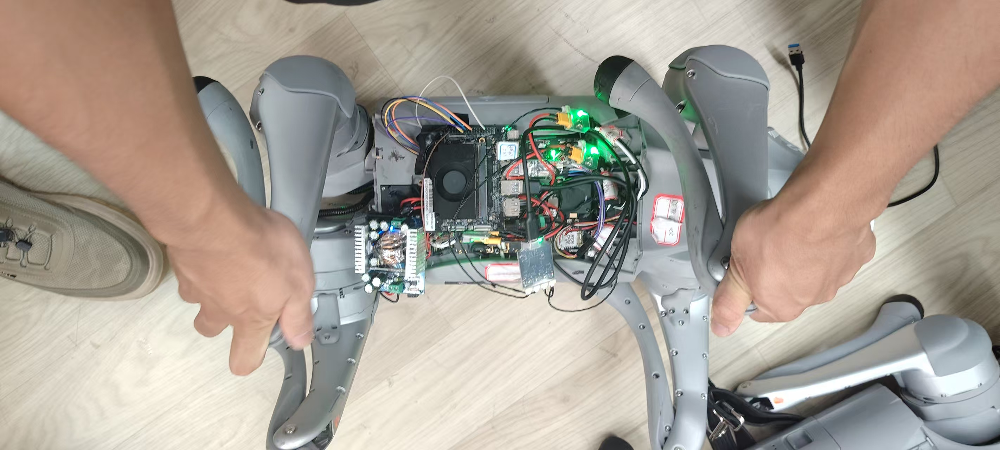

Pose Z：


照片辅助摆姿，参考角度由 `tool/calibration/calibration_pose_xyz.yaml` 定义。

三组记录并校验完成后，终端提示可以松手、放稳机器狗，随后显示 12 个关节的新旧零偏和启动转子参考。结果及原始采样保存在 `output/calibration/poseXYZ-<时间>/`。

输入“确认标定”后，工具只更新本机 YAML 中的 `joint_zero_offsets_rad` 和 `startup_reference_rotor_positions_rad`，保留身份、网络等其他配置。直接回车仅保存结果；摆姿阶段输入 `q` 或按 `Ctrl+C` 退出。确认后的标定在下次启动时生效。

### 4.3 启动姿态 Pose A

每次启动控制程序前，将四条腿恢复为配置定义的 Pose A 蹲姿，保持到程序完成启动。使用开机自启时，上电前就摆好。程序依据该姿态建立本次运行的电机转子位置参考；X/Y/Z 是标定采样姿态，采集结束后需重新摆回 Pose A。

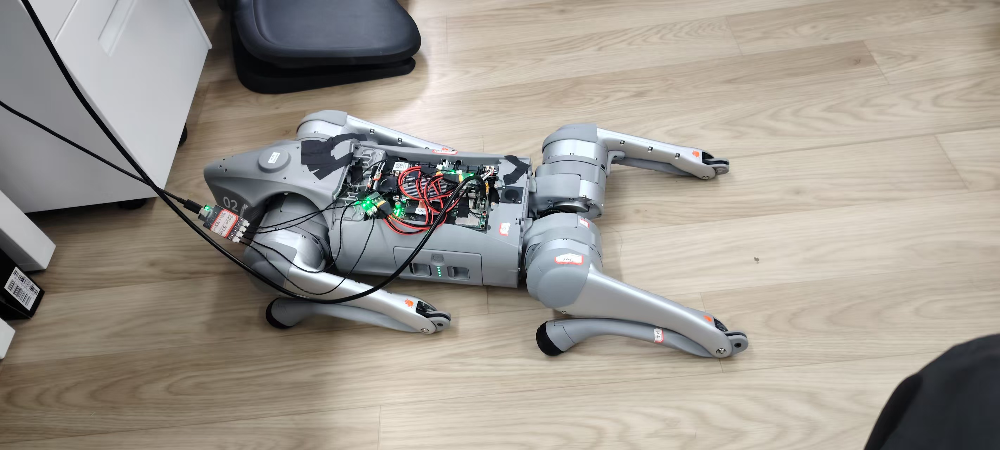

更换电机、重新装配或改变 IMU 安装方向后，重新核对本机标定和安装补偿。分阶段采集与离线合并命令见应用内 `tool/calibration/CALIBRATION.md`。

## 5. 功能使用

### 5.1 启动与网页

两种方案完成各自的本机配置和标定后，共用以下启动命令。每次启动前先摆好 4.3 节的 Pose A 蹲姿。
已启用自启服务时，手动启动前先执行 `systemctl stop go2.service`。

```bash
cd /root/spacemit_robot
bash application/ros2/unitree-go2/scripts/start-go2.sh
```

脚本以 `backend:=serial` 启动实机程序，接入方式从本机 `robot.board_profile` 读取。修改本机文件后重启程序，无需为切换这两种接入方式修改启动脚本。

程序默认使用当前 Wi-Fi。手机或 PC 连接同一网络，打开[控制网页](http://go2-sdk.local:8082/)，
在右上角选择机器狗，也可使用 `http://板端IP:8082/` 访问。
Android 手机可[下载并安装 Go2 App](https://archive.spacemit.com/ros2/prebuilt/unitree-go2/go2-web.apk)。
网页中的“打开摄像头”按钮用于预览。
未连接 SBUS 或接收串口暂不可用时，遥控器节点保持等待并自动重试，网页控制可继续使用。

首次连接后，先确认右上角选中的是目标机器狗。网页能打开表示网页服务可访问，主控是否就绪还需结合连接提示和启动终端日志判断。

网页操作按以下顺序进行：

1. 需要网页控制时，将遥控器置于网页控制档，或关闭遥控器并等待控制权移交。
2. 使用“站立”“蹲下”控制固定姿态；进入“平地行走”或“综合地形”后，再操作摇杆。左摇杆控制前后与横移，右摇杆控制转向。
3. 松开摇杆后速度指令回零，当前运动模式仍然保留。需要休息时使用“正常休眠”，程序完成当前动作的退出流程后蹲下并进入被动。
4. 需要立即中断当前动作时使用“紧急制动”，程序跳过动作退出流程，直接进入蹲下和被动流程。

“坐下”是策略动作，“蹲下”是固定姿态控制，两者用途不同。“翻身”用于倒地自起。页面上的“导航”和“AI”用于切换外部速度输入，路径规划或 AI 决策程序需要另外接入。

停止时先让机器狗蹲下，再在启动终端按 `Ctrl+C`。

### 5.2 热点连接

先停止当前 Go2 程序，再通过 systemd 临时服务以热点模式启动，切换网络时 SSH 断开也能继续运行：

```bash
systemd-run --unit=go2-ap --collect \
  --working-directory=/root/spacemit_robot \
  --property=KillSignal=SIGINT --property=KillMode=mixed \
  --property=TimeoutStopSec=50 \
  --setenv=SROBOTIS_ROOT=/root/spacemit_robot \
  --setenv=GO2_NETWORK_MODE=ap \
  /bin/bash /root/spacemit_robot/application/ros2/unitree-go2/scripts/start-go2.sh
```

热点名称由本机配置的 `robot.ap_ssid` 决定，参考配置为 `Go2`，默认密码为 `go2control`。
连接后打开[热点控制网页](http://10.0.91.250:8082/)。

停止临时热点程序时，PC 连接热点后通过 `ssh root@10.0.91.250` 登录板子，
再执行 `systemctl stop go2-ap.service`。程序会尝试恢复原来的 Wi-Fi。
若停止时提示临时服务未加载，说明程序已退出。日志使用 `journalctl -u go2-ap.service -f` 查看。
需要长期使用热点时，安装下面的自启服务并切换到热点模式。

### 5.3 开机自启

先停止手动运行的程序，摆好 Pose A，再安装并启动服务。
SDK 路径不同时，先修改服务文件中的 `SROBOTIS_ROOT`、`WorkingDirectory` 和 `ExecStart`。

```bash
cd /root/spacemit_robot
install -m 644 application/ros2/unitree-go2/config/systemd/go2.service /etc/systemd/system/go2.service
systemctl daemon-reload
systemctl enable --now go2.service
```

服务默认使用 Wi-Fi；在 SDK 根目录按需执行以下命令，保存网络模式并重启服务：

| 网络模式 | 命令 |
| --- | --- |
| 热点 | `bash application/ros2/unitree-go2/scripts/start-go2.sh --switch ap` |
| Wi-Fi | `bash application/ros2/unitree-go2/scripts/start-go2.sh --switch wifi` |

| 日常管理 | 命令 |
| --- | --- |
| 查看状态 | `systemctl status go2.service` |
| 查看日志 | `journalctl -u go2.service -f` |
| 停止程序 | `systemctl stop go2.service` |
| 启动程序 | `systemctl start go2.service` |
| 取消自启并停止 | `systemctl disable --now go2.service` |

### 5.4 通过串口更换 Wi-Fi

将 K3 调试串口（UART0 / Console）接到 Linux PC。Go2 定制板按丝印与 USB 转串口模块同名连接：
**RX 接 RX、TX 接 TX、GND 接 GND**。
普通开发板按信号方向连接：板端 TX 接转换器 RX，板端 RX 接转换器 TX，GND 共地。

1. 在 PC 上查找设备并打开串口，将 `/dev/ttyUSB0` 替换为实际设备：

   ```bash
   ls -l /dev/serial/by-id/
   sudo minicom -D /dev/ttyUSB0 -b 115200 -8
   ```

   未安装 minicom 时执行 `sudo apt install minicom`。按 `Ctrl+A`、`O` 进入串口设置，
   使用 `115200 8N1`，关闭硬件和软件流控。按回车后使用镜像提供的账号登录；
   后续系统管理命令以 root 执行，普通用户先切换到 root 或使用 `sudo`。

2. 在板端串口终端停止 Go2。服务方式执行 `systemctl stop go2.service`；
   手动运行则先停止对应程序。扫描并连接新 Wi-Fi：

   ```bash
   nmcli radio wifi on
   nmcli device wifi rescan
   nmtui connect
   ```

   用方向键选择 Wi-Fi，按 `Tab` 切到“激活”，输入密码。连接成功后退出。
   若列表没有刷新，退出 nmtui，重新扫描后再打开。

3. 查看连接名，设置自动连接，再查询 IP：

   ```bash
   nmcli -f DEVICE,TYPE,STATE,CONNECTION device status
   nmcli connection modify "Wi-Fi 连接名" connection.autoconnect yes connection.autoconnect-priority 100
   ip -br addr
   ```

   将“Wi-Fi 连接名”替换为已连接无线网卡的 `CONNECTION` 值。
   记下该网卡的 IPv4 地址，例如 `192.168.1.80/24` 中的 `192.168.1.80`。
   `/etc/unitree-go2/robot.yaml` 中的 `robot.wifi_connection` 留空，程序就会沿用当前连接；
   若原来指定了旧网络，只清空这一项，保留其他配置。

4. PC 连接同一 Wi-Fi，在新终端用查到的 IP 登录，例如：

   ```bash
   ssh root@192.168.1.80
   ```

   摆好 Pose A 后，按 5.1 节启动；使用自启服务时，执行上一节的 Wi-Fi 切换命令。
   随后即可断开串口，用网页或 App 控制。

### 5.5 遥控器

左摇杆控制前后和横移，右摇杆左右控制转向。
B 保持暗，使用 F、E 选择常用模式；H 置中后按 C 进入：

| F | E | 模式 |
| --- | --- | --- |
| 低 | 低 | 综合地形 |
| 低 | 中 | 招手 |
| 低 | 高 | 坐下 |
| 中 | 低 | 网页控制，无需按 C |
| 高 | 低 | 前跳 |
| 高 | 高 | 平地行走 |

| 操作 | 按键 |
| --- | --- |
| 站立 / 蹲下 | G 高 / 低保持 0.5 秒 |
| 正常休眠 | H 置中后按 D，完成当前动作的退出过程后蹲下并进入被动 |
| 紧急制动 | H 高 + D，不等待动作退出，直接蹲下并进入被动 |
| 自起 | 被动或蹲下时，H 低保持 0.5 秒 |
| 白灯开关 | H 高 + C |

网页档位下由网页控制，遥控器仅保留急停和白灯操作；切出后恢复遥控器控制。
关闭遥控器或持续断连也会交给网页。G 控制的蹲下与模式表中的坐下动作不同。

### 5.6 终端控制

保持 Go2 程序运行，另开一个板端终端，加载环境和本机通信域：

```bash
cd /root/spacemit_robot
source build/envsetup.sh
sros2_setup
go2_config="${GO2_LOCAL_CONFIG:-/etc/unitree-go2/robot.yaml}"
export ROS_DOMAIN_ID="$(python3 -c 'import sys,yaml; print(yaml.safe_load(open(sys.argv[1]))["robot"]["ros_domain_id"])' "$go2_config")"
```

例如切换到站立：

```bash
ros2 service call /go2/set_mode unitree_go2/srv/SetMode '{mode: stand}'
```

常用模式名称如下，大小写与表中一致：

| `mode` | 操作 |
| --- | --- |
| `stand` | 站立 |
| `crouch` | 蹲下 |
| `walk` | 平地行走，接收速度指令 |
| `terrain` | 综合地形，接收速度指令 |
| `navigation` | 平地行走，使用外部 `/cmd_vel` 速度 |
| `ai_agent` | 平地行走，使用外部 `/cmd_vel_ai` 速度 |
| `wave` | 招手 |
| `sit` | 坐下动作 |
| `forward_jump` | 前跳 |
| `rollover` | 倒地自起 |
| `passive` | 正常休眠，先完成动作退出流程 |
| `passive_direct` | 紧急制动，跳过动作退出流程 |

服务返回 `accepted` 和 `message`。`accepted: true` 表示请求已接受，站立过渡或动作执行可能仍在进行；结合 `/go2/status` 查看当前模式和原因。请求被拒绝时，先阅读 `message`，核对控制权、设备状态和策略加载结果。

终端持续发送速度时，使用 `navigation` 模式和 `/cmd_vel`，由主控选择该输入，避免网页摇杆的周期指令覆盖终端指令。该模式使用平地行走策略。先请求切换模式：

```bash
ros2 service call /go2/set_mode unitree_go2/srv/SetMode '{mode: navigation}'
```

确认请求被接受、站立过渡完成后，以 10 Hz 持续发送低速前进指令。同一话题只保留一个速度发布者：

```bash
ros2 topic pub -r 10 /cmd_vel geometry_msgs/msg/Twist \
  '{linear: {x: 0.1, y: 0.0}, angular: {z: 0.0}}'
```

`linear.x`、`linear.y` 和 `angular.z` 分别表示前后、横移和转向指令。停止该发布命令后，速度输入超时会回零，机器狗仍处于行走模式。需要休息时，再发送正常休眠请求，待蹲下后停止主程序：

```bash
ros2 service call /go2/set_mode unitree_go2/srv/SetMode '{mode: passive}'
```

### 5.7 摄像头预览

点击“打开摄像头”后，网页服务启动 FFmpeg 采集和硬件 H.264 编码，由 MediaMTX 向浏览器提供 WebRTC 画面。默认预览为 640 × 360、30 fps。再次点击关闭时回收预览进程；主控的运动控制仍单独运行。

摄像头按需启动，平时无需单独启动视频服务，也无需编辑视频配置 YAML。未接摄像头或依赖缺失时，页面会显示相应错误，仍可使用其他控制功能。

手机或 PC 除了访问网页的 8082 端口，还需能访问板端预览使用的 TCP 8889 和 UDP 8189。页面能打开但视频一直连接时，检查 Wi-Fi 客户端隔离、VPN 路由和防火墙是否阻断这些连接。设备识别和编码依赖的排查见 6.5 节。

### 5.8 ROS 2 接口与状态

在已按 5.6 节加载环境和通信域的终端中，先查看节点和反馈：

```bash
ros2 node list
ros2 topic echo /go2/status --once
ros2 topic hz /joint_states
```

主要接口如下：

| 接口 | ROS 类型 | 用途 |
| --- | --- | --- |
| `/go2/set_mode` | `unitree_go2/srv/SetMode` | 终端或外部程序切换模式 |
| `/cmd_vel_direct` | `geometry_msgs/msg/Twist` | 直接向主控输入速度 |
| `/cmd_vel` | `geometry_msgs/msg/Twist` | 选择 `navigation` 后转发的外部速度 |
| `/cmd_vel_ai` | `geometry_msgs/msg/Twist` | 选择 `ai_agent` 后转发的外部速度 |
| `/go2/status` | `std_msgs/msg/String` | JSON 格式的模式、控制来源和设备状态 |
| `/joint_states` | `sensor_msgs/msg/JointState` | 12 个关节的状态反馈 |
| `/go2/body_imu` | `sensor_msgs/msg/Imu` | 机身 IMU 反馈 |
| `/go2/toggle_white_light` | `std_srvs/srv/Trigger` | 切换白灯 |

`/go2/status` 中的 `mode` 表示实际模式，`control_source` 表示网页、遥控器或终端控制来源，`reason` 记录当前控制状态的说明。`startup_pose_invalid`、`imu_valid`、`imu_age_ms` 和各关节的 `valid`、`feedback_age_ms` 可用于区分启动姿态、IMU 和电机反馈问题。

状态中显示的控制来源反映网页与遥控器的仲裁结果；直接使用 `/go2/set_mode` 和 `/cmd_vel_direct` 的终端输入不受该仲裁限制。接入外部程序时，明确由谁发送速度，避免并行使用多个输入源。

导航和 AI 输入共用平地行走策略。通过模式服务选择 `navigation` 或 `ai_agent` 后，主控才转发对应速度话题，切换输入时会清除旧速度。应用提供输入通道，建图、路径规划和 AI 决策由外部程序实现。

## 6. 常见问题

### 6.1 模型缺失或校验失败

在 SDK 根目录运行 `python3 application/ros2/unitree-go2/scripts/download_models_go2.py --check`，根据输出核对 5 个模型的文件名、大小和校验值。重新运行下载脚本，校验通过后重新构建安装应用。

### 6.2 提示本机配置缺失或标定数组无效

确认 `/etc/unitree-go2/robot.yaml` 存在，并检查 `robot.id`、`robot.ros_domain_id` 以及两组标定数组。每组数组都需包含 12 个有限数值；新机器先完成交互标定。

### 6.3 电机反馈缺失或启动位置校验失败

按所选方案的接线表检查四路电机设备和每条腿的 ID 0、1、2，确认主程序、标定工具和自启服务没有重复占用串口。USB 方案同时检查转换模块是否出现在 `lsusb` 中、四条稳定路径是否存在且与腿位匹配。启动位置校验失败时，先恢复 Pose A，再核对该本体的标定值及转子参考。

### 6.4 网页打不开或遥控输入未生效

网页先用板端实际 IP 和端口 8082 访问，检查手机与板子是否处于可互通的网络；主机名发现还需 Avahi 正常运行。遥控器检查实际接收设备、接收机供电及通道映射：定制底板默认 `/dev/ttyS7`，普通开发板 USB 方案默认 `/dev/ttyS5`，设置了 `robot.sbus_device` 时以本机配置为准。B 暗、F 中、E 低时由网页控制。

定制底板的状态灯绿色对应被动或固定姿态模式，橙色对应策略模式；红色表示启动姿态、IMU、输入连接或全部电机反馈等检查发现异常。结合 `/go2/status` 的 `light_fault` 和 `reason` 定位原因，灯色本身不表示某个具体关节的状态。

使用 ROS 2 命令检查话题或调用服务时，诊断终端需加载 ROS 环境、SDK 安装环境，并将 `ROS_DOMAIN_ID` 设置为本机 YAML 中的值。

### 6.5 网页正常但摄像头没有画面

先查看网页摄像头区域的错误提示。提示未识别设备时，检查 USB 接线、供电及摄像头型号，当前设备筛选要求 USB ID 为 `1bcf:28c4`。存在 `/dev/video*` 并不一定代表目标 RGB 摄像头已连接，板端编码设备也会产生视频节点。

在板端检查预览程序和硬件编码器：

```bash
command -v ffmpeg
command -v mediamtx
ffmpeg -hide_banner -h encoder=h264_stcodec
```

若编码器未找到，安装与 K3 系统匹配的 FFmpeg。若提示 MediaMTX 启动失败，检查程序是否可执行、端口是否被其他视频服务占用，以及网页服务日志。预览已启动但浏览器没有画面时，再检查 5.7 节的网络端口。

### 6.6 修改配置或模型后没有生效

先区分修改的是本机文件还是应用源码。修改 `/etc/unitree-go2/robot.yaml` 后重启程序；设置了 `GO2_LOCAL_CONFIG` 时，检查实际指定的文件。公共配置和模型需重新构建安装，运行中的进程也需重启。

在加载 SDK 环境的终端中执行 `ros2 pkg prefix unitree_go2`，确认使用的是本次 SDK 的安装结果。`start-go2.sh` 会使用已设置的 `SROBOTIS_ROOT`，从另一个 SDK 终端启动时需核对该变量。自启服务还需检查 `systemctl cat go2.service` 中的 SDK 路径和网络模式覆盖项。

## 7. 许可

源码和项目自训模型采用 Apache-2.0，第三方综合地形模型采用 MIT。模型来源、版本和校验值见 [config/policies.yaml](https://github.com/spacemit-robotics/unitree-go2/blob/main/config/policies.yaml) 的 `model_manifest`，版权声明和许可原文见 [NOTICE](https://github.com/spacemit-robotics/unitree-go2/blob/main/NOTICE) 与 [LICENSE](https://github.com/spacemit-robotics/unitree-go2/blob/main/LICENSE)。
