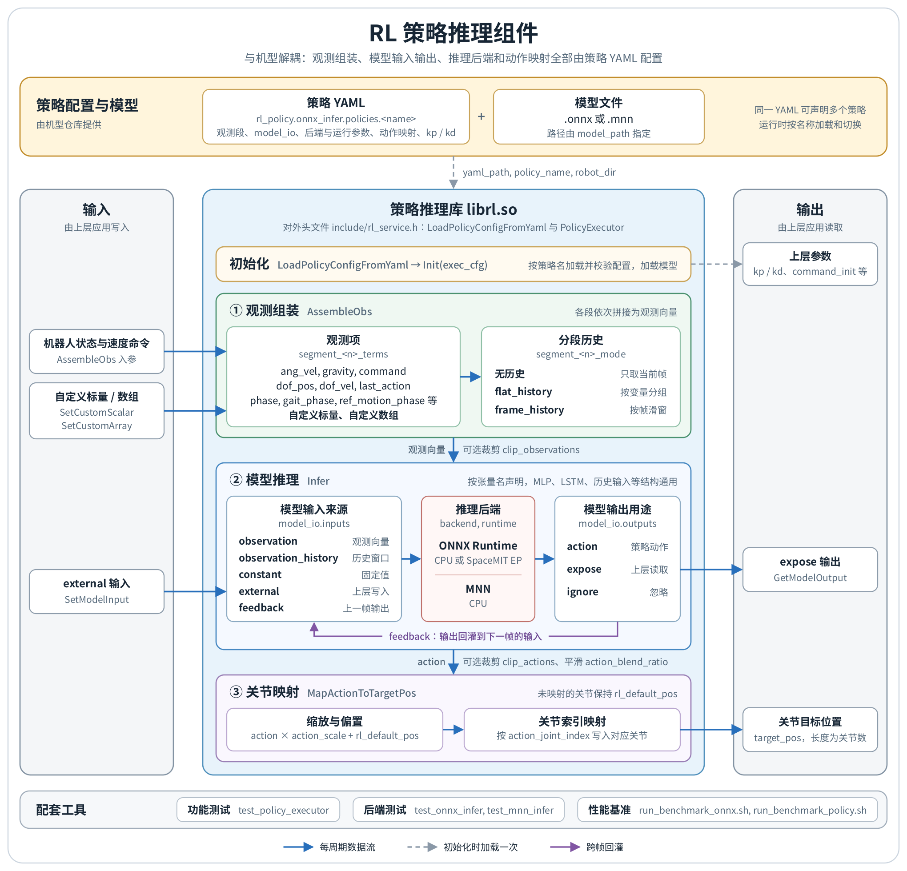

# 强化学习

> **文档类型**：算法与模型能力
> **说明**：基于 ONNX Runtime 或 MNN 的 RL 强化学习策略推理执行器，支持 MLP、LSTM 及带历史观测输入等模型结构，提供段式观测组装功能。本文档涵盖模块概述、环境搭建、示例运行、API 调用、调试和常见问题。

## 1. 模块概述

- **主要功能**：基于 ONNX Runtime 或 MNN 的机器人 RL 策略推理执行器。负责从 YAML 配置文件加载策略模型，按配置组装观测向量（obs），执行推理，并将策略输出映射为关节目标位置。模块与机器人型号完全解耦，所有参数由 YAML 驱动。
- **核心特性**：
  - 支持 MLP、LSTM、obs_hist 等模型结构：模型的输入输出由 YAML 的 `model_io` 按张量名声明，不按网络类别自动识别
  - 段式观测组装：每个 obs segment 独立配置 terms 和历史模式（无历史 / flat_history / frame_history）
  - 多策略切换：同一配置文件可定义多个策略，运行时按名切换
  - 推理后端：ONNX Runtime（CPU 或 SpaceMIT EP）和 MNN（CPU），每个策略用 `backend` 选择，接口与后端解耦
  - 上层扩展：自定义标量、自定义数组和独立的模型输入由上层在每个推理周期写入，模型的附加输出可由上层读取
- **软件框图**：

  

- **相关目录**：

  ```
  components/model_zoo/rl/
  ├── include/
  │   └── rl_service.h                      # 对外唯一头文件：PolicyExecutor、LoadedPolicyConfig 等
  ├── src/
  │   ├── policy_executor.cpp               # 编排层：Init/AssembleObs/Infer/MapAction 实现（接口声明在 rl_service.h）
  │   ├── policy_config_loader.cpp          # YAML 解析：加载策略配置到 PolicyExecutorConfig（接口声明在 rl_service.h）
  │   ├── obs_assembler.h                   # 观测段组装器抽象基类（纯虚接口，仅头文件）
  │   ├── obs_term.h / obs_term.cpp         # 观测项计算器：各 term（gyro/dof_pos/phase 等）的数值计算
  │   ├── obs_none.h / obs_none.cpp         # 无历史模式组装器（mode 为空）
  │   ├── obs_flat_history.h / .cpp         # 按变量分组的环形历史缓冲组装器（mode: flat_history）
  │   ├── obs_frame_history.h / .cpp        # 按帧滑窗历史缓冲组装器（mode: frame_history）
  │   └── backends/
  │       ├── onnx/
  │       │   ├── onnx_infer.h              # ONNX Runtime 推理封装：模型加载、维度推断、Run
  │       │   └── onnx_infer.cpp
  │       └── mnn/
  │           ├── mnn_infer.h               # MNN 推理封装（默认编入）
  │           └── mnn_infer.cpp
  ├── cmake/
  │   ├── FindONNXRuntime.cmake             # ONNX Runtime 查找脚本
  │   └── FindMNN.cmake                     # MNN 查找与自动构建脚本
  ├── example/
  │   ├── test_policy_executor.cpp          # 功能测试：验证配置加载、推理链路、维度正确性
  │   ├── test_onnx_infer.cpp               # 功能测试：验证 ONNX Runtime 后端安装与模型可推理
  │   ├── test_mnn_infer.cpp                # 功能测试：验证 MNN 后端与模型可推理
  │   ├── benchmark_onnx_infer.cpp          # 性能基准：隔离测试 ORT 推理延迟（排除 obs 组装干扰）
  │   └── benchmark_policy_executor.cpp     # 性能基准：AssembleObs→Infer→MapAction 端到端分段计时
  └── scripts/
      ├── run_benchmark_onnx.sh             # 封装 benchmark_onnx_infer，自动定位 SDK_ROOT
      ├── run_benchmark_policy.sh           # 封装 benchmark_policy_executor，自动定位 SDK_ROOT
      └── pt2onnx.py                        # PyTorch→ONNX 转换脚本，自动检测 MLP/LSTM/GRU 并外置状态
  ```

- **策略类型**：RL 组件不区分策略类型，所有策略由同一个执行器运行。常见的几类策略在训练数据和模型输入上的差别如下：

  | 策略类型 | 训练方式与数据 | 模型输入 | 额外输入 |
  | --- | --- | --- | --- |
  | 基础运控 | 通常只用强化学习训练，不需要动作数据集 | 本体观测和速度命令 | 无，可直接用本文的测试和 benchmark 工具运行 |
  | 动作模仿 | 针对一个或一组动作训练，需要少量参考动作数据 | 本体观测，加动作相位或参考动作 | 动作相位 `ref_motion_phase` 由组件按 `motion_length` 计算，不需要额外输入；参考动作由上层写入 |
  | 全身动作跟踪 | 用大规模动作数据集训练的通用跟踪模型，如 SONIC、SuperMimic | 本体观测和参考动作或其编码，通常带历史帧 | 参考动作或其编码由上层写入 |

  额外输入由上层通过 `SetCustomArray`、`SetModelInput` 写入执行器，对应 YAML 中的自定义数组和 `external` 输入。本文的测试和 benchmark 工具不提供这些输入的真实数据：`test_policy_executor` 对自定义数组按零值运行，`run_benchmark_policy.sh` 不接受声明了自定义数组的策略；`external` 输入配置了 `default` 时这两个工具按默认值运行，没有配置时报错。这类策略需要在能提供完整输入的环境中运行和测量。

## 2. 环境准备

### 前置条件

- **运行环境**：C++17，CMake ≥ 3.16
- **ONNX Runtime**：
  - x86_64 开发机：首次 `mm` 编译 `model_zoo/rl` 时 CMake 自动拉取 `onnxruntime-linux-x64-1.21.0.tgz`
    到 `~/.cache/thirdparty/onnxruntime/onnxruntime-linux-x64-1.21.0/`。已预装到 `/usr/local` 或
    通过 `ONNXRUNTIME_DIR` 指定路径时优先使用。
  - K3 板卡（rv64）：安装 SpacemiT 定制版 onnxruntime

    ```bash
    # 安装 spacemit-onnxruntime 定制版（包含 A100核 EP加速）:  
    apt install -y spacemit-onnxruntime python3-onnx
    
    # 若同时安装无加速版 onnxruntime，运行时会冲突，需卸载:  
    sudo apt remove libonnxruntime-dev libonnxruntime1.23 python3-onnxruntime
    ```

- **MNN**（可选推理后端，默认编入）：CMake 依次查找 `MNN_ROOT` 指定的路径、系统安装和 `~/.cache/thirdparty/mnn/` 缓存，都没有时自动下载固定版本的源码并编译（支持 x86_64 和 riscv64）。只使用 ONNX 模型时可用 `mm -DUSE_MNN_BACKEND=OFF` 关闭。

- **其他依赖**：Eigen3、yaml-cpp（均可通过 apt 安装）

    ```bash
    sudo apt install -y libeigen3-dev libyaml-cpp-dev
    ```

- **环境变量**：

    ```bash
    source ~/spacemit_robot/build/envsetup.sh
    ```

### 构建编译

- **获取代码**：

  RL 组件路径为 `components/model_zoo/rl`。运行示例和基准测试还需要对应机型的仓库（包含策略下载脚本和 YAML 配置），按需选择以下拉取方式：

  1. **拉取指定机型**（以 g1 为例）：

  ```bash
  repo init -u https://github.com/spacemit-robotics/manifest.git -b main -m default.xml \
    --repo-url=https://gitee.com/spacemit-robotics/git-repo \
    -g core,model_zoo_rl,humanoid_unitree_g1
  repo sync -j4
  repo start robot-dev --all
  ```

  拉取后，运行该机型的下载脚本获取 ONNX 策略模型：

  ```bash
  SDK_ROOT=$(pwd) application/native/humanoid_unitree_g1/scripts/download_models_g1.sh
  ```

  2. **一次拉取所有机型**（获取全部机型的下载脚本，按需运行各机型策略下载）：

  ```bash
  repo init -u https://github.com/spacemit-robotics/manifest.git -b main -m default.xml \
    --repo-url=https://gitee.com/spacemit-robotics/git-repo \
    -g core,model_zoo_rl,humanoid
  repo sync -j4
  repo start robot-dev --all
  ```

  拉取完成后，按需运行各机型 RL 策略的下载脚本（以 g1 和 tiangong 为例）：

  ```bash
  SDK_ROOT=$(pwd) application/native/humanoid_unitree_g1/scripts/download_models_g1.sh
  SDK_ROOT=$(pwd) application/native/humanoid_tiangong/scripts/download_models_tiangong.sh
  ```

  > 各机型 group 名：`humanoid_unitree_g1`、`humanoid_unitree_h1_2`、`humanoid_unitree_r1`、`humanoid_unitree_go1`、`humanoid_qinglong`、`humanoid_tiangong`、`humanoid_linglong`。

- **编译**：

    ```bash
    source ~/spacemit_robot/build/envsetup.sh
    cd components/model_zoo/rl
    mm
    ```

- **产物**：
  - `output/staging/lib/librl.so` — 推理库
  - `output/staging/bin/test_policy_executor` — 完整接口功能测试
  - `output/staging/bin/test_onnx_infer` — ONNX 后端功能测试
  - `output/staging/bin/test_mnn_infer` — MNN 后端功能测试（编入 MNN 时生成）
  - `output/staging/bin/benchmark_onnx_infer` — 纯推理性能基准
  - `output/staging/bin/benchmark_policy_executor` — 完整链路性能基准
  - `output/staging/bin/run_benchmark_onnx.sh` — 纯推理基准启动脚本
  - `output/staging/bin/run_benchmark_policy.sh` — 完整链路基准启动脚本

## 3. 示例使用（从 0 跑通）

### 3.1 策略推理全链路测试

验证配置加载、obs 组装、推理、动作映射全流程。

**前置条件**：

1. rl组件`mm`编译完成，`output/staging/bin/test_policy_executor` 已生成；

2. 检查具体机型案例的仓库源码是否就位，对应机型的 YAML 在源码中提供（如 `application/native/humanoid_unitree_g1/config/g1.yaml`）；

3. 策略模型（.onnx）需通过以下命令运行下载脚本获取，在仓库根目录执行（以 g1 为例，其他机型替换 `g1` 即可）：

```bash
SDK_ROOT=$(pwd) application/native/humanoid_unitree_g1/scripts/download_models_g1.sh
```

上述命令会将 g1 的 RL 策略模型下载至 `application/native/humanoid_unitree_g1/policy/` 下各子目录。

**步骤 1**：进入 spacemit_robot 根目录

```bash
cd ~/spacemit_robot
```

**步骤 2**：运行测试（以 g1 的 walk_rlgym 策略为例）

```bash
./output/staging/bin/test_policy_executor \
  application/native/humanoid_unitree_g1/config/g1.yaml \
  walk_rlgym \
  application/native/humanoid_unitree_g1
```

参数说明：`<yaml路径> <policy_name> <robot_dir>`，`robot_dir` 用于解析 YAML 中的模型相对路径。

**预期输出**：

```
[test] 加载配置: application/native/humanoid_unitree_g1/config/g1.yaml, policy: walk_rlgym, robot_dir: application/native/humanoid_unitree_g1
[test] 初始化 PolicyExecutor
[ONNX Runtime] ...（模型加载日志）
[PolicyExecutor] model_io: 严格声明, obs_dim=47, action_dim=12, feedback=2, history=no, external=0, expose=0
[PolicyExecutor] 段式观测: 1 段, 计算维度=47, 模型输入维度=47
  段[0] mode=(none), frame_dim=47, output_dim=47, terms=[ang_vel,gravity,command,dof_pos,dof_vel,last_action,phase]

========================================
  测试 1: 模型属性查询接口
========================================
  观测维度: 47
  动作维度: 12
  feedback 状态对: 2
  是否使用 observation_history 输入: 否
  model_io: external=0, constant=0, expose=0, ignore=0

========================================
  测试 2: 观测组装、推理、动作映射
========================================
  执行 5 帧推理循环...
    Frame 0: obs_dim=47 action_dim=12 target_pos_dim=29
    Frame 1: obs_dim=47 action_dim=12 target_pos_dim=29
    Frame 2: obs_dim=47 action_dim=12 target_pos_dim=29
    Frame 3: obs_dim=47 action_dim=12 target_pos_dim=29
    Frame 4: obs_dim=47 action_dim=12 target_pos_dim=29

========================================
  测试 3: 单帧详细推理流程
========================================
  观测向量维度: 47 (期望: 47)
  ✓ 观测维度正确
  动作输出维度: 12 (期望: 12)
  ✓ 动作维度正确
  关节目标位置数量: 29 (期望: 29)
  ✓ 关节维度正确

========================================
✓ 所有测试成功！
========================================
```

### 3.2 ONNX 后端单独测试

直接向推理引擎输入随机张量，验证 ONNX Runtime 的推理能力。支持单模型测试和批量扫描两种模式。

**前置条件**：需已下载策略模型，参考 [§3.1 前置条件](#31-策略推理全链路测试) 中的下载步骤。

**单模型测试**：

```bash
./output/staging/bin/test_onnx_infer \
  application/native/humanoid_unitree_g1/policy/motion/motion.onnx --random
```

**预期输出**（关键信息摘录）：

```
========== ONNX 模型信息 ==========
输入数量: 3
  [0] obs: [1, 47] float32 (total: 47)
  [1] h_in: [1, 1, 64] float32 (total: 64)
  [2] c_in: [1, 1, 64] float32 (total: 64)
输出数量: 3
  [0] action: [1, 12] float32 (total: 12)
  [1] h_out: [1, 1, 64] float32 (total: 64)
  [2] c_out: [1, 1, 64] float32 (total: 64)
===================================

[test] 执行推理 (50 次迭代)...
[test] 推理完成. 平均耗时: 0.0169135 ms, Min: 0.012244 ms, Max: 0.17154 ms

[test] 测试成功
```

**批量扫描**（扫描指定目录下所有 .onnx 文件，fork 子进程防止崩溃影响主进程）：

```bash
./output/staging/bin/test_onnx_infer --scan application/native/humanoid_unitree_g1
```

**预期输出**（关键信息摘录）：

```
=========================================================================================
  ONNX 推理批量测试报告
=========================================================================================

------------------------------------------------------------------------------------------
  [ PASS ]  .../policy/motion/motion.onnx
  │
  ├─ 输入(3): obs[1,47]  h_in[1,1,64]  c_in[1,1,64]
  ├─ 输出(3): action[1,12]  h_out[1,1,64]  c_out[1,1,64]
  └─ 推理耗时 (Avg/Min/Max): 0.02 / 0.02 / 0.19 ms (50 次迭代)

------------------------------------------------------------------------------------------
  [ PASS ]  .../policy/tracking_packed/policy_packed_0430.onnx
  │
  ├─ 输入(2): obs[1,160]  time_step[1,1]
  ├─ 输出(7): actions[1,29]  joint_pos[1,29]  joint_vel[1,29]  ...
  └─ 推理耗时 (Avg/Min/Max): 0.05 / 0.03 / 0.63 ms (50 次迭代)

=========================================================================================
  共 16 个模型    通过: 16    失败: 0
=========================================================================================
```

报告中的模型数量取决于已下载的策略文件。MNN 模型使用 `test_mnn_infer` 做同样的测试：`test_mnn_infer <model.mnn> --random` 或 `test_mnn_infer --scan <目录>`。

### 3.3 性能基准测试

评估 K3 板卡上的 RL 推理实时性，分为纯推理和完整链路两个基准。

**前置条件**：需已下载策略模型，参考 [§3.1 前置条件](#31-策略推理全链路测试) 中的下载步骤。

**纯推理基准**（隔离 ONNX Runtime 性能，排除 obs 组装和动作映射干扰）：

```bash
run_benchmark_onnx.sh g1 walk_rlgym
```

**完整链路基准**（AssembleObs → Infer → MapActionToTargetPos 分段计时）：

```bash
run_benchmark_policy.sh g1 walk_rlgym
```

脚本从任意目录调用均可，自动推算 SDK 根目录。详见 [§附录：性能基准测试](#附录性能基准测试)。

## 4. 应用开发

本章介绍 RL 模块的核心接口和集成方法。

**完整示例代码**：SDK 仓库内 `components/model_zoo/rl/example/test_policy_executor.cpp`

**详细接口文档**：SDK 仓库内 `components/model_zoo/rl/README.md`

### 对外接口

头文件：`include/rl_service.h`，链接库：`librl.so`

### 调用流程

```cpp
#include "rl_service.h"
using namespace rl_policy;

// 1. 从 YAML 加载策略配置
LoadedPolicyConfig cfg = LoadPolicyConfigFromYaml(yaml_path, policy_name, robot_dir);

// 2. 初始化执行器（仅推理相关配置）
PolicyExecutor policy;
policy.Init(cfg.exec_cfg);

// 3. 每控制周期：组装观测 → 推理 → 映射动作
Eigen::VectorXf obs;
policy.AssembleObs(gyro, rpy, cmd_vx, cmd_vy, cmd_wz,
                   joint_pos, joint_vel, base_quat, base_vel, dt, obs);

std::vector<double> action;
policy.Infer(obs, action);

std::vector<double> target_pos(num_dof, 0.0);
policy.MapActionToTargetPos(action, target_pos);

// 4. 上层将策略训练增益填入控制命令下发（PolicyExecutor 不使用 kp/kd）
ctrl_cmd.kp = cfg.kp;
ctrl_cmd.kd = cfg.kd;
```

> `cfg.exec_cfg` 给 `PolicyExecutor.Init` 用，承载推理所需的全部配置（模型路径、obs 分段、scale 等）。
> `cfg.kp / cfg.kd` 不进入 `PolicyExecutor`，由调用方（如 `behavior_manager` / `control_sim2sim_runtime`）在每帧组装 `ControlCmd` 时填入，随控制命令下发给驱动层；切策略时由调用方负责切换对应的 kp/kd 一起下发。这样策略与其训练时的 PD 增益一一绑定，避免不同策略共用同一组 PD 增益导致动力学不匹配。

### 关键接口说明

| 接口 | 说明 |
| --- | --- |
| `LoadPolicyConfigFromYaml(yaml, name, robot_dir)` | 解析 YAML 中 `rl_policy.onnx_infer.policies.<name>` 节点，返回 `LoadedPolicyConfig`：包含推理用的 `exec_cfg`、策略训练时的 PD 增益 `kp / kd`，以及指令初值 `command_init` 等 |
| `Init(cfg)` | 按 `backend` 加载 ONNX 或 MNN 模型，校验 `model_io` 绑定，初始化 obs assembler 和 feedback 状态 |
| `ObsDim()` / `ActionDim()` | 查询观测/动作向量维度 |
| `FeedbackStateCount()` / `HasObsHist()` | 查询 feedback 状态张量对的数量（如 LSTM 的 h / c）/ 是否使用 observation_history 输入 |
| `PrintModelInfo()` | 打印模型信息（输入/输出张量的名称、shape 和数据类型） |
| `AssembleObs(...)` | 按段配置组装观测向量，内部维护历史缓冲 |
| `Infer(obs, action)` | 按 `model_io` 绑定输入并执行推理，feedback 输出自动回灌到下一帧 |
| `MapActionToTargetPos(action, target_pos)` | 按 `action_joint_index` 将策略输出映射到全身关节位置 |
| `SetCustomScalar(name, val)` / `GetCustomScalar(name)` | 设置/获取自定义标量（如 `"z"` 相位、`"stand_flag"` 标志）。需在 AssembleObs 前调用，初始值由 YAML `observation.custom_scalar_keys` / `custom_scalar_values` 配置 |
| `SetCustomArray(name, data, size)` | 写入自定义数组观测项（如参考动作）。需在 AssembleObs 前调用，维度在 YAML `custom_array_dims` 中声明 |
| `SetModelInput(key, ...)` | 写入 `model_io` 中 `source: external` 的模型输入，支持 float 数组或保留原生数据类型的 `TensorView` |
| `GetModelOutput(key)` / `GetModelOutputTensor(key)` | 读取 `model_io` 中 `target: expose` 的最近一次模型输出 |
| `GetRuntimeInfo()` | 查询实际初始化的 provider、线程数等推理会话信息 |
| `RequestInferenceTermination()` / `ClearInferenceTermination()` | 请求中断正在执行的推理 / 推理线程退出后清除中断请求，继续使用已初始化的模型 |

### YAML 配置结构（关键字段）

```yaml
rl_policy:
  type: onnx_infer                         # 固定值
  rl_dt: 0.02                              # 策略推理周期（秒）
  onnx_infer:
    policies:
      motion:                              # policy_name
        backend: onnx                      # 推理后端：onnx（默认）或 mnn
        model_path: "policy/motion/motion.onnx"   # 相对 robot_dir，对应 backend 的 .onnx 或 .mnn 文件
        runtime:                           # 可选：推理运行参数，见下文
          provider: auto
        action_scale: [0.25]
        rl_default_pos: [...]              # 大小 = num_dof，该策略训练时的初始关节位置
        action_joint_index: [0,1,...,11]   # 策略动作到关节的索引映射
        kp: [...]                          # 该策略训练时使用的 PD 比例增益（大小 = num_dof）
        kd: [...]                          # 该策略训练时使用的 PD 微分增益

        # 模型 I/O 绑定（必填），见下文
        model_io:
          inputs:
            - {name: obs, source: observation}
            - {name: h_in, source: feedback, output: h_out}
            - {name: c_in, source: feedback, output: c_out}
          outputs:
            - {name: action, target: action}

        # 观测段配置
        observation:
          segment_0_terms: [ang_vel, gravity, command, dof_pos, dof_vel, last_action, phase]
          segment_0_mode: ""               # 无历史（可省略）
          segment_1_terms: [dof_pos, dof_vel]
          segment_1_mode: "flat_history"   # 按变量分组的历史
          segment_1_length: 10             # 历史帧数
          segment_1_order: "oldest_first"  # 历史排序方向

          # 自定义标量默认值
          custom_scalar_keys: [z, stand_flag]
          custom_scalar_values: [0.0, 0.0]

          # 维度校验
          strict_dim_check: true

        # 指令配置（可在策略级覆盖）
        command:
          scale: [2.0, 2.0, 0.25]          # [vx, vy, wz] 缩放系数
          init: [0.0, 0.0, 0.0]            # 初始速度指令

        # 上层调度参数
        infer_decimation: 1                # 降频倍数（1 为不降频）；随配置返回给上层，执行器不按它降频

      dance:
        # 同 motion 的所有字段 ...
        prerequisite:                      # 可选：前置策略链
          policy: stand                    # 切到 dance 前先跑 stand
          duration: 2.0                    # 持续时长（秒），到时由上层（如 behavior_manager）自动切到 dance
```

> `kp / kd` 是策略训练时的真实 PD 增益，由 `LoadPolicyConfigFromYaml` 解析后随 `LoadedPolicyConfig.kp / kd` 一并返回，供上层（behavior_manager 或 sim2sim_runtime）每帧填入 `ControlCmd.kp / kd` 下发给驱动层。`prerequisite` 是上层（如 FSM）的策略链调度提示，PolicyExecutor 推理本身不读取此字段。

**`model_io` 绑定**：每个模型输入必须按张量名声明来源，每个输出必须声明用途或被 `feedback` 输入引用；声明与模型的实际输入输出不一致时 `Init` 失败。

| 字段 | 说明 |
| --- | --- |
| `source: observation` | `AssembleObs` 组装的观测向量；多个输入可用 `offset` 各取一段 |
| `source: observation_history` | 自动维护某个 observation 输入的历史窗口，用 `history_of` 指定该输入 |
| `source: feedback` | 上一帧的模型输出回灌到本帧输入，用 `output` 指定输出张量名，如 LSTM 的 h / c |
| `source: constant` | 固定值，用 `value` 配置 |
| `source: external` | 上层通过 `SetModelInput` 写入；没有配置 `default` 时须在首次 `Infer` 前写入 |
| `target: action` | 策略动作，每个策略有且只有一个 |
| `target: expose` | 上层通过 `GetModelOutput` 读取 |
| `target: ignore` | 声明不使用该输出 |

**推理后端与运行参数**：`backend: onnx` 使用 ONNX Runtime，`runtime.provider` 可选 `auto`、`cpu`、`spacemit`；`auto` 在 RISC-V 上优先使用 SpaceMIT EP，EP 初始化失败时回退 CPU，在其他架构上使用 CPU；指定 `spacemit` 时不回退，EP 初始化失败即报错。`backend: mnn` 加载 `.mnn` 模型并在 CPU 上推理，使用 `provider`（`auto` 或 `cpu`）、`threads` 和 `warmup_runs`；配置 `affinity`、`worker_sched`、`worker_priority` 或 `ep_options` 时初始化失败。

| `runtime` 字段 | 默认值 | 说明 |
| --- | --- | --- |
| `provider` | `auto` | 推理 provider，取值见上 |
| `threads` | `1` | 推理线程数；ONNX CPU 后端包含调用推理的线程 |
| `warmup_runs` | `0` | 策略接管前用输入初值预跑的次数，预跑结果不更新 feedback、动作和观测历史 |
| `ort_spinning` | `true` | ONNX Runtime 的 worker 线程在两次推理之间是否忙等；与控制、通信线程共用 CPU 时设为 `false` |
| `affinity` | 空 | ONNX CPU 后端：worker 线程使用的 CPU 编号，如 `"0,3,4"`、`"3-4"`；SpaceMIT EP：EP 线程列表，如 `"0;1"` |
| `worker_sched` / `worker_priority` | 继承 | ONNX CPU 后端 worker 线程的调度策略（`other`、`fifo`、`rr`）和优先级 |
| `ep_options` | 空 | 传给 SpaceMIT EP 的键值选项，CPU 会话忽略 |

## 5. 调试指南

- **查看模型结构**：使用 `test_onnx_infer <model.onnx>` 查看模型输入/输出维度和类型（MNN 模型使用 `test_mnn_infer <model.mnn>`）
- **验证推理链路**：使用 `test_policy_executor` 验证配置加载、obs 组装、推理、动作映射全流程
- **性能分析**：使用 `run_benchmark_policy.sh` 查看各环节耗时，识别性能瓶颈
- **确认推理后端**：查看初始化日志中的 `provider requested=..., initialized=...` 和 `worker threads=...`，或调用 `GetRuntimeInfo()`，确认实际使用的 provider、线程数和 worker 线程的落核与调度
- **观测维度调试**：
  - 运行 `test_policy_executor` 查看实际组装的 obs 维度
  - 对比 `ObsDim()` 返回的期望维度
  - 检查 YAML 中 `observation.segment_<n>_terms` 配置是否与训练时一致

## 6. 常见问题

| 现象 | 可能原因 | 处理 |
| --- | --- | --- |
| `[PolicyConfigLoader] 策略 'xxx' 的配置不存在` | YAML 中 `rl_policy.onnx_infer.policies` 下无该策略名 | 检查 YAML 配置，确认策略名拼写正确；查看 `policy_names` 列表 |
| `[PolicyConfigLoader] 模型文件不存在` | `model_path` 路径错误或文件缺失 | 检查该策略的 `model_path`；相对路径从 `robot_dir` 解析，确认对应的 `.onnx` 或 `.mnn` 文件存在 |
| `[PolicyExecutor] 观测维度不匹配` | `strict_dim_check: true` 时，YAML 配置的 obs 维度与模型输入不一致 | 运行 `test_policy_executor` 查看实际维度；对比训练时的 obs 配置；调整 `observation.segment_<n>_terms` |
| `[PolicyExecutor] 观测维度错误: 实际=X, 期望=Y` | `Infer()` 时传入的 obs 维度与 `ObsDim()` 不匹配 | 检查 `AssembleObs()` 输出；确保 obs 向量未被意外修改 |
| `[PolicyExecutor] 未知段模式: xxx` | YAML 中 `segment_<n>_mode` 配置了不支持的值 | 只支持 `""` (无历史) / `"flat_history"` / `"frame_history"`，检查拼写 |
| `[PolicyConfigLoader] 策略 'xxx' 缺少 model_io map`、`[PolicyExecutor] 未绑定的 ONNX 输入: xxx`（或输出） | YAML 没有配置 `model_io`，或没有声明模型的全部输入输出 | 用 `test_onnx_infer` 查看模型的张量名，在 `model_io` 中逐个声明输入来源和输出用途 |
| `[PolicyExecutor] external 输入尚未设置且无默认值: xxx` | `source: external` 的输入没有配置 `default`，首次 `Infer` 前上层没有写入 | 在 `Infer` 前调用 `SetModelInput`，或在 YAML 中配置 `default` |
| `MNN backend was not built` | 策略配置了 `backend: mnn`，但组件以 `USE_MNN_BACKEND=OFF` 编译 | 重新执行 `mm`（默认编入 MNN），或显式使用 `mm -DUSE_MNN_BACKEND=ON` |
| 机器人抖动或动作异常 | 归一化参数与训练不一致；或 `action_scale` 过大 | 对比训练配置检查 `ang_vel_scale` / `dof_pos_scale` / `dof_vel_scale`；降低 `action_scale` 测试 |

## 附录：性能基准测试

### 工具说明

| 脚本 | 测试内容 | 适用场景 |
| --- | --- | --- |
| `run_benchmark_onnx.sh` | 纯 ONNX 推理延迟 | 对比不同硬件 / 模型结构的推理引擎性能 |
| `run_benchmark_policy.sh` | AssembleObs + Infer + MapActionToTargetPos 分段延迟 | 评估真实运控场景端到端性能，识别瓶颈 |

**参数说明**：

| 参数 | 说明 | 默认值 |
| --- | --- | --- |
| `robot` | 机型名称 | 必填 |
| `policy` | 策略名称 | 必填 |
| `--warmup N` | 预热轮数，消除首次加载开销 | `100` |
| `--rounds N` | 正式统计轮数 | `1000` |
| `--mode throughput\|periodic` | `throughput` 背靠背连续调用，只统计耗时；`periodic` 按固定周期释放，统计 deadline 和超时率 | `throughput` |
| `--hz N` | `periodic` 模式的目标控制频率，用于计算 deadline 和超时率 | `1 / rl_dt`（如 `rl_dt: 0.02` 秒对应 50 Hz） |
| `--provider auto\|cpu\|spacemit` | ONNX Runtime provider | `run_benchmark_onnx.sh` 为 `auto`，`run_benchmark_policy.sh` 取策略 YAML 的 `runtime.provider` |
| `--threads N` | 推理线程数 | `1` |
| `--affinity CPU_LIST` | 进程 CPU 亲和性，如 `0,1` | 不设置 |
| `--ort-spinning on\|off` | ONNX Runtime 的 worker 线程空闲时是否忙等 | `on` |
| `--csv PATH` | 保存逐轮原始数据 | 不保存 |
| `--verbose` | 逐帧输出延迟，用于排查尖刺 | 关闭 |

线程数、亲和性和忙等以命令行参数为准，不读取策略 YAML 中 `runtime` 的同名字段；其余参数见组件 README。

**输出指标说明**：

| 指标 | 含义 |
| --- | --- |
| Avg | 平均延迟 |
| Std | 标准差，反映延迟的离散程度 |
| P50 | 中位数，50% 的推理比它快 |
| P95 | 95% 的推理比它快，代表典型最坏情况 |
| P99 | 99% 的推理比它快，代表极端尾延迟 |
| Max | 单次最坏情况 |
| Miss | 超过 deadline（1000 / hz ms）的帧数及占比，`periodic` 模式输出 |

> RL 运控是硬实时闭环，P99 比均值更重要：控制环抖动会被 PD 放大成关节颤抖，P99 决定系统稳定性上限。

### 测试命令

```bash
# 默认参数（100 warmup + 1000 rounds，throughput 模式）
run_benchmark_onnx.sh g1 walk_rlgym
run_benchmark_policy.sh g1 walk_rlgym

# 自定义参数
run_benchmark_policy.sh g1 walk_rlgym --rounds 2000      # 增加测试轮数，提高统计准确性
run_benchmark_policy.sh g1 walk_rlgym --warmup 200       # 增加预热轮数，消除冷启动影响
run_benchmark_policy.sh g1 walk_rlgym --mode periodic --hz 50   # 按 50Hz 周期释放，统计 deadline 超时率
run_benchmark_policy.sh tiangong walk                    # 测试其他机型/策略
```

### 典型数据

以下数据测于 2026 年 4 月的组件版本，当时该策略的键名为 `motion`，即现在的 `walk_rlgym`，模型文件同为 `policy/motion/motion.onnx`。当前版本默认使用 `throughput` 模式，Miss 统计需加 `--mode periodic --hz 50`。

**纯推理基准（`run_benchmark_onnx.sh g1 walk_rlgym`）**：

| 平台 | 策略 | Avg (ms) | Std (ms) | P50 (ms) | P95 (ms) | P99 (ms) | Max (ms) | Miss (50Hz) |
| --- | --- | --- | --- | --- | --- | --- | --- | --- |
| K3 COM260 KIT | g1 / walk_rlgym | 0.178 | 0.003 | 0.177 | 0.179 | 0.190 | 0.224 | 0 / 1000 (0.00%) |

**完整链路基准（`run_benchmark_policy.sh g1 walk_rlgym`）**：

| 平台 | 环节 | Avg (ms) | P50 (ms) | P95 (ms) | P99 (ms) | Max (ms) |
| --- | --- | --- | --- | --- | --- | --- |
| K3 COM260 KIT | Obs Assembly | 0.016 | 0.016 | 0.016 | 0.016 | 0.058 |
| K3 COM260 KIT | Inference | 0.196 | 0.195 | 0.203 | 0.208 | 0.268 |
| K3 COM260 KIT | Action Mapping | 0.004 | 0.004 | 0.004 | 0.004 | 0.011 |
| K3 COM260 KIT | **End-to-End** | **0.215** | **0.214** | **0.223** | **0.228** | **0.329** |
| | **Miss (50Hz)** | **0 / 1000 (0.00%)** | | | | |

> **性能分析**：本次 K3 COM260 KIT 测试中，G1 `walk_rlgym` 策略的平均推理耗时约 0.20 ms，占策略执行器流水线平均耗时（约 0.22 ms）的 91%。按 50 Hz（20 ms 截止时间）统计，1000 轮组件测试无超期。
