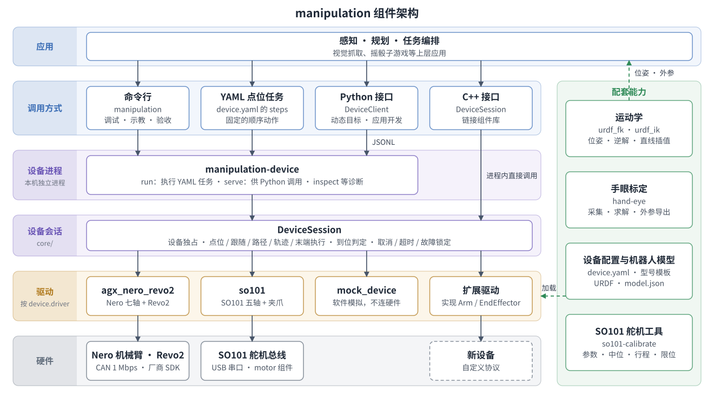

# 运动控制 · 机械臂组件控制

## 1. 模块概述

`manipulation` 组件统一控制机械臂与末端执行器：用设备配置选择硬件，用同一套命令或 C++ / Python 接口下发动作。应用不直接调用厂商 SDK；更换已适配设备只需换配置，接入新设备只需新增驱动。

完整应用示例见[摇骰子游戏](../../03-参考方案/3.3-机械臂/3.3.4-摇骰子游戏.md)。

按需阅读：

- 已适配设备、软件架构和代码结构：[§1 已适配设备](#已适配设备)、[§1 软件框图](#软件框图)、[§1 代码结构](#代码结构)；
- 构建并在无硬件环境运行示例：[§2 环境准备](#2-环境准备)、[§3.1 示例一：Mock 点位任务](#31-示例一mock-点位任务)、[§3.2 示例二：Python 控制 Mock](#32-示例二python-控制-mock)；
- 控制真机：[§3 示例使用](#3-示例使用) 中的真机示例，每种设备一节；
- 在应用中调用、接入新设备：[§4 应用开发](#4-应用开发)；
- 排查问题、查找命令：[§5 调试指南](#5-调试指南)、[§6 常见问题](#6-常见问题)。

### 规格特性

- **设备接入**：YAML 配置驱动、连接参数、关节限位和末端通道；提供 Mock 驱动用于无硬件验证。
- **运动控制**：关节点位、目标跟随、连续路径、定时轨迹和末端多通道动作，具体能力由驱动声明。末端位置统一为 `0` 闭合、`1` 张开。
- **执行安全**：设备独占、到位判定、取消、超时和故障锁定；不自动使能、清错、归位或重试。
- **运动学**：基于 URDF 的正逆运动学，支持末端位姿查询、位姿运动和笛卡尔直线运动。
- **配套工具**：姿态记录与状态监控、眼在手外手眼标定、SO101 舵机参数与中位校准。

### 已适配设备

| 驱动 | 设备 | 机械臂 | 末端执行器 |
| --- | --- | --- | --- |
| `mock_device` | 软件模拟 | 点位、跟随、路径、轨迹 | 可模拟位置反馈 |
| `agx_nero_revo2` | 松灵 Nero 七轴，可选 Revo2 右手 | 点位、跟随、路径、轨迹 | Revo2 六通道，无位置反馈 |
| `so101` | SO101 五轴，可选原配夹爪 | 点位、跟随、使能与失能 | 单通道位置反馈，按负载判断是否夹住 |

### 软件框图



- **调用方式**：命令行和 YAML 点位任务用于调试和固定流程，Python / C++ 接口用于应用开发。
- **设备进程 `manipulation-device`**：命令行、YAML 任务和 Python 接口都经它访问设备。
  - `run`：执行 YAML 任务；
  - `serve`：作为 Python `DeviceClient` 的本地控制进程，通过 JSONL 协议通信；
  - `inspect` 等：诊断。

  C++ 应用不经过它，链接组件库后在自己的进程内直接调用设备会话。
- **设备会话 `DeviceSession`**：持有一台设备的独占，执行动作并判定完成，处理取消、超时和故障。所有入口最终都由它执行，因此安全检查、配置和返回结果一致，用命令行调通的动作搬进应用后行为不变。
- **驱动**：按配置中的 `device.driver` 创建，负责与硬件通信，并如实声明支持的运动和反馈能力。
- **配套能力**：不参与实时控制，为应用提供末端位姿、关节目标和相机外参。

### 代码结构

源码位于 `components/control/manipulation`：

```text
manipulation/
├── include/manipulation/   # C++ 公共接口
├── core/                   # 设备会话：独占、执行、到位判定、故障处理
├── runtime/                # 配置解析与 YAML 点位任务
├── drivers/                # 驱动：arms/、effectors/、common/（共享连接）、mock/
├── capabilities/           # 功能与命令行
│   ├── motion/             #   manipulation-device 与本地控制进程
│   ├── diagnostics/        #   manipulation 操作命令
│   ├── kinematics/         #   正逆运动学
│   └── calibration/        #   姿态记录与手眼标定
├── bindings/python/        # Python 客户端 DeviceClient
├── descriptions/robots/    # 机型描述：URDF、model.json、配置模板
├── examples/               # Mock 配置、C++ 接入、扩展驱动
├── tools/  tests/  docs/   # 辅助脚本、测试、接口参考与开发指南
```

**代码阅读路线**（一次动作自上而下经过的代码）：

1. `capabilities/motion/cli/device_cli.cpp`：`manipulation-device` 各子命令入口。
2. `runtime/device_plan.cpp`：`LoadDevicePlan()` 解析 YAML，`DeviceRegistry` 按 `device.driver` 创建驱动。
3. `core/device.cpp`、`core/arm.cpp`：`DeviceSession` 与 `ArmSession` 执行动作并判定到位。
4. `drivers/`：各型号驱动，例如：
   - Nero：经 `drivers/common/agx_session/agx_worker.py` 调用厂商 SDK；
   - SO101：经 `drivers/common/so101_session/` 调用 `motor` 组件读写舵机寄存器。
5. Python 路径：`bindings/python/spacemit_manipulation/client.py` 的 `DeviceClient` 启动 `manipulation-device serve`，再由 `capabilities/motion/cli/device_service.cpp` 转为会话调用。

## 2. 环境准备

### 前置条件

- **平台**：Linux 开发机或 SpacemiT K3；Mock 不需要硬件。
- **构建**：CMake 3.16+、C++17 编译器、`yaml-cpp`、Python 3.10+、`numpy`。
- **手眼标定**：OpenCV 开发库、相机及其 Python 绑定。
- **真机**：已适配设备、对应的通信接口及访问权限。

### 获取代码

本组件随 SpacemiT Robot SDK 发布。以下命令将 SDK 全量代码下载到 `~/spacemit_robot`。若已在该目录下载完整 SDK，可跳过本节，直接执行构建步骤。

```bash
sudo apt update
sudo apt install repo git

# 仅在尚未配置 Git 身份时执行，将姓名和邮箱替换为自己的信息
git config --global user.name "Your Name"
git config --global user.email "you@example.com"

mkdir -p ~/spacemit_robot
cd ~/spacemit_robot
repo init -u https://github.com/spacemit-robotics/manifest.git -b main -m default.xml \
  --repo-url=https://gitee.com/spacemit-robotics/git-repo
repo sync -j4
repo start robot-dev --all
```

- 无法访问 GitHub 时，将 `-u` 后的地址替换为 `https://gitee.com/spacemit-robotics/manifest.git`；
- 按分组下载部分代码等其他方式，见[构建编译](../../02-快速入门/2.3-构建编译.md)。

### 构建编译

进入 SDK 根目录 `~/spacemit_robot`，加载环境并构建组件：

```bash
cd ~/spacemit_robot
source build/envsetup.sh
bash components/thirdparty/pyagxarm/tools/setup_sdk.sh
cd components/control/manipulation
mm --with-deps -DCMAKE_BUILD_TYPE=Release -DBUILD_TESTING=OFF
```

- `envsetup.sh` 加载 SDK 环境，自动设置安装目录变量 `PREFIX`，默认为 `~/spacemit_robot/output/staging`；
- `setup_sdk.sh` 将第三方库的依赖信息接入 SDK 构建系统；
- `mm --with-deps` 构建并安装依赖和本组件，缺少系统依赖时按提示安装。

之后修改代码只需执行 `mm`。也可以不用 `mm`，直接用 CMake 构建：

```bash
cd ~/spacemit_robot
source build/envsetup.sh
cd components/control/manipulation
cmake -S . -B build -DCMAKE_INSTALL_PREFIX="$PREFIX"
cmake --build build --parallel
cmake --install build
```

构建参数以 `-D参数名=值` 的形式追加到 `mm` 或第一条 `cmake` 命令：

| 构建参数 | 说明 |
| --- | --- |
| `MANIPULATION_ENABLE_NERO` | 默认 `ON`，构建 Nero / Revo2 驱动 |
| `MANIPULATION_ENABLE_SO101` | 默认 `ON`，构建 SO101 驱动，使用 SDK `motor` 组件的 Feetech 驱动 |
| `MANIPULATION_ENABLE_CALIBRATION` | 检测到 OpenCV 时启用手眼标定求解器 |
| `MANIPULATION_EXTRA_DRIVER_DIRS` | 额外驱动目录，多个用分号分隔 |
| `BUILD_TESTING` | `ON` 时构建测试 |

### 安装结果

| 类别 | 位置（相对 `$PREFIX`） |
| --- | --- |
| 命令 | `bin/manipulation`、`bin/manipulation-device`、`bin/hand-eye`、`bin/so101-calibrate` |
| C++ | `include/manipulation/`、`lib/`、`lib/cmake/manipulation/` |
| Python 与资源 | `python/spacemit_manipulation/`、`share/manipulation/` |

确认安装（不连接硬件）：

```bash
manipulation-device drivers
manipulation check --profile control
```

驱动列表应包含 [§1 已适配设备](#已适配设备) 中的驱动。

以下情况需要重新加载 SDK 环境：

- 打开新终端；
- 首次安装后，让新安装的 Python 模块生效。

```bash
cd ~/spacemit_robot
source build/envsetup.sh
cd components/control/manipulation
```

## 3. 示例使用

以下命令在 `~/spacemit_robot/components/control/manipulation` 目录执行。

各真机示例的步骤相同：准备、生成配置、读取状态、运动。设备差异只在准备阶段，生成配置之后的命令通用。

真机配置保存在现场目录 `SITE`（默认 `~/.local/share/spacemit-manipulation/site/`），每台设备一个子目录，存放该设备的配置、姿态和校准文件：

```text
SITE/
├── nero/device.yaml
├── so101/device.yaml
├── so101/so101_calibration.json
├── so101/so101_gripper_calibration.json
└── device.yaml -> nero/device.yaml      # 当前设备
```

- `manipulation configure MODEL` 生成 `MODEL/device.yaml`，并把它设为当前设备；
- 其他 `manipulation` 命令默认控制当前设备；
- `manipulation use` 列出已配置的设备，`manipulation use so101` 切换当前设备。

### 3.1 示例一：Mock 点位任务

Mock 模拟两关节机械臂和六通道末端执行器，不连接硬件：

```bash
manipulation-device validate examples/mock_device.yaml
manipulation-device inspect examples/mock_device.yaml
manipulation-device run examples/mock_device.yaml
```

- `validate` 输出 `valid`；
- `inspect` 输出状态 JSON，其中 `joints_rad` 为 `[0, 0]`、`fault` 为 `false`；
- `run` 依次执行配置中 `steps` 的关节点位和末端动作，最后输出 `{"status":"succeeded","physical_grip_verified":false}`。

### 3.2 示例二：Python 控制 Mock

```bash
python3 - <<'PY'
from spacemit_manipulation import DeviceClient

with DeviceClient("manipulation-device", "examples/mock_device.yaml") as device:
    print(device.state()["joints_rad"])                      # [0, 0]
    device.move_arm([0.2, -0.2], speed_scale=0.05)            # 关节点位，单位 rad
    device.move_effector([0.5] * 6, duration_s=0.5)           # 末端各通道：0 闭合，1 张开
    device.move_arm_path([[0.1, 0.1], [0.2, -0.1]], speed_scale=0.05,
                         max_velocity_rad_s=0.2, max_acceleration_rad_s2=0.5)
    start = device.state()["joints_rad"]                     # 定时轨迹：0.5 s 内回到零位
    times = [i / 10 for i in range(6)]
    device.move_arm_trajectory(times, [[q * (1 - t / 0.5) for q in start] for t in times])
    print(device.state()["joints_rad"])                      # [0, 0]
PY
```

每个动作成功时返回 `status` 为 `succeeded` 的结果，失败时抛出 `DeviceCommandError`。

- **关节点位**：每段运动都停在目标点。
- **连续路径**：经过中间点不停顿，只在最后一点停下。
- **定时轨迹**：由应用指定每个时刻的位置，适合摇晃这类有节奏的动作。

### 3.3 示例三：Nero 机械臂与 Revo2 灵巧手

**安全要求**：现场须有人看护，急停按钮伸手可及，工作区内无人、无障碍物。Nero 失能或断电后会坍塌，不能用失能或断电代替软件停止。

**步骤 1：准备。** 退出厂商 Web、遥操作等其他控制程序，启用 CAN 接口：

```bash
sudo ip link set can0 up type can bitrate 1000000
```

Nero 出厂已校准，不需要其他准备。

**步骤 2：生成配置。**

```bash
manipulation configure nero --variant revo2_right    # 仅机械臂时去掉 --variant revo2_right
manipulation validate
```

- `configure` 按型号模板生成 `SITE/nero/device.yaml`，并把 Nero 设为当前设备。
- 已有配置时不覆盖；要换配置，先把 `SITE/nero/device.yaml` 移走。
- CAN 接口不是 `can0` 时，加 `--set channel=<接口名>`。

主要字段：

```yaml
device:
    driver: agx_nero_revo2          # 驱动注册名
    model: nero                     # 运动学与标定使用的机型描述
    arm:
        resource_id: agx_can0       # 设备独占的物理资源
        tolerance_rad: 0.002        # 到位容差
        timeout_s: 10               # 单次动作期限，不是运动时长
        joints:                     # 关节顺序与限位，单位 rad
            - {name: joint1, minimum_rad: -2.705261, maximum_rad: 2.705261}
            # joint2–joint7 略
    options: {channel: can0, ...}   # 驱动连接参数，由驱动定义
steps: []                           # 顺序动作；空列表表示不运动
```

**步骤 3：读取状态。** 按厂商规程使能机械臂并进入位置模式，组件不会自动使能：

```bash
manipulation inspect
manipulation teach start_pose.json
```

- `inspect`：只读取状态。确认 `enabled`、`position_mode` 为 `true`，`fault` 为 `false`，七个关节角与实际姿态一致。
- `teach`：把当前静止姿态保存到 `SITE/nero/start_pose.json`。

**步骤 4：运动。**

```bash
manipulation joint-step joint1 0.01 --speed 0.01     # 关节 1 转动 0.01 rad
manipulation hand-move 1 1 1 1 1 1                   # 灵巧手全部张开
manipulation hand-move 1 1 0.7 1 1 1 --duration 1    # 食指弯曲到 0.7
manipulation hand-move 1 1 1 1 1 1                   # 恢复张开
```

- `joint-step` 在连续三个新鲜反馈样本都在容差内且静止时返回 `succeeded`。失败时先用 `inspect` 检查状态，不直接重试。
- `hand-move` 按 `thumb_tip`、`thumb_base`、`index_finger`、`middle_finger`、`ring_finger`、`pinky_finger` 的顺序给出位置，`0` 闭合、`1` 张开；`--duration` 默认 2 s，最长 2.55 s。
- Revo2 经 Nero 末端口接入，没有位置反馈：结果为 `unverified`，表示已下发并等完执行时长，但未测量是否到位。
- 起点未知，即使目标数值很小也可能大幅动作，执行前确认手指周围无人无物。

**步骤 5（可选）：YAML 顺序任务。** 在 Nero 的配置目录中复制一份配置：

```bash
cd ~/.local/share/spacemit-manipulation/site/nero
cp device.yaml motion.yaml
```

编辑 `motion.yaml`，把 `steps: []` 替换为以实测姿态为起点的目标：

```yaml
steps:
    - capability: joint_point
      target_rad: [J1, J2, J3, J4, J5, J6, J7]   # 只小幅改变一个关节，其余保持实测值
      speed_scale: 0.01
    - capability: effector_position
      positions: [1, 1, 0.7, 1, 1, 1]
      duration_s: 1.0
```

```bash
manipulation-device validate motion.yaml
manipulation-device run motion.yaml
```

`run` 按顺序执行 `steps`，任一步失败即停止。退出码：`0` 成功，`1` 失败或中断，`2` 配置或连接错误，`3` 完成但含无反馈的末端动作（如上面的灵巧手步骤）。

### 3.4 示例四：SO101 机械臂与夹爪

- **SO101 机械臂**：STS3215 舵机 ID 1–5，按额定规格供电；
- **原配夹爪**：STS3215 舵机 ID 6，与机械臂共用串口总线；
- **USB 串口板**：1 Mbps，当前账号属于 `dialout` 组。

**步骤 1：准备。** 退出 LeRobot 等其他串口程序，以下以 `/dev/ttyACM0` 为例：

```bash
sudo usermod -aG dialout "$(id -un)"     # 首次使用，执行后重新登录
ls -l /dev/serial/by-id/
```

SO101 使用通用舵机，首次使用前须校准。已有这台机械臂的 `so101_calibration.json` 和 `so101_gripper_calibration.json` 时，放入 `SITE/so101/` 即可跳过校准。新装或重新装配后，先支撑机械臂、取下夹爪中的物品并释放扭矩，再执行：

```bash
so101-calibrate --port /dev/ttyACM0 status    # 读取舵机状态（只读）
so101-calibrate --port /dev/ttyACM0 all       # 按提示完成全部标定
```

`all` 依次执行下表中的 `configure`、`center`、`capture`、`limits`，操作人员按提示完成：

1. 把机械臂摆在中位姿态，完成中位校准。
2. 与 LeRobot 相同，把前四个关节逐个在整个行程内缓慢转到两端；屏幕实时刷新每个关节的 `MIN`、`POS`（当前位置）和 `MAX`，全部转完后按一次回车。`wrist_roll` 可整圈转动，不需要采集。
3. 把夹爪分别移到张开和闭合位置。

需要重做某一步时（例如只重新采集行程），单独执行对应子命令：

| 子命令 | 作用 |
| --- | --- |
| `status` | 只读，每个舵机一行：型号、扭矩、偏移、限位、PID、保护参数、位置、负载、电压、温度 |
| `configure` | 写入推荐参数：P/D/I 16/0/0、返回延迟 0、位置模式；夹爪另写最大扭矩 500、保护电流 250 mA、过载扭矩 25 |
| `center` | 中位校准：把各关节摆到行程中间（模型零位），设为编码器中位 2047，并把舵机限位重置为 0–4095 |
| `capture` | 采集行程：实时显示各关节的 `MIN`/`POS`/`MAX`，按回车结束，行程须包含中位；夹爪读取张开和闭合位置；只读，不覆盖已有文件 |
| `limits` | 把采集的行程写入舵机位置限位 |

- 校准文件保存在 `SITE/so101/`，文件名与 SO101 配置模板一致，`configure` 自动引用。
- 工具从不使能扭矩；除 `status` 外，任一舵机有扭矩时拒绝执行；写入只改变与当前值不同的寄存器，写后读回确认。
- `center` 后原有校准文件不再匹配，须移走后重新 `capture`。
- `--part arm|gripper` 只处理机械臂或夹爪。

**步骤 2：生成配置。**

```bash
manipulation configure so101 --variant gripper --set port=/dev/ttyACM0    # 仅机械臂时去掉 --variant gripper
manipulation validate
```

配置保存到 `SITE/so101/device.yaml`，并把 SO101 设为当前设备。配置引用上一步生成的校准文件；文件不存在时 `configure` 报错，不生成配置。

**步骤 3：读取状态。**

```bash
manipulation inspect
manipulation monitor
```

- `monitor` 每秒 5 次打印关节角（度）、夹爪位置和负载，Ctrl+C 结束。它只读，释放扭矩时可手动拖动机械臂观察读数。
- 机械臂摆在中位姿态时，各关节应接近 0°。

**步骤 4：运动。** 有人看护、工作区无障碍时执行：

```bash
manipulation enable && manipulation hand-enable
manipulation joint-step shoulder_pan 0.05 --speed 0.2
manipulation hand-move 1.0                          # 夹爪全开；0 为闭合
manipulation hand-grasp                             # 闭合，报告是否夹住物体
manipulation pose                                   # 当前末端位姿
manipulation pose-move 0.20 0.00 0.15 --speed 0.2   # 末端移到基座坐标 (m)
manipulation line-move 0.20 0.05 0.15 --speed 0.2   # 末端沿直线移动
```

- **使能**：要求各关节在校准行程内，收拢姿态也可以直接使能。超出时报错会列出每个超限关节的当前位置和允许范围。
- **速度**：`--speed 1` 对应驱动选项 `max_velocity_rad_s`（默认 1 rad/s）。`pose-move` 估算的时长超过 `timeout_s`（默认 10 s）时，会在运动前拒绝。
- **抓握判断**：`hand-grasp` 根据夹爪停下时的位置和负载判断是否夹住。
  - 闭合途中受阻停下，且负载不低于 `grip_load_threshold`（默认 100，即额定输出的 10%）：结果为 `effector_grasp_holding`，`physical_grip_verified` 为 `true`；
  - 完全闭合：结果为 `effector_position_reached`，表示未夹住物体；
  - 受阻停下但负载不足：超时失败。

  负载判断不是力觉测量，首次抓取新物体时须在旁观察。
- **逆运动学**：SO101 只有五个关节，默认只求位置；加 `--rpy R P Y` 同时求姿态。不收敛时不运动；只检查关节限位，不检查碰撞。
- **直线运动**：按 5 mm 间隔插值路点并逐点求解。任一路点不可达或关节突变时，整条直线在运动前拒绝。SO101 不支持连续路径，直线逐点下发。
- **停止与示教**：
  - `hold` / `hand-hold`：保持当前位置，夹住物体时不松开；
  - `disable` / `hand-disable`：释放扭矩，执行前须支撑机械臂；
  - 重新 `enable`：以当前位置为目标，不会跳回旧目标。

## 4. 应用开发

### 接口选择

- 固定的顺序点位：YAML `steps` 加 `manipulation-device run`；
- 根据感知结果动态生成目标：Python `DeviceClient` 或 C++ `DeviceSession`；
- 末端位姿目标、直线运动：用 Python `spacemit_manipulation.urdf_ik` 求逆解，再交给 `DeviceClient`；
- 遥操作、视觉伺服等高频更新目标：目标跟随 `follow_arm()`、`follow_effector()`。

### Python 接口

```python
DeviceClient(executable, plan, *, allow_motion=True, allow_enable=False, allow_disable=False,
             allow_effector_enable=False, allow_effector_disable=False)
```

`DeviceClient` 启动本地控制进程，存活期间持有设备独占。`allow_motion=False` 以只读方式打开；使能、失能需显式授权。

| 方法 | 作用 |
| --- | --- |
| `state()`、`diagnose()`、`capabilities()` | 读取状态、诊断设备、查询驱动能力 |
| `enable_arm()` / `disable_arm()`、`enable_effector()` / `disable_effector()` | 改变使能状态 |
| `hold_arm()`、`hold_effector()` | 保持当前位置，不释放扭矩 |
| `jog_arm(joint_index, delta_rad, speed_scale)` | 单关节相对点位 |
| `move_arm(target_rad, speed_scale, tolerance_rad=0, wait_for_arrival=True)` | 关节点位 |
| `follow_arm(target_rad, speed_scale)` | 目标跟随：发出目标即返回，可在运动中替换目标 |
| `move_arm_path(path_rad, speed_scale, max_velocity_rad_s, max_acceleration_rad_s2)` | 连续路径，最多 128 点 |
| `move_arm_trajectory(times_s, positions_rad, command_rate_hz=100, effector_schedule=())` | 定时轨迹，可同时按时下发末端动作 |
| `move_effector(positions, duration_s=0.5, allow_unverified=False)` | 末端各通道移到指定位置（`0` 闭合，`1` 张开） |
| `follow_effector(positions, duration_s=0.1, allow_unverified=False)` | 末端目标跟随 |

所有方法接受 `timeout`（默认 10 s）和 `is_cancelled`（回调返回 `True` 时取消）。完成条件：

| 用法 | 返回时机 | 结果 |
| --- | --- | --- |
| 默认 | 连续三个新鲜反馈在容差内且静止 | `succeeded` |
| `wait_for_arrival=False` | 点位：两个样本进入容差；轨迹：最后一点已发送 | `succeeded`，下一条命令可在收尾时开始 |
| 末端无位置反馈，或带 `effector_schedule` | 已下发并等完执行时长 | `unverified`，须 `allow_unverified=True` |
| 声明抓握判断的末端停在物体上 | 连续三个样本判定夹住 | `succeeded`，`physical_grip_verified=true` |
| `follow_arm`、`follow_effector` | 目标已发出，不等到位 | `succeeded`，无反馈末端为 `unverified` |

失败时抛出 `DeviceCommandError`：`result` 字段含 `status` 和原因；`rejected` 为 `true` 表示请求在写入设备前被拒绝，`latched` 为 `true` 表示会话已锁定、须重新连接。完整参数见组件源码 `docs/reference.md`。

### 目标跟随

遥操作、视觉伺服等需要持续更新目标时，用目标跟随代替点位运动：

```python
with DeviceClient("manipulation-device", plan) as device:
    for target in targets:                    # 由应用按自己的周期产生目标
        device.follow_arm(target, speed_scale=0.5)
        state = device.state()                # 读取实际位置和末端抓握判断
    device.hold_arm()                         # 结束：停在当前位置
```

首个目标要求机械臂静止，之后的目标可以替换还在运动中的目标；每个目标仍检查关节限位、使能和故障。要确认到达最终目标时，最后调用 `move_arm()`。更新频率受设备往返时间限制。

### 运动学

```python
import json, os
from pathlib import Path
from spacemit_manipulation import urdf_ik
from spacemit_manipulation.urdf_fk import UrdfKinematics

root = Path(os.environ["PREFIX"]) / "share/manipulation/descriptions/robots/so101"
config = json.loads((root / "model.json").read_text())
model = UrdfKinematics(root / config["urdf"], config["base"], config["tip"], config["joints"])
result = urdf_ik.solve(model, urdf_ik.pose([0.2, 0.0, 0.15]), seed_rad=[0.0] * 5)
if result["converged"]:
    print(result["joints_rad"])          # 交给 DeviceClient.move_arm 执行
```

- `solve()` 使用阻尼最小二乘，收敛阈值为 0.5 mm / 0.01 rad。`orientation_weight` 为 0 时只求位置，为 1 时同时求姿态。
- `line()` 返回直线路点，`forward()` 返回末端位姿。
- 跟踪末端位姿目标时，以上一次的解作为 `seed_rad` 求解，再交给 `follow_arm()`。
- `converged` 为 `false` 的结果不能作为运动目标。

### 参考实现：摇骰子游戏

[摇骰子游戏](../../03-参考方案/3.3-机械臂/3.3.4-摇骰子游戏.md)的抓杯应用（`application/native/dice_arena/python/cup_shake/`）使用了上述接口：

| 动作 | 接口 | 源码 |
| --- | --- | --- |
| 接近、抬杯、返回 HOME | `move_arm_trajectory`，`wait_for_arrival=False` | `green_cup.py` 的 `transition()` |
| 摇杯 | `move_arm_trajectory`，200 Hz 轨迹 | `green_cup.py` 的 `shake()` |
| 放杯 | `move_arm`，`resend_interval_s=0.05` | `green_cup.py` 的 `_motions()` |
| 结果手势 | `move_arm_trajectory` + `effector_schedule` | `green_cup.py` 的 `gesture()` |
| 手部闭合、张开 | `move_effector` | `runtime.py` 的 `_hand()` |

### C++ 接入

```cmake
find_package(manipulation CONFIG REQUIRED)
target_link_libraries(app PRIVATE spacemit::manipulation_motion spacemit::manipulation_drivers)
```

随附示例 `examples/device_consumer/` 读取 Mock 状态，可作为起点：

```bash
cmake -S examples/device_consumer -B build/device-consumer -DCMAKE_PREFIX_PATH="$PREFIX"
cmake --build build/device-consumer && build/device-consumer/device-state examples/mock_device.yaml
```

预期输出 `joints=2 moving=0`。

### 接入新设备

已有驱动支持的设备只需新增配置模板。新硬件需要新驱动：

1. 参考 `examples/bench_driver/`，实现机械臂接口 `Arm`；有末端时实现 `EndEffector`。
2. 通过 `DeviceRegistry` 注册驱动，用 `MANIPULATION_EXTRA_DRIVER_DIRS` 加入构建。
3. 在 `descriptions/robots/<型号>/` 放置 URDF、`model.json` 和配置模板。

驱动必须如实声明能力：修改配置不能让不支持路径或位置反馈的设备获得相应能力。驱动约定见组件源码 `docs/development.md`。

### 手眼标定

眼在手外：相机固定，标定板装在法兰上。流程为：

`hand-eye collect`（采集）→ `solve`（求解与质量检查）→ `promote`（确认）→ `export`（导出 `T_base_camera`）

- 采集工具不移动机械臂，需按设备规程摆好姿态后采样。
- 机型描述（`device.model`）必须与实物一致。

## 5. 调试指南

按 **环境 → 配置 → 反馈 → 动作** 的顺序排查，前一步未确认前不发送真机目标：

| 检查 | 命令 | 重点 |
| --- | --- | --- |
| 环境 | `manipulation check --profile control` | 安装路径与运行依赖 |
| 配置 | `manipulation validate`、`manipulation-device describe PLAN` | 驱动、关节顺序、限位 |
| 反馈 | `manipulation inspect`、`manipulation monitor` | 实际位置、使能、故障 |
| 动作 | `manipulation joint-step` 小步运动 | 到位、停止状态 |

执行失败时按结果处理：

- `cancelled`：已确认停止，可继续；
- `timed_out` / `fault`：已确认停止，会话锁定，检查目标、反馈和设备故障后重新连接；
- `stop_unknown`：无法确认停止，按现场安全规程处理，不继续发送目标。

会话锁定后，重新连接只读取实际状态，不重放动作、不自动使能或归位。软件停止不能替代硬件急停。

### 命令一览

`manipulation` 的设备类命令默认控制当前设备，单条命令可用 `--plan FILE` 改用其他配置。现场目录 `SITE` 默认为 `~/.local/share/spacemit-manipulation/site/`，需要改用其他目录时，在子命令前加 `--site DIR`。

| 命令 | 作用 | 运动 |
| --- | --- | --- |
| `manipulation check` / `validate` / `capabilities` | 检查依赖 / 校验配置 / 查询能力 | 否 |
| `manipulation configure MODEL [--variant V] [--set K=V]` | 由型号模板生成 `SITE/MODEL/device.yaml`，并设为当前设备 | 否 |
| `manipulation use [NAME]` | 切换当前设备；省略 `NAME` 时列出已配置的设备 | 否 |
| `manipulation inspect` / `monitor` | 读取一次状态 / 持续打印状态 | 否 |
| `manipulation teach FILE` / `fk FILE` / `pose` | 记录姿态 / 姿态的正运动学 / 当前末端位姿 | 否 |
| `manipulation ik X Y Z` | 求逆解 | 否 |
| `manipulation enable` / `disable`、`hand-enable` / `hand-disable` | 使能 / 释放扭矩 | 是 |
| `manipulation hold` / `hand-hold` | 保持当前位置 | 是 |
| `manipulation joint-step` / `joint-move` | 单关节相对 / 全关节绝对点位 | 是 |
| `manipulation hand-move` / `hand-step` / `hand-grasp` | 末端绝对位置 / 小步 / 抓取 | 是 |
| `manipulation pose-move` / `line-move` | 末端移到目标位姿 / 沿直线移动 | 是 |
| `manipulation arm-check` | 关节 1 往返 0.01 rad，检查取消与重连 | 是 |
| `manipulation-device run PLAN` | 执行 YAML 顺序任务 | 是 |
| `so101-calibrate all` | SO101 全部标定；也可单独执行 `status`、`configure`、`center`、`capture`、`limits` | 否 |
| `hand-eye collect` / `solve` / `promote` / `export` | 手眼标定 | 否 |

完整参数见组件源码 `docs/reference.md`。

## 6. 常见问题

| 问题 | 处理 |
| --- | --- |
| 找不到命令或 Python 模块 | 进入 `~/spacemit_robot`，重新执行 `source build/envsetup.sh` |
| 提示设备已占用 | 退出其他控制程序；不要删除锁文件或修改资源标识绕过 |
| Nero 连接失败 | 检查 `ip -details link show can0`（应为 `UP`、1 Mbps）、供电和厂商 SDK |
| `run` 返回 `idle` | `steps` 为空，配置模板默认不含动作 |
| `ik` 不收敛或 `line-move` 拒绝 | 目标超出工作空间或限位；SO101 去掉 `--rpy`；直线跨越奇异位置时分段执行 |
| `pose-move` 提示时长超过 `timeout_s` | 提高 `--speed` 或分段移动 |
| 一台主机连接多种机械臂 | 分别 `configure` 后，用 `manipulation use NAME` 切换当前设备，或在单条命令后加 `--plan FILE` |
| 同型号连接多台机械臂 | 每台用一个现场目录：在 `manipulation` 和 `so101-calibrate` 的子命令前加同一个 `--site DIR` |
| SO101 夹爪拒绝使能 | 释放扭矩后执行 `so101-calibrate configure` |
| SO101 提示偏移与校准文件不一致 | 偏移已改变（如执行过 `center`），移走旧校准文件后重新 `so101-calibrate capture` |
| 找不到标定求解器 | 安装 OpenCV 后以 `-DMANIPULATION_ENABLE_CALIBRATION=ON` 重新构建 |
