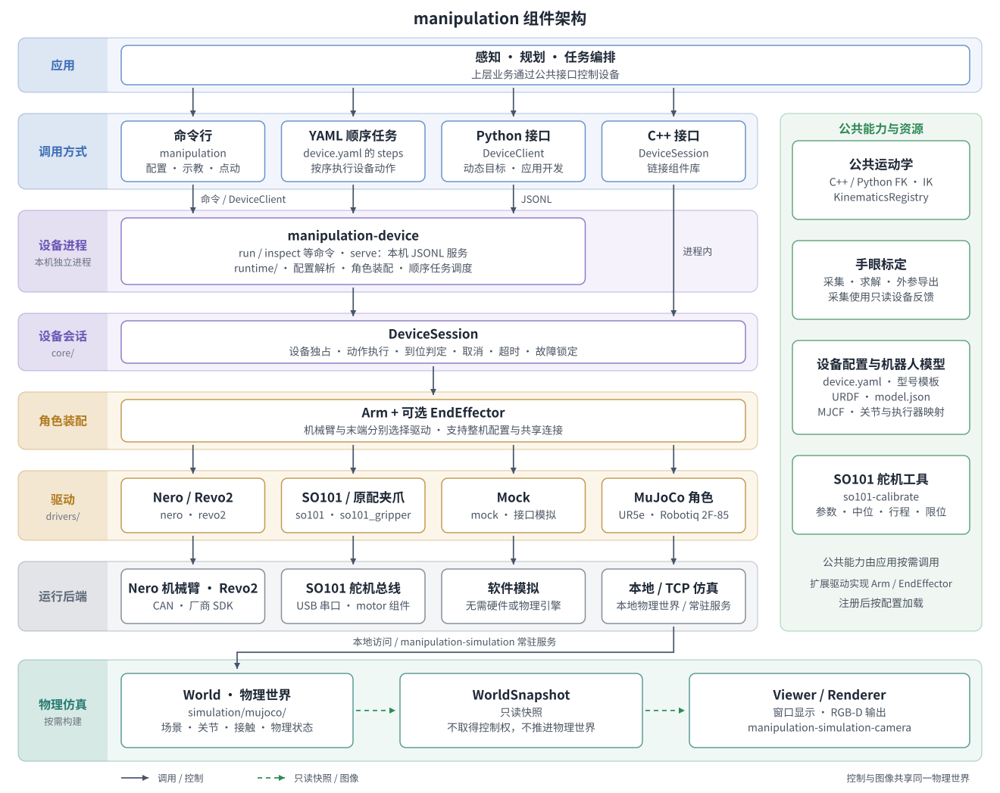

# 运动控制 · 机械臂组件控制

## 1. 模块概述

`manipulation` 组件统一控制机械臂与末端执行器：用设备配置选择硬件，用同一套命令或 C++ / Python 接口下发动作。应用不直接调用厂商 SDK；更换已适配设备只需换配置，接入新设备只需新增驱动。

完整应用示例见[摇骰子游戏](../../03-参考方案/3.3-机械臂/3.3.4-摇骰子游戏.md)。

按需阅读：

- 已适配设备、软件架构和代码结构：[§1 已适配设备](#已适配设备)、[§1 软件框图](#软件框图)、[§1 代码结构](#代码结构)；
- 构建并在无硬件环境运行示例：[§2 环境准备](#2-环境准备)、[§3.1 示例一：Mock 点位任务](#31-示例一mock-点位任务)、[§3.2 示例二：Python 控制 Mock](#32-示例二python-控制-mock)；
- 控制真机：[§3 示例使用](#3-示例使用) 中的真机示例，每种设备一节；
- 在应用中调用、接入新设备：[§4 应用开发](#4-应用开发)；
- 排查问题、查找命令：[§5 调试指南](#5-调试指南)、[§6 常见问题](#6-常见问题)。

### 规格特性

- **设备接入**：YAML 配置驱动、连接参数、关节限位和末端通道；提供 Mock 驱动用于无硬件验证。
- **运动控制**：关节点位、目标跟随、连续路径、定时轨迹和末端多通道动作，具体能力由驱动声明。末端位置统一为 `0` 闭合、`1` 张开。
- **执行安全**：设备独占、到位判定、取消、超时和故障锁定；不自动使能、清错、归位或重试。
- **运动学**：基于 URDF 的正逆运动学，支持末端位姿查询、位姿运动和笛卡尔直线运动。
- **C++ 运动学**：独立求解器接口与注册表，Pinocchio 后端按需构建；模型和关节顺序由配置指定，不连接设备。
- **配套工具**：姿态记录与状态监控、眼在手外手眼标定、SO101 舵机参数与中位校准。

### 已适配设备

| 驱动 | 设备 | 机械臂 | 末端执行器 |
| --- | --- | --- | --- |
| `mock_device` | 软件模拟 | 点位、跟随、路径、轨迹 | 可模拟位置反馈 |
| `agx_nero_revo2` | 松灵 Nero 七轴，可选 Revo2 右手 | 点位、跟随、路径、轨迹 | Revo2 六通道，无位置反馈 |
| `so101` | SO101 五轴，可选原配夹爪 | 点位、跟随、使能与失能 | 单通道位置反馈，按负载判断是否夹住 |
| `mujoco_ur5e`、`mujoco_robotiq_2f85` | UR5e 机械臂与 Robotiq 2F-85 夹爪物理仿真 | 点位、跟随、保持 | 位置反馈与保持 |

表中的驱动分为两类：

- **整机驱动**：`mock_device`、`agx_nero_revo2`、`so101`。
- **角色驱动**：`mujoco_ur5e` 控制机械臂，`mujoco_robotiq_2f85` 控制末端执行器。

角色组合与驱动名见[独立角色与顺序能力](#独立角色与顺序能力)。

### 软件框图



- **调用方式**：命令行和 YAML 点位任务用于调试和固定流程，Python / C++ 接口用于应用开发。
- **设备进程 `manipulation-device`**：命令行、YAML 任务和 Python 接口都经它访问设备。
  - `run`：执行 YAML 任务；
  - `serve`：作为 Python `DeviceClient` 的本地控制进程，通过 JSONL 协议通信；
  - `inspect` 等：诊断。

  C++ 应用不经过它，链接组件库后在自己的进程内直接调用设备会话。
- **设备会话 `DeviceSession`**：持有一台设备的独占，执行动作并判定完成，处理取消、超时和故障。所有入口最终都由它执行，因此安全检查、配置和返回结果一致，用命令行调通的动作搬进应用后行为不变。
- **驱动**：按 `device.arm.driver` 和 `device.effector.driver` 分别创建机械臂与末端，也兼容整机 `device.driver`。驱动声明支持的运动和反馈能力。
- **配套能力**：不参与实时控制，为应用提供末端位姿、关节目标和相机外参。

### 代码结构

机械臂控制组件位于 SDK 的 `components/control/manipulation`。

物理仿真与渲染由 [MuJoCo 仿真组件仓库](https://github.com/spacemit-robotics/simulation_mujoco) 提供，SDK 路径为 `components/simulation/mujoco`。

机械臂控制组件的目录结构如下：

```text
manipulation/
├── include/manipulation/   # C++ 公共接口
├── core/                   # 设备会话：独占、执行、到位判定、故障处理
├── runtime/                # 配置解析、设备装配与 YAML 顺序任务
├── drivers/                # 设备驱动
│   ├── arms/               # 机械臂驱动
│   ├── effectors/          # 末端执行器驱动
│   ├── common/             # 共享连接
│   ├── simulation/         # 仿真设备驱动
│   └── mock/               # 无硬件模拟设备
├── capabilities/           # 公共能力与命令行工具
│   ├── motion/             # 运动控制与 manipulation-device
│   ├── diagnostics/        # 设备检查与 manipulation 操作命令
│   ├── kinematics/         # 正逆运动学
│   ├── calibration/        # 姿态采集与手眼标定
│   └── simulation/         # 仿真服务、可视化与远程相机工具
├── bindings/python/        # Python 客户端 DeviceClient
├── descriptions/           # 模型与配置
│   ├── robots/             # 机型描述：URDF、model.json、配置模板
│   └── simulation/         # 仿真场景、关节与执行器映射
├── examples/               # Mock 配置、C++ 接入、驱动与能力扩展
├── tools/                  # 辅助脚本
├── tests/                  # 测试
└── docs/                   # 接口参考与开发指南
```

应用调用和驱动扩展见[应用开发](#4-应用开发)。C++ 接口契约、注册方法和模块实现说明见组件源码中的 `docs/reference.md` 与 `docs/development.md`。

## 2. 环境准备

### 前置条件

- **平台**：Linux 开发机或 SpacemiT K3；Mock 不需要硬件。
- **构建**：CMake 3.16+、C++17 编译器、`yaml-cpp`、Python 3.10+、`numpy`。
- **手眼标定**：OpenCV 开发库、相机及其 Python 绑定。
- **真机**：已适配设备、对应的通信接口及访问权限。

### 获取代码

本组件随 SpacemiT Robot SDK 发布。以下命令将 SDK 全量代码下载到 `~/spacemit_robot`。若已在该目录下载完整 SDK，可跳过本节，直接执行构建步骤。

```bash
sudo apt update
sudo apt install repo git

# 仅在尚未配置 Git 身份时执行，将姓名和邮箱替换为自己的信息
git config --global user.name "Your Name"
git config --global user.email "you@example.com"

mkdir -p ~/spacemit_robot
cd ~/spacemit_robot
repo init -u https://github.com/spacemit-robotics/manifest.git -b main -m default.xml \
  --repo-url=https://gitee.com/spacemit-robotics/git-repo
repo sync -j4
repo start robot-dev --all
```

- 无法访问 GitHub 时，将 `-u` 后的地址替换为 `https://gitee.com/spacemit-robotics/manifest.git`；
- 按分组下载部分代码等其他方式，见[构建编译](../../02-快速入门/2.3-构建编译.md)。

### 构建编译

进入 SDK 根目录 `~/spacemit_robot`，加载环境并构建组件：

```bash
cd ~/spacemit_robot
source build/envsetup.sh
bash components/thirdparty/pyagxarm/tools/setup_sdk.sh
cd components/control/manipulation
mm --with-deps -DCMAKE_BUILD_TYPE=Release -DBUILD_TESTING=OFF
```

- `envsetup.sh` 加载 SDK 环境，自动设置安装目录变量 `PREFIX`，默认为 `~/spacemit_robot/output/staging`；
- `setup_sdk.sh` 将第三方库的依赖信息接入 SDK 构建系统；
- `mm --with-deps` 构建并安装依赖和本组件，缺少系统依赖时按提示安装。

之后修改代码只需执行 `mm`。也可以不用 `mm`，直接用 CMake 构建：

```bash
cd ~/spacemit_robot
source build/envsetup.sh
cd components/control/manipulation
cmake -S . -B build -DCMAKE_INSTALL_PREFIX="$PREFIX"
cmake --build build --parallel
cmake --install build
```

构建参数以 `-D参数名=值` 的形式追加到 `mm` 或第一条 `cmake` 命令：

| 构建参数 | 说明 |
| --- | --- |
| `MANIPULATION_ENABLE_NERO` | 默认 `ON`，构建 Nero / Revo2 驱动 |
| `MANIPULATION_ENABLE_SO101` | 默认 `ON`，构建 SO101 驱动，使用 SDK `motor` 组件的 Feetech 驱动 |
| `MANIPULATION_ENABLE_CALIBRATION` | 检测到 OpenCV 时启用手眼标定求解器 |
| `MANIPULATION_ENABLE_KINEMATICS_PINOCCHIO` | 默认 `OFF`，构建 C++ FK/IK 的 Pinocchio 后端，需要已安装 Pinocchio |
| `MANIPULATION_ENABLE_MUJOCO` | 默认 `OFF`，构建本机物理仿真与远程客户端 |
| `MANIPULATION_ENABLE_MUJOCO_REMOTE` | 默认 `OFF`，单独构建远程客户端，不依赖本机 MuJoCo |
| `MANIPULATION_ENABLE_SIMULATION_RENDERER` | 默认 `OFF`，为本机仿真启用窗口和模拟相机 |
| `MANIPULATION_EXTRA_DRIVER_DIRS` | 额外驱动目录，多个用分号分隔 |
| `MANIPULATION_EXTRA_CAPABILITY_DIRS` | 额外顺序能力模块目录，多个用分号分隔 |
| `BUILD_TESTING` | `ON` 时构建测试 |

### 安装结果

| 类别 | 位置（相对 `$PREFIX`） |
| --- | --- |
| 命令 | `bin/manipulation`、`bin/manipulation-device`、`bin/hand-eye`、`bin/so101-calibrate` |
| C++ | `include/manipulation/`、`lib/`、`lib/cmake/manipulation/` |
| Python 与资源 | `python/spacemit_manipulation/`、`share/manipulation/` |

确认安装（不连接硬件）：

```bash
manipulation drivers
manipulation drivers --roles
manipulation check --profile control
```

| 命令 | 显示内容 |
| --- | --- |
| `manipulation drivers` | 整机驱动，默认构建包含 `mock_device`、`agx_nero_revo2`、`so101` |
| `manipulation drivers --roles` | 按机械臂、末端执行器分别列出角色驱动 |

两类列表只显示已启用构建的驱动。启用本机或远程仿真后，角色列表中包含 `mujoco_ur5e` 和 `mujoco_robotiq_2f85`。

以下情况需要重新加载 SDK 环境：

- 打开新终端；
- 首次安装后，让新安装的 Python 模块生效。

```bash
cd ~/spacemit_robot
source build/envsetup.sh
cd components/control/manipulation
```

## 3. 示例使用

以下命令在 `~/spacemit_robot/components/control/manipulation` 目录执行。

各真机示例的步骤相同：准备、生成配置、读取状态、运动。设备差异只在准备阶段，生成配置之后的命令通用。

真机配置保存在现场目录 `SITE`（默认 `~/.local/share/spacemit-manipulation/site/`），每台设备一个子目录，存放该设备的配置、姿态和校准文件：

```text
SITE/
├── nero/device.yaml
├── so101/device.yaml
├── so101/so101_calibration.json
├── so101/so101_gripper_calibration.json
└── device.yaml -> nero/device.yaml      # 当前设备
```

- `manipulation configure MODEL` 生成 `MODEL/device.yaml`，并把它设为当前设备；
- `inspect`、`monitor` 和单次运动命令默认控制当前设备；顺序任务 `manipulation run` 必须显式提供 `--plan FILE`；
- `manipulation use` 列出已配置的设备，`manipulation use so101` 切换当前设备。

### 3.1 示例一：Mock 点位任务

Mock 模拟两关节机械臂和六通道末端执行器，不连接硬件：

```bash
manipulation-device validate examples/mock_device.yaml
manipulation-device inspect examples/mock_device.yaml
manipulation-device run examples/mock_device.yaml
```

- `validate` 输出 `valid`；
- `inspect` 输出状态 JSON，其中 `joints_rad` 为 `[0, 0]`、`fault` 为 `false`；
- `run` 依次执行配置中 `steps` 的关节点位和末端动作，完成后返回 `status: succeeded`，`physical_grip_verified` 为 `false`。

### 3.2 示例二：Python 控制 Mock

```bash
python3 - <<'PY'
from spacemit_manipulation import DeviceClient

with DeviceClient("manipulation-device", "examples/mock_device.yaml") as device:
    print(device.state()["joints_rad"])                      # [0, 0]
    device.move_arm([0.2, -0.2], speed_scale=0.05)            # 关节点位，单位 rad
    device.move_effector([0.5] * 6, duration_s=0.5)           # 末端各通道：0 闭合，1 张开
    device.move_arm_path([[0.1, 0.1], [0.2, -0.1]], speed_scale=0.05,
                         max_velocity_rad_s=0.2, max_acceleration_rad_s2=0.5)
    start = device.state()["joints_rad"]                     # 定时轨迹：0.5 s 内回到零位
    times = [i / 10 for i in range(6)]
    device.move_arm_trajectory(times, [[q * (1 - t / 0.5) for q in start] for t in times])
    print(device.state()["joints_rad"])                      # [0, 0]
PY
```

每个动作成功时返回 `status` 为 `succeeded` 的结果，失败时抛出 `DeviceCommandError`。

- **关节点位**：每段运动都停在目标点。
- **连续路径**：经过中间点不停顿，只在最后一点停下。
- **定时轨迹**：由应用指定每个时刻的位置，适合摇晃这类有节奏的动作。

### 3.3 示例三：Nero 机械臂与 Revo2 灵巧手

**安全要求**：现场须有人看护，急停按钮伸手可及，工作区内无人、无障碍物。Nero 失能或断电后会坍塌，不能用失能或断电代替软件停止。

**步骤 1：准备。** 退出厂商 Web、遥操作等其他控制程序，启用 CAN 接口：

```bash
sudo ip link set can0 up type can bitrate 1000000
```

Nero 出厂已校准，不需要其他准备。

**步骤 2：生成配置。**

```bash
manipulation configure nero --variant revo2_right    # 仅机械臂时去掉 --variant revo2_right
manipulation validate
```

- `configure` 按型号模板生成 `SITE/nero/device.yaml`，并把 Nero 设为当前设备。
- 已有配置时不覆盖；要换配置，先把 `SITE/nero/device.yaml` 移走。
- CAN 接口不是 `can0` 时，加 `--set channel=<接口名>`。

主要字段：

```yaml
device:
    driver: agx_nero_revo2          # 驱动注册名
    model: nero                     # 运动学与标定使用的机型描述
    arm:
        resource_id: agx_can0       # 设备独占的物理资源
        tolerance_rad: 0.002        # 到位容差
        timeout_s: 10               # 单次动作期限，不是运动时长
        joints:                     # 关节顺序与限位，单位 rad
            - {name: joint1, minimum_rad: -2.705261, maximum_rad: 2.705261}
            # joint2–joint7 略
    options: {channel: can0, ...}   # 驱动连接参数，由驱动定义
steps: []                           # 顺序动作；空列表表示不运动
```

**步骤 3：读取状态。** 按厂商规程使能机械臂并进入位置模式，组件不会自动使能：

```bash
manipulation inspect
manipulation teach start_pose.json
```

- `inspect`：只读取状态。确认 `enabled`、`position_mode` 为 `true`，`fault` 为 `false`，七个关节角与实际姿态一致。
- `teach`：把当前静止姿态保存到 `SITE/nero/start_pose.json`。

**步骤 4：运动。**

```bash
manipulation joint-step joint1 0.01 --speed 0.01     # 关节 1 转动 0.01 rad
manipulation hand-move 1 1 1 1 1 1                   # 灵巧手全部张开
manipulation hand-move 1 1 0.7 1 1 1 --duration 1    # 食指弯曲到 0.7
manipulation hand-move 1 1 1 1 1 1                   # 恢复张开
```

- `joint-step` 在连续三个新鲜反馈样本都在容差内且静止时返回 `succeeded`。失败时先用 `inspect` 检查状态，不直接重试。
- `hand-move` 按 `thumb_tip`、`thumb_base`、`index_finger`、`middle_finger`、`ring_finger`、`pinky_finger` 的顺序给出位置，`0` 闭合、`1` 张开；`--duration` 默认 2 s，最长 2.55 s。
- Revo2 经 Nero 末端口接入，没有位置反馈：结果为 `unverified`，表示已下发并等完执行时长，但未测量是否到位。
- 起点未知，即使目标数值很小也可能大幅动作，执行前确认手指周围无人无物。

**步骤 5（可选）：YAML 顺序任务。** 在 Nero 的配置目录中复制一份配置：

```bash
cd ~/.local/share/spacemit-manipulation/site/nero
cp device.yaml motion.yaml
```

编辑 `motion.yaml`，把 `steps: []` 替换为以实测姿态为起点的目标：

```yaml
steps:
    - capability: joint_point
      target_rad: [J1, J2, J3, J4, J5, J6, J7]   # 只小幅改变一个关节，其余保持实测值
      speed_scale: 0.01
    - capability: effector_position
      positions: [1, 1, 0.7, 1, 1, 1]
      duration_s: 1.0
```

```bash
manipulation-device validate motion.yaml
manipulation-device run motion.yaml
```

`run` 按顺序执行 `steps`，任一步失败即停止。退出码：`0` 成功，`1` 失败或中断，`2` 配置或连接错误，`3` 完成但含无反馈的末端动作（如上面的灵巧手步骤）。

### 3.4 示例四：SO101 机械臂与夹爪

- **SO101 机械臂**：STS3215 舵机 ID 1–5，按额定规格供电；
- **原配夹爪**：STS3215 舵机 ID 6，与机械臂共用串口总线；
- **USB 串口板**：1 Mbps，当前账号属于 `dialout` 组。

**步骤 1：准备。** 退出 LeRobot 等其他串口程序，以下以 `/dev/ttyACM0` 为例：

```bash
sudo usermod -aG dialout "$(id -un)"     # 首次使用，执行后重新登录
ls -l /dev/serial/by-id/
```

SO101 使用通用舵机，首次使用前须校准。

- 已有本台机械臂的 `so101_calibration.json` 和 `so101_gripper_calibration.json`：放入 `SITE/so101/`，跳过校准。
- 新装或重新装配：先支撑机械臂、取下夹爪中的物品并释放扭矩，再执行以下校准命令。

```bash
so101-calibrate --port /dev/ttyACM0 status    # 读取舵机状态（只读）
so101-calibrate --port /dev/ttyACM0 all       # 按提示完成全部标定
```

`all` 依次执行下表中的 `configure`、`center`、`capture`、`limits`，操作人员按提示完成：

1. 把机械臂摆在中位姿态，完成中位校准。
2. 与 LeRobot 相同，把前四个关节逐个在整个行程内缓慢转到两端；屏幕实时刷新每个关节的 `MIN`、`POS`（当前位置）和 `MAX`，全部转完后按一次回车。`wrist_roll` 可整圈转动，不需要采集。
3. 把夹爪分别移到张开和闭合位置。

需要重做某一步时（例如只重新采集行程），单独执行对应子命令：

| 子命令 | 作用 |
| --- | --- |
| `status` | 只读，每个舵机一行：型号、扭矩、偏移、限位、PID、保护参数、位置、负载、电压、温度 |
| `configure` | 写入推荐参数：P/D/I 16/0/0、返回延迟 0、位置模式；夹爪另写最大扭矩 500、保护电流 250 mA、过载扭矩 25 |
| `center` | 中位校准：把各关节摆到行程中间（模型零位），设为编码器中位 2047，并把舵机限位重置为 0–4095 |
| `capture` | 采集行程：实时显示各关节的 `MIN`/`POS`/`MAX`，按回车结束，行程须包含中位；夹爪读取张开和闭合位置；只读，不覆盖已有文件 |
| `limits` | 把采集的行程写入舵机位置限位 |

- 校准文件保存在 `SITE/so101/`，文件名与 SO101 配置模板一致，`configure` 自动引用。
- 工具从不使能扭矩；除 `status` 外，任一舵机有扭矩时拒绝执行；写入只改变与当前值不同的寄存器，写后读回确认。
- `center` 后原有校准文件不再匹配，须移走后重新 `capture`。
- `--part arm|gripper` 只处理机械臂或夹爪。

**步骤 2：生成配置。**

```bash
manipulation configure so101 --variant gripper --set port=/dev/ttyACM0    # 仅机械臂时去掉 --variant gripper
manipulation validate
```

配置保存到 `SITE/so101/device.yaml`，并把 SO101 设为当前设备。配置引用上一步生成的校准文件；文件不存在时 `configure` 报错，不生成配置。

**步骤 3：读取状态。**

```bash
manipulation inspect
manipulation monitor
```

- `monitor` 每秒 5 次打印关节角（度）、夹爪位置和负载，Ctrl+C 结束。它只读，释放扭矩时可手动拖动机械臂观察读数。
- 机械臂摆在中位姿态时，各关节应接近 0°。

**步骤 4：运动。** 有人看护、工作区无障碍时执行：

```bash
manipulation enable && manipulation hand-enable
manipulation joint-step shoulder_pan 0.05 --speed 0.2
manipulation hand-move 1.0                          # 夹爪全开；0 为闭合
manipulation hand-grasp                             # 闭合，报告是否夹住物体
manipulation pose                                   # 当前末端位姿
manipulation pose-move 0.20 0.00 0.15 --speed 0.2   # 末端移到基座坐标 (m)
manipulation line-move 0.20 0.05 0.15 --speed 0.2   # 末端沿直线移动
```

- **使能**：要求各关节在校准行程内，收拢姿态也可以直接使能。超出时报错会列出每个超限关节的当前位置和允许范围。
- **速度**：`--speed 1` 对应驱动选项 `max_velocity_rad_s`（默认 1 rad/s）。`pose-move` 估算的时长超过 `timeout_s`（默认 10 s）时，会在运动前拒绝。
- **抓握判断**：`hand-grasp` 根据夹爪停下时的位置和负载判断是否夹住。
  - 闭合途中受阻停下，且负载不低于 `grip_load_threshold`（默认 100，即额定输出的 10%）：结果为 `effector_grasp_holding`，`physical_grip_verified` 为 `true`；
  - 完全闭合：结果为 `effector_position_reached`，表示未夹住物体；
  - 受阻停下但负载不足：超时失败。

  负载判断不是力觉测量，首次抓取新物体时须在旁观察。
- **逆运动学**：SO101 只有五个关节，默认只求位置；加 `--rpy R P Y` 同时求姿态。不收敛时不运动；只检查关节限位，不检查碰撞。
- **直线运动**：按 5 mm 间隔插值路点并逐点求解。任一路点不可达或关节突变时，整条直线在运动前拒绝。SO101 不支持连续路径，直线逐点下发。
- **停止与示教**：
  - `hold` / `hand-hold`：保持当前位置，夹住物体时不松开；
  - `disable` / `hand-disable`：释放扭矩，执行前须支撑机械臂；
  - 重新 `enable`：以当前位置为目标，不会跳回旧目标。

### 3.5 示例五：UR5e / MuJoCo 物理仿真

无需机械臂或显示器。在 SDK 根目录执行：

```bash
source build/envsetup.sh
cd components/control/manipulation
python3 tools/prepare_simulation_assets.py
mm -DMANIPULATION_ENABLE_MUJOCO=ON
manipulation run --plan examples/simulation/ur5e_robotiq.yaml
```

示例执行 UR5e 六轴机械臂点位与 Robotiq 2F85 夹爪开合。仅控制机械臂时，使用 `examples/simulation/ur5e_arm.yaml`。

仿真后端默认不构建。上述命令启用仿真后端，按固定版本下载并校验模型网格，并由构建系统获取 MuJoCo 库。

| 配置 | 作用 |
| --- | --- |
| `device.arm.driver: mujoco_ur5e` | 选择 UR5e 仿真机械臂 |
| `device.effector.driver: mujoco_robotiq_2f85` | 选择 Robotiq 2F-85 仿真夹爪 |
| 两个角色使用相同 `resource_id` | 共用一个物理世界 |
| `options.mapping_file` | 指向场景及关节、执行器映射文件，相对设备配置解析 |

- **UR5e 映射**：`descriptions/simulation/ur5e_robotiq/mapping.yaml`。
- **其他模型**：使用通用映射驱动，分别配置机械臂与末端映射，步骤见组件源码 `docs/development.md` 的“仿真模型接入”。
- **反馈**：物理引擎读取实际关节位置和速度；末端位置统一为 `0` 闭合、`1` 张开。

本地设备会话各自创建仿真；需要在多个命令间保留状态时，启动常驻仿真服务。

在同一组件目录安装图形依赖并构建：

```bash
sudo apt install -y git ca-certificates libglfw3-dev libgl1-mesa-dev libx11-dev
mm -DMANIPULATION_ENABLE_MUJOCO=ON -DMANIPULATION_ENABLE_SIMULATION_RENDERER=ON
manipulation-simulation --plan examples/simulation/ur5e_robotiq.yaml --viewer
```

在同一目录的另一终端执行点位任务或读取模拟相机：

```bash
manipulation run --plan examples/simulation/ur5e_robotiq_remote.yaml
manipulation-simulation-camera --camera overview --output camera-frame
```

相机输出目录 `camera-frame/` 须不存在，命令在其中生成以下文件：

| 文件 | 内容 |
| --- | --- |
| `rgb.ppm` | 彩色图 |
| `depth.f32` | 深度，单位为 m |
| `metadata.json` | 相机参数 |

窗口和相机使用同一物理世界，均需要 X11 桌面会话。K3 使用 X11/gl4es，PC 使用 GLFW/OpenGL；纯物理模式不需要显示器。

服务只监听 `127.0.0.1:9100`。PC 运行服务时，在 K3 建立转发：

```bash
read -rp "PC SSH 地址（用户@主机）: " SIM_PC
ssh -N -L 9100:127.0.0.1:9100 "$SIM_PC"
```

保持转发，在 K3 的另一终端使用相同远程配置。仅需远程控制时，构建客户端即可：

```bash
mm -DMANIPULATION_ENABLE_MUJOCO_REMOTE=ON \
  -DMANIPULATION_ENABLE_MUJOCO=OFF -DMANIPULATION_ENABLE_SIMULATION_RENDERER=OFF
```

仿真控制的运行约束：

- **通信中断**：断连或控制租约超时后，服务请求保持并检查停止状态，不自动重连或重放目标。
- **反馈时限**：远程示例的 `maximum_age_s` 为 `1.0` 秒，包含网络往返耗时；服务端本地采样时限独立生效。
- **运动能力**：不支持连续路径、定时轨迹和通用抓握判断。夹爪到位不表示已抓稳物体。
- **模型文件**：MJCF 不替代运动学与手眼标定所需的 URDF 和 `model.json`。

### 3.6 示例六：视觉仿真抓取

`perceptive_grasp` 提供 UR5e、Robotiq 2F-85 和 RGB-D 相机的抓取场景，支持本机运行和 PC/K3 分开部署。

本机窗口和模拟相机需要 X11 桌面；K3 使用带 EGL/GLES 图形驱动的桌面镜像，并先登录桌面。

在 SDK 根目录执行：

```bash
sudo apt update
sudo apt install -y build-essential cmake pkg-config git python3 ca-certificates libopencv-dev \
  libyaml-cpp-dev liburdfdom-dev libglfw3-dev libgl1-mesa-dev libx11-dev
cd application/ros2/linksee/perceptive_grasp
python3 scripts/run_manipulation_simulation.py build
python3 scripts/run_manipulation_simulation.py serve
```

在同一目录的另一终端运行：

```bash
python3 scripts/run_manipulation_simulation.py grasp apple
```

目标可选 `apple`、`banana`、`cube`、`cup`。示例使用仿真颜色分割，将目标从绿色区域搬到红色区域；无需真实相机或机械臂。

抓持采用双指接触后的约束，不代表纯摩擦抓持或真机抓稳结果。

远程部署时，PC 保持上述服务运行。K3 在 SDK 根目录执行：

```bash
sudo apt update
sudo apt install -y build-essential cmake pkg-config python3 openssh-client \
  libopencv-dev libyaml-cpp-dev liburdfdom-dev
cd application/ros2/linksee/perceptive_grasp
python3 scripts/run_manipulation_simulation.py build --client-only
read -rp "PC SSH 地址（用户@主机）: " SIM_PC
ssh -N -L 9090:127.0.0.1:9090 "$SIM_PC"
```

保持 SSH 转发，在 K3 同一目录的另一终端运行：

```bash
python3 scripts/run_manipulation_simulation.py grasp apple --client-only
```

远程客户端不需要 K3 本机显示器或 MuJoCo。

应用使用抓取任务协议，不能连接组件工具的 `9100` 端口。真机配置与原仿真配置保持独立。

## 4. 应用开发

### 接口选择

- 固定的顺序点位：YAML `steps` 加 `manipulation-device run`；
- 根据感知结果动态生成目标：Python `DeviceClient` 或 C++ `DeviceSession`；
- 末端位姿目标、直线运动：用 Python `spacemit_manipulation.urdf_ik` 求逆解，再交给 `DeviceClient`；
- 遥操作、视觉伺服等高频更新目标：目标跟随 `follow_arm()`、`follow_effector()`。

### 独立角色与顺序能力

机械臂与末端可分别选择驱动，各自的 `options` 保存连接参数：

| 角色 | 随附设备驱动 |
| --- | --- |
| `device.arm.driver` | `mock`、`nero`、`so101`、`mujoco_ur5e`（按需构建） |
| `device.effector.driver` | `mock`、`revo2`、`so101_gripper`、`mujoco_robotiq_2f85`（按需构建） |

独立角色配置与整机 `device.driver/options` 二选一，不能混用。

- **不同物理连接**：使用不同的 `resource_id`。
- **共用物理连接**：使用相同的 `resource_id`，驱动对须注册共享连接工厂，且两侧连接选项一致。Nero / Revo2、SO101 / 原配夹爪和 MuJoCo 已提供共享连接。

软件组合不代表机械安装、电气连接或应用动作兼容。

在组件目录执行组合 Mock 示例，不连接硬件：

```bash
manipulation drivers --roles
manipulation validate --plan examples/composed_mock.yaml
manipulation capabilities --plan examples/composed_mock.yaml
manipulation run --plan examples/composed_mock.yaml
manipulation run --plan examples/capability_sequence.yaml
```

`composed_mock.yaml` 使用独立的 Mock 机械臂与末端；`capability_sequence.yaml` 演示注册能力的顺序组合。

每个 `steps` 项用 `capability` 选择能力，开始运动前检查全部步骤：

| 能力 | 用途 |
| --- | --- |
| `joint_point` / `joint_jog` | 关节绝对点位 / 单关节相对运动 |
| `joint_path` / `joint_trajectory` | 连续关节路径 / 定时轨迹 |
| `effector_position` | 末端各通道位置 |
| `arm_hold` / `effector_hold` | 保持并确认停止 |

当前设备可用的顺序能力以 `manipulation capabilities` 输出的 `registered` 列表为准；配置不能补充驱动缺少的能力。

### Python 接口

```python
DeviceClient(executable, plan, *, allow_motion=True, allow_enable=False, allow_disable=False,
             allow_effector_enable=False, allow_effector_disable=False)
```

`DeviceClient` 启动本地控制进程，存活期间持有设备独占。`allow_motion=False` 以只读方式打开；使能、失能需显式授权。

| 方法 | 作用 |
| --- | --- |
| `state()`、`diagnose()`、`capabilities()` | 读取状态、诊断设备、查询驱动能力 |
| `execute_capability(name, parameters=None, *, allow_unverified=False)` | 执行注册能力，参数字段与对应 YAML 步骤相同 |
| `enable_arm()` / `disable_arm()`、`enable_effector()` / `disable_effector()` | 改变使能状态 |
| `hold_arm()`、`hold_effector()` | 保持当前位置，不释放扭矩 |
| `jog_arm(joint_index, delta_rad, speed_scale)` | 单关节相对点位 |
| `move_arm(target_rad, speed_scale, tolerance_rad=0, wait_for_arrival=True)` | 关节点位 |
| `follow_arm(target_rad, speed_scale)` | 目标跟随：发出目标即返回，可在运动中替换目标 |
| `move_arm_path(path_rad, speed_scale, max_velocity_rad_s, max_acceleration_rad_s2)` | 连续路径，最多 128 点 |
| `move_arm_trajectory(times_s, positions_rad, command_rate_hz=100, effector_schedule=())` | 定时轨迹，可同时按时下发末端动作 |
| `move_effector(positions, duration_s=0.5, allow_unverified=False)` | 末端各通道移到指定位置（`0` 闭合，`1` 张开） |
| `follow_effector(positions, duration_s=0.1, allow_unverified=False)` | 末端目标跟随 |

所有方法接受 `timeout`（默认 10 s）和 `is_cancelled`（回调返回 `True` 时取消）。完成条件：

| 用法 | 返回时机 | 结果 |
| --- | --- | --- |
| 默认 | 连续三个新鲜反馈在容差内且静止 | `succeeded` |
| `wait_for_arrival=False` | 点位：两个样本进入容差；轨迹：最后一点已发送 | `succeeded`，下一条命令可在收尾时开始 |
| 末端无位置反馈，或带 `effector_schedule` | 已下发并等完执行时长 | `unverified`，须 `allow_unverified=True` |
| 声明抓握判断的末端停在物体上 | 连续三个样本判定夹住 | `succeeded`，`physical_grip_verified=true` |
| `follow_arm`、`follow_effector` | 目标已发出，不等到位 | `succeeded`，无反馈末端为 `unverified` |

失败时抛出 `DeviceCommandError`，包含以下字段：

| 字段 | 含义 |
| --- | --- |
| `result` | 包含 `status` 和失败原因 |
| `rejected` | 为 `true` 时，请求在写入设备前被拒绝 |
| `latched` | 为 `true` 时，会话已锁定，须重新连接 |

完整参数见组件源码 `docs/reference.md`。

同一个 `DeviceClient` 也可调用注册能力，复用 YAML 顺序任务的校验与结果语义：

```python
from spacemit_manipulation import DeviceClient

with DeviceClient("manipulation-device", "examples/composed_mock.yaml") as device:
    device.execute_capability("joint_jog", {"joint_index": 0, "delta_rad": 0.1})
```

### 目标跟随

遥操作、视觉伺服等需要持续更新目标时，用目标跟随代替点位运动：

```python
with DeviceClient("manipulation-device", plan) as device:
    for target in targets:                    # 由应用按自己的周期产生目标
        device.follow_arm(target, speed_scale=0.5)
        state = device.state()                # 读取实际位置和末端抓握判断
    device.hold_arm()                         # 结束：停在当前位置
```

首个目标要求机械臂静止，之后的目标可以替换还在运动中的目标；每个目标仍检查关节限位、使能和故障。要确认到达最终目标时，最后调用 `move_arm()`。更新频率受设备往返时间限制。

### 运动学

Python 接口从 URDF 和关节链配置创建模型：

```python
import json, os
from pathlib import Path
from spacemit_manipulation import urdf_ik
from spacemit_manipulation.urdf_fk import UrdfKinematics

root = Path(os.environ["PREFIX"]) / "share/manipulation/descriptions/robots/so101"
config = json.loads((root / "model.json").read_text())
model = UrdfKinematics(root / config["urdf"], config["base"], config["tip"], config["joints"])
result = urdf_ik.solve(model, urdf_ik.pose([0.2, 0.0, 0.15]), seed_rad=[0.0] * 5)
if result["converged"]:
    print(result["joints_rad"])          # 交给 DeviceClient.move_arm 执行
```

- `solve()` 使用阻尼最小二乘，收敛阈值为 0.5 mm / 0.01 rad。`orientation_weight` 为 0 时只求位置，为 1 时同时求姿态。
- `line()` 返回直线路点，`forward()` 返回末端位姿。
- 跟踪末端位姿目标时，以上一次的解作为 `seed_rad` 求解，再交给 `follow_arm()`。
- `converged` 为 `false` 的结果不能作为运动目标。

C++ 应用使用 Pinocchio 后端时，先安装 Pinocchio，再在已加载 SDK 环境的终端启用构建：

```bash
cd ~/spacemit_robot/components/control/manipulation
mm -DMANIPULATION_ENABLE_KINEMATICS_PINOCCHIO=ON
```

应用包含 `manipulation/kinematics.h`，链接 `spacemit::manipulation_kinematics`，通过 `KinematicsRegistry` 选择求解器。

Python 与 C++ 逆解都只检查运动学和关节限位；执行前仍需由应用检查碰撞和任务约束。C++ 接口参数见组件源码 `docs/reference.md` 的运动学部分。

### 参考实现：摇骰子游戏

[摇骰子游戏](../../03-参考方案/3.3-机械臂/3.3.4-摇骰子游戏.md)的抓杯应用（`application/native/dice_arena/python/cup_shake/`）使用了上述接口：

| 动作 | 接口 | 源码 |
| --- | --- | --- |
| 接近、抬杯、返回 HOME | `move_arm_trajectory`，`wait_for_arrival=False` | `green_cup.py` 的 `transition()` |
| 摇杯 | `move_arm_trajectory`，200 Hz 轨迹 | `green_cup.py` 的 `shake()` |
| 放杯 | `move_arm`，`resend_interval_s=0.05` | `green_cup.py` 的 `_motions()` |
| 结果手势 | `move_arm_trajectory` + `effector_schedule` | `green_cup.py` 的 `gesture()` |
| 手部闭合、张开 | `move_effector` | `runtime.py` 的 `_hand()` |

### C++ 接入

```cmake
find_package(manipulation CONFIG REQUIRED)
target_link_libraries(app PRIVATE spacemit::manipulation_motion spacemit::manipulation_drivers)
```

随附示例 `examples/device_consumer/` 读取 Mock 状态，可作为起点：

```bash
cmake -S examples/device_consumer -B build/device-consumer -DCMAKE_PREFIX_PATH="$PREFIX"
cmake --build build/device-consumer && build/device-consumer/device-state examples/mock_device.yaml
```

预期输出 `joints=2 moving=0`。

### 接入新设备

已有驱动支持的设备只需新增配置模板。新硬件需要新驱动：

1. 参考 `examples/bench_driver/`，实现机械臂接口 `Arm` 或末端接口 `EndEffector`。
2. 用 `DeviceRegistry::RegisterArm` / `RegisterEffector` 注册对应角色；同一物理连接上的组合另用 `RegisterShared` 注册共享工厂。`Register` 用于兼容整机配置。
3. 在模块的 `CMakeLists.txt` 中登记源文件和注册入口：
   ```cmake
   target_sources(manipulation_drivers PRIVATE ${CMAKE_CURRENT_SOURCE_DIR}/my_driver.cpp)
   manipulation_register_device(RegisterMyDevice)
   ```
4. 构建时用 `MANIPULATION_EXTRA_DRIVER_DIRS` 指定模块目录，多个目录用分号分隔。
5. 在 `descriptions/robots/<型号>/` 放置 URDF、`model.json` 和 `devices/<variant>.yaml` 配置模板。

驱动实现须满足以下约定：

- 注册函数位于 `spacemit::manipulation` 命名空间，接收 `DeviceRegistry*`。
- 配置校验和工厂构造不访问硬件；共享工厂校验两侧连接参数一致。
- 如实声明能力。修改配置不能让不支持路径或位置反馈的设备获得相应能力。

详细约定见组件源码 `docs/development.md`。

### 扩展顺序能力

能力模块通过 `CapabilityRegistry` 注册参数解析、支持条件、离线校验和执行函数；执行函数经 `DeviceSession` 控制设备，不直接调用厂商 SDK。

模块在 `CMakeLists.txt` 中登记，不修改任务解析器或执行分支：

```cmake
target_sources(manipulation_motion PRIVATE ${CMAKE_CURRENT_SOURCE_DIR}/my_capability.cpp)
manipulation_register_capability(RegisterMyCapability)
```

注册函数位于 `spacemit::manipulation` 命名空间并接收 `CapabilityRegistry*`。树外模块用 `MANIPULATION_EXTRA_CAPABILITY_DIRS` 纳入构建。

在组件目录运行只读取 Mock 反馈的示例：

```bash
cmake -S . -B build-capability -DCMAKE_BUILD_TYPE=Release -DBUILD_TESTING=OFF \
  -DMANIPULATION_EXTRA_CAPABILITY_DIRS="$PWD/examples/capability_probe"
cmake --build build-capability -j2
build-capability/manipulation-device run examples/capability_probe/device.yaml
```

示例注册 `assert_joint_position`。支持条件和参数校验不访问设备；能力不自动使能、清错或把 `unverified` 改为成功。

### 手眼标定

采用眼在手外方式：相机固定，ChArUco 标定板装在法兰上。结果 `T_base_camera` 把相机坐标变换到机械臂基座坐标。

先完成当前设备配置，确保 `device.model` 与实物一致。内置采样器使用 RealSense，需要与 Python 版本匹配的 `pyrealsense2`。

在组件目录安装 OpenCV 并启用求解器：

```bash
sudo apt install libopencv-dev python3-opencv
mm -DMANIPULATION_ENABLE_CALIBRATION=ON
```

按实物填写 `board.json`，例如：

```json
{"type": "charuco", "dictionary": "4x4_50", "squares_x": 5, "squares_y": 7,
 "square_length_m": 0.025, "marker_length_m": 0.018}
```

为这套固定的机械臂、相机安装选择标识（示例为 `workcell-01`），生成采集配置并执行：

```bash
hand-eye configure collection.json --installation-id workcell-01 --board board.json
hand-eye collect cal_01 --config collection.json
hand-eye solve cal_01
hand-eye promote cal_01
hand-eye export cal_01
```

- `configure` 引用当前设备与关节模型；多台相机时追加 `--serial <序列号>`。配置中的文件路径相对 `collection.json` 解析。
- 采集不移动、使能或释放机械臂扭矩。按设备规程摆好姿态并静止后输入 `CAPTURE`；默认采集 12 组。
- 求解同时评估全部样本和留出样本，残差阈值默认为 5 mm / 2°；未通过时不能 `promote`。
- 会话与结果保存在 `SITE/cal_01/`，`export` 生成 `extrinsic.json`。采集配置、会话及输出文件不覆盖。

Dice Arena 和 `perceptive_grasp` 共用采样、会话、求解和导出能力，自动运动路线与业务策略由应用负责。

将已确认结果导出为 `perceptive_grasp` 的外参片段：

```bash
hand-eye export-perceptive cal_01 --installation-id workcell-01 \
  --camera-type realsense --output perceptive_calibration.yaml
```

命令从 `active.json` 读取结果。导出时须满足：

- 安装标识与采集时显式确认的标识相同，不能使用自动生成的会话编号代替。
- 相机类型与采集会话匹配，坐标系为 `color_optical`。

导出只新建片段，不自动修改应用配置或切换控制后端。将外参片段合入抓取配置：

- RealSense：使用输出的 `calibration.realsense.T_base_camera`。
- LAS2：使用 `--camera-type spacemit_las2` 导出到对应字段。

外参平移单位为 m，旋转为 XYZ RPY rad。

更换基座、相机位置或安装后须重新标定，不能改写标识复用旧结果。

## 5. 调试指南

按 **环境 → 配置 → 反馈 → 动作** 的顺序排查，前一步未确认前不发送真机目标：

| 检查 | 命令 | 重点 |
| --- | --- | --- |
| 环境 | `manipulation check --profile control` | 安装路径与运行依赖 |
| 配置 | `manipulation validate`、`manipulation-device describe PLAN` | 驱动、关节顺序、限位 |
| 反馈 | `manipulation inspect`、`manipulation monitor` | 实际位置、使能、故障 |
| 动作 | `manipulation joint-step` 小步运动 | 到位、停止状态 |

执行失败时按结果处理：

- `cancelled`：已确认停止，可继续；
- `timed_out` / `fault`：已确认停止，会话锁定，检查目标、反馈和设备故障后重新连接；
- `stop_unknown`：无法确认停止，按现场安全规程处理，不继续发送目标。

会话锁定后，重新连接只读取实际状态，不重放动作、不自动使能或归位。软件停止不能替代硬件急停。

### 命令一览

`manipulation` 的配置选择规则：

- **诊断与单次运动命令**：默认控制当前设备，用 `--plan FILE` 改用其他配置。
- **`run` 命令**：必须显式提供 `--plan FILE`。
- **现场目录 `SITE`**：默认为 `~/.local/share/spacemit-manipulation/site/`；改用其他目录时，在子命令前加 `--site DIR`。

| 命令 | 作用 | 运动 |
| --- | --- | --- |
| `manipulation check` / `validate` / `capabilities` | 检查依赖 / 校验配置 / 查询能力 | 否 |
| `manipulation drivers [--roles]` | 列出实际构建的整机驱动 / 独立角色驱动 | 否 |
| `manipulation configure MODEL [--variant V] [--set K=V]` | 由型号模板生成 `SITE/MODEL/device.yaml`，并设为当前设备 | 否 |
| `manipulation use [NAME]` | 切换当前设备；省略 `NAME` 时列出已配置的设备 | 否 |
| `manipulation inspect` / `monitor` | 读取一次状态 / 持续打印状态 | 否 |
| `manipulation teach FILE` / `fk FILE` / `pose` | 记录姿态 / 姿态的正运动学 / 当前末端位姿 | 否 |
| `manipulation ik X Y Z` | 求逆解 | 否 |
| `manipulation enable` / `disable`、`hand-enable` / `hand-disable` | 使能 / 释放扭矩 | 是 |
| `manipulation hold` / `hand-hold` | 保持当前位置 | 是 |
| `manipulation joint-step` / `joint-move` | 单关节相对 / 全关节绝对点位 | 是 |
| `manipulation hand-move` / `hand-step` / `hand-grasp` | 末端绝对位置 / 小步 / 抓取 | 是 |
| `manipulation pose-move` / `line-move` | 末端移到目标位姿 / 沿直线移动 | 是 |
| `manipulation arm-check` | 关节 1 往返 0.01 rad，检查取消与重连 | 是 |
| `manipulation run --plan FILE` / `manipulation-device run PLAN` | 执行 YAML 顺序任务 | 是 |
| `so101-calibrate all` | SO101 全部标定；也可单独执行 `status`、`configure`、`center`、`capture`、`limits` | 否 |
| `hand-eye configure FILE --installation-id ID --board FILE` | 生成共享采集配置 | 否 |
| `hand-eye collect NAME --config FILE` / `solve NAME` / `promote NAME` / `export NAME` | 采集、求解、确认并导出手眼标定结果 | 否 |
| `hand-eye export-perceptive NAME --installation-id ID --output FILE` | 新建抓取外参片段；相机类型由 `--camera-type` 指定 | 否 |

完整参数见组件源码 `docs/reference.md`。

## 6. 常见问题

| 问题 | 处理 |
| --- | --- |
| 找不到命令或 Python 模块 | 进入 `~/spacemit_robot`，重新执行 `source build/envsetup.sh` |
| 提示设备已占用 | 退出其他控制程序；不要删除锁文件或修改资源标识绕过 |
| Nero 连接失败 | 检查 `ip -details link show can0`（应为 `UP`、1 Mbps）、供电和厂商 SDK |
| `run` 返回 `idle` | `steps` 为空，配置模板默认不含动作 |
| `ik` 不收敛或 `line-move` 拒绝 | 目标超出工作空间或限位；SO101 去掉 `--rpy`；直线跨越奇异位置时分段执行 |
| `pose-move` 提示时长超过 `timeout_s` | 提高 `--speed` 或分段移动 |
| 一台主机连接多种机械臂 | 分别 `configure` 后，用 `manipulation use NAME` 切换当前设备，或在单条命令后加 `--plan FILE` |
| 同型号连接多台机械臂 | 每台用一个现场目录：在 `manipulation` 和 `so101-calibrate` 的子命令前加同一个 `--site DIR` |
| SO101 夹爪拒绝使能 | 释放扭矩后执行 `so101-calibrate configure` |
| SO101 提示偏移与校准文件不一致 | 偏移已改变（如执行过 `center`），移走旧校准文件后重新 `so101-calibrate capture` |
| 找不到标定求解器 | 安装 OpenCV 后以 `-DMANIPULATION_ENABLE_CALIBRATION=ON` 重新构建 |
